<!-- _class: lead -->
<!-- _paginate: skip -->
<!-- _footer: "" -->

# Bab 1 — Pengantar Pemrograman Mobile

Fondasi konsep sebelum menulis kode · Pertemuan 1

<!--
Buka dengan satu kalimat: "Hari ini kita belum menulis kode sama sekali, tapi keputusan
hari ini menentukan 14 bab berikutnya."

Pertanyaan pembuka: "Kalau data akademik sudah ada di website kampus, kenapa kampus
masih butuh aplikasi mobile?" Tampung 2–3 jawaban tanpa dikoreksi dulu.
-->

---

## Tujuan Pembelajaran

Setelah bab ini, kamu bisa:

- Menjelaskan pengertian dan karakteristik aplikasi mobile
- Membedakan native, web, hybrid, dan cross-platform
- Menjelaskan posisi Android & iOS dan evolusi teknologi mobile
- Menjelaskan cara kerja React Native dan peran Expo
- Menganalisis trade-off React Native dan arsitektur aplikasi mobile

<!--
Bacakan kelima butir dengan tempo cepat, jangan dijelaskan satu per satu sekarang.
Tegaskan bahwa butir kelima adalah inti berpikir profesional: keputusan teknologi selalu
trade-off, bukan soal selera.

Kaitkan dengan penilaian: pertemuan ini dinilai lewat partisipasi diskusi dan Tugas 1
(laporan pengamatan tiga aplikasi mobile).
-->

---

<!-- _class: lead -->
<!-- _paginate: skip -->

# Bagian 1 — Karakteristik, Jenis & Platform

subbab 1.1 Karakteristik · 1.2 Empat Pendekatan · 1.3 Android & iOS · 1.4 Evolusi

<!--
Bagian ini konseptual. Kalau waktu sempit, bagian inilah yang boleh dipadatkan, tetapi
subbab 1.1 tidak boleh dilewati karena semua bab sesudahnya merujuk kembali ke situ.
-->

---

## Aplikasi Mobile Bukan Website yang Diperkecil

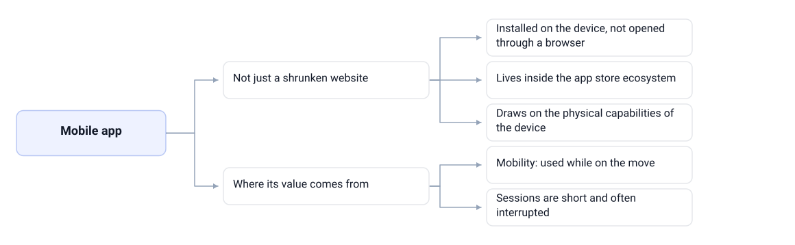

**Aplikasi mobile** adalah perangkat lunak yang dirancang untuk perangkat bergerak, terutama smartphone dan tablet.

- Istilah *mobile* menunjuk mobilitas: dipakai sambil bergerak
- Sesi pendek dan sering terputus, jadi aplikasi harus tahan berhenti lalu lanjut lagi

<!--
Dipotong ke gambar (diagram yang mengatakan ini):
- **Bukan website yang diperkecil**
- Dipasang di perangkat, tidak dibuka lewat browser
- Hidup dalam ekosistem toko aplikasi
- Memanfaatkan kemampuan fisik perangkat
- **Dari mana nilainya lahir**

Dua kolom grid yang dulu ada di sini sekarang menjadi diagram 07. Subjudul "dari mana
nilainya lahir" ikut pindah — itu label cabang kedua gambar — dan dua butir di bawah
definisi adalah satu-satunya prosa yang tersisa, karena keduanya tidak muat di kotak node
tanpa kehilangan anak kalimat "tahan berhenti lalu lanjut lagi".

Analogi: aplikasi web seperti berjalan ke loket setiap kali ingin dilayani; aplikasi
mobile seperti petugas loket yang tinggal di kantong pengguna.

Minta mahasiswa menyebut satu aplikasi dan satu website yang mereka buka hari ini, lalu
bandingkan bagaimana rasanya masing-masing.
-->

---

## Tujuh Hal yang Membuat Aplikasi Mobile Berbeda (1–4)

| # | Karakteristik | Konsekuensi desain |
|---|---|---|
| 1 | **Mobilitas & konteks pengguna** | Sesi pendek dan sering terputus → harus lanjut tanpa kehilangan data |
| 2 | **Antarmuka berbasis sentuhan** | Ukuran jari, gesture geser dan cubit, lebar layar terbatas |
| 3 | **Akses sensor & fitur perangkat** | Kamera, mikrofon, GPS, akselerometer, notifikasi yang selalu aktif |
| 4 | **Konektivitas yang berubah-ubah** | Wi-Fi berganti ke data seluler, kadang hilang → prinsip *offline-first* |

<!--
Jangan minta dihafal; hubungkan tiap butir dengan pengalaman mahasiswa sendiri. Tanya:
"Kapan terakhir kali aplikasi di HP-mu terasa lambat atau kehilangan data?"

Karakteristik 1 adalah alasan state dan penyimpanan lokal dibahas serius di Bab 9 dan
Bab 11 — bukan sekadar teori.
-->

---

## Tujuh Hal yang Membuat Aplikasi Mobile Berbeda (5–7)

| # | Karakteristik | Konsekuensi desain |
|---|---|---|
| 5 | **Distribusi lewat toko aplikasi** | Google Play & App Store menjamin keamanan dasar, tetapi ada proses *review* |
| 6 | **Sumber daya perangkat terbatas** | Baterai dan memori terbatas → hindari pemrosesan berulang yang tidak perlu |
| 7 | **Siklus hidup diatur sistem** | Sistem bisa membekukan aplikasi → aplikasi harus menyimpan state-nya |

> Hampir setiap sistem informasi modern punya "wajah mobile": e-learning, presensi, layanan akademik, hingga sistem antrean rumah sakit.

<!--
Karakteristik 7 paling sering terlewat. Demonstrasi: buka satu aplikasi, tekan Home,
tunggu, lalu buka lagi — di aplikasi yang buruk posisi terakhir pengguna hilang.

Cek pemahaman: "Kalau aplikasi ditutup lalu dibuka besok pagi, data yang tadi sedang
diisi seharusnya bagaimana?" (Jawaban: tersimpan, bukan hilang.)
-->

---

<!-- _class: compact -->

## Setiap Karakteristik Menjadi Keputusan Desain

| Karakteristik | Konsekuensi desain | Diterapkan di |
|---|---|---|
| Mobilitas & siklus hidup | State & penyimpanan agar data aman | Bab 9, 11 |
| Antarmuka sentuh | Komponen & layout khusus mobile | Bab 5, 6 |
| Sensor & fitur perangkat | Kamera, lokasi, notifikasi via Expo | Bab 12 |
| Konektivitas berubah | Pola *offline-first* & sinkronisasi | Bab 11 |
| Distribusi lewat toko | *Build* dan publikasi aplikasi | Bab 15 |
| Sumber daya terbatas | Kebiasaan menulis kode hemat | Semua bab |

<!--
Slide ini adalah peta jalan tersembunyi: karakteristik yang terlihat teoretis berubah
menjadi baris kode di bab tertentu.

Kalau ada yang bertanya "kenapa teori dulu, bukan langsung ngoding?", jawab dengan slide
ini — tanpa karakteristik 1 dan 4, aplikasi akan kehilangan data saat jaringan putus dan
pembuatnya tidak tahu itu salah.
-->

---

## Empat Pendekatan (1): Native & Web Mobile

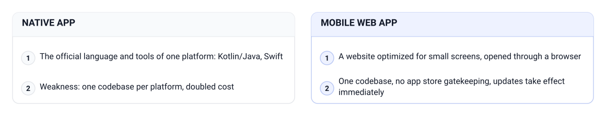

**Aplikasi native**

- Performa tertinggi, akses fitur perangkat paling lengkap

**Aplikasi web mobile**

- Akses sensor dan notifikasi terbatas, performa di bawah native

<!--
Dipotong ke gambar (diagram yang mengatakan ini):
- Bahasa dan alat resmi satu platform: Kotlin/Java, Swift
- Kelemahan: satu codebase per platform, biaya berlipat
- Website yang dioptimalkan untuk layar kecil, dibuka lewat browser

Dan penutup kolom web mobile, yaitu sel kanan bawah gambar:
- Satu codebase, tanpa gerbang toko aplikasi, pembaruan langsung berlaku

Gambar memuat dua baris yang tidak ada di prosa: pendekatan ini dibuat dengan apa, dan
apa harganya saat dirilis. Yang ditinggal di prosa adalah apa yang diterima pengguna
(performa dan akses perangkat), karena pasangan itu paling enak dibaca sebagai kalimat.
Pembagian ini disengaja — tidak ada butir di bawah yang mengulang sel di atas.

Tegaskan dua hal yang sering tertukar: (a) native bukan selalu "lebih baik", hanya lebih
mahal; (b) web mobile paling murah, tetapi kalah di senjata utama mobile — notifikasi dan
kehadiran di layar utama.

Pertanyaan penuntun: "Kalau anggaran hanya cukup untuk satu aplikasi, mana yang kamu
pilih dan apa risikonya?"
-->

---

## Empat Pendekatan (2): Hybrid & Cross-platform

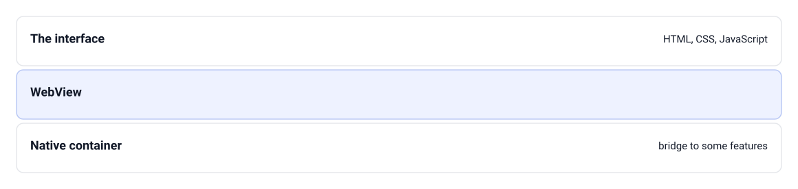

- Tidak pernah terasa native — populer 2012–2015, lalu ditinggalkan

**Cross-platform modern**

- Satu bahasa: JavaScript (React Native) atau Dart (Flutter)
- Diterjemahkan menjadi antarmuka native sungguhan, bukan halaman web

<!--
Dipotong ke gambar (diagram yang mengatakan ini):
- Antarmukanya ditulis dengan HTML, CSS, JavaScript
- Dibungkus kontainer native lewat WebView, dengan bridge ke sebagian fitur
- **Aplikasi hybrid** — pengantar: gambar tepat di atas butir ini adalah aplikasi hybrid
- "Tulis sekali, jalankan di mana-mana yang *layak*." — kutipan kunci; ucapkan di sini

Pertanyaan pembeda yang harus bisa dijawab mahasiswa: "hasil akhirnya halaman web atau
komponen UI milik sistem operasi?" Hybrid = halaman web; cross-platform modern = komponen
native.

Salah paham tersering: "cross-platform itu sama dengan hybrid". Slide Tabel 1.1 sesudah
ini dipakai untuk mematahkannya.
-->

---

## Tabel 1.1 — Bahasa, Codebase, Distribusi, Performa

| Aspek | Native | Web mobile | Hybrid | Cross-platform |
|---|---|---|---|---|
| **Bahasa** | Kotlin/Java, Swift | HTML, CSS, JS | HTML, CSS, JS | JavaScript/JSX |
| **Codebase** | Dua (per platform) | Satu | Satu | Satu |
| **Distribusi** | Toko aplikasi | Browser | Toko aplikasi | Toko aplikasi |
| **Performa** | Tertinggi | Rendah–sedang | Sedang | Tinggi, mendekati native |

<!--
Bandingkan dulu dua kolom yang paling kontras (native vs web mobile), jangan dibaca baris
per baris.

Tanya: "Kolom mana yang paling cocok untuk aplikasi kampus?" Biarkan mahasiswa yang
menemukan bahwa jawabannya cross-platform, lalu buktikan di slide berikutnya.
-->

---

## Tabel 1.1 — Fitur Perangkat, Tampilan, Biaya

| Aspek | Native | Web mobile | Hybrid | Cross-platform |
|---|---|---|---|---|
| **Akses fitur perangkat** | Penuh | Terbatas | Sebagian (lewat bridge) | Luas (lewat module) |
| **Tampilan** | Native platform | Tidak native | Tidak native | Mendekati native |
| **Biaya pengembangan** | Tertinggi | Rendah | Sedang | Sedang |

> Tidak ada pendekatan yang menang mutlak. Setiap pilihan adalah trade-off antara biaya, performa, dan pengalaman pengguna.

<!--
Poin diskusi terpenting: dua kolom terakhir sama-sama "satu codebase", tetapi di baris
Tampilan hybrid "tidak native" sedangkan cross-platform "mendekati native".

Itulah inti perbedaan hybrid dan cross-platform modern — tanyakan lagi ke kelas sebelum
melanjutkan.
-->

---

## Prioritas Pasar Menentukan Urutan Platform

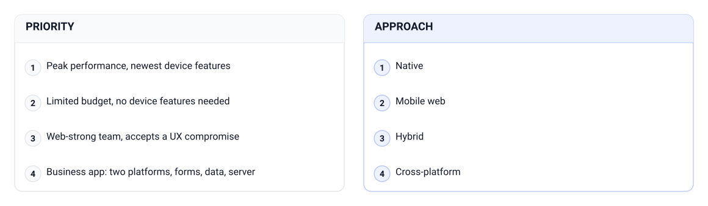

> Jangkauan luas (umum di Indonesia) → Android dulu; pengguna ekosistem Apple → jangan lewatkan iOS.

<!--
Grafik ini kumpulan kriteria penuntun, bukan aturan mutlak. Kasus nyata sering campuran:
aplikasi cross-platform dengan satu modul berat yang ditulis native.

Pertanyaan lanjutan: "Aplikasi presensi dengan foto selfie dan lokasi masuk cabang mana?"
(Jawaban: cross-platform — formulir, data, dan fitur perangkat standar.)
-->

---

<!-- _class: center -->

## Latihan: Dua Mahasiswa Magang, Dua Platform

- Kampusmu akan membuat aplikasi untuk melihat jadwal dan nilai
- Timnya hanya **dua mahasiswa magang**, kemampuan JavaScript dasar, anggaran terbatas
- Target pengguna: **Android kelas menengah bawah** dan **iPhone**
- Tugas: pilih satu pendekatan dan sebutkan minimal **empat kriteria**

<!--
Think-pair-share 5 menit, lalu bahas. Jawaban kuat menyebut: batas perangkat kelas bawah
(ukuran aplikasi dan memori), kebutuhan dua platform dengan tim kecil, dan peran Expo Go
dalam mempercepat pengembangan.

Jawaban yang hanya berbunyi "cross-platform karena modern" belum menjawab — minta
alasannya.
-->

---

## Android dan iOS: Dua Model yang Berbeda

| Aspek | Android (Google, 2008) | iOS (Apple, 2007) |
|---|---|---|
| Model sumber | Terbuka (AOSP) | Tertutup |
| Perangkat | Ratusan merek | Hanya perangkat Apple |
| Bahasa native | Kotlin (Java) | Swift |
| Toko aplikasi | Google Play & sumber lain | App Store |
| Review aplikasi | Lebih longgar | Ketat |
| Alat pengembangan | Android Studio (semua OS) | Xcode (hanya macOS) |

<!--
Hubungkan dengan praktikum: semua praktikum buku ini berjalan di Android (Expo Go atau
emulator) karena tidak menuntut Mac, sementara kode yang sama tetap bisa jalan di iOS.

Pertanyaan penuntun: "Kenapa pengembang kecil di Indonesia hampir selalu mulai dari
Android?" (Pangsa pasar, rentang harga perangkat, tidak perlu Mac.)
-->

---

## Kebebasan Android Ditukar dengan Fragmentasi

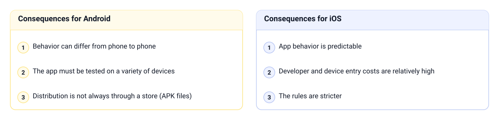

**Konsekuensi untuk iOS**

- Perilaku aplikasi mudah diprediksi
- Biaya masuk pengembang dan perangkat relatif tinggi; aturannya lebih ketat

<!--
Dipotong ke gambar (diagram yang mengatakan ini):
- **Konsekuensi untuk Android**
- Aplikasi harus diuji di berbagai perangkat
- Perilaku bisa berbeda dari HP ke HP
- Distribusi tidak selalu lewat toko (file APK)

Premis yang dulu berjalan di atas dua kolom pindah ke sini, karena panel kiri gambar
adalah kolom itu sekarang. Ucapkan sebelum gambar, dengan kata-kata ini:

  Android terbuka dan menguasai mayoritas pasar, tetapi membawa fragmentasi: ribuan model
  dengan ukuran layar, performa, dan versi sistem yang berbeda.

Dari sini lahir reaksi wajar: kalau membangun native untuk dua platform berarti dua
bahasa, dua alat, dua proses review, pengembang mencari cara membangun sekali untuk dua
platform — di situlah React Native lahir.

Kebijakan toko dan privasi dibahas di Bab 12 dan Bab 13.
-->

---

## Setiap Era Lahir dari Keterbatasan Era Sebelumnya

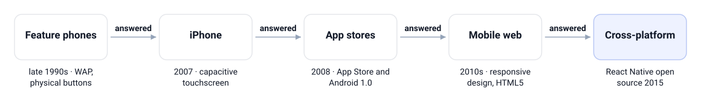

<!--
Jangan menghafal tanggal. Yang harus dipahami adalah polanya: setiap generasi lahir
sebagai jawaban atas keterbatasan generasi sebelumnya.

Pertanyaan cepat: "Keterbatasan apa yang dijawab oleh toko aplikasi?" (Distribusi yang
dulu dikendalikan operator seluler.)
-->

---

<!-- _class: lead -->
<!-- _paginate: skip -->

# Bagian 2 — React Native, Expo & Arsitektur

subbab 1.5 React Native · 1.6 Expo · 1.7 Trade-off · 1.8 Arsitektur · 1.9–1.10

<!--
Bagian ini inti bab dan bagian yang paling mungkin keluar di ujian. Kalau waktu pertemuan
menipis, pindahkan subbab 1.8–1.10 ke pertemuan berikutnya.
-->

---

## Ditulis Sekali, Digambar Native di Dua Platform

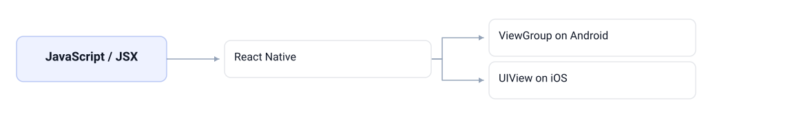

**React Native (RN)**

- Framework open-source dari Meta, berbahasa JavaScript
- Turunan React: komponen, props, dan state ikut terbawa
- Antarmuka ditulis sekali, digambar sebagai komponen native

<!--
Versi yang dipakai buku ini: React Native 0.86 di Expo SDK 57, dengan React 19.2 sebagai
library antarmukanya (ringkasan versi ada di pengantar buku).

Di sinilah beda terbesarnya dengan hybrid: komponen View menjadi ViewGroup di Android dan
UIView di iOS — elemen antarmuka milik sistem operasi, bukan kotak di dalam halaman web.

Pertanyaan penuntun: "Kalau kodenya tetap JavaScript, apa yang sebenarnya jadi native?"
(Jawaban: antarmuka yang ditampilkan.)
-->

---

## JavaScript Memerintah, Native yang Menggambar

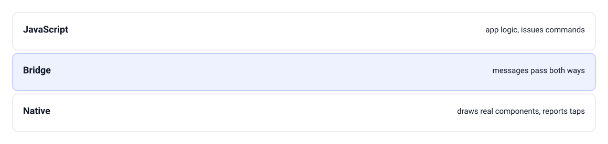

> **Hot reload** membuat perubahan kode langsung terlihat tanpa membangun ulang aplikasi.

<!--
Alurnya mudah dibayangkan: JavaScript memberi perintah "buat tombol hijau di sini",
lapisan native menerjemahkannya menjadi tombol sungguhan, lalu melaporkan ketukan
pengguna kembali ke JavaScript.

Hubungkan bridge dengan batasan performa di subbab 1.7: komunikasi lintas lapisan menambah
beban, jadi grafis berat tetap lebih baik dikerjakan native.
-->

---

## React Native Bukan Penerjemah Kode

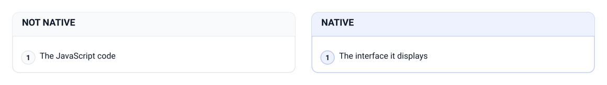

- Bukan penerjemah kode menjadi Kotlin atau Swift
- Bukan pembungkus halaman web di dalam WebView

> Konsekuensinya: RN unggul untuk aplikasi berbasis data — formulir, daftar, integrasi server — bukan untuk game berat.

<!--
Dipotong ke gambar (diagram yang mengatakan ini):
- Yang native adalah **antarmuka yang ditampilkan**, bukan kode JavaScript-nya

Tampilkan judul, minta kelas menebak dulu, lalu buka satu per satu. Dua salah paham ini
yang paling sering muncul di kelas.

Pertanyaan lanjutan: "Kalau RN bukan pembungkus web, kenapa aplikasinya bisa lebih besar
dari aplikasi native?" (Karena membawa runtime JavaScript.)
-->

---

## Expo: Tiga Komponen Utama

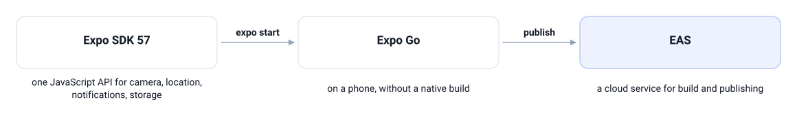

- **Expo Go** — menjalankan project di HP tanpa *build* native: pindai kode QR
- **EAS** — layanan cloud untuk *build* dan publikasi ke toko aplikasi

Perintah utamanya `npx expo start`; dipraktikkan di Bab 2, publikasi dijelaskan di Bab 15.

<!--
Dipotong ke gambar (diagram yang mengatakan ini):
- **Expo SDK 57** — satu API JavaScript untuk kamera, lokasi, notifikasi, penyimpanan

Analogi: kalau React Native adalah "bahasa dan mesinnya", Expo adalah "bengkel yang
membuat mesin itu mudah dipakai".

Manfaat terbesar bagi mahasiswa adalah kurva belajarnya: dari nol sampai aplikasi jalan di
HP hanya butuh beberapa langkah, tanpa memasang Android Studio lebih dulu.
-->

---

## Setiap Kemudahan Expo Punya Harganya

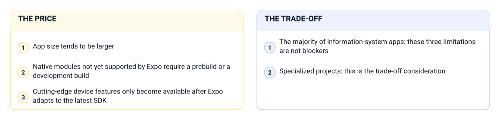

- Native module yang belum didukung Expo butuh *prebuild* atau *development build*
- Fitur perangkat terbaru baru tersedia setelah Expo menyesuaikan SDK terbaru

> Untuk sebagian besar aplikasi sistem informasi, tiga batasan ini bukan penghalang. Untuk proyek khusus, inilah yang dihitung dalam trade-off.

<!--
Dipotong ke gambar (diagram yang mengatakan ini):
- Ukuran aplikasi Expo cenderung lebih besar

Setiap keputusan teknologi punya harga. Minta mahasiswa menilai: batasan mana yang paling
berisiko untuk aplikasi kampus mereka (biasanya: ukuran aplikasi di perangkat kelas bawah).

Menyebut biaya ini di depan kelas bukan kelemahan, melainkan bagian dari analisis yang
jujur.
-->

---

<!-- _class: compact -->

## Keunggulan dan Keterbatasan React Native

| Keunggulan | Keterbatasan |
|---|---|
| Satu codebase untuk Android dan iOS | Performa di bawah native saat beban berat |
| Tim JavaScript langsung produktif | Aplikasi lebih besar dan boros memori |
| Ekosistem npm sangat luas | Fitur platform baru kadang terlambat |
| *Hot reload* mempercepat iterasi | *Debugging* lintas lapisan lebih rumit |
| Pembaruan tanpa membangun ulang | Native module khusus butuh keahlian native |
| Komunitas besar, bahan belajar banyak | Bergantung pada library pihak ketiga |

<!--
Cara menyampaikannya: setiap keunggulan punya sisi lain. "Satu codebase" menghemat
perawatan jangka panjang, tetapi ketergantungan pada library pihak ketiga adalah harganya.

Pertanyaan penutup: "Sebutkan satu keterbatasan yang paling berisiko untuk aplikasi
kampus." (Biasanya: perangkat Android kelas bawah dengan memori terbatas.)
-->

---

## Kapan React Native Tepat Dipakai?

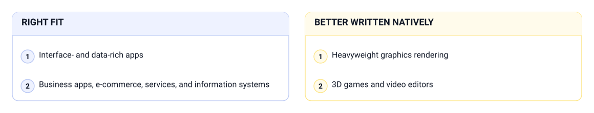

- Game 3D dan video editor masih lebih baik ditulis native
- Keputusan diambil lewat analisis trade-off, bukan karena tren

<!--
Dipotong ke gambar (diagram yang mengatakan ini):
- Aplikasi kaya antarmuka dan data, bukan rendering grafis berat
- Aplikasi bisnis, e-commerce, layanan, dan sistem informasi

Tegaskan bahwa penghematan terbesar ada di perawatan jangka panjang, bukan di penulisan
awal — ini argumen terkuat saat berdebat dengan pemangku kepentingan.

Ingatkan bahwa pola pikir inilah yang akan mereka pakai di dunia kerja, apa pun framework
yang sedang populer saat itu.
-->

---

## Satu Aplikasi, Tiga Lapisan

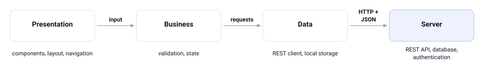

> Contoh alur: aplikasi cek nilai → permintaan "tampilkan nilai saya" → server menjawab dengan JSON → aplikasi menggambar tabel nilai.

<!--
Pola paling umum adalah client–server: perangkat menampilkan antarmuka dan menampung
masukan, server menyediakan data dan aturan bisnis.

Tegaskan bahwa memisahkan tiga lapisan bukan sekadar kerapian: lapisan yang terpisah bisa
diuji, dirawat, dan diganti sendiri-sendiri.
-->

---

## Tiga Lapisan Client dan Babnya

| Lapisan | Di React Native/Expo | Dibahas di |
|---|---|---|
| **Presentasi** | Komponen React, `View`, `Text`, `FlatList`, Flexbox, navigasi | Bab 4–7 |
| **Bisnis** | State lokal dan global, validasi formulir, logika yang teruji | Bab 8, 9, 14 |
| **Data** | `fetch` ke REST API, penyimpanan lokal, token autentikasi | Bab 10, 11, 13 |

> Di Project Akhir, kamu membangun aplikasi yang memakai arsitektur tiga lapisan ini.

<!--
Slide ini menjawab pertanyaan "kapan semua ini dipakai?". Setiap bab punya "rumah" di
dalam arsitektur, jadi materinya tidak terasa terpisah-pisah.

Minta mereka menebak: "Formulir login dengan validasi dan panggilan API menyentuh lapisan
apa saja?" (Presentasi: tampilannya; bisnis: validasinya; data: permintaan ke server.)
-->

---

## Aplikasi Nyata di Sekitar Kita (1/2)

| Kategori | Contoh | Fitur perangkat yang dipakai |
|---|---|---|
| Transportasi online | Ojek dan taksi online | GPS, kamera, notifikasi status pesanan |
| Belanja online | Marketplace, toko online | Notifikasi promo, pembayaran pindai kode QR |
| Perbankan dan pembayaran | Aplikasi bank, dompet digital | Sidik jari, kamera, notifikasi transaksi |
| Komunikasi | Aplikasi pesan, panggilan video | Mikrofon, kamera, notifikasi *real-time* |

<!--
Minta mahasiswa memilih baris yang paling dekat dengan hidup sehari-hari, lalu menyebut
karakteristik subbab 1.1 mana yang paling dominan di aplikasi itu.

Contoh: dompet digital memindai kode QR dengan kamera sambil mengunci akses dengan sidik
jari — konteks, sensor, dan notifikasi bekerja bersama.
-->

---

## Aplikasi Nyata di Sekitar Kita (2/2)

| Kategori | Contoh | Fitur perangkat yang dipakai |
|---|---|---|
| Media sosial | Media sosial, berbagi video | Kamera, galeri, GPS untuk tag lokasi |
| Pendidikan | Kursus daring, aplikasi kampus | Notifikasi jadwal, unduh materi offline |
| Kesehatan | Penghitung langkah, telekonsultasi | Sensor gerak, GPS, kamera |
| Produktivitas | Catatan, kalender | Notifikasi pengingat, sinkronisasi antar perangkat |

> Pola yang menarik: banyak aplikasi besar **mulai dari web**, menambah aplikasi mobile, lalu menjadikan mobile produk utamanya.

<!--
Slide ini jembatan ke praktikum: mengamati tiga aplikasi, menaksir jenisnya (subbab 1.2),
mengenali fitur perangkat yang dipakai, dan menilai pengalaman penggunanya.

Kemampuan "membedah" aplikasi seperti ini akan terus dipakai saat merancang aplikasi
sendiri di bab-bab berikutnya.
-->

---

## Studi Kasus: Delapan Ribu Mahasiswa, Satu Aplikasi

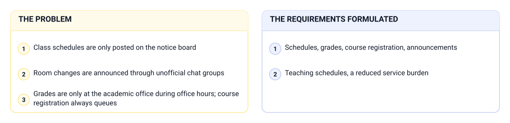

**Kasus fiktif dengan pola nyata.** Universitas Wijaya Nusantara, ± 8.000 mahasiswa.

- Mahasiswa butuh jadwal, nilai, KRS, pengumuman
- Dosen dan staf akademik: jadwal mengajar, beban layanan berkurang

> Akar masalahnya **bukan datanya**, tetapi saluran yang mengantarkannya.

<!--
Dipotong ke gambar (diagram yang mengatakan ini):
- Jadwal kuliah hanya ditempel di papan pengumuman
- Perubahan ruang diumumkan lewat grup chat tidak resmi
- Nilai hanya di kantor akademik pada jam kerja; KRS selalu mengantre

Bacakan sebagai cerita, bukan sebagai daftar. Tujuannya agar mahasiswa merasa bahwa
analisis kebutuhan dimulai dari pengguna, bukan dari teknologi.

Pertanyaan sebelum slide berikutnya: "Kalau kamu analis sistem di kampus ini, apa
keputusan pertamamu?" Biarkan mereka menebak dulu.
-->

---

## Studi Kasus: Keputusan Arsitekturnya

| Opsi | Pertimbangan | Hasil |
|---|---|---|
| Website mobile | Murah, tetapi tanpa notifikasi proaktif dan tanpa ikon di layar utama | Ditolak |
| Native untuk dua platform | Kualitas terbaik, tetapi tim kecil harus memelihara dua codebase | Ditolak |
| **React Native + Expo** | Satu codebase, notifikasi lewat Expo SDK, kurva belajar yang sanggup diikuti mahasiswa magang | **Dipilih** |

> Aplikasi yang lahir dari keputusan ini kita sebut **Aplikasi Manajemen Data Mahasiswa** — yang akan kamu bangun sedikit demi sedikit sampai Bab 15.

<!--
Tegaskan pola pengambilan keputusannya: dua opsi pertama bukan "salah", keduanya kalah
karena tidak cocok dengan konteks — kebutuhan notifikasi proaktif dan kapasitas tim.

Inilah bentuk analisis trade-off yang menjadi tujuan pembelajaran pertemuan ini, dan
polanya sama dengan Project Akhir.

Perkenalkan namanya di sini, sekali saja: Aplikasi Manajemen Data Mahasiswa, dengan slug
project `siakad-mobile` yang akan dipakai di Bab 7. Sesudah ini cukup sebut "aplikasi
kita".
-->

---

<!-- _class: center -->

## Diskusi: Masalah Teknologi atau Masalah Proses?

- Antrean KRS menyusut karena aplikasi — tetapi tetap panjang kalau prosesnya berbelit
- Data yang tidak dirawat tetap salah, secantik apa pun aplikasinya
- Analis sistem yang matang memisahkan masalah teknologi dari masalah proses

**Pertanyaan:** sebutkan satu masalah di kampusmu yang terlihat seperti masalah teknologi, tetapi sebenarnya masalah proses atau data.

<!--
Slide terpenting bagi mahasiswa Sistem Informasi: menempatkan teknologi pada tempatnya.
Beri 3 menit berpasangan, lalu tampung 2–3 jawaban.

Kalau jawaban lemah, beri arahan: sistem presensi yang datanya tidak pernah diverifikasi
(masalah data), atau prosedur izin dengan berlapis tanda tangan (masalah proses) — bukan
masalah aplikasinya.
-->

---

## Peta 15 Bab: Setiap Bab Satu Bata

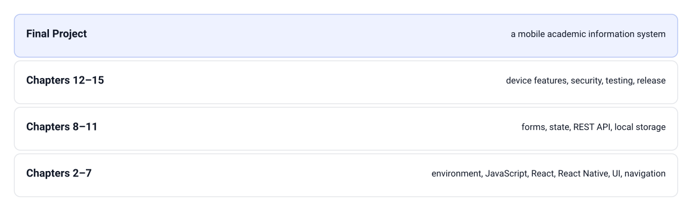

**Kompetensi yang didapat**

- Menjelaskan konsep dan arsitektur aplikasi mobile
- Membangun aplikasi dengan React Native dan Expo, termasuk UI dan navigasi

<!--
Dipotong ke gambar (diagram yang mengatakan ini):
- Bab 2–7: lingkungan, JavaScript, React, React Native, UI, navigasi
- Bab 8–11: formulir, state, REST API, penyimpanan lokal
- Bab 12–15: fitur perangkat, keamanan, testing, rilis
- Puncaknya: **Project Akhir** — sistem informasi akademik berbasis mobile

Tunjukkan bahwa setiap bab adalah bata: Bab 3 (JavaScript) menjadi fondasi Bab 4 (React),
yang menjadi fondasi Bab 5 (React Native).

Tegaskan kebiasaan profesional yang menyertai seluruh perjalanan: membaca dokumentasi
resmi, membaca pesan error sebelum bertanya, dan mencatat kendala.
-->

---

## Praktikum: Yang Dibangun Pertemuan Ini

- Unduh dan pasang **Node.js LTS** dari nodejs.org — pilih label LTS, bukan Current
- Pasang **Visual Studio Code** sebagai editor kode
- Buat **akun Expo** di expo.dev sebagai syarat layanan pengembangan
- Jalankan skrip `cek-lingkungan.js` dan baca hasilnya
- Tulis **laporan pengamatan** tiga aplikasi mobile yang kamu pakai sehari-hari

> Kalau satu langkah gagal, jangan lanjut — selesaikan dulu lewat bagian Troubleshooting bab ini.

<!--
Ingatkan memilih LTS, bukan Current: kesalahan paling umum di praktikum, karena perilaku
npm dan Expo CLI bisa berbeda dari yang dibahas buku.

Mahasiswa yang memakai komputer laboratorium kampus harus berkoordinasi dengan pengelola
lab sebelum jadwal praktikum (Node.js LTS dan VS Code wajib tersedia).
-->

---

## Yang Harus Teramati

Untuk tiap aplikasi yang kamu amati, catat tiga hal:

- **Jenisnya** — native, web mobile, hybrid, atau cross-platform? (subbab 1.2)
- **Fitur perangkat** yang dipakai — kamera, GPS, notifikasi, sidik jari
- **Pengalaman pengguna** — di mana terasa lambat, di mana terasa janggal

> Laporan yang baik menyebut bukti yang bisa diperiksa, bukan kesan: "tombol Simpan tertutup papan ketik di layar 5,5 inci", bukan "aplikasinya kurang enak".

<!--
Tiga hal ini yang dinilai di Tugas 1, jadi bacakan perlahan. Yang paling sering hilang
adalah butir ketiga: mahasiswa menulis kesan, bukan pengamatan.

Beri satu contoh buruk dan satu contoh baik di papan tulis, lalu minta mereka menilai
mana yang bisa diperiksa ulang oleh orang lain.
-->

---

## Contoh Kode: cek-lingkungan.js

`kode/bab-01-pengantar-pemrograman-mobile/cek-lingkungan.js` — bagian penilaian

```js
const nomorUtamaNode = Number(versiNode ? versiNode.match(/^v(\d+)/)?.[1] : 0);
if (nomorUtamaNode >= 22) {
  console.log('\nHasil: lingkungan siap. Versi Node.js memenuhi syarat (minimal 22).');
} else if (versiNode) {
  console.log('\nHasil: Node.js terpasang, tetapi versinya lebih lama dari 22.');
  console.log('       Instal ulang Node.js LTS terbaru dari situs resminya.');
} else {
  console.log('\nHasil: Node.js belum terpasang. Instal dahulu Node.js LTS.');
}
```

> Pola **periksa → bandingkan → simpulkan** ini versi kecil dari cara kerja aplikasi yang jauh lebih besar.

<!--
Tunjukkan tiga hal saja: regular expression mengambil nomor versi utama, ambang 22 adalah
syarat buku ini, dan tiga cabang if/else memberi kesimpulan berbeda.

Detail sintaksis belum perlu — variabel, fungsi, dan regular expression dibangun di Bab 3.
-->

---

<!-- _class: center -->

## Kuis Kilat

- Karakteristik apa yang paling membedakan aplikasi mobile dari aplikasi web?
- Aplikasi yang ditulis dengan teknologi web lalu dibungkus WebView disebut apa?
- Di dalam React Native, komponen `View` digambar sebagai apa?
- Pada arsitektur client–server, REST API berada di sisi mana?

<!--
Kuis lisan 5 menit: tampilkan pertanyaan, minta kelas menjawab serempak atau dengan
mengangkat tangan, lalu lanjut ke slide kunci. Jangan bocorkan jawaban di slide ini.

Kalau jawaban kelas beragam, catat dan ulangi pembedaannya di akhir pertemuan.
-->

---

<!-- _class: center -->

## Kunci Kuis Kilat

- Pemakaian sensor, konteks, dan notifikasi perangkat
- Aplikasi hybrid — bukan mobile web, bukan native
- Komponen UI native platform, misalnya `ViewGroup` di Android
- Di sisi server — client memanggilnya lewat HTTP

<!--
Ulangi pembedaan yang paling sering tertukar: hybrid (WebView) versus cross-platform
modern (komponen native).

Kalau banyak yang salah di pertanyaan pertama, ulangi subbab 1.1 tentang karakteristik
sebelum menutup pertemuan.
-->

---

## Ringkasan

1. Tujuh karakteristik khas aplikasi mobile, dari mobilitas sampai siklus hidup
2. Empat pendekatan: native, web mobile, hybrid, cross-platform
3. Android terbuka dan terfragmentasi; iOS tertutup dan konsisten
4. React Native memetakan JavaScript ke komponen native; Expo melengkapinya
5. Arsitektur client–server dengan tiga lapisan client: presentasi, bisnis, data

<!--
Jangan dibacakan. Minta mahasiswa memilih satu nomor dan menjelaskannya dengan kata-kata
sendiri — ini bekerja lebih baik daripada mengulang bacaan.

Pesan penutup: kebiasaan profesional dimulai hari ini — setiap kali menemui istilah asing,
cari artinya; setiap kali aplikasi gagal, baca pesan error sebelum bertanya.
-->

---

## Referensi

| Sumber | Link |
|---|---|
| Dokumentasi React Native (2026) | reactnative.dev |
| Dokumentasi Expo (2026) | docs.expo.dev |
| Dokumentasi React (2026) | react.dev |
| JavaScript, MDN Web Docs (2026) | developer.mozilla.org |
| Dokumentasi Node.js (2026) | nodejs.org |

**Bacaan lanjutan:** Bab 2 — Persiapan Lingkungan Pengembangan

**Versi teknologi:** Expo SDK 57 · React Native 0.86 · React 19.2 · Node.js ≥ 22

<!--
Rujukan lengkap ada di Lampiran D; glosarium istilah (60 entri) di Lampiran C sangat
membantu untuk istilah seperti bridge, WebView, dan hot reload.

Sumber utama bab ini tetap dokumentasi resmi di reactnative.dev dan docs.expo.dev, bukan
blog yang mungkin sudah usang.
-->

---

<!-- _class: lead -->
<!-- _paginate: skip -->

# Siap ke Bab 2

**Tugas:** selesaikan praktikum (Node.js LTS, VS Code, akun Expo) dan tulis laporan pengamatan tiga aplikasi mobile.

Pertemuan berikutnya: menyiapkan lingkungan dan menjalankan aplikasi pertama.

<!--
Tutup dengan satu kalimat: "Hari ini kita membeli petanya; mulai Bab 2 kita mulai
berjalan."

Sebutkan tenggat Tugas 1 secara eksplisit: kapan dikumpulkan, dalam format apa, dan aspek
apa yang dinilai (lihat Lampiran A — rubrik praktikum: pemahaman konsep 15%, implementasi
25%, kualitas kode 15%, UI/UX 15%, debugging 10%, dokumentasi 20%).
-->
