<!-- _class: lead -->
<!-- _paginate: skip -->
<!-- _footer: "" -->

# Chapter 2 — Development Environment Setup

Preparing the workbench, running the first app · Meeting 2

<!--
Open with the hook sentence: "In Chapter 1 we drew the map; today we prepare the tools
and start the engine."

Opening question: "What do you set up first when you use a new laptop for class?" Collect
two or three answers as a bridge to the concept of a standardized, reproducible working
environment.

Per the RPS, this meeting is worth 3 credits (2 theory credits + 1 practicum credit);
insert a short demo and then go straight to hands-on practice at the computer.
-->

---

## Learning Objectives

- Explain the role of Node.js, npm, and npx in the Expo ecosystem
- Identify the components of a development environment and their functions
- Implement the creation of a first Expo project and run it
- Analyze the three testing paths in terms of speed and behavioral fidelity
- Explain the project folder structure and evaluate common obstacles

<!--
Read out only the verbs. The fourth objective is the core of analytical thinking and the
one that appears most often on exam questions.

Connect it to this meeting's RPS assessment: the Chapter 2 practicum rubric plus a
troubleshooting checklist submitted together with the practicum report.

Stress that the fifth objective is diagnostic: students must be able to choose a solution,
not merely memorize error messages.
-->

---

<!-- _class: lead -->
<!-- _paginate: skip -->

# Part 1 — Foundations: Node.js, npm & VS Code

Section 2.1 Node.js and npm · 2.2 Package Manager · 2.3 Visual Studio Code

<!--
This part is conceptual, but it determines the whole practicum today. If time is tight,
compress Sections 2.2 and 2.3; do not skip Section 2.1.

Remind them that students who fail in Part 1 almost always fail in Part 2 as well,
because every Expo tool runs on top of Node.js.
-->

---

## Node.js: A JavaScript Runtime Outside the Browser

**Node.js** is a JavaScript *runtime* (execution environment) that runs outside a browser.

<div class="grid2">
<div>

**Why it is the foundation**

- It wraps the V8 JavaScript engine, the same engine as Chrome
- Expo CLI and Metro Bundler run on top of Node.js
- One language for the app and for its developer tools

</div>
<div>

**What is often misunderstood**

- Not a new programming language: JavaScript stays JavaScript
- Not a browser: there is no screen, only a terminal

**Additional explanation:** the term *runtime* here means a program that provides a place for JavaScript to be executed.

</div>
</div>

<!--
Analogy: JavaScript is the language you master; Node.js is the workspace that makes that
language usable outside a web page.

Guiding question: "If Node.js is only for tools, why do we need to bother managing its
version?" (Answer: the runtime version affects the behavior of syntax and tools, so a
version difference produces obscure errors.)

Misconception warning: many students think Node.js is a language or a framework. Stress
that Node.js adds no syntax; it only provides a place to run.
-->

---

## Diagram: Node.js: A JavaScript Runtime Outside the Browser

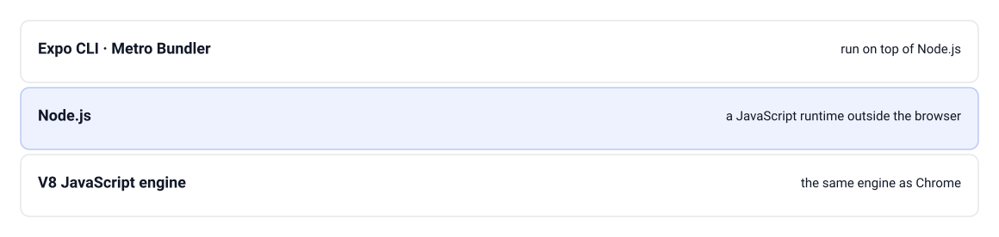

<!--
Point at the three bands from the bottom up: the engine Chrome also uses, then Node.js as the
runtime that wraps it, then the two Expo tools that run on top of Node.js. This is the point the
part opener keeps returning to, drawn as an order.

The bands are not to scale and they are not a memory map: they are places where JavaScript runs,
stacked by who depends on whom. Nothing in this picture adds syntax to the language.
-->

---

## npm: The Project's Package Manager

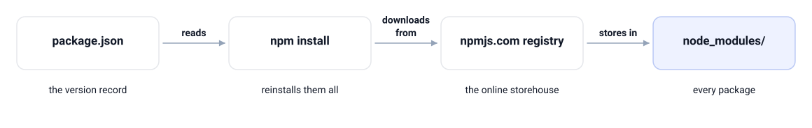

**npm** (*Node Package Manager*) is the package manager that is installed automatically together with Node.js.

**If done manually**

- Libraries copied by hand and prone to typos
- Versions differ on each computer and are hard to trace

<!--
Trimmed to the picture (the diagram says this):
- Download packages from the npmjs.com registry
- Manage versions and record them in `package.json`
- Store every package in the `node_modules/` folder

The two-column layout went with them: the "Its duties" column was the picture, and at w:1120
the slide had no room to print the same three duties twice without the last line landing on the
page number.

Read the picture from package.json to node_modules/: the version record is the source of truth,
npm install is the single command that reads it, and the registry is the online store where the
packages come from — not a folder on the student's computer.

Analogy: npm is like a library that records every book borrowed, so your work shelf can be
rebuilt at any time from a single list.

Stress the term registry: the online storehouse npmjs.com that holds millions of packages,
not a folder on the student's computer.

Guiding question: "What happens if the node_modules folder is deleted?" (Answer: just run
npm install and every package is reinstalled according to the package.json record.)
-->

---

## `npm install` or `npx`?

| Aspect | `npm install <package>` | `npx <command>` |
|---|---|---|
| Role | Installs the package into the project | Runs the package without installing it permanently |
| Result | Recorded in `package.json` and `node_modules/` | Leaves no global installation behind |
| Example | `npm install <package-name>` | `npx create-expo-app`, `npx expo start` |
| Added value | Guarantees the project's dependencies are complete | Always uses the newest version from the registry |

> Pure JavaScript packages are installed with `npm install`; SDK-bundled packages are installed with `npx expo install`.

<!--
Compare only the first two columns on the Role row; do not read the table row by row. The
Example row is what students ask about most.

Guiding question: "Why is create-expo-app run with npx instead of being installed first?"
(Answer: this tool changes over time, npx always fetches the current version and does not
pile rarely used programs onto the computer.)

Warning: do not write version numbers in install commands; let npm choose the version that
matches the SDK.
-->

---

## Package Manager: Why, and Which One to Choose

Ten mutually dependent libraries quickly produce the problem known as *dependency hell*.

- Record the dependency list so the project can be reinstalled on another computer
- Download mutually compatible versions automatically
- Store packages in `node_modules/` so a single command is enough to set it up

| Package Manager | Distinguishing Feature | When It Fits |
|---|---|---|
| **npm** | Bundled with Node.js, most widely used | Standard projects — this book uses npm |
| **yarn** | Strict lockfile, developed by Meta | Teams that already use yarn |
| **pnpm** | Saves disk space by sharing packages | Monorepos or large projects |

<!--
Main message: the difference between npm, yarn, and pnpm is not capability but file
storage strategy and speed.

Ask: "If there are three choices, which is safest for team work in class?" (Answer: npm,
because it is bundled with Node.js and used by default by create-expo-app — avoiding
lockfile differences between team members.)

Warning: mixing package managers within one team is the cause of lockfile conflicts, as in
the Case Study at the end of this chapter.
-->

---

## VS Code: The Editor and Helper Extensions

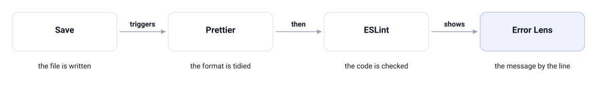

**VS Code** — a free source code editor made by Microsoft

- Syntax highlighting and automatic completion (IntelliSense)
- Cross-file search for projects holding dozens of files
- Integrated terminal, no need to switch applications

> The combination of ESLint + Prettier + the Expo terminal is already enough to follow this entire book.

<!--
Trimmed to the picture (the diagram says this):
- **ESLint** checks code quality; **Prettier** tidies the format when a file is saved
- **Error Lens** shows error messages next to the problem line

Read the picture from left to right as a single save: Prettier tidies the format, ESLint checks
the code, Error Lens prints the message beside the line. The bold lead-in "Extensions that help"
was the header of the column those two bullets filled; the extensions now sit in the picture.

Stress the reason the features exist, not the list of features: one React Native project
holds dozens to thousands of files, so a plain text editor is not realistic.

Guiding question: "Why does Prettier matter in team work?" (Answer: every member's code
format becomes uniform, so changes in Git are easier to read.)

Version warning: extensions in the marketplace change and some are archived by their
developers, including once-popular ones such as React Native Tools. This item is flagged
version-sensitive in the chapter: check the extension name in the marketplace when
reading. Material Icon Theme is optional, purely visual comfort.
-->

---

## Verifying Node.js and npm

`Terminal` — two mandatory check commands

```bash
node --version
npm --version
```

If both print a version number, your environment is ready. This book uses **Node.js LTS**, minimum version 22.

**Question:** what happens if Node.js is not installed yet or is not recognized?

<!--
Teaching method: ask the whole class to run both commands now, then raise the hands of
those who do not see a version number. Do not move on before it is settled.

Stress the LTS choice, not Current: LTS is maintained longer and is therefore the most
stable for development, and that is what this book uses.

Version-sensitive warning: the latest LTS version number changes over time; use the newest
LTS release from the official site nodejs.org.

The answer to this question is on the next slide — do not answer it now.
-->

---

## When the Command Is Not Recognized


- The terminal answers `node: command not found` or `'node' is not recognized`
- Solution: install Node.js LTS from nodejs.org; on Windows tick the "Add to PATH" option
- Prevention: download only from the official site and verify before starting a project

<!--
Trimmed to the picture (the diagram says this):
- Cause: Node.js is not installed yet, or its installation was not recorded on the PATH
- After installing, **open a new terminal** — the old terminal has not read the new PATH

Walk the three states: "command not found", then "PATH not loaded" the moment the LTS is
installed while the old terminal is still open, then "a version prints" once a new terminal is
opened. The red loop is the move students make instead: reinstalling lands back in the same
state, because the installation was never the problem.

PATH is the list of folders where the operating system looks for commands; describe it as
the terminal's "address book". The most frequent problem is not the installation but an
old terminal that has not loaded the PATH.

Guiding question: "Why can closing and reopening the terminal fix the problem?" (Answer: a
new terminal reads the updated PATH; the old terminal still uses the old list.)

Warning: students often reinstall Node.js many times when they only need to open a new
terminal.
-->

---

<!-- _class: lead -->
<!-- _paginate: skip -->

# Part 2 — Expo, Testing Tools & First Project

Section 2.4 Expo and Expo Go · 2.5 Emulator · 2.6 iOS Simulator · 2.7-2.9 the first project

<!--
This part is the core of today's practicum: from the concept of testing tools to the first
app appearing on screen.

If there is only time for one part, choose this part and move the folder-structure
discussion to independent work.
-->

---

## Expo CLI: The Command-Line Interface

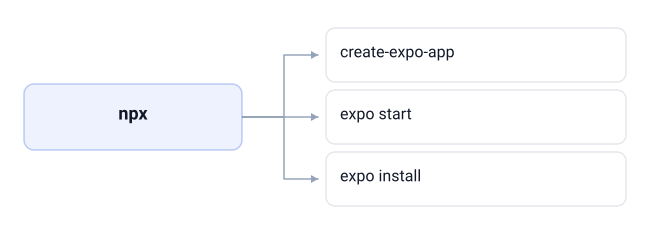

**Expo CLI** is the command-line interface for creating, running, and managing an Expo project — no global installation needed.

- `npx create-expo-app` — creates a new project
- `npx expo start` — starts the development server
- `npx expo install <package>` — adds an SDK-bundled package with a matching version

<!--
Stress that every command is run through npx: there is no global installation to manage
and the tool version is always fresh.

Guiding question: "What will npx expo install be used for later?" (Answer: installing
SDK-bundled packages, for example the camera in Chapter 12, so that the version
automatically matches the SDK.)

Warning: npm install is still correct for pure JavaScript packages; do not mix them up,
because the wrong install method is a source of version errors that are hard to trace.
-->

---

## Expo Go: Fast, with Limits

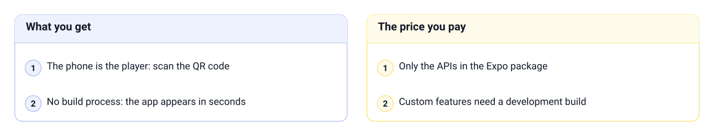

- The phone only needs to be on the same Wi-Fi network as the computer
- It does not carry its own native code, so custom features need a *development build* (Chapter 15)

<!--
Trimmed to the picture (the diagram says this):
- The app on the phone acts as the project's "player": scan the QR code
- No build process, the result is visible within seconds
- It only supports APIs available in the Expo package

Read the picture as a trade: the left panel is what the speed buys, the right panel is what it
costs. The two rows are not paired one to one — the price of the whole left column is the whole
right column. The bullets kept below carry the details a panel cannot hold: the Wi-Fi
requirement and the pointer to the development build in Chapter 15.

Analogy: a traditional build is like printing a book before it can be read; Expo Go is
like reading the manuscript straight from the author's screen.

Guiding question: "When is Expo Go no longer enough?" (Answer: when the app needs its own
native code or testing close to production, so a development build is needed in
Chapter 15.)

Version-sensitive warning: SDK 57 has just been released, so Expo Go on Google Play and the
App Store may still be awaiting approval. In the meantime, install it through eas go for
iOS devices or through the Expo CLI facility for Android and emulators according to the
official instructions at docs.expo.dev; this mechanism may change at any time.
-->

---

## Metro Bundler and Fast Refresh

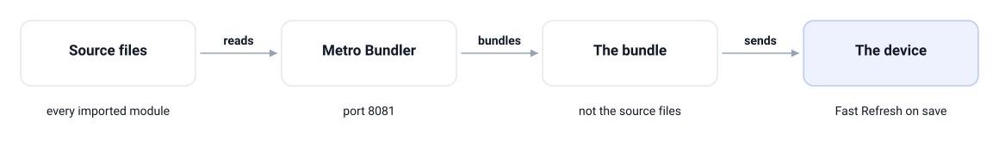

> Your laptop becomes the "kitchen"; the device only receives the finished dish.

<!--
Read the flow from left to right: Metro reads every imported module, bundles them, then
sends them to the device over the network on default port 8081.

Stress Fast Refresh: a saved change appears immediately without losing the state that is
currently running, and that experience will be felt in Practicum 2.

Guiding question: "Why does the device not need to know the app's original code?" (Answer:
what is sent is the bundle Metro produced, not the source files.)
-->

---

## Three Paths for Testing an App

| Path | Preparation | Speed and behavioral fidelity |
|---|---|---|
| **Expo Go** (Wi-Fi) | Most concise: phone and computer on the same Wi-Fi | Fastest; the behavior of a real phone |
| **Android emulator** | A virtual device is created and started first | Slower; some sensors are not supported |
| **Physical device** (USB) | Developer options and USB debugging enabled | Most convincing for camera, location, notifications |

> For daily development, the Wi-Fi + Expo Go path is more practical because it does not depend on a cable.

<!--
Compare the last column first, because that is the reason for choosing a path, not the
preparation column.

Guiding question: "Your group will test the camera feature in Chapter 12; which path do
you choose?" (Answer: a physical device, because the emulator does not represent a real
sensor.)

Warning: the emulator consumes a lot of computer memory; a laptop with 8 GB of RAM or more
is recommended, and the emulator is started before npx expo start.
-->

---

<!-- _class: center -->

## What Happens If…?

The phone and the computer are on **different networks** — the QR code cannot be connected.

- What fails: the code, the network, or the device?
- What solutions are available without changing the campus network settings?
- What speed must be paid for that solution?

<!--
Ask first, do not answer: collect two or three guesses, then move to the next slide. This
question tests whether students understand that the app is sent over the network, not
installed from a cable.

Trigger if the class is silent: "The campus Wi-Fi usually blocks communication between
devices; if so, what can we still use?"

The expected answer is on the next slide: what fails is the network, and
npx expo start --tunnel becomes the solution.
-->

---

<!-- _class: center -->

## Answer: Different Networks

- What fails is the **network**, not the code: Metro and the phone cannot reach each other
- Stop the server (**Ctrl+C**), then run `npx expo start --tunnel`
- The `--tunnel` option bridges the connection through a public server; the network is not changed
- The price paid: slower transfer and a need for a stable internet connection

<!--
Connect it to the troubleshooting slide: the row "the QR code cannot be connected" is the
same case, so this answer is not new knowledge but a diagnostic pattern.

Stress that the tunnel is a fallback, not a daily habit; for daily work, the same Wi-Fi
network is still faster.

Closing question: "When would you choose the tunnel instead of classroom Wi-Fi?" (Answer:
when the network blocks communication between devices, for example a phone hotspot.)
-->

---

## Android Emulator: Android Studio and AVD

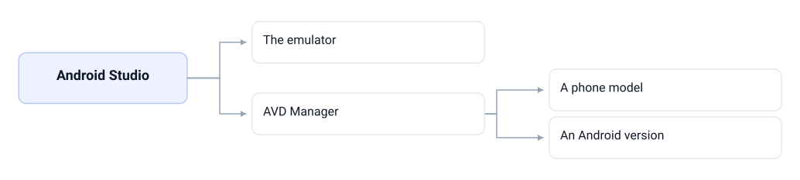

**An emulator** is a program that simulates the behavior of an Android phone inside a computer.

- Advantage: test across Android versions at almost no cost
- Limitation: slower, memory-hungry, some sensors are not supported

<!--
Trimmed to the picture (the diagram says this):
- **Android Studio** — the official Android IDE, where the emulator is managed
- **AVD Manager** — creates a virtual device: choose a phone model and an Android version

Read the picture as containment, not as a sequence: the IDE holds the emulator and the AVD
Manager, and the AVD Manager asks for two things — a phone model and an Android version. The
two bullets that stay are the trade-off, which a container cannot show.

Analogy: an emulator is like a flight simulator — realistic enough for basic practice, but
it does not replace a real flight.

Guiding question: "Why do developers not buy many phones to test across versions?"
(Answer: the emulator makes it possible to test various Android versions at no device
cost.)

Warning: an AVD that has never been created makes the a key in the Expo terminal do
nothing, and that is not a mistake in the student's code.
-->

---

## adb and Physical Devices

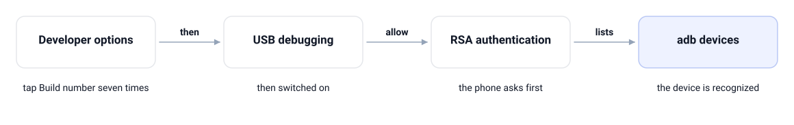

- **adb** — the command-line bridge between the computer and an Android device
- For Expo Go, a USB connection is not required — one Wi-Fi network is enough

<!--
Trimmed to the picture (the diagram says this):
- `adb devices` lists the devices the computer recognizes
- Enable Developer options: tap *Build number* seven times in *About phone*
- Enable *USB debugging*, then allow RSA authentication when the phone asks

The picture is the order, left to right: Developer options, then USB debugging, then the RSA
prompt, then `adb devices` listing the device. The two bullets that stay are the ones the chain
cannot hold — what adb is for, and the exception that a cable is not needed for Expo Go.

Explain the order that is often reversed: Developer options first, then USB debugging, then
connect the cable. Demonstrate if there is a phone in class.

Guiding question: "When is adb really needed?" (Answer: when making sure the emulator or
phone is recognized by the computer before running the app, for example when the a key
opens nothing.)

Warning: a charging cable without a data line is the hidden cause; the unauthorized status
means the phone has not yet approved the computer's authentication.
-->

---

## iOS Simulator: An Introduction

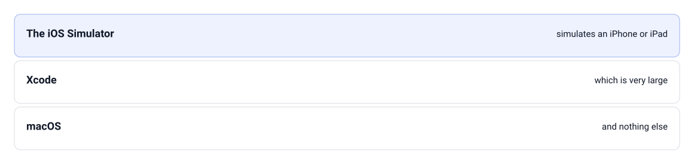

**The iOS Simulator** is a program that simulates an iPhone or iPad running on a computer.

- Windows and Linux cannot run it at all
- Alternatives: a physical iPhone with Expo Go, or a cloud build with EAS Build (Chapter 15)
- On a Mac, press **i** in the Expo terminal to open it

<!--
Trimmed to the picture (the diagram says this):
- It runs only on **macOS** and requires **Xcode**, which is very large

The three bands are the answer to "why can Windows and Linux not run it at all": the
Simulator sits on Xcode, Xcode sits on macOS. The bullet that stays is the absence the stack
cannot draw, and the two alternatives below it are the way out.

The important message is not about the tool but about the mindset: cross-platform
development does not mean everyone must own every device.

Guiding question: "How do students on Windows test the display on iOS?" (Answer: borrow an
iPhone and install Expo Go on the same network, or hand the build to a cloud service in
Chapter 15.)

Warning: do not promise complete iOS testing in a class that has no Mac.
-->

---

## The Flow for Creating the First Project

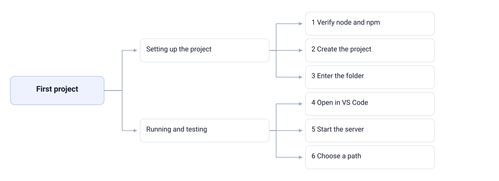

> **Additional explanation:** finish the step that failed before continuing to the next step.

<!--
Read it as the work sequence for today's practicum, then write the sequence on the board
as a checklist that students tick off one by one. Read the diagram as two rows (setting
up, then running); point to step 4 (`code .`) as the same step as the command line on the
next slide.

Guiding question: "Which step may be skipped if you only want to see the app on the
emulator?" (Answer: none may be skipped, but step 6 is run by pressing a instead of
scanning the QR code.)

Warning: skipping step 1 is the most frequent habit and the cause of cascading errors in
the following steps.
-->

---

## Creating the First Expo Project

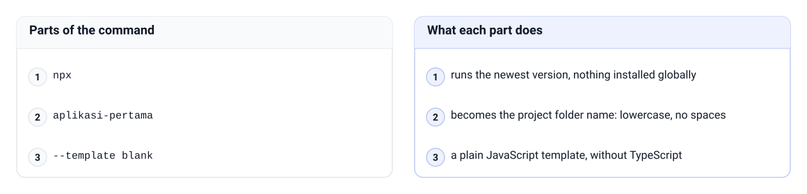

```bash
npx create-expo-app aplikasi-pertama --template blank
cd aplikasi-pertama
code .
npx expo start
```

- `aplikasi-pertama` becomes the project folder name: lowercase, no spaces
- `--template blank` chooses a plain JavaScript template without TypeScript

<!--
Trimmed to the picture (the diagram says this):
- `npx` runs the newest version of `create-expo-app` without installing it globally

The picture reads the command part by part — npx, the project name, the template — with the job
of each part on the right. Only one of the three bullets could move: the slide must keep two, so
the other two stay and repeat their row of the picture on purpose.

The lead-in line also moved, because at w:1120 the panel ran 60px past the bottom edge:
- `Terminal` — from the working folder to a running server

Stress reading the command rather than memorizing it: npx, the project name, then the
template. The creation process takes one to several minutes because npm downloads every
dependency.

Explain the two commands not yet covered on the slide: cd moves the terminal into the
project folder, and code . asks VS Code to open the active folder. If code . is not
recognized, open it through the File then Open Folder menu.

Guiding question: "Why is every subsequent command run from inside the project folder?"
(Answer: npm and Expo read package.json in the active folder.)
-->

---

## Why `--template blank`?

| Aspect | `--template blank` | Without the option (default template) |
|---|---|---|
| Language | Plain JavaScript in `.js` files | TypeScript in `.tsx` files |
| Navigation | No Expo Router | Expo Router is already included |
| Fit | Matches the book's decision: plain JavaScript | Adds concepts that are not needed yet |
| Learning focus | The simplest possible structure | Navigation is only discussed in Chapter 7 |

> Chapter 3 examines the reason for choosing JavaScript; file-based navigation is first studied in Chapter 7.

<!--
This is a writing decision for the book, not mere taste: every code example in this book
uses plain JavaScript, so the default TypeScript-based template would make students meet
type annotations that have not been taught.

Guiding question: "What is the consequence if we use the default template by mistake?"
(Answer: the project holds .tsx files and Expo Router that are not needed at this stage,
so students learn two things at once.)

Version-sensitive warning: template behavior can change between Expo versions; if in
doubt, check the template description at docs.expo.dev or run the create-expo-app help
command.
-->

---

## Starting the Development Server

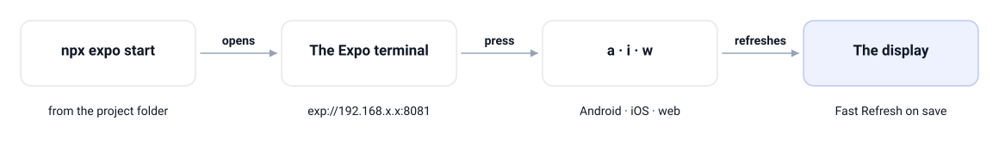

`Terminal` — run from inside the project folder

```bash
npx expo start
```

- **a** Android · **i** iOS Simulator (macOS) · **w** web · **r** manual reload
- **Ctrl+C** stops the development server

> Save a change in App.js, then watch the screen change by itself within 1-2 seconds — that is Fast Refresh.

<!--
Trimmed to the picture (the diagram says this):
- A QR code appears, a LAN address such as `exp://192.168.x.x:8081`, and shortcut keys

Read the chain left to right: the command opens the Expo terminal, the terminal carries the QR
code and the LAN address, a key picks the target, and the display follows the save. The two
bullets that stay carry what the chain does not: the r key and Ctrl+C.

Demonstrate directly on the projector instead of explaining: show the Expo terminal
interface and point to each part, especially the LAN address that proves Metro is working.

Guiding question: "Why does the exp:// address matter to students who use a phone?"
(Answer: that is the address where Metro serves the app, and the phone must be on the same
network.)

Warning: do not close the Expo terminal during the practicum; closing it shuts down Metro
and the app on the phone loses its connection.
-->

---

## Key Commands for Chapter 2

| Command | Function |
|---|---|
| `node --version` / `npm --version` | Checks the Node.js and npm versions |
| `npx create-expo-app <name> --template blank` | Creates a plain JavaScript Expo project |
| `npx expo start` | Starts the Metro Bundler and the development server |
| `npx expo start --tunnel` | Starts the server with a public network bridge |
| `npx expo start --port 8082` | Uses another port if 8081 is already taken |
| `adb devices` | Lists the connected Android devices |

<!--
This slide is a reference students may photograph; do not read it out one by one.

Not in the table: the shortcut keys a, i, w, r and Ctrl+C in the Expo terminal, the
commands cd and code ., npx expo start --android to open the emulator directly, and the
cache-clearing option on the start command.

Guiding question: "When is the --tunnel option used?" (Answer: when the phone and the
computer are not on one network, for example campus Wi-Fi that blocks communication
between devices.)
-->

---

## Expo Project Folder Structure

`aplikasi-pertama/` — the result of `create-expo-app --template blank`

```plaintext
aplikasi-pertama/
├── assets/
├── node_modules/
├── .gitignore
├── App.js
├── app.json
├── index.js
└── package.json
```

<!--
Ask students to open the Explorer panel in VS Code and match their structure against this
slide instead of memorizing it.

Version-sensitive warning: the exact contents of the template can differ between SDK
versions, for example the names of icon assets or extra files. If a student's structure is
not exactly the same, that is normal; what must be understood is the role of the core
files.

After npx expo start is run, a .expo folder appears holding local settings and device
information; it is created automatically and does not need to be touched.
-->

---

## The Role of Core Files and Folders

| File / Folder | Its Role |
|---|---|
| `App.js` | The app's main component — the file you edit most often |
| `index.js` | The entry point; calls `registerRootComponent` |
| `app.json` | Project configuration: name, slug, version, orientation, icon |
| `package.json` | Project name, list of scripts, and exact-version dependencies |
| `assets/` | Static assets: app icons and images bundled with the template |
| `node_modules/` | Every package downloaded by npm; not edited and not tracked by Git |

<!--
Group the roles into three functions: project identity (app.json, package.json), the app
entry point (index.js, App.js), and supporting content (assets, node_modules).

Guiding question: "Why is node_modules never edited and never reported to Git?" (Answer:
its contents can be reinstalled at any time with npm install, so storing them only makes
the repository bigger.)

Warning: do not edit package.json by hand unless you understand the consequences; use npm
commands or npx expo install.

The .gitignore file holds the patterns Git excludes, for example node_modules and .expo.
-->

---

## Execution Flow: index.js then App.js

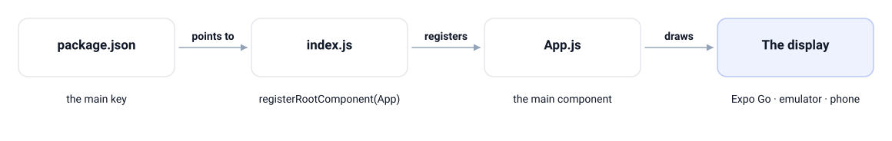

> The calling order is simple: `package.json` points to `index.js`, `index.js` registers `App.js`, and `App.js` draws the display.

<!--
Stress that this flow explains why App.js is the file edited most often: it is the entry
point of the display.

Guiding question: "If index.js is deleted, what happens?" (Answer: Metro finds no entry
point, the app fails to load even though App.js still exists.)

Warning: the concepts of import and export are only covered fully in Chapter 3; for now it
is enough to understand the flow, do not explain modules at length here.
-->

---

## Code Example: App.js "Halo, Dunia!"

`kode/bab-02-persiapan-lingkungan-pengembangan/App.js` — the product of this meeting's practicum

```js
import { StatusBar } from 'expo-status-bar';
import { StyleSheet, Text, View } from 'react-native';

export default function App() {
  return (
    <View style={styles.kontainer}>
      <Text style={styles.judul}>Halo, Dunia!</Text>
      <Text style={styles.keterangan}>
        Project Expo pertama saya berhasil berjalan di perangkat.
      </Text>
      <StatusBar style="auto" />
    </View>
  );
}
```

> The `styles` object (`StyleSheet.create`) is in the complete file `kode/bab-02-persiapan-lingkungan-pengembangan/App.js`.

<!--
This code follows the official SDK 57 template pattern and was in fact not run on an
emulator by the authoring team; state neutrally that students should test it themselves.

Show only three things: the two import lines borrow tools from packages, View is a
container box, Text is the text that appears. View, Text, and StyleSheet are examined in
depth in Chapter 5, so here it is enough to imitate the pattern.

Guiding question: "Which part may you change today?" (Answer: the text content inside the
title and description Text, then save to see Fast Refresh work.)
-->

---

## Expected Practicum Result

- Two version numbers appear when `node --version` and `npm --version` are run
- The `aplikasi-pertama` folder is created without errors
- `npx expo start` shows a QR code and the address `exp://...:8081`
- The text "Halo, Dunia!" appears in Expo Go and/or the Android emulator
- Saving a change in App.js changes the screen within 1-2 seconds (Fast Refresh)

<!--
Make this list a checklist: students tick each item and then attach screenshots as
practicum evidence according to the rubric.

Deliberately breaking the code is also valuable practice: delete one quotation mark, save,
watch the red error screen, then restore the code. The goal is to train reading error
messages.

Guiding question: "What does that red screen mean?" (Answer: a Metro bundling error, not
device damage, and the first line of the message names the file and its line.)
-->

---

## Case Study: Standardizing the Environment

**Illustrative example** with a real pattern: three student interns in the campus Information Systems Division are working on a prototype academic announcement app.

| Three problems in the first week | Three weapons from this chapter |
|---|---|
| One intern uses an old Node version from last year's tutorial | **Platform standardization**: the same Node.js LTS, verified with `node --version` |
| Another intern uses yarn, so the lockfile differs from their teammate's | **One package manager**: npm uniformly, avoid lockfile differences |
| The app runs on one laptop and fails on another | **npx rather than global installs**: always the current version from the registry |

> Different runtime versions are a source of obscure errors, not just warnings.

<!--
Read the problem column first, ask the class to guess the weapon that fits each problem,
then reveal the right column. Do not read it as a list: a week is wasted equalizing
versions before a single line of code is written.

Stress the term reproducibility: the ability to reinstall the same project on another
computer. This is the seed of the environment management practice needed for the Final
Project, Mobile Academic Information System.

Guiding question: "What is the cheapest single step to keep this case from recurring?"
(Answer: write down the setup steps and record the tool versions in the team
documentation.)

Warning: this case is illustrative, assembled from real patterns in the chapter, not real
data from a campus.
-->

---

## Common Troubleshooting (1/2)

| Symptom | Cause | Solution |
|---|---|---|
| `node: command not found` | Not installed or not on the PATH | Install Node.js LTS, then open a new terminal |
| Port 8081 is in use | Another app is using Metro's default port | Close that app or use port 8082 |
| Red screen when saving | Syntax error or module not found | Read the first line of the error, then clear the cache |
| Pressing **a** does nothing | The emulator is not running | Start the AVD in Android Studio first |

<!--
Teach the order: read the error message, identify which layer failed, then act. Jumping to
a solution without reading the message is the most expensive habit.

Guiding question: "Why is clearing the Metro cache sometimes necessary?" (Answer: the
cache can hold an old version of the code or of a module, so changes do not appear.)

Warning: do not suggest reinstalling the whole project before checking the error message;
that erases the most valuable clue.
-->

---

## Common Troubleshooting (2/2)

| Symptom | Cause | Solution |
|---|---|---|
| `adb devices` is empty or `unauthorized` | USB debugging is not enabled or not allowed | Enable debugging, allow authentication, change the cable |
| Code changes do not appear | Fast Refresh failed or the Metro cache is stale | Press **r**; if it persists, clear the cache |
| The project is not compatible with Expo Go | The project SDK and Expo Go are on different versions | Align the versions, then check with `npx expo-doctor` |
| The QR code cannot be connected | The phone and the computer are on different networks | Restart the server with the `--tunnel` option |

<!--
Connect each row to the earlier slides: network problems, device problems, and SDK version
problems. All three are the most frequent causes in class.

Guiding question: "When is npx expo-doctor used?" (Answer: when you are unsure whether the
project is healthy and its packages are compatible with the SDK in use.)

Warning: the tunnel option is slower than the local network and needs a stable internet
connection; keep it as a fallback, not a daily habit.
-->

---

## Summary

1. Node.js is a JavaScript runtime outside the browser — a prerequisite for Expo CLI and Metro
2. npm manages dependencies in `package.json`; `npx` runs commands without installing
3. VS Code + ESLint + Prettier is the workbench; Expo Go tests instantly without a build
4. An emulator for cross-version testing; a physical device for sensors and the real experience
5. `--template blank` = plain JavaScript; `npx expo start` starts Metro on port 8081

<!--
Do not read it out. Ask students to pick one number and explain it in their own words;
this sticks better than repeating the reading.

Complete it orally: the iOS Simulator is only available on macOS, and reproducibility is
achieved by standardizing versions and the package manager.

Closing message: starting today, every app that fails is seen as a message that must be
read, not a misfortune.
-->

---

<!-- _class: center -->

## Comprehension Check

- Which tool is required before running `npx create-expo-app`?
- What is the difference between `npm install <package>` and `npx <command>`?
- Why does this book choose `--template blank`?
- What is the Metro Bundler's role in `npx expo start`?
- What is the default port used by the Metro Bundler?

<!--
A 5-minute oral quiz: show the questions, ask the class to answer in chorus or by a show of
hands, then move to the answers slide. Do not leak the answers on this slide.

These five questions come from the Chapter 2 Evaluation multiple-choice section; use them
as a quick check before closing the meeting.

If class answers vary on the third question, repeat the template blank slide before
closing the meeting.
-->

---

<!-- _class: center -->

## Answers

- Node.js — required before the Expo tools can be run
- `npm install` installs the package into the project; `npx` runs it without a permanent install
- `blank` produces plain JavaScript, while the default template uses TypeScript
- It bundles JavaScript modules and sends them to the device
- The Metro Bundler's default port is **8081**

<!--
Repeat the distinction most often confused: npm installs, npx runs.

Ask one number again at random to make sure the class is really following, then close by
linking the fifth answer to the port 8081 troubleshooting message.
-->

---

## Class Discussion: Reproducibility

<div class="grid2">
<div>

**Questions**

- Who has encountered "it works on my computer"?
- What will you standardize first in your next team project?

</div>
<div>

**What is assessed**

- Accuracy in connecting versions, the package manager, and npx
- The ability to assemble environment verification habits

</div>
</div>

<!--
Give 3 minutes in pairs, then collect two or three answers. Write the proposed team habits
on the board so they can be used in the Final Project.

If answers are weak, steer toward three things: record the tool versions, choose one
package manager, and do not rely on global installs.

What is assessed is not the length of the answer but the ability to connect cause with
prevention.
-->

---

## References

| Source | Link |
|---|---|
| Node.js documentation (2026) | nodejs.org |
| Expo documentation (2026) | docs.expo.dev |
| React Native documentation (2026) | reactnative.dev |

<div class="grid2">
<div>

**Further reading**

- Chapter 3 — Modern JavaScript

</div>
<div>

**Technology versions in this book**

- Expo SDK 57 · React Native 0.86 · React 19.2 · Node.js LTS ≥ 22

</div>
</div>

<!--
The complete references are in Appendix D, and the glossary of terms in Appendix C contains
entries such as Dependency, Emulator, Metro Bundler, npm, and Node.js.

The primary source for this chapter remains the official documentation, not third-party
tutorials of unknown version.

Remind them that the parts marked version-sensitive in the chapter must be matched against
the official documentation before being used in the next class.
-->

---

<!-- _class: lead -->
<!-- _paginate: skip -->

# Ready for Chapter 3

**Assignment:** submit the Practicum 2 report — screenshots of the app in Expo Go or the emulator, a record of the Node.js and npm versions, and the troubleshooting checklist.

Next meeting: modern JavaScript — variables, data types, and functions.

<!--
Close with one sentence: "Today we started the engine; from Chapter 3 we begin to write
its language."

State the practicum report deadline explicitly and its assessment following the practicum
rubric: conceptual understanding, implementation, code quality, UI/UX, debugging, and
documentation.

Final message: keep the aplikasi-pertama project because it will be used again in several
of the following chapters.
-->
