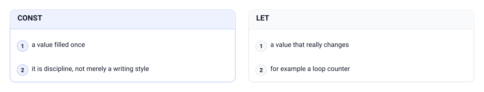
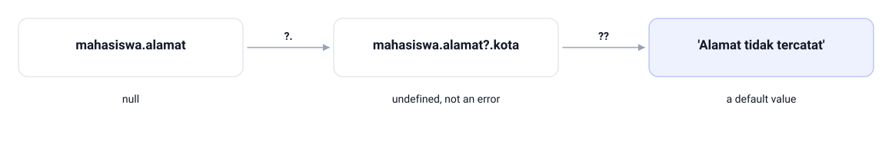
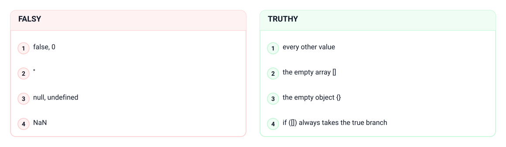
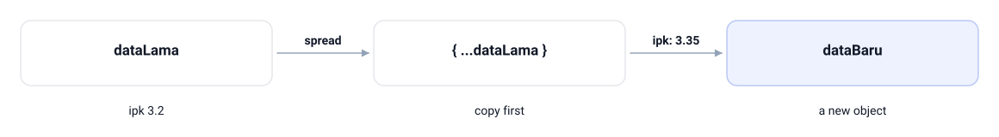
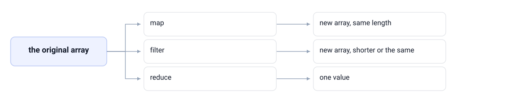
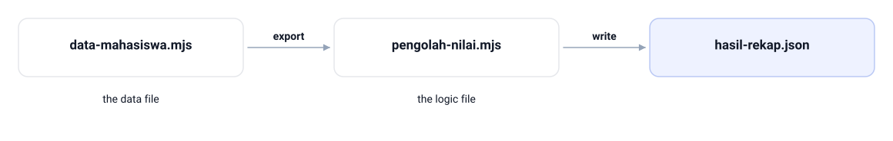
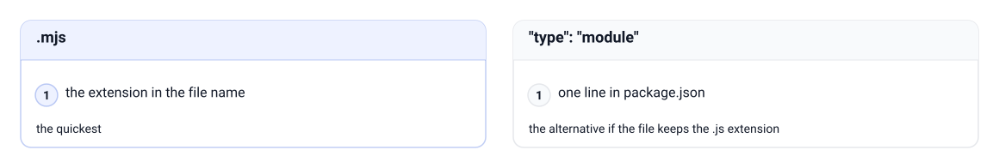
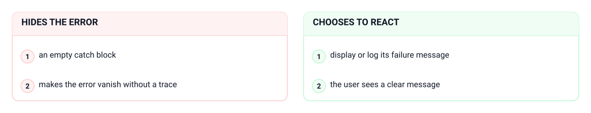

<!-- _class: lead -->
<!-- _paginate: skip -->
<!-- _footer: "" -->

# Chapter 3 — Modern JavaScript for React Native

Language foundations before writing components · Meetings 3–4

<!--
Open with one hook: "For the next three meetings we do not write a single screen yet.
Today we build the language first, because React Native is ultimately JavaScript."

Opening question: "Which programming language does React Native actually use?" (Answer:
JavaScript, not Kotlin or Swift — both are native languages we do not use in this book.)
-->

---

## Learning Objectives

- Explain `const` and `let` with their *scope* consequences
- Apply data types, operators, branching, and loops
- Analyze ordinary functions and arrow functions, including `this` behavior
- Implement *destructuring*, *spread*, `map`, `filter`, `reduce`
- Evaluate `import`/`export` modules and the `async`/`await` asynchronous pattern

<!--
Read out only the verbs, not the whole sentences. Stress that objectives 1 to 4 are
assessed through Chapter 3 Exercises and Quiz 1 in the next meeting, while objective 5 is
only fully used when we call a server in Chapter 10.

Tie it to the chapter's promise: all code in this chapter runs with Node.js, with no interface
yet — the goal is to sharpen logic before writing components in Chapter 4.
-->

---

<!-- _class: lead -->
<!-- _paginate: skip -->

# Part 1 — JavaScript Language Basics

Section 3.1 Variables · 3.2 Data Types & Operators · 3.3 Branching & Loops · 3.4 Functions

<!--
This part is mandatory groundwork. If this meeting's time is tight, speed up Section 3.3 because
the patterns are already familiar from other programming languages, but do not skip Sections 3.1 and 3.4
which shape the habits of writing React code.

All examples in this part are stored in the praktik-js folder and run with node.

> `praktik-js/` is the book's generic exercise folder. In the practicum repository the same
> techniques live in `kode/bab-03-javascript-modern-untuk-react-native/`: `utils/akademik.js`
> (the pure functions) and `latihan-predikat.js` / `latihan-cari.js` / `latihan-async.js`
> (the runnable exercises). Read the file names in the slides as technique labels, not as
> paths that must exist.
-->

---

## Variables: `const` and `let`



A **variable** is a place to store a value inside a program, declared with `const` or `let`.

- Both are *block scoped* — they only apply inside the nearest `{ }`
- `var` is left behind: it is *function scoped* and its value changes easily without being noticed

<!--
Analogy: const is like a value already written in ink, let is like a pencil mark.

Guiding question: "Why does React almost always use const?" (Answer: state values are not
replaced directly, but through the setter function from useState in Chapter 4.)

Misconception warning: students often assume const freezes its object. The next slide
breaks that assumption.

Trimmed to the picture (the diagram says this):
- `const` is for a value filled once; it is discipline, not merely a writing style
- `let` is for a value that really changes, for example a loop counter
-->

---

## `const` Keeps the Reference, Not the Contents

`praktik-js/01-variabel.js`

```js
const namaAplikasi = 'Aplikasi Mahasiswa';
let jumlahMahasiswa = 5;

jumlahMahasiswa = jumlahMahasiswa + 1; // boleh: let dapat diisi ulang
console.log(namaAplikasi, jumlahMahasiswa); // Aplikasi Mahasiswa 6

const mahasiswa = { nama: 'Budi Santoso', ipk: 3.45 };
mahasiswa.ipk = 3.5; // BOLEH: properti objek tetap bisa diubah
console.log(mahasiswa.ipk); // 3.5
```

> `const` guards the reference to an object, not the object's contents.

<!--
Show just three lines: let is reassigned, const may not be reassigned, and a const object's
properties can still be changed.

The most common misconception warning: "const means the data cannot be changed at all".
What const guards is the object's memory address, not its property values.

If run, `namaAplikasi = 'Nama Lain'` raises a TypeError; show it in the editor.
-->

---

## Basic Data Types in JavaScript

| Type | Example | Note |
|---|---|---|
| **string** | `'2201001'` | text |
| **number** | `3.45` | includes decimal numbers |
| **boolean** | `true` / `false` | result of a comparison |
| **undefined** | `nilaiBelumDiketahui` | not yet defined |
| **null** | `null` | deliberately left empty |
| **object** | `{ nama: 'Budi' }`, `[1, 2, 3]` | covers arrays and functions |

> Checked with `typeof`, but `typeof []` and `typeof null` are both `"object"`.

<!--
Do not read it row by row. Ask students to name the type of the values you
write on the board, for example nim, ipk, and graduation status.

Warning: `typeof` alone is not enough to tell an array from null. Additional explanation:
for arrays, use a dedicated check such as Array.isArray.

Ask: "If a property that does not exist is accessed, error or undefined?" (Answer: undefined,
and that must be handled carefully.)
-->

---

## Operators and Strict Equality

| Group | Operator | Example result |
|---|---|---|
| Arithmetic | `+` `-` `*` `/` `%` | `10 % 3` gives `1` |
| Comparison | `===` `!==` `>` `<` `>=` `<=` | `3.45 >= 3.5` gives `false` |
| Logic | `&&` \|\| `!` | `aktif && ipk >= 3.5` |
| Equality | `===` used, `==` avoided | `'3' === 3` gives `false` |

> `'3' == 3` is `true` because JavaScript converts the type automatically — this is why this book uses `===`.

<!--
Stress just one rule: always ===. Show that == "helps" by converting text
into a number, and that help is the source of bugs.

A classic surprise worth mentioning: 0.1 + 0.2 === 0.3 is false in JavaScript (decimal numbers
are stored in binary). For money values, do not compare directly.

Guiding question: "Which operator is used to tell an odd or even row?"
(Answer: modulo %.)
-->

---

## Optional Chaining and Nullish Coalescing



`praktik-js/03-operator.js`

```js
const mahasiswa = { nama: 'Siti Aminah', alamat: null };

console.log(mahasiswa.alamat?.kota);  // undefined, tidak error
console.log(mahasiswa.alamat ?? 'Alamat tidak tercatat');
// Alamat tidak tercatat
```

- `?.` secures access to a property that may be `null` or `undefined`
- `??` supplies a default value only when the value is `null` or `undefined`

<!--
Analogy: `?.` is like asking at once "does this thing exist and have that property?" without writing
a long `if (objek && objek.profil)`.

Warning: without `?.`, accessing `alamat.kota` when `alamat` is null throws an error.
Show the difference by commenting out one line.

If students ask about the difference between `??` and `||`, just answer briefly that `??` only
fires on null/undefined, then move on — its detail is not a demand of this chapter.
-->

---

## Branching: `if`, Ternary, `switch`

`praktik-js/04-percabangan.js`

```js
const ipk = 3.45;

if (ipk >= 3.5) {
  console.log('Predikat Cumlaude');
} else if (ipk >= 3.0) {
  console.log('Predikat Sangat Memuaskan');
} else {
  console.log('Predikat Memuaskan');
}

const statusKelulusan = ipk >= 2.0 ? 'Lulus' : 'Tidak Lulus';
```

> Ternary for two simple choices; `switch` for one value with many possibilities.

<!--
The order of conditions is the core of this slide. Ask: "If `ipk >= 3.0` is written first, which
branch does GPA 3.45 fall into?" (Answer: the 'Sangat Memuaskan' branch — even though it deserves Cumlaude.)

Mention that `break` in switch prevents execution from falling into the next case, and that
they will often see the ternary in React code in Chapter 4 when a condition sits inside the view.
-->

---

## Falsy and Truthy



- As a result `if ([])` always takes the true branch
- Therefore write conditions explicitly: `if (daftarMahasiswa.length > 0)`

<!--
Trimmed to the picture (the diagram says this):
- The *falsy* values are only: `false`, `0`, `''`, `null`, `undefined`, and `NaN`
- Every other value is *truthy* — including the empty array `[]` and the empty object `{}`

This is the most expensive misconception in this part: "empty means false". Prove it directly in Node.js
with `if ([])` and `if (daftar.length > 0)`.

Guiding question: "If the student list is empty, is `if (daftarMahasiswa)` considered false?"
(Answer: no — it is always true.)

Look ahead: array-length checks like this appear when displaying a list in Chapter 4.
-->

---

## Loops: `for`, `while`, `for...of`

`praktik-js/05-perulangan.js`

```js
let sisaPercobaan = 3;
while (sisaPercobaan > 0) {
  console.log(`Login gagal, sisa ${sisaPercobaan} kali`);
  sisaPercobaan--;
}

const daftarNilai = [3.45, 3.82, 3.2, 3.61, 2.95];
let total = 0;
for (const nilai of daftarNilai) {
  total = total + nilai;
}
console.log(`Total IPK: ${total}`); // Total IPK: 17.03
```

<!--
Stress choosing the tool, not the syntax: for when the number of rounds is known, while when stopping
depends on a condition (for example login attempts in Chapter 13), for...of to walk an array.

Warning: `for (const nilai in daftarNilai)` returns the index, not the value — do not
confuse it with for...of.

Mention that for...of is the basis for understanding the iteration React uses to render a list.
-->

---

<!-- _class: center -->

## What Happens If…?

- `for (let i = 1; i <= 5; i--)` is run — what happens?
- An `if` chain is ordered from the loosest condition — which branch is wrong?
- `for (const nilai in daftarNilai)` is used on an array — what gets printed?

<!--
Give 3 minutes of think-pair-share. Ask for reasons, not just answers; the complete answers are on
the next slide, so every group still guesses first.

If a group gets everything right, ask them to write a one-line fix for each case
on the board — that is the next exercise.
-->

---

<!-- _class: center -->

## Answers

- The loop never stops: `i` gets smaller, so the condition `i <= 5` is always true
- The GPA 3.45 is categorized wrongly; the conditions must run from strict to loose
- What is printed is the index `0, 1, 2, …`, not the GPA value — use `for...of`

<!--
Repeat the cause, not the result: these three mistakes are "wrong tool" mistakes,
not "hard JS" mistakes.

**Additional explanation:** an endless loop only freezes the terminal, it does not damage the computer
— teach Ctrl+C so students do not panic during the practicum.
-->

---

## Declaration Functions and Arrow Functions

`praktik-js/06-fungsi.js`

```js
function tentukanPredikat(ipk = 0) {
  if (ipk >= 3.5) return 'Cumlaude';
  if (ipk >= 3.0) return 'Sangat Memuaskan';
  return 'Memuaskan';
}

const tentukanStatus = (ipk) => (ipk >= 2.0 ? 'Lulus' : 'Tidak Lulus');

const jumlahkan = (...angka) => angka.reduce((total, nilai) => total + nilai, 0);

console.log(tentukanPredikat());     // Memuaskan (parameter default 0)
console.log(jumlahkan(1, 2, 3, 4));  // 10
```

> An **arrow function** is more concise and has no `this` of its own — that is why it dominates in React.

<!--
Discuss three things: the early return pattern (every branch returns a value), the single-expression
arrow function without an explicit return, and the default parameter ipk = 0.

Misconception warning: an arrow function is not merely "a shorter function" — what sets it apart is
`this` pointing to the outer scope, and that is why React uses it for event handlers.

Mention the road ahead: small single-purpose functions are the foundation of the pure functions tested
in Chapter 14.
-->

---

<!-- _class: lead -->
<!-- _paginate: skip -->

# Part 2 — Arrays, Objects & Data Processing

Section 3.5 Arrays & Objects · 3.6 Destructuring & Spread · 3.7 map / filter / reduce

<!--
This is the part used most often in the following chapters: almost all application data
is shaped as an array of objects, and almost all list views are born from map.

Remind them that this pattern carries through to the Final Project, so do not merely memorize it.
-->

---

## Arrays and Objects: Reference Types

`praktik-js/07-array-object.js`

```js
const daftarNama = ['Budi', 'Siti', 'Agus'];
daftarNama.push('Dewi');
console.log(daftarNama.includes('Siti')); // true
console.log(daftarNama.slice(1, 3));      // [ 'Siti', 'Agus' ]

const mahasiswa = { nim: '2201001', nama: 'Budi Santoso', ipk: 3.45 };
const salinan = mahasiswa;       // SALAH jika ingin data terpisah
salinan.ipk = 4.0;
console.log(mahasiswa.ipk);      // 4.0 — objek asli ikut berubah!
```

> Arrays and objects are reference types: copying with `=` copies only the address.

<!--
Analogy: copying a reference is like giving a second nickname to the same person —
changing the nickname does not make a second person appear.

Show the surprise in the last three lines, then ask: "What is the right way to copy an object?"
(Answer: spread in Section 3.6 — let students guess before the next slide.)

Warning: this kind of aliasing bug rarely appears in small practice, but it happens very often
when changing React state in Chapter 4.
-->

---

## Standard Student Data in This Book

| NIM | Name | Program | GPA |
|---|---|---|---|
| 2201001 | Budi Santoso | Information Systems | 3.45 |
| 2201002 | Siti Aminah | Informatics Engineering | 3.82 |
| 2201003 | Agus Wijaya | Informatics | 3.20 |
| 2201004 | Dewi Lestari | Software Engineering | 3.61 |
| 2201005 | Rizky Pratama | Information Systems | 2.95 |

> The object shape is `{ id, nim, nama, prodi, angkatan, ipk, email, telepon }`, reused until the Final Project.

<!--
Explain that these five records are not a one-off example: the same structure is used in Chapters 4
to 8, Chapter 10, and the Final Project, so students always work on familiar data.

Guiding question: "How many unique programs are in this table?" (Answer: four, and Information
Systems appears twice.)

Warning: do not invent other student records in the exercises, so that student results can be
compared with one another.
-->

---

## Destructuring: Taking Values in One Line

`praktik-js/08-destructuring.js`

```js
const mahasiswa = { nim: '2201002', nama: 'Siti Aminah', ipk: 3.82 };
const { nama, nim: nomorInduk, prodi = 'Belum diketahui' } = mahasiswa;
console.log(nama, nomorInduk, prodi);
// Siti Aminah 2201002 Belum diketahui

const nilaiUjian = [80, 90, 75, 88];
const [pertama, kedua, ...sisaNilai] = nilaiUjian;
console.log(pertama, kedua, sisaNilai); // 80 90 [ 75, 88 ]
```

> **Destructuring** takes object/array values into variables in one line.

<!--
Show three capabilities at once: taking a property straight into a variable, renaming the
variable with `nim: nomorInduk`, and giving a default value for a property that does not exist.

Warning: array destructuring works by order, not by name — swapping the position swaps
the value.

Look ahead: the pattern `const [nilai, setNilai] = useState(0)` in Chapter 4 uses the same
mechanism, so this slide is the gateway to hooks.
-->

---

## Spread Operator: Copying and Updating



`praktik-js/08-destructuring.js` and `praktik-js/pengolah-nilai.mjs`

```js
const dataLama = { nim: '2201003', nama: 'Agus Wijaya', ipk: 3.2 };
const dataBaru = { ...dataLama, ipk: 3.35 };

console.log(dataLama.ipk); // 3.2 (tidak berubah)
console.log(dataBaru.ipk); // 3.35 (objek baru)
```

- The symbol `...` is the same, the job differs: *spread* scatters the contents, *rest* gathers the rest
- The pattern `{ ...dataLama, ipk: 3.35 }` is the basis of *immutable* updates in React

<!--
Stress the pattern "copy first, then update": the original object stays intact, and we get a new object
to display. This is how React updates state in Chapter 4 and Chapter 9.

Tell spread and rest apart with one short example: `...dataLama` scatters, `...sisaNilai`
gathers.

Guiding question: "Why does React prefer creating a new object to changing the old one?"
(Answer: so the data change is detected and no component reads the wrong data.)

The Set trick was moved off the slide so the picture would fit (write it on the board if a
student asks): `const prodiUnik = [...new Set(daftarMahasiswa.map((m) => m.prodi))]` — Set
rejects duplicates, spread turns it back into an array.
-->

---

## `map`, `filter`, and `reduce`

| Method | Its job | Its result |
|---|---|---|
| `map` | changes each element into a new element | new array, same length |
| `filter` | picks the elements that meet a condition | new array, shorter or the same |
| `reduce` | combines all elements | one value, for example the total GPA |

- All three return a new value without changing the original array
- Their companions: `find` looks up one record, `some` and `every` check a condition



<!--
Read out only the middle column, then ask students to guess the method name for three jobs: "take the names
of all students", "take the GPAs above 3.5", "compute the total GPA". (Answer: map, filter, reduce.)

Warning: `reduce` without an initial value uses the first element as the accumulator and fails
on an empty array — always write the initial value `0`.

Mention that `map` returns a new array, whereas `forEach` only walks around without
returning anything; that is why the printing in the practicum uses forEach.
-->

---

## Example: Summary of High-achieving Students

`praktik-js/09-map-filter-reduce.js`

```js
const berprestasi = daftarMahasiswa.filter((m) => m.ipk >= 3.5);
console.log(berprestasi.map((m) => `${m.nama} (${m.ipk})`));
// [ 'Siti Aminah (3.82)', 'Dewi Lestari (3.61)' ]

const totalIpk = daftarMahasiswa.reduce((total, m) => total + m.ipk, 0);
const rataRata = totalIpk / daftarMahasiswa.length;
console.log(`Rata-rata IPK: ${rataRata.toFixed(2)}`); // Rata-rata IPK: 3.41

const namaBerprestasi = daftarMahasiswa
  .filter((m) => m.ipk >= 3.5)
  .map((m) => m.nama);
console.log(namaBerprestasi); // [ 'Siti Aminah', 'Dewi Lestari' ]
```

> The `filter(...).map(...)` chain reads naturally: filter first, map afterwards.

<!--
Show that each method's argument is a callback receiving one array element — here
named m, short for mahasiswa.

Compare the way of thinking: a manual loop tells the computer *how*, whereas this chain
states *what* is wanted; its result cannot get an index wrong.

Warning: beginners often write `filter` for what is really a lookup of one record —
for that use `find`, which returns an object instead of an array.
-->

---

<!-- _class: lead -->
<!-- _paginate: skip -->

# Part 3 — Modules & Asynchronous Programming

Section 3.8 Modules · 3.9 Promise · 3.10 async/await & try/catch

<!--
This part separates "can write JavaScript" from "ready to use React Native": a mobile
app always calls data from outside itself, and all of it takes the form of asynchronous operations.

Per the RPS, the Module System (3.8) is still part of meeting 3; if meeting 3 runs out of time, it is
Sections 3.9–3.10 that move to meeting 4 along with Practicum 3.
-->

---

## Modules: Splitting Code into Files



> A **module** splits code into files; only what is `export`ed can be used by another file.

<!--
Explain the historical reason briefly: before modules existed, every file was loaded through a
script tag and shared one global namespace, so two files using the name `daftarMahasiswa`
overwrote each other without warning.

Guiding question: "Why is the data file separated from the logic file?" (Answer: data and logic
can be tested and changed on their own, and that mirrors the separation of data from presentation later.)

Warning: the name inside the import braces must match the export name exactly.
-->

---

## Running Modules in Node.js

`praktik-js/cetak-data.mjs` — run from inside the `praktik-js` folder

```bash
node cetak-data.mjs
node --check cetak-data.mjs
```



- Without `.mjs` or `"type": "module"`, Node rejects `import` with a `SyntaxError`
- `node --check` succeeds when the terminal shows nothing (exit code 0)

<!--
Show the two ways to enable ESM, then state the practical choice for this chapter: use the
.mjs extension because it is the quickest.

Warning: the absence of output from the syntax-check option is often taken as failure by
students. Have them check the exit code with `echo $?` (macOS/Linux) or
`echo %errorlevel%` (Windows): the number 0 means the syntax is valid.

Guiding question: "What happens if the import points to a file with the wrong name?" (Answer:
ERR_MODULE_NOT_FOUND, because file names in Node are case-sensitive.)

Trimmed to the picture (the diagram says this):

    `praktik-js/package.json` — the alternative if the file keeps the `.js` extension

    { "type": "module" }

The picture's right panel carries the same two facts in one glance — `"type": "module"` and
where it goes — so the literal itself is kept here, word for word, for anyone who types it
along.
-->

---

## Promises and Their Three States


> A **Promise** is an object representing the result of an asynchronous operation that is not necessarily finished.

<!--
Analogy: a promise is like a service queue number — you do not have the goods yet, but you already have
proof that the result will exist, or that the request failed.

Stress the reason it exists: JavaScript runs on a single thread, so a slow operation
left to block will freeze the entire application.

Warning: students often think they must frequently create Promises themselves. What is mandatory
is being able to consume one, because fetch in Chapter 10 returns a Promise.
-->

---

## Consuming a Promise: `then` and `catch`

`praktik-js/10-promise.js`

```js
function ambilDataMahasiswa() {
  return new Promise((resolve, reject) => {
    setTimeout(() => {
      resolve({ nim: '2201001', nama: 'Budi Santoso', ipk: 3.45 });
    }, 1000);
  });
}

console.log('Mengambil data...');
ambilDataMahasiswa()
  .then((data) => console.log(`Data diterima: ${data.nama} (IPK ${data.ipk})`))
  .catch((error) => console.error('Gagal mengambil data:', error.message))
  .finally(() => console.log('Proses selesai.'));
```

> `.finally` always runs — the right place to close the "loading…" indicator.

<!--
Explain that the setTimeout here is only a helper to make it feel like network latency; in
Chapter 10 its role is taken over by fetch.

Show the flat code shape: the .then/.catch chain replaces nested callbacks that get deeper
and harder to read.

Guiding question: "Where do we write 'Mengambil data…' and where do we remove it?"
(Answer: before the call, and inside .finally.)

Mention that Promise.all is used when several requests are to be awaited at once.
-->

---

## `async`/`await`: Asynchronous as if Synchronous

```js
async function tampilkanData() {
  console.log('Memuat data...');
  const data = await ambilDataMahasiswa();
  console.log(`Data diterima: ${data.nama} (IPK ${data.ipk})`);
  return data;
}

tampilkanData();
```

- An `async` function always returns a *promise*
- `await` waits for one Promise without freezing the entire application


<!--
Show that the only line differing from synchronous code is the `await` in front of
the call — that is the appeal of this syntax for three sequential steps such as "fetch data,
process, save".

Warning: `await` is only valid inside an async function or at the top level of a module; using it
anywhere else raises a SyntaxError.

Look ahead: this async/await + try/catch pattern is what is used every time we call a server in
Chapter 10, save locally in Chapter 11, and authenticate in Chapter 13.

Trimmed to make room for the picture — not because the diagram says it, but because the
`try`/`catch` route is the next slide's subject and it has its own picture. The fence keeps the
`async`/`await` template whole, including its progress line and its invocation; the wrapper it
was written inside is here, verbatim. This slide also gave up its file line to the picture — the
file is `praktik-js/11-async-await.js`, and it is the one runnable example of this pattern.

    async function tampilkanData() {
      try {
        console.log('Memuat data...');
        const data = await ambilDataMahasiswa();
        console.log(`Data diterima: ${data.nama} (IPK ${data.ipk})`);
        return data;
      } catch (error) {
        console.error('Terjadi kegagalan:', error.message);
      }
    }

    tampilkanData();

The full version is `latihan-async.js` in `kode/bab-03-javascript-modern-untuk-react-native/`.
-->

---

## `try`/`catch`: the App Must Not Stay Silent



> The `catch` block is where the app chooses to react, not where it hides the error.

<!--
Read the flow as the story of one data request: succeeding until the user sees the data, failing
until the user sees a clear message.

Guiding question: "Which app have you used that just stayed silent when loading failed?"
(Answers vary; steer toward the conclusion that silence is a bad design choice.)

**Additional explanation:** an empty `catch` block makes the error vanish without a trace — always display
or log its failure message.
-->

---

## Practicum 3: Student Grade Processor

- Open `kode/bab-03-javascript-modern-untuk-react-native/`; `node --version` shows 22 or higher
- `utils/akademik.js` holds one pure function per technique: `totalSks` (`reduce`), `filterSemester` (`filter`), `hitungIpk` (`reduce`), `cariMatakuliah` (`find`), `kelompokkanPerSemester` (`reduce`), `urutkanJadwal` (`sort` on a copy)
- `data/matakuliah.js` and `data/mahasiswa.js` export the records with `export` — no `require`
- Run the three CLI exercises: `node latihan-predikat.js`, `node latihan-cari.js 20230002`, `node latihan-async.js`
- `latihan-async.js` shows `async`/`await` + `try`/`catch`/`finally`; add `--gagal` to see the error path

> The complete files are in `kode/bab-03-javascript-modern-untuk-react-native/`. All of them are ES modules, because this project sets `"type": "module"` in `package.json`; that is why `node latihan-cari.js` works without `.mjs`.

<!--
Stress that this exercise is a small version of report automation: one script that can be
rerun with consistent results.

Add one guiding question: "What happens if the command is run from another folder?"
(Answer: the program still runs, but hasil-rekap.json appears in the folder where the terminal is.)

Warning: this practicum has no dependencies, so a failure almost always comes from the file
extension or the wrong working folder, not from a package that has not been installed.
-->

---

## Expected Results and Verification

| Program | Average GPA |
|---|---|
| Information Systems | 3.20 |
| Informatics Engineering | 3.82 |
| Informatics | 3.20 |
| Software Engineering | 3.61 |

- High-achieving students (GPA of at least 3.5): Siti Aminah 3.82 and Dewi Lestari 3.61
- Pass when the terminal shows no error, the numbers match, and `hasil-rekap.json` is created

<!--
Stress three markers of success, not just "no error": the output matches, the file is created,
and the file content has jumlahMahasiswa 5.

Treat it as normal if something differs: the note in the manuscript says that the numbers above come from
the book author's real run, so the only value that may differ on the student's computer
is disimpanPada (the storage time).

Guiding question: "Why are the Information Systems and Informatics averages both 3.20?"
(Answer: each program has only one student in the static data.)
-->

---

## Case Study: Academic Office Report

| Management request | Technique used |
|---|---|
| Average GPA per program | `filter` + `reduce` per program |
| Scholarship recipients (GPA of at least 3.5) | `filter` with a threshold |
| Student data with a specific NIM | `find` |
| A report that can be repeated consistently | a JavaScript *script* with JSON output |

> Previously staff filtered an Excel file by hand: slow, prone to copy errors, and results differed between staff.

<!--
Read it as the story of an office problem, not as a table. The point: the problem is not the data,
but manual processing that cannot be repeated.

Guiding question: "What is the biggest risk when two staff members handle the same request
by hand?" (Answer: two different reports from the same data.)

Look ahead to the Final Project: the student list will later be fetched from a server, filtered, computed, and
displayed on the device screen with the same techniques.
-->

---

<!-- _class: center -->

## Mini Quiz

- The result of `[5, 8, 3, 9].filter((x) => x > 4)` is…
- The result of `[1, 2, 3, 4].reduce((total, x) => total + x, 0)` is…
- For `import` to run in Node.js without extra configuration, the file extension is…
- The statement that is true about arrow functions is…

<!--
Five-minute oral quiz: show the questions, ask the whole class to answer together or raise
hands, then move to the answer slide. Do not leak the answers on this slide.

The third and fourth items are the most often missed; if that happens, repeat Sections 3.8 and 3.4 before
closing the meeting. These questions also warm up Quiz 1 in the next meeting.
-->

---

<!-- _class: center -->

## Answers

- `[5, 8, 9]` — `filter` keeps the elements that meet the condition
- `10` — `reduce` adds up all elements with the initial value `0`
- `.mjs` — the alternative is `"type": "module"` in `package.json`
- An arrow function has no `this` of its own — which is why it dominates in React

<!--
Repeat the two distinctions most often swapped: `filter` returns an array, whereas `find`
returns a single element; and the .mjs extension changes how Node reads the file, not the code content.

If class answers vary on the fourth item, rewrite the event handler example on the board and
ask for the value of `this` inside it.
-->

---

## Summary

1. `const` for fixed values and `let` for values that change; both are *block scoped*
2. Use `===`, plus `?.` and `??`; remember *falsy* values when writing conditions
3. Arrow functions are more concise and have no `this` of their own — the basis of React code
4. `map`, `filter`, `reduce`, *destructuring*, and *spread* process data without changing the original
5. Modules split code; `async`/`await` with `try`/`catch` is the standard pattern for calling data

<!--
Do not read it out. Ask five different students to explain one number each in their own words —
this is far more effective than repeating the reading.

Closing message: the two habits carried from this chapter through the whole book are using === and
treating data as something that is copied, not changed.
-->

---

## Exercises and Discussion

<div class="grid2">
<div>

**Exercises (see Chapter 3)**

- `latihan-predikat.js`: `map` + `tentukanPredikat`
- `latihan-cari.js`: `find` by NIM
- `hitungRataRataAngkatan(angkatan)`: `filter` + `reduce`

</div>
<div>

**Class discussion**

- `for` with a container vs `reduce` for the highest GPA
- Why is `try`/`catch` better than letting an error stop the program?

</div>
</div>

<!--
The first and second exercises are done in class if time remains, the third becomes homework
together with questions 1–5 in the Chapter 3 Exercises, per the RPS for meeting 3.

For the discussion, give 3 minutes in pairs then collect 2–3 answers. The expected answer on
the second item: the app stays alive and the user receives a clear message, not a frozen screen.

Assess the discussion on the quality of the reasoning, not on the choice of answer; record participation
for the participation component.
-->

---

## References

| Source | Link |
|---|---|
| JavaScript, MDN Web Docs (2026) | developer.mozilla.org |
| Node.js documentation (2026) | nodejs.org |
| React documentation (2026) | react.dev |
| React Native documentation (2026) | reactnative.dev |
| Expo documentation (2026) | docs.expo.dev |

<div class="grid2">
<div>

**Further reading**

- Chapter 4 — React Basics (components, JSX, `state`)
- Appendix C — Glossary (the terms *Promise*, *hook*, *JSX*)

</div>
<div>

**Technology versions in this book**

- Expo SDK 57 · React Native 0.86 · React 19.2 · Node.js LTS ≥ 22

</div>
</div>

<!--
Mention that the Appendix C glossary holds the terms used today — destructuring, spread
operator, Promise, Async/Await — so students need not look up the meaning on foreign blogs.

The main sources for this chapter are the official MDN and Node.js documentation; all examples run with
Node.js in the praktik-js folder without extra dependencies.
-->

---

<!-- _class: lead -->
<!-- _paginate: skip -->

# Ready for Chapter 4

**Assignment:** complete Practicum 3, do the Chapter 3 Exercises, and prepare for Quiz 1.

Next meeting: React Basics — components, JSX, props, and state.

<!--
Close with a hook: "Today we learned to speak; next meeting we start drawing
on the screen." Stress that everything from today will reappear in every following chapter.

State the deadline explicitly: when the Chapter 3 Exercises are due, in what format,
and how they are assessed through the Appendix A practicum rubric (conceptual understanding 15%,
implementation 25%, code quality 15%, UI/UX 15%, debugging 10%, documentation 20%).
-->
