<!-- _class: lead -->
<!-- _paginate: skip -->
<!-- _footer: "" -->

# Chapter 4 — React Fundamentals

Components, JSX, props, state, and hooks · Meetings 4–5

<!--
Open by linking back to the previous meeting: Chapter 3 already supplied the language
tools (variables, functions, arrays, objects, spread, map). Today those tools are used to
build an interface.

Opening question: "If student data changes, who is supposed to update the screen? Our
code or the tool?" Collect the answers without correcting them, because slide 8 answers
it.
-->

---

## Learning Objectives (1/2)

- Explain the declarative UI concept and `UI = f(state)`
- Identify the rules for writing JSX and distinguish components from elements
- Implement reusable components with props and default values
- Analyze the difference between props and state and update state immutably

<!--
Read out only the verbs, then stress that objective 4 is the one tested most often: most
beginner bugs are born from mixing up props and state.

Map the assessment: these objectives are assessed through Chapter 4 Exercises and
Chapter 4 Practicum (practicum rubric, Appendix A); Quiz 1 in this meeting tests
Chapter 3 JavaScript material, not this chapter's material.
-->

---

## Learning Objectives (2/2)

- Apply event handling with a function reference on the `on` prop
- Apply conditional rendering and list rendering with a correct `key`
- Implement a simple lifecycle with `useEffect`, including cleanup
- Evaluate when `useMemo` and `useCallback` are genuinely needed

<!--
The last objective (evaluating useMemo and useCallback) is the most often
misunderstood: students tend to use useMemo everywhere because they think it is
"mandatory". Stress the word evaluate.

Numbering note: the deck splits the source chapter's objective 5 (event handling,
conditional and list rendering) into two items, so the useMemo objective becomes item 8.

Guiding question: "What is objective 4 about, and what is the last objective about?"
(Answer: 4 is about updating state without mutation, the last is about holding back so
as not to optimize without reason.)
-->

---

<!-- _class: lead -->
<!-- _paginate: skip -->

# Part 1 — Mindset, Components & Props

Section 4.1 React concepts · 4.2 Components and JSX · 4.3 Props

<!--
This part is conceptual and the most decisive. If the meeting-4 time left is short,
this part is the one that must stay intact, because Section 4.4 and the rest assume
students already hold UI = f(state).

The rest of this chapter's parts move to meeting 5.
-->

---

## Why Does React Exist?

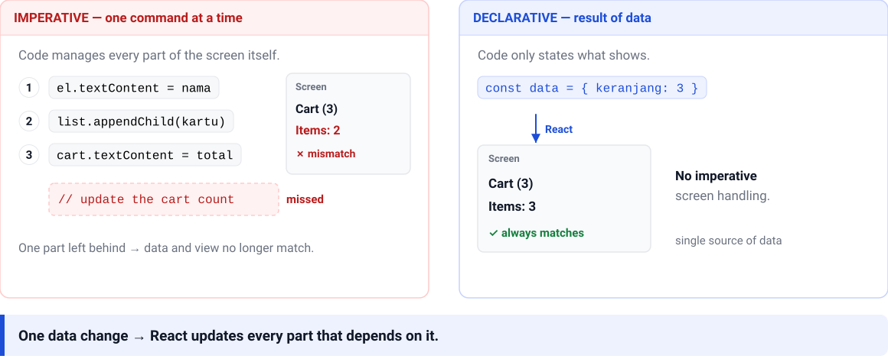

<!--
Analogy: imperative is like giving the driver a turn-by-turn list, whereas declarative
is like writing down the destination address and letting the driver pick the route.

Ask: "Which app have you seen where the data changes in one place but does not change
in another?" (Expected answer: a real experience, for example the item count on the
cart does not match the cart contents.)

A common misconception: declarative is taken to mean "writing no logic". What moves
is only the place of the logic, not the amount of it.
-->

---

## `UI = f(state)`: The View Is a Function of State

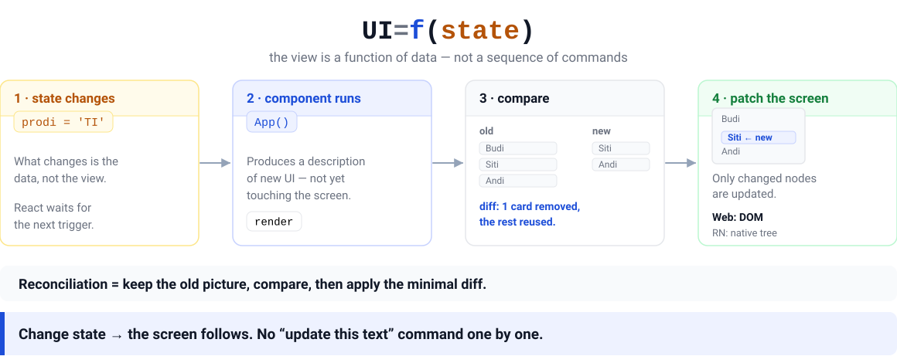

<!--
Link back to the term function from Chapter 3: a component receives data and returns
a view, exactly like a function that receives arguments and returns a value.

Stress that reconciliation is enough to understand as an idea, not to memorize in
detail: React keeps the old picture, compares it, then applies the differences.

Guiding question: "If the state does not change but the screen changes anyway, what is
wrong?" (Answer: something mutates data outside state, for example changing the
contents of an array directly.)
-->

---

## Components: The Smallest Unit of the UI

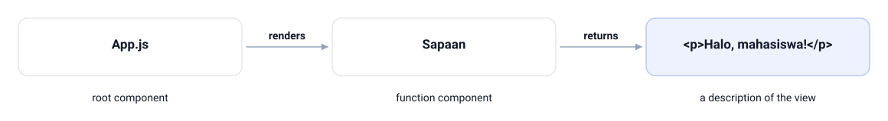

**A component** is a JavaScript function that receives data (props) and returns a description of the view.

- A large application is built from dozens of small components arranged together
- Modern React knows only **function components**, not class components

```jsx
export default function Sapaan() {
  return <p>Halo, mahasiswa!</p>;
}
```

<!--
Explain that a component is essentially an ordinary function: it can be named, called,
and returned by another component. Students already wrote functions like this in
Chapter 3, so the barrier is low.

Mention that <p> is an ordinary HTML element that may be written directly inside JSX;
in Chapter 5 elements like this are replaced by React Native components such as <View>
and <Text>.

Guiding question: "What is the difference between a component and an element?"
(Answer: a component is the function, an element is the result of calling it, a
description of the view.)

Warning: the component above does not appear on screen until it is imported and used
by a parent component. That is discussed on the practicum slide.

Mention once that <p>Halo, mahasiswa!</p> is written with JSX (JavaScript XML); its name
and rules are only discussed on the next slide.

Trimmed to the picture (the diagram says this):
- `App.js` at the project root is the **root component**: the entry point for the whole view (Chapter 2)

Path of the file whose body is below, moved off the slide so the picture and the code fit
on one screen together:
`components/Sapaan.jsx`
-->

---

## Six Rules for Writing JSX

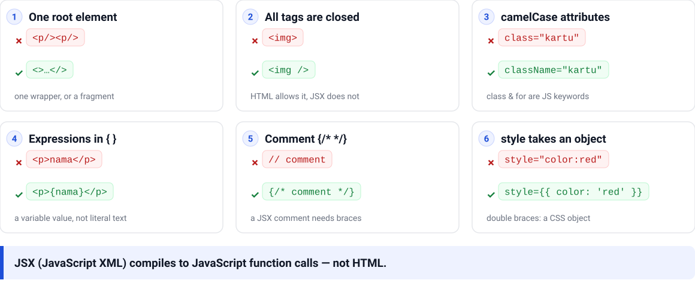

<!--
Make sure the term JSX (JavaScript XML) lands first: it is markup-like syntax that is
compiled into JavaScript function calls.

Do not read them in order. Start with the rules that most often cause errors in the
practicum: the camelCase rule and the single root element rule.

Show fragments with a quick example in the editor: two sibling elements without a
wrapper produce an error, and the solution is an empty opening tag and empty closing
tag.

Guiding question: "Why can JSX not write class like HTML?" (Answer: because class is a
reserved keyword in JavaScript; that is why React uses className.)

Mention that in React for the web every HTML element may be used directly, whereas
React Native components such as View and Text only appear in Chapter 5.
-->

---

## Props: Data from Parent to Child

**Props** (properties) are how data flows from a parent component to a child component — think of them as function parameters for a component.

`components/KartuMahasiswa.jsx`

```jsx
export default function KartuMahasiswa({ mahasiswa }) {
  return (
    <div>
      <p>{mahasiswa.nama}</p>
      <p>NIM {mahasiswa.nim}</p>
    </div>
  );
}
```

<!--
Stress one thing: the child component does not need to know where the data comes from.
Its use from the parent component looks like an ordinary HTML tag, for example
KartuMahasiswa mahasiswa={mahasiswaBudi}.

Link the curly braces in the parameter to the destructuring already learned in
Chapter 3, Section 3.6: a shorthand for unwrapping the props object.

Guiding question: "If the same data is displayed ten times, how many components must
be written?" (Answer: one, used ten times with different props.)

Warning: do not call props a "global variable"; props always flow in one direction from
parent to child.
-->

---

## Props: Read-only, Default Values, and `children`

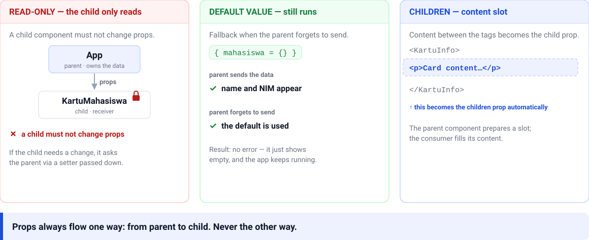

<!--
Stress the reason for read-only: if a child may change data owned by the parent, the
source of truth for the data becomes blurred. Data changes must be requested from the
owner, namely the parent component or a setter passed down.

Explain that in React 19.2 a default value is simply written in the function
parameter, as already used in Chapter 3; defaultProps is the old way.

Guiding question: "If the parent forgets to send the mahasiswa props, what happens?"
(Answer: the component still runs with the default value, no error.)

Warning: the children pattern is discussed again on the composition slide; do not jump
ahead to lifting state up, which only appears in Chapter 9.
-->

---

## State and `useState`

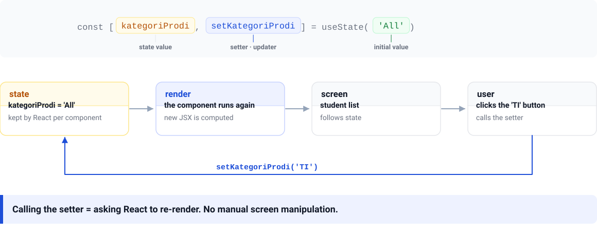

<!--
Analogy: props are like a parcel from outside whose contents may not be unpacked,
state is like a personal notebook its owner may rewrite.

Show it in the editor: pressing the button calls the setter, and the text on screen
changes without a single display-manipulation command being written.

Guiding question: "Which may a component change: props or state?" (Answer: only its own
state, and only through the setter.)

Warning: useState may not be called inside an if branch or a loop; this rule is repeated
on the hooks slide.
-->

---

## The Golden Rule: Immutability

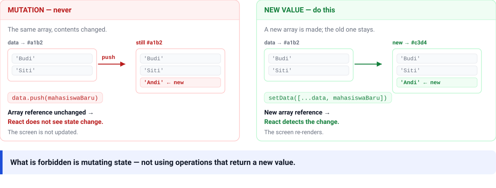

<!--
This is the slide most worth repeating if time allows. Show that push changes the
contents of the same array, so React does not see state as "changed"; the spread
operator makes a new array so React detects the change.

Link it to Chapter 3: the spread operator is already mastered, so what is new is only
the habit of using it to copy before changing.

Guiding question: "If the data is already correct but the screen does not change, what is
your first suspect?" (Answer: state mutated directly, not through the setter.)

Warning: many students conclude that arrays may not be changed at all. What is forbidden
is mutating state, not using operations that return a new value.
-->

---

## Props vs State

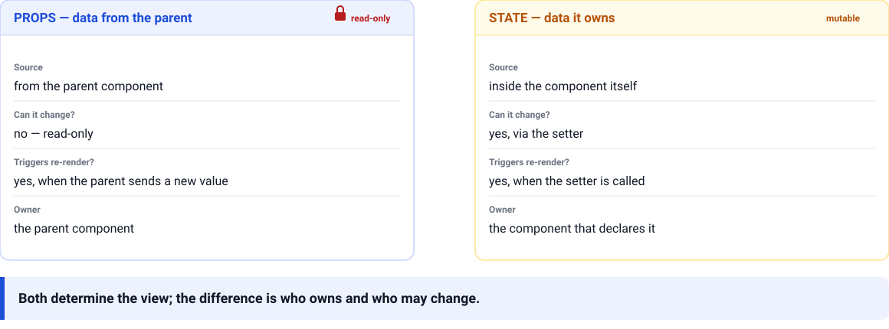

<!--
Do not read the table row by row. Compare the two columns through one example: the
program category is chosen by the user so it becomes state in App, whereas the student
object is sent to the card so it becomes props.

Practice with a quick question: "Is sedangMemuat props or state?" (Answer: state,
because it is managed and changed inside App itself.)

Warning: props can still trigger a re-render, but it is not the child that changes them;
the parent sends the new value. This subtle difference is often mixed up in exams.
-->

---

<!-- _class: lead -->
<!-- _paginate: skip -->

# Part 2 — Interaction, Rendering & Composition

Section 4.5 Event handling · 4.6 Conditional & list · 4.7 Composition · 4.8–4.9 Hooks

<!--
This part is the core of the practicum and the densest. If the meeting-5 time is tight,
move Section 4.9 (useMemo and useCallback) into the question-and-answer session, because
it is introductory in nature.

All the code discussed here comes together into one small application on the practicum
slide.
-->

---

## Event Handling: Hand Over a Function Reference

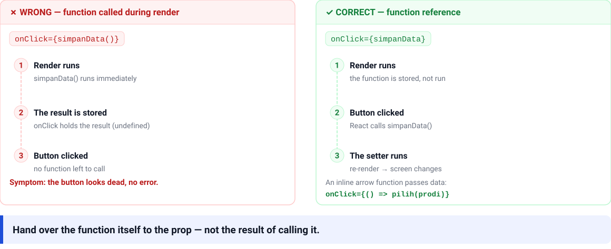

<!--
The core of this slide is one sentence: what is handed to onClick is the function
itself, not the result of calling it.

The classic mistake that must be shown directly in the editor: writing
onClick={ubahTampilDetail()} runs the function immediately at render, so the button
appears not to work.

Also explain the functional update in setDetailTampil: the new value is computed from
the old value, so it is safe even when the update happens several times in one batch.

Guiding question: "How do you carry data into the handler, for example the program
name?" (Answer: an inline arrow function, for example onClick={() => ubahKategoriProdi(prodi)}.)

Warning: <button> is an ordinary HTML element; its counterpart in React Native is
Pressable (the replacement for TouchableOpacity), which is only discussed in Chapter 5.
-->

---

## Conditional Rendering: Three Patterns

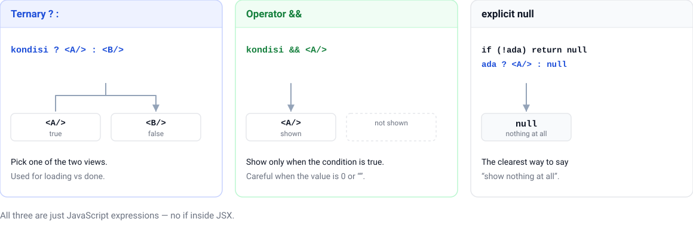

<!--
Stress that these three patterns use JavaScript expressions that return truthy and
falsy values, Chapter 3 Section 3.2 material, not a new feature of React.

Show one state driving two views at once: detailTampil determines the button text and
brings up the detail block at the same time. This is the cheapest example for
explaining UI = f(state).

Guiding question: "If the value is 0 or an empty string, is && still safe?" (Answer: be
careful, because 0 and the empty string are falsy values that can still be printed on
screen. For conditions like this use a ternary.)

Warning: empty conditions often make students write if inside JSX; remind them that only
an expression is needed.
-->

---

## List Rendering with `map`

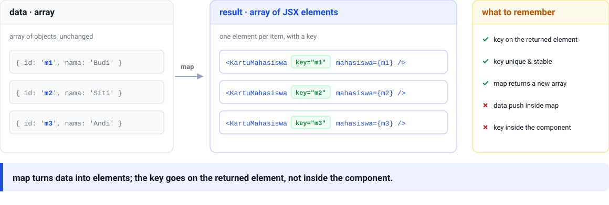

`components/DaftarMahasiswa.jsx`

```jsx
{data.map((mahasiswa) => (
  <KartuMahasiswa key={mahasiswa.id} mahasiswa={mahasiswa} />
))}
```

<!--
Connect it to composition: list rendering and reusable components are an inseparable
pair, because map produces the same component over and over.

Note where key is written: key goes on the element produced by map, not inside the
KartuMahasiswa component. This is the most frequent mistake.

Guiding question: "Why may the data not be changed inside map?" (Answer: because map
already returns a new array; mutating the data actually breaks the immutability rule.)

Warning: for a large list, do not conclude that map is always enough. FlatList is
introduced in Chapter 5.
-->

---

## `key`: Unique, Stable, Not the Index

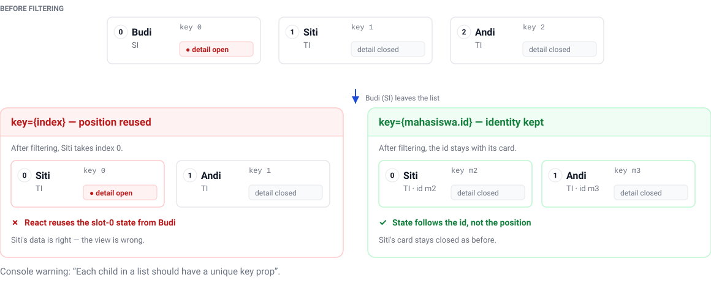

<!--
The closing slide of the list rendering series: stress the word stable. A key is not
merely unique, it also does not change between renders.

The most convincing example: a card whose detail is open moves to another card after
the list is filtered, because React thinks the old element at index 2 is the new element
at index 2.

Guiding question: "Why is Math.random() as a key actually worse than the index?"
(Answer: the key changes on every render, so React discards and rebuilds every element.)

Warning: a missing key does not stop the application; its warning is easy to ignore
precisely because the application keeps running. The bug appears later and is hard to
trace.
-->

---

<!-- _class: center -->

## What Happens If…?

- The list of five students uses `key={index}`, then you filter by program?
- A card has its detail open, then the list is re-sorted by name?
- How does React tell you when the list has a problem?

<!--
These scenarios are taken from this chapter's practicum. Ask students to write down
their guessed answers on paper for 2 minutes before the next slide is shown.

Do not confirm answers from the seats; just note who says the word "shift" or "swapped",
because that is the core of the answer.

If the class hesitates, give a hint: "What does React match the elements by?"
-->

---

<!-- _class: center -->

## Answers: The Detail Gets Stuck to Another Card

- The index shifts, so React matches the old element with the wrong element
- The `detailTampil` state of another card opens along with it — the data is correct, the view is wrong
- The console warning: *"Each child in a list should have a unique key prop"*

> The fix: `key={mahasiswa.id}` — unique and unchanged between renders.

<!--
Stress that this symptom is deceptive: students will blame swapped student data, when
the data is correct and what is wrong is React's element matching.

Show it in the editor: change the key to id, and the odd behavior disappears without
changing a single line of data logic.

Guiding question: "Why does React not just fix this problem itself?" (Answer: React does
not know the true identity of the data; only the developer knows it.)

Warning: do not suggest a random key as a shortcut; that moves the bug, it does not
remove it.
-->

---

## Component Composition & Reusable Components

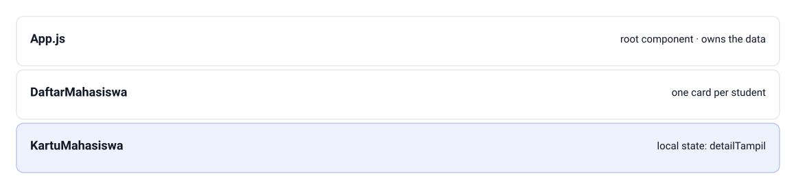

<!--
Explain the arrow direction once only: data flows down, whereas state stands where it
is declared. Do not re-read labels already visible on screen.

Mention the children pattern as the second way of passing the view: the parent
component defines a slot, its user fills that slot. The KartuInfo component in the
chapter is the example.

Guiding question: "If the button on Budi's card is pressed, does Siti's card open as
well?" (Answer: no, because detailTampil is local state in each card.)

Warning: do not invite students to split components too finely. The practical rule in
this chapter is just two: used in more than one place, or starting to get too long to
grasp at a glance.
-->

---

## Two Rules of Hooks That Must Not Be Broken

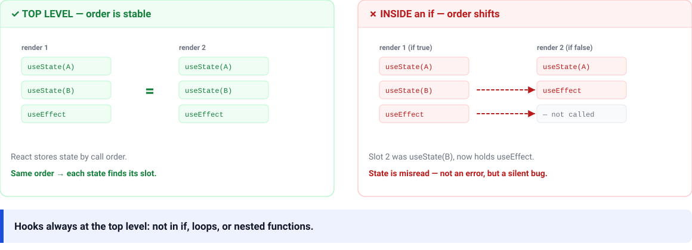

<!--
Stress the reason behind this rule: React does not store state by variable name, but
by call order. If the order shifts because a call sits inside a branch, React reads the
wrong state.

Mention that ESLint in the Expo project already warns when this rule is broken,
so students need not memorize it without a tool to help them.

Guiding question: "Why is useEffect inside if dangerous?" (Answer: in some renders the
effect is called and in others it is not, so the hooks order shifts.)
-->

---

## `useEffect`: Side Effects and Cleanup

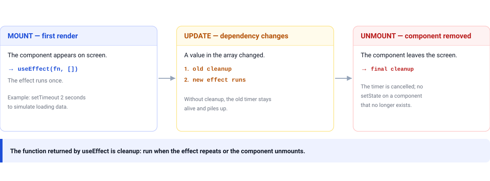

<!--
Explain the two arguments of useEffect: the effect function and the dependency array.
The effect function runs after the component renders, whereas the array determines when
it is run again.

The returned function is cleanup: called when the component is removed or before the
effect is run again. Without cleanup, a timer keeps running and can trigger a state
update on a component that no longer exists.

Mention that in development mode React deliberately runs effects twice to help find
effects that are not clean; this is normal and not a bug in the student's code.

Guiding question: "What is the difference between [] , [dep], and no array at all?"
(Answer: once on mount, re-run when dep changes, and on every render.)

Warning: this effect is a simulation of data loading, not real data fetching. The real
loading state is discussed in Chapter 10.
-->

---

## Lifecycle: Mount, Update, Unmount

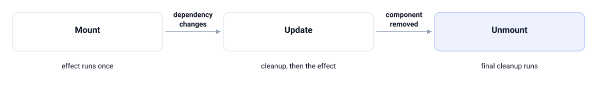

<!--
Remind them that the terms mount and unmount will appear again in the navigation
lifecycle in Chapter 7, so they must be used with a consistent meaning.

A simple analogy: turning a lamp on when entering a room, adjusting its brightness when
conditions change, and turning it off when leaving the room.

Guiding question: "If the dependency array is dropped entirely, when does the effect
run?" (Answer: on every render, rarely desirable, and often a source of performance
problems.)

Warning: do not equate lifecycle with the working order of class components. In modern
React everything is managed through effects.
-->

---

## `useMemo` and `useCallback`: When to Use Them

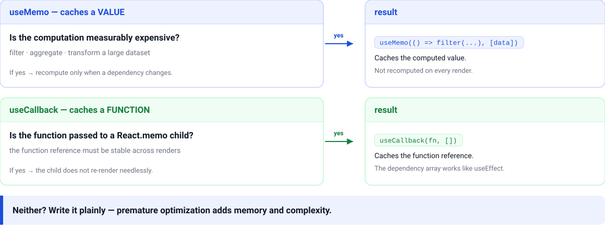

<!--
Stress the word measurable in the last column. An optimization is made because there is
evidence of load, not because of habit or fashion.

Explain the division of labor in one sentence: useMemo stores a value, useCallback
stores a function. Both use a dependency array that works the same way as in useEffect.

Guiding question: "If useMemo is used on every computation, what is the consequence?"
(Answer: it is not only useless, it adds memory use and makes the code harder for a
reader.)

Warning: this chapter's practicum does use useMemo for the filter and the GPA average as
an illustration of the pattern; say plainly that on data this small the benefit is only
felt once the data grows.
-->

---

## The Event Flow: One Tap, One Re-render

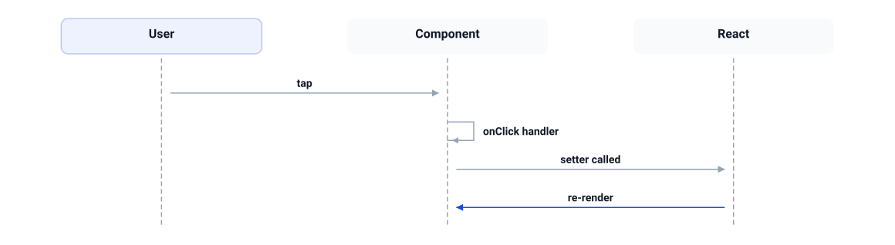

<!--
This slide summarizes the middle of the chapter. Ask students to retell this chain in
their own sentences before you explain it.

Test it with the essay question in the chapter: explain the complete flow from pressing
the Tampilkan Detail button until the detail block appears. A correct answer mentions the
handler, the setter, the re-render, and conditional rendering.

Guiding question: "Why can the screen not change without a setter?" (Answer: because
React only knows state has changed if the setter is called; a direct mutation is not
detected.)
-->

---

## Case Study: Academic Data at BAAK

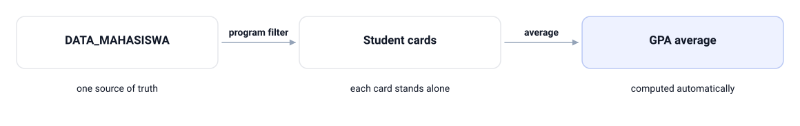

The academic administration office answers dozens of questions a day; staff sift through spreadsheet files manually — slow, and prone to copy errors.

- One source of truth: data is separated from the view, so there are never two versions of a number
- Each card stands alone, so a mistake in one card does not spread to another
- The GPA average is computed automatically from the displayed data, not typed by hand
- When the data comes from a server in Chapter 10, the component structure does not change

<!--
Tell it as a story of a user need, not as a list of features. The goal is for students
to see that the whole of this chapter closes one real problem.

Stress two things: data separated from the view makes the migration to a server almost
free, and an aggregate computed automatically cannot be out of sync with the list being
displayed.

Guiding question: "What changes in the components when DATA_MAHASISWA is replaced by
the result of fetch?" (Answer: almost nothing, only the data source.)

Warning: this case is the forerunner of the Student Data Management Application
towards the final project; do not design features beyond this chapter's scope.

Trimmed to the picture (the diagram says this):
- The application displays student data **dynamically**: program filter and aggregate summary
-->

---

## Practicum: Sequence of Work Steps

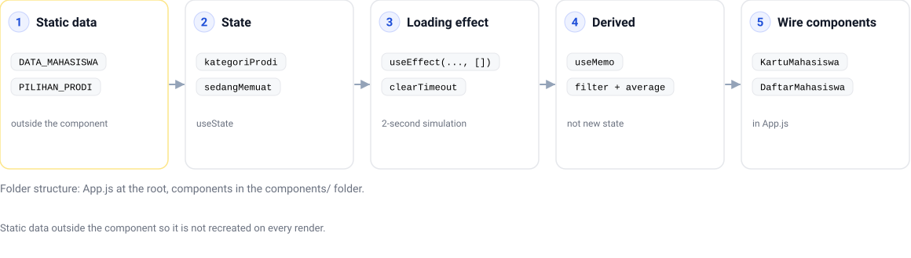

<!--
Mention the minimal folder structure out loud: App.js at the root, then a components
folder holding DaftarMahasiswa.js and KartuMahasiswa.js.

Remind them why static data is placed outside the component: DATA_MAHASISWA and
PILIHAN_PRODI do not need to be recreated on every render.

Guiding question: "Why is key not written inside KartuMahasiswa?" (Answer: because key
is needed on the element produced by map, not inside its component.)

Warning: the first two hours are usually spent on environment failures, not on logic.
Point students to this chapter's Troubleshooting section if the application will not run
before guessing at the logic.
-->

---

## Key Code: `KartuMahasiswa.js`

`kode/bab-04-dasar-react/components/KartuMahasiswa.js`

```jsx
export default function KartuMahasiswa({ mahasiswa }) {
  const [detailTampil, setDetailTampil] = useState(false);

  const ubahTampilDetail = () => {
    setDetailTampil((tampilSebelumnya) => !tampilSebelumnya);
  };
  return (
    <div className="kartu">
      {/* … rincian kartu: bagian kanan, tombol, dan blok detail … */}
      <p className="nama">{mahasiswa.nama}</p>
      <p className="nim">NIM {mahasiswa.nim}</p>
    </div>
  );
}
```

<!--
The code on this slide is truncated to fit the screen; the complete file is in the
kode/bab-04-dasar-react folder and inside the chapter.

Show only three things in the code: the mahasiswa props enter through the parameter,
the detailTampil state belongs to that card itself, and the ubahTampilDetail handler is
handed to the button element. The other JSX parts are marked with an ellipsis and need
not be read out.

Guiding question: "Which line makes pressing the button change the screen?" (Answer: the
setDetailTampil call inside the handler; the handler itself only receives the event.)

Warning: the styling (className and CSS) and layout are deliberately not discussed here,
because the topic appears for React Native in Chapter 5.
-->

---

## Practicum Troubleshooting

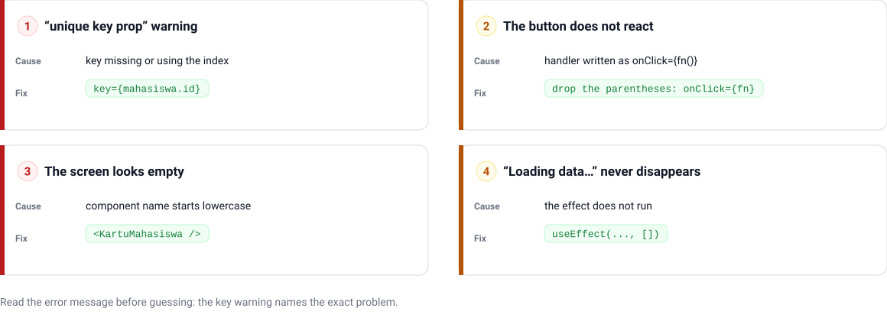

<!--
Pick the two rows that happen most often in your class, usually the first and second
rows, then discuss them thoroughly.

Read out the pattern: read the error message before guessing. The key warning names the
problem exactly, whereas the third row often produces no message at all, so it must be
checked from how the component name is written.

There is one more that does not fit the table: "Maximum update depth exceeded", an update
loop because a setter is called in the component body or in an effect without a
dependency. Mention it as an advanced case.

Warning: do not suggest that students patch it with a random key or turn off the ESLint
warning; that hides the symptom, not the cause.
-->

---

## Application in IS/IT Practice

| Practice in this chapter | Continues into |
|---|---|
| The `KartuMahasiswa` component for the student list | Chapter 5: `FlatList` and React Native components |
| Local state for each card's detail | Chapter 8: forms and controlled components |
| Static data inside the code | Chapter 10: `fetch` to a REST API and loading state |
| State held by the `App` parent component | Chapter 9: lifting state up and the Context API |
| Filter and average as pure logic | Chapter 14: function testing |

<!--
This slide answers the question "when do I use all of this?". Each row connects one
decision in this chapter with the chapter where that decision is tested or extended.

Stress the last row: it is the pure aggregate logic that is later tested automatically,
so keeping computation outside the view is not merely tidiness.

Guiding question: "If student data later comes from a server, which row changes?"
(Answer: the third row, the data source; the components stay.)

Warning: lifting state up and the Context API are Chapter 9 material. Here it is enough
to mention them as the continuation, do not explain them further.
-->

---

<!-- _class: center -->

## Mini Quiz

- What is the difference between props and state, and which one triggers a re-render?
- We write `onClick={simpanData()}` — what happens when the application runs?
- When does `useEffect(() => {...}, [])` run, and when does its cleanup run?
- When is `useMemo` genuinely needed?

<!--
A five-minute oral quiz: show the questions, ask students to answer in pairs, then move
on to the answer slide. Do not leak the answers on this slide.

If more than half the class gets the second question wrong, repeat the onClick
demonstration in the editor before closing the meeting.
-->

---

<!-- _class: center -->

## Answers (1/2)

- Props are read-only from the parent; internal state is changed through the setter
- Both trigger a re-render — the difference is who owns them and who may change them
- `onClick={simpanData()}` runs the function at render time, not when pressed

<!--
Repeat the distinction most often confused: onClick receives a function reference, not
the result of calling it.

Stress that the second answer deliberately affirms that both trigger a re-render,
so students do not conclude that only state is able to change the screen.
-->

---

<!-- _class: center -->

## Answers (2/2)

- `useEffect(fn, [])` runs once on mount; cleanup on unmount or when the effect re-runs
- `useMemo` is needed when the computation is measurably expensive (large-data filter/aggregation/transformation)
- `useCallback` is needed when a function is passed to a child wrapped in `React.memo`

<!--
Stress the word measurable in the useMemo answer: an optimization is made because there
is evidence of load, not because of habit. One distinguishing sentence: useMemo stores a
value, useCallback stores a function.

If many miss the last question, recall the premature optimization slide and stop there.
-->

---

## Summary

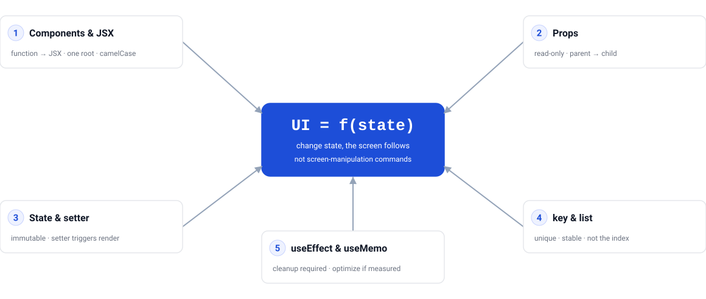

<!--
Do not read it out. Ask students to pick one number and explain it in their own words;
this works far better than repeating the reading.

Stress numbers 1 and 4 as the two sentences most worth remembering from this chapter.

Closing message: from now on, every "data changed but the view did not" bug has its own
checklist, namely setter, immutability, and key.
-->

---

## Class Discussion and Reflection

<div class="grid2">
<div>

**Discussion**

- What changed in your picture of how the screen is updated?
- Why is the bug "the data changed, the view did not" hard to trace?

</div>
<div>

**What is assessed**

- Precision of terms: props, state, re-render, cleanup
- Not memorization, but the reason for using `useMemo`

</div>
</div>

> The comprehension, practice, analysis, and challenge questions of this chapter form the material for Chapter 4 Exercises and are assessed through the practicum rubric in Appendix A.

<!--
Give three minutes in pairs, then collect two to three answers. The first question is
reflective, so there is no wrong answer; what is assessed is the courage to admit the old
intuition.

The second question connects reflection with practice: that bug is hard to trace because
the data really is correct, so the check usually stops at the data and never reaches the
re-render mechanism.

Ask students to write their answers briefly, because the Chapter 4 challenge asks for a
comparison of the local state pattern with state in the parent, which is the doorway into
Chapter 9.
-->

---

## References

| Source | Link |
|---|---|
| React documentation (2026) | react.dev |
| React Native documentation (2026) | reactnative.dev |
| Expo documentation (2026) | docs.expo.dev |
| JavaScript, MDN Web Docs (2026) | developer.mozilla.org |
| Node.js documentation (2026) | nodejs.org |

<div class="grid2">
<div>

**Further reading**

- Chapter 5 — React Native Fundamentals

</div>
<div>

**Technology versions in this book**

- Expo SDK 57 · React Native 0.86 · React 19.2 · Node.js LTS ≥ 22

</div>
</div>

<!--
The complete references are in Appendix D. The Appendix C glossary has 60 entries (for
example Hook, Props, State, and JSX); the terms reconciliation and immutability are
explained on slide 8 and slide 14, with the glossary equivalents
rekonsiliasi/pencocokan and ketidakberubahan.

The primary source for this chapter is the official react.dev documentation, not blogs or
forum answers that may already be out of date for React 19.2.

Remind them that the technology versions used in this book are pinned to Expo SDK 57,
React Native 0.86, React 19.2, and Node.js LTS at least 22.
-->

---

<!-- _class: lead -->
<!-- _paginate: skip -->

# Ready for Chapter 5

**Assignment:** complete Practicum 4 — a reusable `KartuMahasiswa` component and a static student list — plus Chapter 4 Exercises.

Next meeting: React Native display components — `View`, `Text`, `FlatList`, and Flexbox.

<!--
Close with one sentence: "Today we learned to cook the ingredients; Chapter 5 teaches
how to plate them."

State the Chapter 4 Exercises deadline explicitly, then repeat that the practicum is
assessed with the practicum rubric in Appendix A: conceptual understanding 15%,
implementation 25%, code quality 15%, UI/UX 15%, debugging 10%, and documentation 20%.
-->
