<!-- _class: lead -->
<!-- _paginate: skip -->
<!-- _footer: "" -->

# Bab 5 — Dasar-Dasar React Native

Component inti, layout, dan perbedaan platform · Pertemuan 6

<!--
Buka dengan menyambung Bab 4: "Di Bab 4 kita belajar cara berpikir React. Hari ini abjad
visualnya, dan hasilnya satu layar sungguhan di HP."

Pertanyaan pembuka: "Kalau cara berpikirnya sama dengan React, kenapa kodenya harus
berbeda?" Tampung dua sampai tiga jawaban tanpa dikoreksi, karena jawabannya baru muncul
di subbab 5.1 pada slide berikutnya.
-->

---

## Tujuan Pembelajaran

Setelah bab ini, kamu bisa:

- Menjelaskan beda React untuk web dan React Native
- Mengenali peran component inti React Native
- Menerapkan `StyleSheet`, array style, dan gaya kondisional
- Menyusun layout responsif dengan Flexbox dan `useWindowDimensions`
- Memilih scroller yang tepat dan menangani perbedaan platform

<!--
Bacakan verbanya saja, jangan seluruh butir. Butir ketiga dan keempat adalah inti
praktikum: keduanya dipakai langsung di layout profil mahasiswa.

Kaitkan dengan penilaian: hasil praktikum bab ini menjadi fondasi antarmuka Bab 6
(membangun UI) dan Bab 7 (navigasi), dan dinilai dengan rubrik praktikum di Lampiran A.

Salah paham yang perlu dicegah: belajar component bukan latihan menghafal nama properti,
tetapi tahu kapan memakai component yang mana.
-->

---

<!-- _class: lead -->
<!-- _paginate: skip -->

# Bagian 1 — Dua Dunia React

subbab 5.1 React untuk web vs React Native

<!--
Bagian ini singkat, tetapi menentukan seluruh bab. Kalau waktu pertemuan mepet, bagian ini
tetap tidak boleh dipotong: tanpa bagian ini, component di Bagian 2 terasa seperti hafalan
tanpa alasan.

Analogi yang bisa dipakai: bahasa yang sama, tetapi dua penerbit yang berbeda.
-->

---

## React 2013, React Native 2015: Gagasan Sama, Media Beda

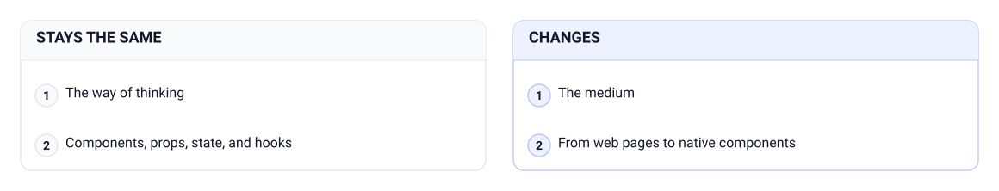

- React lahir 2013: JSX dirender `react-dom` menjadi elemen DOM
- Facebook merilis React Native 2015 dengan gagasan yang sama
- Harganya: sebagian fitur platform butuh native module tambahan

<!--
Dipotong ke gambar (diagram yang mengatakan ini):
- Yang tetap: component, props, state, dan hook (Bab 4)
- Yang berubah: mediumnya, dari halaman web ke component native

Tegaskan bahwa yang berganti hanya target render, bukan cara berpikir. Mahasiswa yang
sudah lulus Bab 4 sudah menempuh separuh bab ini.

Analogi: resep yang sama, tetapi dapur dan alat masaknya berbeda, jadi cara menyajikannya
harus disesuaikan.

Pertanyaan penuntun: "Modul React apa yang merender ke DOM?" (Jawaban: react-dom. React
Native tidak memakainya.)

Salah paham: "React Native adalah versi baru React." Bukan versi baru, tetapi target
render yang berbeda.
-->

---

## Gagasan 2015 Itu Masih Sama Sampai Hari Ini

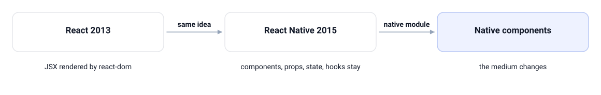

- Yang tetap: component, props, state, dan hook yang kamu tulis di Bab 4
- Yang berubah: halaman web diganti component milik sistem operasi

> Kalau Bab 4 sudah kamu kuasai, separuh bab ini sudah kamu lewati.

<!--
Tekankan dua hal yang paling sering tertukar: yang berganti adalah media render, bukan cara
berpikir; dan harga dari gagasan itu adalah native module tambahan saat ada fitur platform
yang belum dijangkau.

Pertanyaan penuntun: "Kalau kodenya tetap JavaScript, apa yang menjadi native?" (Jawaban:
antarmuka yang ditampilkan.)

Peringatan waktu: slide ini jangan lebih dari dua menit; sisa waktu dibutuhkan untuk
latihan component di Bagian 2.
-->

---

## JSX yang Sama Berakhir di Component Native

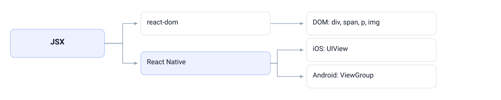

> `View` digambar sebagai `ViewGroup` di Android dan `UIView` di iOS — bukan kotak di dalam halaman web.

<!--
Tunjukkan bahwa React Native merender component milik sistem operasi, yaitu UIView di iOS
dan ViewGroup di Android. Karena itulah tampilan aplikasi terasa native, bukan halaman web
yang dibungkus cangkang.

Bandingkan dengan Bab 1: di sana kita membahas arsitektur dan trade-off, di sini kita
melihat akibatnya saat menulis kode.

Pertanyaan penuntun: "Kalau View menjadi ViewGroup di Android, apa artinya bagi
pengembang?" (Jawaban: framework yang memetakan, pengembang cukup menulis JSX.)

Ingatkan bahwa diagram ini disusun dari Tabel 5.1 bab ini, bukan dari sumber lain.
-->

---

<!-- _class: compact -->

## Tabel 5.1 — Enam Hal yang Berganti saat Pindah ke Mobile

| Aspek | React (web) | React Native |
|---|---|---|
| Elemen | DOM: `div`, `span`, `p`, `img` | Component: `View`, `Text`, `Image` |
| Styling | File CSS: selector, cascade | Objek JavaScript: `StyleSheet` |
| Layout | Box Model + Flexbox, bawaan `row` | Yoga: Flexbox, bawaan `column` |
| Event sentuh | `onClick`, `onMouseEnter` | `onPress`, `onLongPress` |
| Navigasi | URL browser, react-router | Tanpa URL (Bab 7: Expo Router) |
| API browser | `document`, `window` | Tidak ada (Bab 12: modul Expo) |

<!--
Bandingkan kolomnya, bukan barisnya. Mulai dari baris layout dan API browser, karena dua
baris itulah yang paling sering membuat error di praktikum.

Baris API browser adalah kuncinya: tanpa browser, tidak ada document, tidak ada window, dan
tidak ada localStorage, jadi tutorial web tidak bisa disalin mentah-mentah ke React Native.

Pertanyaan penuntun: "Kenapa kode yang memakai localStorage gagal di React Native?"
(Jawaban: localStorage bagian dari browser, tidak tersedia di runtime mobile.)

Salah paham: "React Native sama dengan web, hanya ukurannya lebih kecil."
-->

---

<!-- _class: lead -->
<!-- _paginate: skip -->

# Bagian 2 — Component Inti

subbab 5.2 View & Text · 5.3 Image · 5.4 Pressable · 5.5 TextInput · 5.6 daftar · 5.7 safe area

<!--
Bagian terpanjang dan paling praktis. Setiap component dibahas dengan pola yang sama: apa
itu, kapan dipakai, dan apa kesalahan umumnya.

Saran pengelolaan waktu: tidak lebih dari dua menit per component, dan sisakan waktu untuk
praktikum layout.
-->

---

## Hanya `Text` yang Boleh Membawa Tulisan

**`View` — wadah serbaguna**

- Padanan `div`: tempat menyusun dan membungkus layout
- Isinya component lain, bukan teks mentah

**`Text` — satu-satunya pembawa teks**

- Setiap judul, label, dan angka harus berada di dalam `Text`
- Boleh bersarang untuk mencampur gaya dalam satu kalimat
- `numberOfLines` memotong teks panjang dengan elipsis

> `<View>Halo!</View>` ✗ memicu error · `<View><Text>Halo!</Text></View>` ✓

<!--
Tegaskan satu aturan saja: hanya Text yang boleh menampilkan teks. Mahasiswa yang datang
dari web hampir selalu menulis teks langsung di dalam View.

Demonstrasi cepat: minta satu mahasiswa menebak apa yang terjadi kalau aturan itu
dilanggar. (Jawaban: layar merah dengan error, bukan sekadar peringatan.)

Pertanyaan penuntun: "Kalau Text boleh bersarang, apa manfaatnya?" (Jawaban: menegaskan
sebagian kalimat, misalnya satu kata ditebalkan.)

Salah paham: menganggap View sama dengan div dalam segala hal, padahal View tidak bisa
menampung teks.
-->

---

<!-- _class: compact -->

## Satu `View`, Dua `Text`, dan Satu Kalimat Bersarang

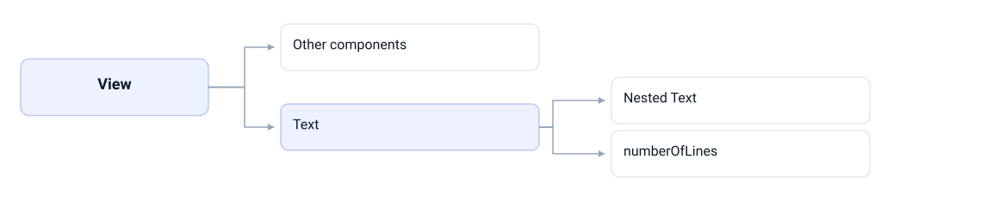

```jsx
import { StyleSheet, Text, View } from 'react-native';

export default function App() {
  return (
    <View style={styles.kartu}>
      <Text style={styles.judul}>Sistem Informasi Akademik</Text>
      <Text numberOfLines={2}>
        Selamat datang di aplikasi <Text style={styles.tebal}>mobile</Text>…
      </Text>
    </View>
  );
}
// styles: kartu, judul, tebal — lengkap di buku, Subbab 5.2
```

<!--
Kode ini ada di App.js pada project praktikum. Tunjukkan tiga hal saja: gayanya berasal dari
objek styles, Text kedua bersarang, dan numberOfLines membatasinya dua baris supaya tinggi
kartu tidak berubah.

Jelaskan bahwa StyleSheet lengkapnya ada di buku (subbab 5.2), jadi mahasiswa tidak perlu
menyalinnya dari slide.

Pertanyaan penuntun: "Apa yang terjadi kalau numberOfLines dihapus?" (Jawaban: kartu
memanjang mengikuti panjang teks, dan layout di bawahnya ikut bergeser.)

Dipotong ke gambar (diagram yang mengatakan ini):
- `View` hanya menerima component sebagai anak, bukan teks mentah
- `Text` boleh bersarang dan menerima `numberOfLines`
-->

---

## Kotak Kosong Selama Foto Masih Diunduh

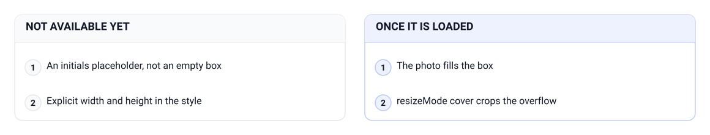

- Selama foto belum selesai diunduh, kotak gambar masih kosong
- Isi dengan inisial nama lewat pola `AvatarPlaceholder` di praktikum
- `resizeMode="cover"` mengisi kotak dengan memotong bagian yang berlebih

<!--
Alasan dimensi wajib: React Native tidak bisa menebak ukuran piksel gambar yang belum
selesai diunduh, sehingga gambar tanpa width dan height berukuran nol.

Pola inisial dari praktikum dijelaskan di sini secara singkat; component
AvatarPlaceholder dibahas penuh di praktikum. Alternatif cache dengan expo-image disebut
sebagai bahan lanjutan, bukan materi wajib bab ini.

Pertanyaan penuntun: "Kenapa logo sebaiknya di-bundle, bukan diambil dari server?"
(Jawaban: selalu muncul walaupun tanpa internet.)

Kedua butir itu sudah tertulis di slide; gambar hanya menegaskan bahwa kotak yang belum
terisi adalah keadaan normal sesaat, bukan kesalahan kode.
-->

---

## Satu Gambar, Dua Sumber: Aset Lokal atau URL

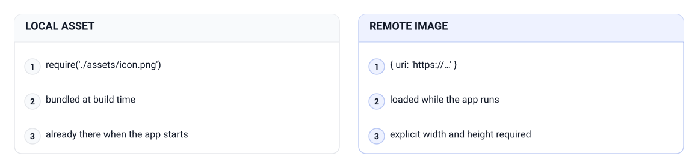

- Aset lokal: `require('./assets/icon.png')`, ikut di-bundle saat build
- Gambar jarak jauh: `{ uri: 'https://…' }`, dimuat saat aplikasi berjalan
- Yang jarak jauh wajib diberi `width` dan `height` eksplisit di style

<!--
Bandingkan dua sumber ini lewat pengalaman: aset lokal selalu ada di dalam aplikasi,
sedangkan gambar jarak jauh bergantung pada jaringan.

Pertanyaan penuntun: "Apa yang terjadi kalau perangkat tidak punya internet?" (Jawaban:
kotak gambar kosong, dan di situlah pola inisial membantu.)

Salah paham: menulis `src` seperti pada tag `img` di web. Di React Native namanya `source`.

Salah paham kedua: menganggap gambar lokal tidak perlu dimensi. Tetap perlu ditulis di
style.
-->

---

<!-- _class: compact -->

## URL Salah Tidak Terlihat sampai Gambar Gagal

`File: App.js` — gambar jaringan dengan dimensi eksplisit

```jsx
import { Image, StyleSheet } from 'react-native';

export default function FotoMahasiswa() {
  return (
    <Image
      source={{ uri: 'https://example.com/foto/2201001.jpg' }}
      style={styles.foto}
      resizeMode="cover"
    />
  );
}
const styles = StyleSheet.create({
  foto: { width: 72, height: 72, borderRadius: 36 },
});
```

> URL `example.com` hanya placeholder — ganti dengan URL gambar sungguhan saat mencoba.

<!--
Tunjukkan bahwa example.com sengaja dipakai sebagai placeholder supaya URL karangan tidak
dianggap nyata; ganti dengan URL sungguhan saat berlatih.

Tunjukkan juga bahwa borderRadius sebesar separuh lebar menghasilkan foto bulat, pola yang
sama dengan avatar inisial di praktikum.

Pertanyaan penuntun: "Apa yang terjadi kalau perangkat tidak punya internet?" (Jawaban:
kotak gambar kosong, dan di situlah pola inisial membantu.)

Salah paham: menaruh dimensi di props, padahal tempatnya di style.
-->

---

<!-- _class: compact -->

## Tombol Harus Terasa Merespons Sentuhan

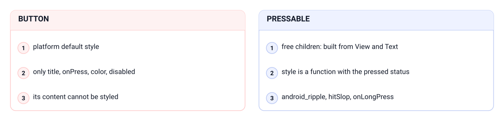

**`Button` — siap pakai, terbatas**

- Hanya `title`, `onPress`, `color`, `disabled`; isinya tidak bisa diberi gaya

**`Pressable` — pilihan utama**

- Anak bebas: tombol disusun dari `View` dan `Text`
- `style` berupa fungsi yang menerima status `pressed`

<!--
Dipotong ke gambar (diagram yang mengatakan ini):
- Gaya bawaan platform: teks biru di iOS, tombol berwarna di Android
- `android_ripple`, `hitSlop`, `disabled`, dan `onLongPress`
- `Button` cukup untuk prototipe cepat; `Pressable` adalah component sentuh utama buku ini

Tegaskan umpan balik sentuhan: pengguna harus merasa tombolnya merespons. Tanpa itu,
pengguna menekan berulang kali dan mengira aplikasinya membeku.

Sebutkan bahwa keluarga TouchableOpacity masih banyak di kode lama, tetapi Pressable
menggantikan perannya. Ini contoh nyata API usang yang tidak dipakai buku ini.

Pertanyaan penuntun: "Kapan Button masih pilihan yang wajar?" (Jawaban: prototipe cepat
atau tombol sekali pakai tanpa desain khusus.)

Salah paham: menganggap Button lebih mudah sehingga lebih baik. Kemudahannya justru berarti
gayanya tidak bisa disesuaikan.
-->

---

## Gaya Bisa Berubah Saat Tombol Ditekan

`File: App.js` — tombol dengan umpan balik saat ditekan

```jsx
import { Pressable, StyleSheet, Text } from 'react-native';

export default function TombolSimpan() {
  return (
    <Pressable
      onPress={() => console.log('Tombol ditekan')}
      style={({ pressed }) => [styles.tombol, pressed && styles.tombolTertekan]}
      android_ripple={{ color: '#c9d9f8' }}
    >
      <Text style={styles.labelTombol}>Simpan Data</Text>
    </Pressable>
  );
}
// styles: tombol, tombolTertekan, labelTombol — lengkap di buku, Subbab 5.4
```

<!--
Ini contoh pertama style kondisional di bab ini: pressed bernilai benar selama jari
menekan, jadi gaya tombolTertekan hanya aktif saat itu.

Jelaskan hitSlop sebagai perluasan area sentuh tanpa mengubah tampilan, karena sasaran
sentuh yang terlalu kecil sulit dikenai jari.

Pertanyaan penuntun: "Kenapa gaya pressed diletakkan paling akhir di dalam array?"
(Jawaban: gaya yang ditulis terakhir menimpa yang lebih awal, jadi aman menimpa gaya
dasar.)

Salah paham: menganggap android_ripple juga muncul di iOS. Efek riak itu khas Android.
-->

---

## Kotak Isian Terikat ke State, Bukan ke Dirinya Sendiri

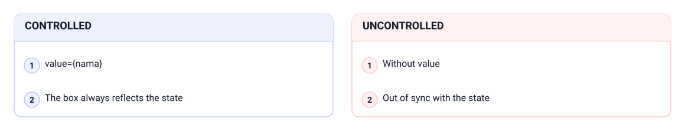

- Satu `state` menyimpan nilainya, `onChangeText` memperbaruinya tiap ketikan
- `value={nama}` membuat kotak selalu mencerminkan state
- Tanpa `value`, kotak menjadi uncontrolled dan tidak sinkron dengan state
- Properti dasar: `keyboardType`, `secureTextEntry`, `multiline`, `maxLength`
- Detail papan ketik dan validasi dibahas penuh di Bab 8

<!--
Sambungkan dengan Bab 4: ini penerapan langsung pola state. Setiap ketikan memanggil
setNama, state berubah, component di-render ulang, dan teks di bawahnya ikut berubah.

Tegaskan bahwa controlled component adalah kebiasaan yang dipakai sepanjang buku, termasuk
formulir data mahasiswa di Bab 8.

Pertanyaan penuntun: "Apa yang terjadi kalau value ditulis tetapi onChangeText tidak?"
(Jawaban: pengguna tidak bisa mengubah kotak, karena nilainya terkunci oleh state.)

Salah paham: menganggap value hanya nilai awal, padahal ia mengikat state sepanjang umur
component.
-->

---

<!-- _class: compact -->

## Satu Ketikan Memutar Rantai yang Sama

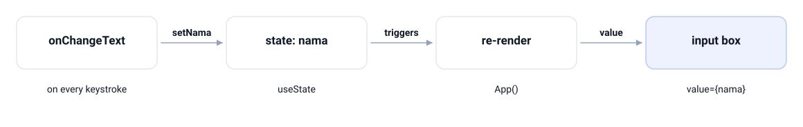

```jsx
export default function App() {
  const [nama, setNama] = useState('');
  return (
    <View style={styles.form}>
      <TextInput
        style={styles.input}
        value={nama}
        onChangeText={setNama}
        placeholder="Ketik nama lengkap"
      />
      <Text>Halo, {nama ? nama : 'belum ada nama'}!</Text>
    </View>
  );
}
```

<!--
Jelaskan gambar sebagai rantai: ketikan memanggil onChangeText, state berubah, component
di-render ulang, lalu value mengikat kotak kembali ke state. Gambar hanya menggambar rantai
satu arah; panah kembalinya ada di kalimat value={nama}.

Tunjuk tiga baris yang menentukan di kode: value, onChangeText, dan baris Text yang
menampilkan state. Ketiganya membentuk lingkaran state yang sama seperti di Bab 4.

Contoh singkat di depan kelas: minta mahasiswa menebak apa yang tampil sebelum pengguna
mengetik apa pun. (Jawaban: sapaan ditambah teks cadangan, karena nama masih kosong.)

Peringatan: detail papan ketik, termasuk papan ketik yang menutupi kotak isian, baru
dibahas di Bab 8, jadi jangan diselesaikan sekarang.
-->

---

<!-- _class: center -->

## Apa yang Terjadi Jika…?

- Dua `View` ditumpuk tanpa menulis `flexDirection` sama sekali?
- Satu layar memuat scroller di dalam scroller dengan arah yang sama?
- `keyExtractor` pada `FlatList` dibiarkan kosong?

Jawaban skenario 2 dan 3 ada di dua slide berikutnya; skenario 1 di subbab 5.9.

<!--
Minta kelas menjawab bersama atau mengangkat tangan sebelum lanjut. Jangan beri petunjuk
jawabannya.

Skenario ketiga sengaja diulang sebagai penguatan: pertanyaan ini muncul di evaluasi bab,
dan jawabannya adalah peringatan unique key di console.

Kalau kelas diam pada pertanyaan pertama, beri dorongan: "Arah Flexbox bawaan di web itu
apa?" Jawaban skenario pertama baru datang di subbab 5.9, di bagian ketiga pertemuan ini.
-->

---

## Satu Layar, Satu Scroller Utama

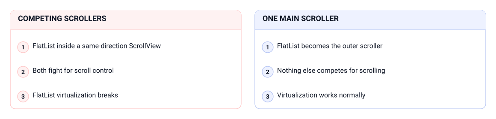

- `FlatList` di dalam `ScrollView` searah memicu peringatan VirtualizedLists
- Keduanya berebut kendali gulir, sehingga virtualisasi `FlatList` rusak
- Perbaikannya: `FlatList` menjadi scroller luar, isi tetap masuk `ListHeaderComponent`
- Alternatifnya: satu `ScrollView` saja kalau seluruh halaman berstruktur tetap
- Peringatan ini benar-benar muncul di console Metro, bacalah (Bab 14)

<!--
Aturan ini diambil dari bagian troubleshooting bab ini dan menjadi inti jawaban soal
analisis di akhir bab; slide ini sekaligus menjawab skenario kedua dari slide tanya jawab
tadi. Tegaskan bahwa kesalahan ini tidak langsung merusak aplikasi, tetapi merusak performa
tanpa terasa.

Tunjukkan pola dari kode praktikum: kartu profil diletakkan sebagai ListHeaderComponent di
dalam FlatList, bukan dibungkus ScrollView.

Pertanyaan penuntun: "Kenapa memindahkan kartu ke ListHeaderComponent menyelesaikan
masalahnya?" (Jawaban: hanya ada satu scroller, jadi virtualisasi bekerja normal.)

Salah paham: menganggap peringatan di console boleh diabaikan karena aplikasi tetap jalan.
-->

---

<!-- _class: compact -->

## Empat Baris Tabel dan Tiga Properti Wajib

| Aspek | `ScrollView` | `FlatList` |
|---|---|---|
| Cara render | Semua anak dirender sekaligus | Virtualisasi: hanya butir yang terlihat |
| Cocok untuk | Isi pendek berstruktur tetap | Data yang bisa memanjang |
| Contoh | Satu artikel, formulir, beberapa kartu | Daftar mahasiswa, katalog produk |
| Kelemahan | 1.000 butir menghabiskan memori | `keyExtractor` unik wajib diisi |

`File: App.js` — daftar mahasiswa (subbab 5.6)

```jsx
<FlatList
  data={DAFTAR_MAHASISWA}
  keyExtractor={(item) => item.id}
  renderItem={({ item }) => (
    <View style={styles.baris}>
      <Text style={styles.nama}>{item.nama}</Text>
      <Text style={styles.nim}>{item.nim}</Text>
    </View>
  )}
/>
```

<!--
Jelaskan virtualisasi sebagai gagasan intinya: FlatList menyimpan beberapa butir cadangan di
atas dan di bawah layar, membuang yang sudah terlewati, dan menyusun yang baru saat digulir.

Analogi: ScrollView seperti mencetak seluruh buku untuk membaca satu halaman; FlatList
seperti mencetak satu halaman saat halamannya dibutuhkan.

Pertanyaan penuntun: "Berapa biaya render daftar 1.000 butir di FlatList?" (Jawaban:
sebanding dengan jumlah butir yang terlihat di layar, bukan 1.000.)

Salah paham: menganggap FlatList otomatis lebih cepat dalam segala hal, termasuk untuk lima
kartu statis.

Bahas tiga properti wajib: data, keyExtractor, dan renderItem. Sisanya hanya disebut
sebagai tambahan supaya mahasiswa tahu ke mana harus membaca dokumentasi.

keyExtractor terkait konsep key di Bab 4: React perlu identitas unik untuk melacak satu
baris, dan indeks array bukan identitas yang stabil. Slide ini sekaligus menuntaskan
skenario ketiga: tanpa keyExtractor, console menampilkan peringatan unique key.

Pertanyaan penuntun: "Kenapa item.id lebih baik daripada indeks array sebagai key?"
(Jawaban: indeks bergeser saat data difilter atau diurutkan, sehingga React mencocokkan
baris dengan salah.)

Salah paham: mengisi keyExtractor dengan nilai acak yang selalu berubah, yang justru
membuat daftar dibangun ulang setiap saat.

Properti lain yang tersedia dan tidak digambar di slide: ItemSeparatorComponent,
ListHeaderComponent, ListFooterComponent, ListEmptyComponent, dan numColumns.

Aturan praktisnya: ScrollView untuk isi pendek, FlatList untuk data yang bisa memanjang.
-->

---

## Safe Area Bukan Tambahan, tetapi Syarat

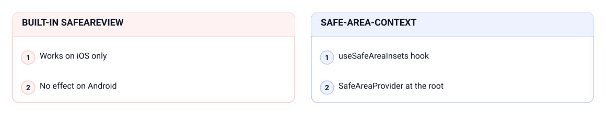

- Layar HP punya notch, status bar, dan home indicator
- Safe area: area yang masih aman untuk isi, jaraknya disebut inset
- Sejak Android 15 isi layar digambar edge-to-edge, dan RN 0.86 mengikutinya

> Pemasangan: `npx expo install react-native-safe-area-context`, lalu `SafeAreaProvider` di akar dan `edges={['top', 'bottom']}`.

<!--
Tunjuk di HP mereka sendiri di mana notch atau status bar berada, lalu tanya apa yang
terjadi kalau isi layar menabraknya.

Penanda peka versi harus disebut: status SafeAreaView bawaan dan kebijakan edge-to-edge
bisa berubah antar-rilis, jadi periksa dokumentasi resmi di reactnative.dev dan
docs.expo.dev. Bab ini memakai React Native 0.86 di Expo SDK 57.

Pertanyaan penuntun: "Kenapa kebijakan Android 15 membuat safe area menjadi wajib, bukan
tambahan?" (Jawaban: isi layar digambar sampai tepi, jadi judul bisa tertutup status bar.)

Salah paham: menganggap SafeAreaView bawaan sudah menangani dua platform.
-->

---

## Notch dan Status Bar Mengurangi Ruang yang Aman

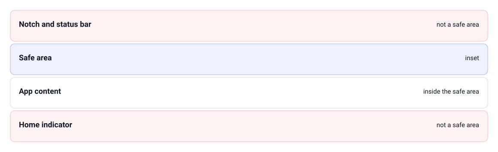

<!--
Dipotong ke gambar (diagram yang mengatakan ini):
- `SafeAreaView` bawaan hanya bekerja di iOS; di Android tidak berpengaruh
- Pilihan modern: `react-native-safe-area-context` dan hook `useSafeAreaInsets`

Bacakan gambar dari atas ke bawah sebagai satu tumpukan: notch, safe area, isi aplikasi,
lalu home indicator. Dua pita terluar bukan area aman untuk isi.

Pertanyaan penuntun: "Kenapa menghapus peringatan safe area bukan solusi?" (Jawaban:
peringatannya hilang, judulnya tetap tertutup status bar.)
-->

---

<!-- _class: lead -->
<!-- _paginate: skip -->

# Bagian 3 — Style, Layout & Platform

subbab 5.8 StyleSheet · 5.9 Flexbox responsif · 5.10 perbedaan platform

<!--
Bagian ini yang paling sering membuat mahasiswa mantan pengembang web tersandung, karena
tidak ada CSS dan arah Flexbox berbeda.

Kalau sisa waktu sedikit, subbab 5.9 tetap tidak boleh dilewati: praktikum dan Bab 6
bergantung padanya.
-->

---

## `StyleSheet`, Bukan CSS

- Tidak ada file CSS: gaya ditulis sebagai objek JavaScript
- `StyleSheet.create` memeriksa properti gaya saat aplikasi dimuat
- Definisi gaya dikumpulkan di luar JSX supaya component mudah dibaca
- Tidak ada cascade, kecuali sebagian pewarisan teks di iOS

```jsx
const styles = StyleSheet.create({
  kartu: {
    backgroundColor: '#ffffff',
    borderRadius: 12,
    padding: 16,
    marginBottom: 12,
  },
});
```

<!--
Manfaat pertama yang paling terasa: salah ketik nama properti gaya langsung terlihat saat
aplikasi dimuat, tidak gagal diam-diam seperti di CSS.

Analogi cascade: di web gaya menetes dari induk ke anak seperti air terjun; di React Native
setiap component menyatakan gayanya sendiri, jadi satu-satunya cara mengubah tampilan
adalah membungkusnya dengan gaya baru.

Pertanyaan penuntun: "Bagaimana memberi dua View gaya dasar yang sama tetapi ukuran
berbeda?" (Jawaban: gaya dasar di StyleSheet, gaya khusus ditambahkan lewat array style di
slide berikutnya.)

Salah paham: mencari file CSS terpisah di dalam struktur project Expo, padahal gaya ditulis
sebagai objek JavaScript.
-->

---

## Array Style Menggabungkan Gaya Secara Berurutan


- Array style menggabungkan objek berurutan; gaya sesudahnya menimpa
- Contoh: `style={[styles.kartu, styles.kartuBesar]}`
- Gaya kondisional memilih lewat `&&` atau ternary di dalam array
- Contoh: `style={[styles.baris, aktif && styles.barisAktif]}`
- Nilai `false` dan `null` di dalam array style diabaikan React Native

<!--
Kedua pola dipakai terus sampai akhir buku, jadi tulis keduanya di papan dan minta
mahasiswa mencatat.

Kaitkan dengan component BarisMahasiswa di praktikum: satu array style memuat gaya dasar,
gaya terpilih, dan gaya tertekan sekaligus.

Pertanyaan penuntun: "Kenapa kondisi aktif && styles.barisAktif aman ditulis, padahal nilai
aktif bisa salah?" (Jawaban: React Native mengabaikan nilai false dan null di dalam array
style.)

Salah paham: memakai if/else untuk memilih dua variabel gaya terpisah; pola array lebih
ringkas dan tidak menggandakan definisi gaya.
-->

---

## Lapisan Paling Atas Selalu yang Dipakai

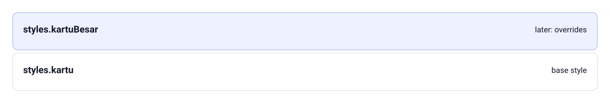

- Gaya dasar ditulis lebih dulu, gaya khusus menyusul di belakangnya
- Properti yang tidak ditimpa tetap memakai nilai gaya dasar

<!--
Slide ini melanjutkan slide sebelumnya dengan sumbu yang berbeda: bukan cara memilih gaya,
tetapi urutan menang. Lapisan paling atas selalu yang dipakai.

Contohkan dengan kartu yang sama: gaya dasar kartu, lalu gaya besar yang menimpa sebagian
propertinya.

Pertanyaan penuntun: "Kalau properti yang sama ditulis dua kali di dalam array, mana yang
menang?" (Jawaban: yang ditulis paling akhir.)

Salah paham: menganggap urutan penulisan tidak penting karena gaya digabung otomatis.
-->

---

## Flexbox di React Native Dimulai dari `column`

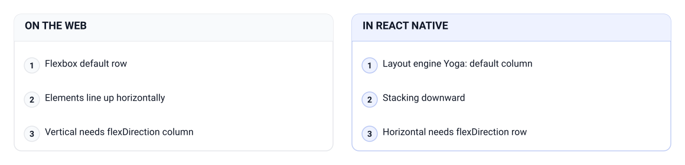

- Di web Flexbox bawaannya `row`, jadi elemen berjajar mendatar
- Di React Native mesin layoutnya Yoga: bawaan `column`, menumpuk ke bawah
- Alasannya: layar HP lebih wajar dibaca dari atas ke bawah
- Dua `View` yang ditumpuk otomatis tersusun vertikal
- Inilah titik yang paling sering menjebak pengembang web

<!--
Slide ini menuntaskan pertanyaan pertama dari slide tanya jawab di Bagian 2: arah bawaan
adalah column. Skenario lain sudah dijawab saat membahas scroller bersarang dan
keyExtractor yang kosong.

Analogi: menata buku di rak secara vertikal. Untuk menjejerkannya mendatar, arahnya harus
dinyatakan tegas dengan flexDirection row.

Pertanyaan penuntun: "Bagaimana membuat dua kartu berdampingan?" (Jawaban: flexDirection
row, biasanya ditambah gap dan flexWrap.)

Salah paham: menganggap React Native tidak mendukung Flexbox, padahal mesinnya sama dan
hanya nilai bawaannya yang berbeda.
-->

---

<!-- _class: compact -->

## Enam Properti, Satu Pola Layout yang Sama

| Properti | Arti |
|---|---|
| `flexDirection` | Arah sumbu utama: `row` atau `column` (bawaan) |
| `justifyContent` | Susunan sepanjang sumbu utama |
| `alignItems` | Susunan pada sumbu silang, bawaan `stretch` |
| `flex` | Bagian ruang antar-saudara; `flex: 1` mengisi sisa |
| `gap` | Jarak antar-anak tanpa margin berulang (sejak RN 0.71) |
| `flexWrap` | Anak pindah baris saat sumbu utama penuh |

<!--
Menguasai enam properti ini sudah cukup; sisanya jarang dipakai di aplikasi buku ini.

Tegaskan flex sebagai rahasia layout dengan header tetap dan isi yang mengisi layar, dan
gap sebagai pengganti marginTop berulang.

Pertanyaan penuntun: "Apa bedanya flex: 1 dan flex: 2 pada dua anak bersaudara?" (Jawaban:
sisa ruang dibagi, anak kedua mendapat dua kali lipat.)

Salah paham: menerjemahkan alignItems sebagai perataan mendatar. Namanya menunjuk sumbu
silang, jadi maknanya bergantung pada flexDirection.
-->

---

## Keenam Properti Itu Tertulis dalam Satu `StyleSheet`

```jsx
const styles = StyleSheet.create({
  layar: { flex: 1, backgroundColor: '#f5f7fb', padding: 16 },
  barisJudul: {
    flexDirection: 'row',
    justifyContent: 'space-between',
    alignItems: 'center',
    marginBottom: 12,
  },
  barisKartu: { flexDirection: 'row', flexWrap: 'wrap', gap: 10 },
  kartuKecil: { width: '48%', padding: 10, backgroundColor: '#ffffff' },
  kaki: { flex: 1 },
});
```

<!--
Bacakan tiga pola dari kode: barisJudul sebagai judul di kiri dan jumlah di kanan,
barisKartu sebagai grid dua kolom pada 48 persen, dan kaki sebagai pendorong. flex: 1 pada
kaki inilah yang mengangkat seluruh isi ke atas, pola klasik footer di dasar layar.

Tunjukkan bahwa 48 persen dipilih supaya dua kartu muat bersama sisa gap, bukan angka 50
persen yang membuat keduanya bersentuhan.

Pertanyaan penuntun: "Apa yang terjadi kalau flexWrap dihapus di layar sempit?" (Jawaban:
kartu tetap di satu baris dan meluber keluar layar.)

Salah paham: menambah margin di setiap anak, padahal satu properti gap sudah cukup.
-->

---

## Lebar Layar Berubah, Jumlah Kolom Ikut Berubah

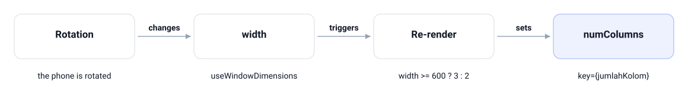

- Hook ini mengembalikan `{ width, height, scale, fontScale }`
- Polanya: `const jumlahKolom = width >= 600 ? 3 : 2`, lalu dipakai sebagai `numColumns`

```jsx
const { width } = useWindowDimensions();
const jumlahKolom = width >= 600 ? 3 : 2;

<FlatList key={jumlahKolom} numColumns={jumlahKolom} data={DATA} />
```

<!--
Dipotong ke gambar (diagram yang mengatakan ini):
- Nilainya berubah dan memicu render ulang saat HP diputar

Jelaskan alasan key={jumlahKolom}: saat numColumns berubah, React Native perlu membangun
ulang daftar dari awal, dan mengubah key adalah cara bakunya.

Latihan lisan cepat: "Pada HP selebar 360 piksel, berapa kolom yang muncul?" (Jawaban: dua
kolom, karena 360 kurang dari 600.)

Peringatan: pemikiran lengkap desain responsif, termasuk tipografi dan aksesibilitas, baru
dibahas di Bab 6.

Salah paham: mengukur lebar layar sekali di awal lalu menyimpannya di variabel; nilainya
tidak ikut berubah saat orientasi berganti.
-->

---

## Beda Kecil Cukup Ditangani `Platform.select`

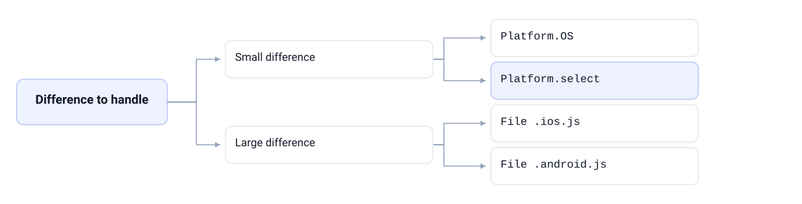

> Aturan sederhana: `Platform.select` untuk beda kecil, ekstensi file untuk beda besar.

<!--
Tegaskan aturan pemilihannya: beda kecil cukup lewat Platform.select, sedangkan component
yang benar-benar berbeda ditulis sebagai file .ios.js dan .android.js supaya Metro memilih
yang tepat saat build.

Sebutkan Platform.OS untuk percabangan paling sederhana. Tanya: "Kalau seluruh strukturnya
berbeda, masih pakai if di dalam satu file?" (Jawaban: tidak, pakai ekstensi file.)

Penanda peka versi juga berlaku di sini: kebijakan edge-to-edge dan detail perilaku
platform bisa berubah antar-rilis, jadi selalu periksa dokumentasi resmi.

Salah paham: menulis dua basis kode penuh untuk Android dan iOS, padahal hanya bedanya yang
perlu ditangani.
-->

---

<!-- _class: compact -->

## `elevation` Android Tidak Menggantikan Bayangan iOS

`File: components/KartuMahasiswa.js` — bayangan kartu yang berbeda per platform

```jsx
kartu: {
  flexDirection: 'row',
  alignItems: 'center',
  ...Platform.select({
    ios: {
      shadowColor: '#000000',
      shadowOpacity: 0.15,
      shadowRadius: 6,
      shadowOffset: { width: 0, height: 2 },
    },
    android: { elevation: 3 },
    default: {},
  }),
},
```

<!--
Dipotong ke catatan (tidak muat di slide):
> Pola `...` (spread) menyisipkan hasil `Platform.select` ke dalam objek gaya `StyleSheet`.

Tunjukkan bahwa iOS memakai empat properti bayangan dan Android memakai elevation, dan
keduanya tidak saling menggantikan. Ini contoh paling konkret perbedaan platform yang tidak
bisa disatukan.

Sebutkan juga pemakaian ringkas Platform.select langsung di dalam JSX, seperti component
SalamSistem pada contoh buku, untuk memilih sebagian kalimat per platform.

Pertanyaan penuntun: "Kenapa default perlu diisi?" (Jawaban: sebagai cadangan saat platform
tidak dikenali, supaya gayanya tetap sah.)

Salah paham: menulis elevation di iOS atau shadowColor di Android lalu menyimpulkan gayanya
tidak bekerja.
-->

---

## Studi Kasus: Daftar yang Tersendat Saat Digulir

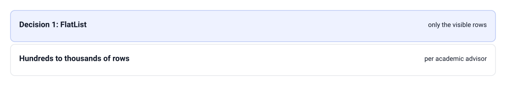

**Kasus fiktif dengan pola nyata.** Sistem Informasi Akademik sebuah universitas.

- Tabel web menyusut sampai tidak terbaca di HP, dan gulirnya tersendat
- Keputusan 2: layout kartu dengan `useWindowDimensions`, satu sampai dua kolom
- Keputusan 3: `Platform.select` dan safe area untuk iOS maupun Android

> Praktikum bab ini adalah miniatur kasus itu, dan ia tumbuh menjadi Aplikasi Manajemen Data Mahasiswa.

<!--
Dipotong ke gambar (diagram yang mengatakan ini):
- Bagian Akademik menampilkan ratusan sampai ribuan baris per dosen wali
- Keputusan 1: `FlatList` supaya hanya baris yang terlihat yang dirender

Bacakan sebagai cerita, bukan sebagai daftar: dosen wali mengeluh, rektorat memutuskan
membangun versi mobile, tim menghadapi tiga keputusan.

Tegaskan bahwa tiga keputusan itu persis tiga pokok bahasan bab ini: component inti, layout,
dan perbedaan platform; bab ini bukan kumpulan component yang tidak berhubungan.

Pertanyaan penuntun: "Alternatif kedua pada soal analisis adalah ScrollView berisi kartu
dan FlatList. Apa risiko utamanya?" (Jawaban: virtualisasi rusak karena scroller bersarang,
dan performa kembali buruk.)

Kasus ini fiktif dengan pola nyata; nyatakan itu terus terang supaya mahasiswa tidak
mencarinya sebagai berita.
-->

---

## Tiga Keputusan, Satu Rantai Penyelesaian

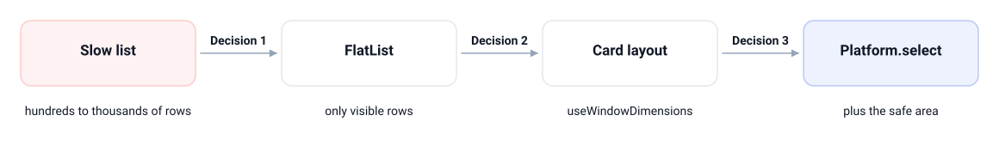

- Keputusan pertama menjawab keluhan awal: ribuan baris tidak boleh dirender sekaligus
- Dua keputusan berikutnya menjawab layar sempit dan dua platform sekaligus

<!--
Dipotong ke gambar (diagram yang mengatakan ini):
- Satu keluhan, lalu tiga keputusan berurutan menuju penyelesaian

Bacakan rantainya sebagai satu kalimat panjang: tabel web yang menyusut di HP dijawab
FlatList, lalu layout kartu yang responsif, lalu penanganan perbedaan platform.

Kaitkan ke praktikum: miniatur kasus ini adalah aplikasi yang mereka bangun hari ini.
-->

---

## Praktikum: Yang Dibangun Pertemuan Ini

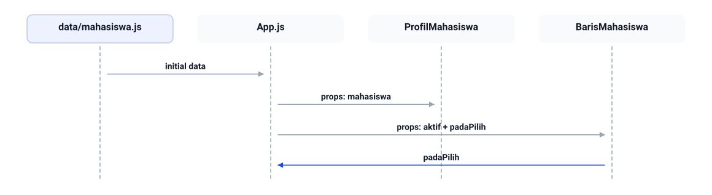

> Data mengalir turun lewat props, sentuhan mengalir naik lewat `padaPilih` (Bab 9).

<!--
Bacakan arsitektur praktikum: data dipisah di data/mahasiswa.js, component kecil seperti
AvatarPlaceholder dan BarisInfo, lalu App sebagai perakit yang memegang state.

Tegaskan satu arah aliran data: App menyimpan terpilih, mengirimnya sebagai props, dan
menerima pilihan kembali lewat callback padaPilih.

Pertanyaan penuntun: "Component mana yang memegang state di aplikasi ini?" (Jawaban: hanya
App, dengan satu state terpilih berisi mahasiswa pertama, Budi Santoso.)

Salah paham: menaruh state di setiap BarisMahasiswa sehingga kartu di atasnya tidak pernah
bisa berubah.

Sambungkan ke spine: layar profil inilah layar pertama Aplikasi Manajemen Data Mahasiswa
yang dibangun bertahap sampai Bab 15.
-->

---

## Yang Harus Teramati

Tiga hal yang dinilai di praktikum ini:

- **Component terpisah** — `AvatarPlaceholder` dan `BarisInfo` dipakai ulang, bukan disalin
- **Aliran data satu arah** — `App` mengirim props, anak mengirim pilihan lewat `padaPilih`
- **Layout responsif** — kartu tetap terbaca saat lebar layar berubah

> Bukti yang bisa diperiksa, bukan kesan: "kartu Budi tetap terpilih setelah daftar digulir" lebih kuat daripada "aplikasinya jalan".

<!--
Tiga hal inilah yang dinilai di praktikum, jadi bacakan perlahan. Yang paling sering hilang
adalah butir ketiga: mahasiswa menulis kesan, bukan pengamatan.

Beri satu contoh buruk dan satu contoh baik di papan tulis, lalu minta mereka menilai mana
yang bisa diperiksa ulang oleh orang lain.

Kalau waktu memungkinkan, minta satu mahasiswa membuka aplikasinya di depan kelas dan
menunjukkan bukti untuk ketiga butir ini.
-->

---

<!-- _class: center -->

## Kuis Kilat

- Kenapa teks tidak boleh ditulis langsung di dalam `View`?
- Component mana yang tepat untuk daftar 1.000 mahasiswa, dan mengapa?
- Properti `FlatList` apa yang menentukan identitas unik tiap baris?
- Di Android, properti apa yang dipakai untuk bayangan?
- Apa nilai bawaan `flexDirection` di React Native?

<!--
Kuis lisan lima menit: tampilkan pertanyaan, minta kelas menjawab bersama atau mengangkat
tangan, lalu lanjut ke slide kunci. Jangan bocorkan jawabannya di slide ini.

Kalau jawaban pertanyaan keempat beragam, ulangi pembedaan iOS dan Android sebelum menutup
pertemuan.

Catat pertanyaan yang paling sering salah dijawab; itulah bahan ulasan singkat di
pertemuan berikutnya.
-->

---

<!-- _class: center -->

## Kunci Kuis Kilat

- Karena `View` hanya menerima component sebagai anak, bukan teks
- `FlatList`, karena virtualisasi hanya merender butir yang terlihat
- `keyExtractor`, diisi nilai unik dan stabil seperti `item.id`
- `elevation`; di iOS dipakai `shadowColor` bersama `shadowOpacity`, `shadowRadius`, `shadowOffset`
- `column`, berbeda dari web yang bawaannya `row`

<!--
Ulangi pembedaan yang paling sering tertukar: bayangan iOS memakai empat properti bayangan,
Android memakai elevation.

Kalau banyak yang salah di jawaban ketiga, tegaskan bahwa keyExtractor adalah kewajiban,
bukan tambahan opsional, dan indeks array bukan identitas yang stabil.

Tutup kuis dengan satu kalimat penguat: lima jawaban ini adalah pola yang dipakai lagi dari
Bab 6 sampai Bab 8.
-->

---

## Ringkasan

1. React Native merender component native: tanpa DOM, tanpa CSS, tanpa API browser
2. `View` wadah serbaguna, `Text` satu-satunya pembawa teks; `Pressable` component sentuh utama dan `TextInput` memakai controlled component
3. Gambar jarak jauh wajib berdimensi; pola inisial mengisi kotak yang belum terisi
4. `ScrollView` merender semua anak, `FlatList` memvirtualisasi daftar panjang; scroller bersarang merusak virtualisasi
5. `SafeAreaView` bawaan hanya bekerja di iOS; pustaka safe area menangani dua platform
6. `StyleSheet`, array style, dan gaya kondisional menjadi pola styling sepanjang buku
7. Flexbox bawaannya `column`; `useWindowDimensions`, `Platform.select`, dan ekstensi file menutup beda layar dan platform

<!--
Jangan dibacakan. Minta mahasiswa memilih satu nomor dan menjelaskannya dengan kata-kata
sendiri, lalu lengkapi dari catatan penyaji kalau kurang.

Tegaskan nomor 1 sebagai kalimat kunci bab ini: setiap perbedaan lain mengalir dari fakta
bahwa React Native tidak berjalan di dalam browser.

Ulangi penanda peka versi pada nomor lima: status SafeAreaView bawaan dan kebijakan
edge-to-edge Android bisa berubah antar-rilis, jadi dokumentasi resmi selalu menjadi rujukan
akhir.

Pertanyaan penutup cepat: "Dari tujuh butir ini, mana yang paling mungkin membuat aplikasimu
tersendat?" (Jawaban yang diharapkan: scroller bersarang atau daftar panjang yang dirender
seluruhnya.)

Nyatakan bahwa ringkasan ini menjadi daftar periksa saat mengerjakan tantangan bab.
-->

---

## Diskusi: Satu Layar, Dua Ribu Baris

- Konsep React mana yang tetap sama, dan mana yang berubah bentuk? Mengapa?
- Bagaimana kamu menjelaskan alasan memilih `FlatList` kepada rekan satu tim?
- Skenario: `ScrollView` berisi kartu statistik, lalu `FlatList` di bawahnya

**Pertanyaan:** halaman berisi 2.000 catatan dengan satu kartu ringkasan di atas, pilihan mana yang kamu rekomendasikan, dan apa risikonya?

> Soal pemahaman, latihan, analisis, dan tantangan bab ini menjadi bahan Latihan Bab 5, dinilai lewat rubrik praktikum di Lampiran A.

<!--
Diskusi kelas lima menit: minta mahasiswa berpasangan, lalu tampung dua sampai tiga
jawaban.

Jawaban yang kuat menyebut pola kartu sebagai ListHeaderComponent, alasan virtualisasi, dan
risiko tiap alternatif. Jawaban yang hanya menyebut nama component belum menjawab; minta
alasannya.

Ingatkan bahwa tantangan bab (daftar responsif dan mode ringkas untuk kartu profil) dinilai
di praktikum berikutnya, dan rubriknya ada di Lampiran A.
-->

---

<!-- _class: compact -->

## Referensi

| Sumber | Link |
|---|---|
| Dokumentasi React Native (2026) | reactnative.dev |
| Dokumentasi Expo (2026) | docs.expo.dev |
| Dokumentasi React (2026) | react.dev |
| JavaScript, MDN Web Docs (2026) | developer.mozilla.org |
| Dokumentasi Node.js (2026) | nodejs.org |

**Bacaan lanjutan:** Bab 4 — Dasar-Dasar React · Bab 6 — Membangun User Interface Mobile

**Versi teknologi:** Expo SDK 57 · React Native 0.86 · React 19.2 · Node.js ≥ 22

<!--
Rujukan lengkap ada di Lampiran D, dan istilah seperti virtualisasi, inset, serta controlled
component ada di glosarium Lampiran C.

Sumber utama bab ini tetap dokumentasi resmi di reactnative.dev dan docs.expo.dev, bukan
blog atau video yang mungkin sudah usang.

Ulangi penanda peka versi: SafeAreaView bawaan dan kebijakan edge-to-edge Android perlu
diperiksa ulang terhadap dokumentasi rilis.
-->

---

<!-- _class: lead -->
<!-- _paginate: skip -->

# Siap ke Bab 6

**Tugas:** selesaikan praktikum layout profil mahasiswa dan tantangan daftar dua kolom yang responsif.

Pertemuan berikutnya: membangun antarmuka yang rapi dan konsisten.

<!--
Tutup dengan satu kalimat: "Hari ini kamu belajar abjad visual React Native; mulai Bab 6
kita belajar menatanya dengan rapi dan konsisten."

Sebutkan tenggat praktikum secara eksplisit: kapan dikumpulkan, dalam format apa, dan aspek
apa yang dinilai (Lampiran A — rubrik praktikum: pemahaman konsep 15%, implementasi 25%,
kualitas kode 15%, UI/UX 15%, debugging 10%, dokumentasi 20%).

Ingatkan mahasiswa menyimpan project profil-mahasiswa, karena project itu menjadi layar
pertama Aplikasi Manajemen Data Mahasiswa yang dilanjutkan di bab-bab berikutnya.
-->
