<!-- _class: lead -->
<!-- _paginate: skip -->
<!-- _footer: "" -->

# Bab 6 — Membangun User Interface Mobile

Prinsip, fondasi visual, dan component · Pertemuan 7

<!--
Buka dengan satu kalimat penyambung: "Bab lalu kita menyiapkan bahan mentahnya; hari ini
kita belajar menyusunnya dengan alasan."

Pertanyaan pembuka: "Kenapa dua aplikasi dengan fitur yang mirip bisa terasa sangat jauh
beda kenyamanannya?" Tampung dua sampai tiga jawaban tanpa dikoreksi dulu, karena
jawabannya tersebar di tiga tempat: prinsip (subbab 6.1), component (6.2), dan adaptasi
layar (6.5–6.6).

Sebutkan sejak awal bahwa bab ini tidak mengulang Bab 5, melainkan memakai ulang bahan
Bab 5.
-->

---

## Tujuan Pembelajaran

Setelah bab ini, kamu bisa:

- Menjelaskan empat prinsip desain UI mobile beserta alasan di belakangnya
- Mengidentifikasi peran sistem jarak 8pt, skala tipografi, dan palet warna
- Mengimplementasikan component Card, Button, Form, dan List secara konsisten
- Merancang *wireframe* halaman Daftar dan Detail Mahasiswa sebelum menulis kode
- Menerapkan aksesibilitas dasar dan menganalisis keputusan desain pada studi kasus

<!--
Bacakan verba tiap butir dengan tempo cepat, jangan dijelaskan satu per satu sekarang.

Empat butir pertama bertumpu pada Sub-CPMK 3.1 (prinsip desain UI mobile); butir terakhir
menyentuh Sub-CPMK 3.2 (responsivitas dan aksesibilitas dasar), yang di RPS juga dipetakan
ke Bab 6.

Sebutkan penilaiannya di depan: Praktikum Bab 6 dan Tugas 2 — perancangan ulang UI
aplikasi kampus.

Tegaskan bahwa butir keempat yang paling sering diremehkan: rancangan di atas kertas lebih
murah diperbaiki daripada layar yang sudah ditulis.
-->

---

<!-- _class: lead -->
<!-- _paginate: skip -->

# Bagian 1 — Empat Prinsip Desain UI Mobile

subbab 6.1 empat prinsip · 6.2–6.4 fondasi visual dan component

<!--
Bagian ini konseptual, tetapi tidak boleh dilewati: setiap keputusan di praktikum nanti
bisa dilacak balik ke empat prinsip di sini.

Kalau waktu pertemuan menipis, subbab 6.4 boleh dibaca mandiri oleh mahasiswa; subbab 6.1
tidak boleh.
-->

---

## Kenapa Dua Aplikasi Mirip Terasa Jauh Berbeda?

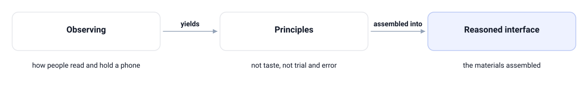

Pertanyaan pertama seorang perancang bukan soal teknologi.

**Prinsip, bukan selera**

- Antarmuka disusun dengan alasan, bukan coba-coba

**Bahan mentahnya sudah siap**

- Bab 5 memberi `View`, `Text`, `StyleSheet`, Flexbox, `FlatList`

<!--
Dipotong ke gambar (diagram yang mengatakan ini):
- Lahir dari pengamatan cara orang membaca dan memegang HP
- Bab ini mengajarkan cara menyusunnya menjadi antarmuka yang beralasan

Butir pertama yang pindah adalah tahap pertama gambar (pengamatan di balik sebuah prinsip),
dan butir kedua adalah tahap terakhirnya (penyusunan di bab ini). Yang tinggal di slide
adalah daftar bahan Bab 5, yang tidak disebut satu tahap pun, dan aturan "beralasan, bukan
coba-coba", yang hanya disinggung tahap kedua.

Tekankan pergeseran perannya: dari perakit layar menjadi perancang yang bisa menjelaskan
alasan di balik setiap keputusan. Kalimat penuh yang layak diucapkan: pertanyaan pertama
seorang perancang bukan soal teknologi, melainkan soal kenapa sebuah antarmuka terasa enak
atau susah dipakai.

Pertanyaan penuntun: "Kalau dua tombol punya fungsi berbeda, apa yang membedakannya di mata
pengguna?" (Jawaban: tampilan dan posisinya, bukan niat pengembangnya.)

Tutup dengan menegaskan bahwa bab ini tidak mengulang Bab 5, tetapi memakai ulang bahannya.
-->

---

## Prinsip 1 — Elemen Serupa Tampil Serupa

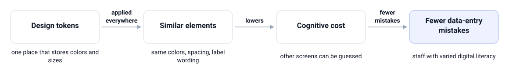

- Di sistem informasi: staf dengan literasi digital beragam membuat lebih sedikit salah input
- *Trade-off*: konsistensi yang terlalu kaku bisa memblokir solusi khusus satu konteks

<!--
Dipotong ke gambar (diagram yang mengatakan ini):
- Elemen serupa tampil dan berperilaku serupa: warna, jarak, dan pilihan kata yang sama
- Menurunkan beban kognitif: setelah satu layar dipelajari, layar lain bisa ditebak
- Bentuk teknisnya: **token desain** — satu tempat yang menyimpan warna dan ukuran

Tiga dari lima butir adalah mata rantai yang digambar gambar itu (token → elemen serupa →
beban kognitif), jadi dipindahkan. Yang tinggal adalah trade-off, yang merupakan batas
rantainya, bukan salah satu mata rantainya, dan akibatnya di sistem informasi — alasan
rantai itu penting di bidang mata kuliah ini sendiri.

Contoh paling murah: minta mahasiswa menyebut warna tombol "Simpan" di aplikasi yang mereka
pakai tiap hari, lalu tunjukkan bahwa jawabannya seragam.

Peringatkan salah paham yang umum: konsisten bukan berarti semua layar identik. Layar
dasbor dan layar formulir boleh berbeda sedikit asal aturan dasar warna, huruf, dan jarak
tetap sama.

Pertanyaan penuntun: "Kenapa konsistensi penting di aplikasi kampus?" (Staf dengan
literasi digital beragam cukup dilatih sekali.)
-->

---

## Prinsip 2 — Mata Memindai, Bukan Membaca

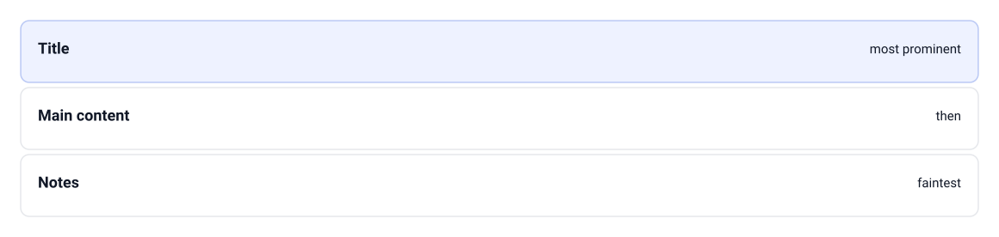

- Mata memindai layar, bukan membacanya baris demi baris
- Atur ukuran, ketebalan, warna, dan posisi untuk menunjukkan urutan
- *Trade-off*: hierarki terlalu agresif membuat layar berteriak sekaligus
- *Trade-off*: hierarki terlalu datar membuat bingung harus mulai dari mana

<!--
Dipotong ke gambar (diagram yang mengatakan ini):
- Judul paling menonjol, lalu isi utama, lalu keterangan yang paling redup

Butir itu adalah tiga pita di gambar, dalam urutan yang sama, jadi dipindahkan. Sisa slide
tidak diubah: fakta tentang memindai, empat alat pengatur, dan dua mode kegagalan adalah
kalimat yang tidak bisa diucapkan pita gambar.

Demonstrasi cepat: tampilkan dua tangkapan layar, satu dengan semua teks besar dan tebal,
satu dengan satu judul yang benar-benar menonjol.

Pertanyaan penuntun: "Layar mana yang bisa kamu pindai dalam satu detik?" (Yang kedua;
hierarki yang datar justru memperlambat pembacaan.)

Hubungkan dengan hasil akhirnya: hierarki yang baik membuat layar bisa dipindai dalam
hitungan detik.
-->

---

## Prinsip 3 — Setiap Sentuhan Butuh Jawaban

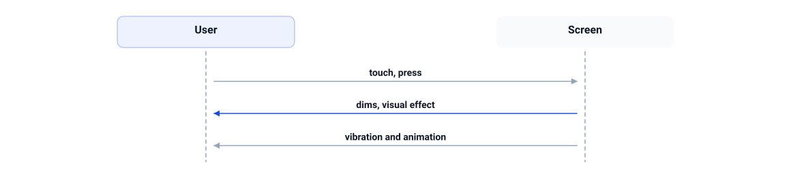

- Tombol yang ditekan meredup; kartu yang diketuk memberi efek visual
- Umpan balik menjawab kecemasan: "apakah sentuhan saya diterima?"
- Layar sentuh tidak memberi sensasi fisik, jadi respons visual menggantikannya
- *Trade-off*: respons sentuh wajib (`Pressable`), getaran dan animasi menyusul

<!--
Dipotong ke gambar (diagram yang mengatakan ini):
- Setiap tindakan pengguna harus mendapat respons yang terlihat

Aturan itu pindah karena gambar adalah aturan itu sendiri sebagai pertukaran: sentuhan
keluar, respons datang kembali. Contohnya tinggal — gambar menyebut "meredup, efek visual"
tetapi tidak pernah menyebut kontrol mana, dan kartu yang diketuk adalah kasus kedua yang
tidak dibawa gambar.

Analogi: menekan tombol lift yang tidak menyala — orang menekannya berkali-kali, bukan
menyerah.

Peringatkan bahwa tanpa umpan balik, pengguna menyimpulkan aplikasinya rusak walaupun
kodenya benar. Bentuk teknisnya ditunjukkan di slide kode `Pressable` nanti. Getaran dan
animasi sengaja disebut belakangan karena keduanya boleh, bukan wajib.

Pertanyaan penuntun: "Respons mana yang wajib, dan mana yang boleh menyusul?" (Respons
sentuh yang terlihat itu wajib; getaran dan animasi boleh dipertimbangkan belakangan.)
-->

---

## Prinsip 4 — Jangkauan Ibu Jari Menentukan Posisi

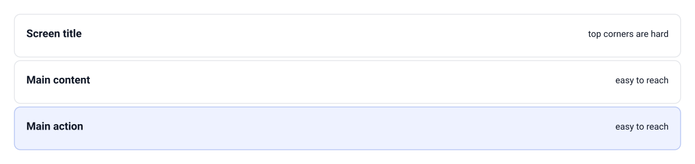

- Sebagian besar interaksi HP dilakukan dengan satu ibu jari
- Bagian bawah dan tengah layar mudah dijangkau; sudut atas sulit
- *Trade-off*: jangkauan kadang bentrok dengan kebiasaan (tombol kembali di kiri atas)
- Itu sebabnya tombol aksi utama di HP modern ada di bawah — bukan kebetulan

<!--
Zona jangkauan tidak perlu diucapkan ulang karena gambarnya sudah membaginya: judul layar di
atas dengan catatan "sudut atas sulit", isi dan aksi utama di bawah dengan catatan "mudah
dijangkau". Yang diucapkan hanyalah butir ketiga yang dulu ada di slide ini: aksi penting
ditaruh di zona terjangkau, sedangkan area atas disediakan untuk judul.

Demonstrasi: minta mahasiswa memegang HP dengan satu tangan lalu menyentuh sudut kanan
atas tanpa mengubah pegangan. Biarkan mereka merasakan batasannya sendiri.

Pertanyaan penuntun: "Tombol Simpan di formulir panjang sebaiknya di mana?" (Mengikuti ibu
jari: menempel di bawah formulir, bukan di sudut atas.)

Ingatkan bahwa pengorbanannya nyata: sebagian kepadatan layout dilepas demi kenyamanan
jangkauan.
-->

---

## Empat Prinsip Ini Tidak Berdiri Sendiri

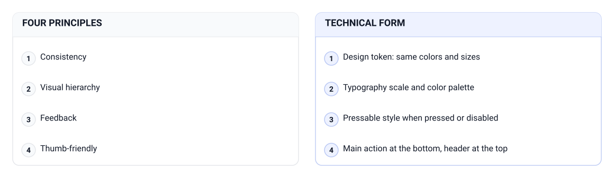

> Prinsip menjadi nyata lewat token desain, skala tipografi, palet warna, dan gaya `Pressable` saat ditekan atau nonaktif.

<!--
Pesan utamanya: prinsip tidak berdiri sendiri. Hierarki tanpa konsistensi membuat setiap
layar mengiklankan caranya sendiri; umpan balik tanpa hierarki memberi respons yang sama
untuk tindakan yang berbeda.

Sebutkan bahwa setiap label di bagan bisa dilacak ke subbabnya (6.1, 6.2, 6.4), jadi
mahasiswa tahu ke mana harus kembali saat lupa.

Think-pair-share singkat: minta setiap pasangan memilih satu prinsip dan menyebut satu
pelanggarannya di aplikasi yang mereka pakai sehari-hari.
-->

---

<!-- _class: compact -->

## Sistem Jarak 8pt: Angka yang Disepakati, Bukan Dirasa

- Satu set nilai jarak: 4, 8, 12, 16, 24, 32, 48, 64
- Dipilih karena habis dibagi 2: cukup kecil untuk detail, cukup besar untuk irama

| Aturan praktis | Nilai |
|---|---|
| Jarak antar elemen dalam satu kelompok | 8 |
| Jarak antar kelompok | 16 |
| Margin tepi layar | 16–24 |
| Jarak di dalam kartu (padding) | 16 |
| Sudut membulat | 8–12 |

<!--
Tekankan bahwa manfaatnya bukan estetika, melainkan kecepatan memutuskan: tim tidak lagi
berdebat "16 atau 17 piksel?".

Nilai di tabel ini jugalah yang berulang di seluruh kode praktikum, jadi layar yang terasa
janggal biasanya punya satu nilai yang keluar dari irama.

Pertanyaan penuntun: "Kenapa 8, bukan 5 atau 7?" (8 habis dibagi 2, sehingga 4, 8, 16, dan
32 selalu sejajar.)
-->

---

## Satu Kartu Membawa Satu Entitas

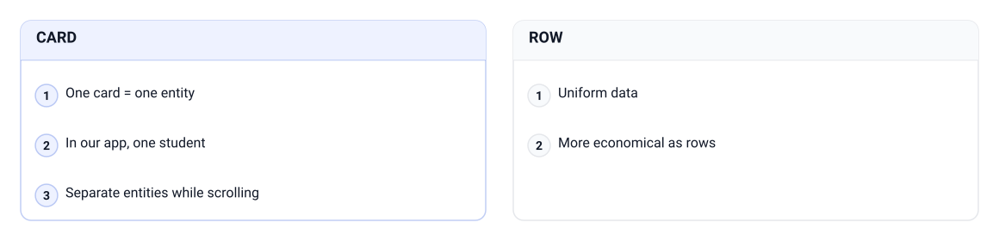

- Memberi batas visual agar mata bisa memisahkan entitas saat menggulir
- Anatomi: latar putih, radius 8–12, padding 16, jarak antar kartu 8
- *Trade-off*: kartu memakan ruang vertikal; data seragam lebih hemat sebagai baris

<!--
Dipotong ke gambar (diagram yang mengatakan ini):
- Satu kartu = satu gagasan = satu entitas; di aplikasi kita, satu mahasiswa

Itu panel kiri gambar, jadi dipindahkan. Tiga butir tinggal karena gambar tidak bisa
membawanya: anatomi (latar, radius, padding), harganya (ruang vertikal), dan butir batas
visual — panel menyebut "memisahkan entitas saat menggulir" tetapi tidak menjelaskan kenapa
itu bekerja.

Analogi: kartu itu seperti kartu nama — setelah ditumpuk pun, mata masih bisa memisahkan
satu dari yang lain.

Salah paham tersering: menumpuk dua entitas dalam satu kartu. Ingatkan bahwa satu kartu
membawa satu pesan.

Pertanyaan penuntun: "Kapan baris lebih tepat daripada kartu?" (Saat datanya banyak dan
seragam, misalnya tabel nilai.)
-->

---

<!-- _class: compact -->

## Empat Varian Tombol, Satu Hierarki Aksi

Pertanyaan desainnya bukan "bentuknya bagaimana", melainkan "seberapa penting aksi ini".

| Varian | Tampilan | Kegunaan |
|---|---|---|
| primary | Latar warna utama, teks putih | Satu-satunya aksi utama di layar |
| secondary | Latar abu lembut | Aksi pendukung yang tetap penting |
| outline | Transparan, garis warna utama | Aksi alternatif |
| danger | Latar merah | Aksi berisiko atau merusak |

- Aturan: satu primary per layar — kalau semua menonjol, tidak ada yang menonjol
- Label berupa verba yang jelas: "Simpan", bukan "OK"

<!--
Inti pesannya: pengguna membaca makna dari warna sebelum membaca teksnya. Tombol merah yang
tidak pernah dipakai untuk menghapus kehilangan artinya.

Pertanyaan penuntun: "Boleh dua aksi penting sama-sama primary di satu layar?" (Tidak —
hierarki aksinya langsung hilang.)

Ingatkan bahwa `danger` bukan berarti "penting", melainkan khusus untuk aksi yang merusak.
-->

---

## Tombol Nonaktif Tidak Boleh Ikut Meredup

`File: components/Tombol.js`

```js
style={({ pressed }) => [
  styles.dasar,
  {
    backgroundColor: modeNonaktif ? '#E5E7EB' : LATAR_VARIASI[variasi],
    opacity: pressed && !modeNonaktif ? 0.75 : 1,
  },
]}
```

> Tiga warna status: normal sesuai varian, meredup saat ditekan, dan terkunci abu saat nonaktif.

<!--
Bahas dulu urutan kondisinya: tombol nonaktif tidak boleh meredup saat "ditekan", karena ia
sama sekali tidak merespons sentuhan.

Tanya: "Kenapa opacity ditulis sebagai ekspresi, bukan dua gaya terpisah?" (Karena fungsi
gaya `Pressable` menerima `{ pressed }`, sehingga statusnya bisa dibaca saat render.)

Tegaskan bahwa slide ini bukan sintaksis baru: `Pressable` sudah dipelajari di Bab 5; yang
baru adalah alasan desain di belakangnya.
-->

---

## Label Menetap, Placeholder Hanya Petunjuk

```plaintext
┌──────────────────────────────┐
│ Full Name               label│
│ ┌──────────────────────────┐ │
│ │ Budi Santoso         [×] │ │  ← input with a value
│ └──────────────────────────┘ │
│ NIM                          │
│ ┌──────────────────────────┐ │
│ │                          │ │  ← empty + placeholder
│ └──────────────────────────┘ │
│          [ Save ]            │ ← primary button
└──────────────────────────────┘
```

- Label selalu terlihat — placeholder hilang begitu pengguna mulai mengetik
- Tombol simpan menempel di bawah formulir, dalam jangkauan ibu jari

<!--
Bahas dua keputusan tampilan saja: label tidak boleh bergantung pada placeholder, dan posisi
tombol simpan.

Ingatkan lingkup bab ini: state, validasi, dan perilaku papan ketik sengaja ditunda ke Bab 8
supaya kelas fokus pada pola visualnya.

Pertanyaan penuntun: "Kenapa label di atas kolom, bukan di sampingnya?" (Lebar layar HP
tidak cukup untuk dua kolom berdampingan.)
-->

---

## Item Seragam Membuat Daftar Terasa Tenang

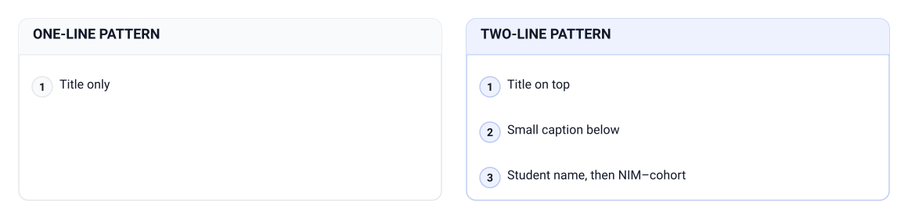

- Struktur item seragam: area sentuh, jarak dalam, dan hierarki teks yang sama
- Pemisah: garis tipis atau jarak 8 — pilih satu dan pakai konsisten
- Tiga keadaan diantisipasi: sedang memuat, kosong, dan gagal dimuat

<!--
Dipotong ke gambar (diagram yang mengatakan ini):
- Pola satu baris: judul saja; pola dua baris: judul di atas, keterangan kecil di bawah
- Aplikasi kita memakai dua baris: nama mahasiswa, lalu NIM–angkatan

Kedua butir itu adalah dua panel gambar: gambar menaruh bentuk satu baris di samping bentuk
dua baris, dan menyebut dua baris aplikasi kita di panel kedua. Tiga butir tinggal karena
gambar tidak bisa menunjukkannya: struktur yang seragam (area sentuh, jarak dalam, hierarki
teks), pilihan pemisah, dan tiga keadaan yang harus diantisipasi setiap daftar.

Ingatkan bahwa `FlatList` sudah diperkenalkan di Bab 5; yang dibahas di sini adalah
keseragaman itemnya, bukan cara memakainya.

Sebutkan bahwa tiga keadaan (memuat, kosong, gagal dimuat) baru diimplementasikan di Bab 10
saat data datang dari server; untuk sekarang cukup diantisipasi di rancangan.

Pertanyaan penuntun: "Apa yang membuat daftar terasa bergetar saat digulir?" (Tinggi item
dan jarak antar item tidak seragam.)
-->

---

## Header Menjawab, Navigasi Bawah Menjangkau

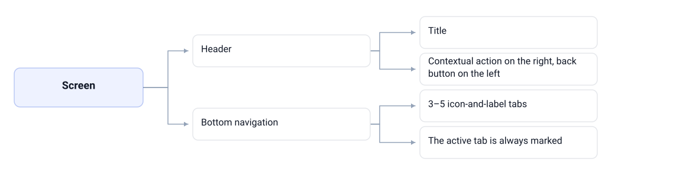

**Header (atas layar)**

- Menjawab: di mana aku, apa yang bisa aku lakukan, bagaimana kembali

**Navigasi bawah**

- Di bawah karena itu tempat paling nyaman untuk ibu jari
- Tab aktif selalu ditandai; navigasi bawah hanya untuk bagian utama aplikasi

<!--
Dipotong ke gambar (diagram yang mengatakan ini):
- Elemennya: judul, aksi kontekstual di kanan, tombol kembali di kiri
- Tab bar di bawah layar berisi 3–5 tab dengan ikon dan label

Keduanya adalah anatomi yang digambar pohon itu: header memuat judul, tombol kembali di kiri,
dan aksi kontekstual di kanan, sedangkan navigasi bawah memuat 3–5 tab berikon dan berlabel.
Yang tinggal di slide adalah hal yang tidak bisa ditunjukkan pohon: apa yang dijawab header,
kenapa tab bar ada di bawah, dan aturan bahwa tab aktif hanya untuk bagian utama aplikasi —
gambar menandai tab aktif tetapi tidak mengatakan di mana tab boleh dipakai.

Juga dipindah ke sini supaya gambar tetap terbaca (kutipan slide ini):
> Tinggi header biasanya 56pt ditambah area status; penerapan tab dengan Expo Router dibangun di Bab 7.

Kalimat itu menyebut satu konstanta desain dan satu penunjuk ke Bab 7 — keduanya tidak
ditunjukkan gambar, dan keduanya tidak perlu dibaca dari proyektor saat anatominya sedang
dibahas.

Tekankan alasan header ada, bukan bentuknya: header adalah "papan nama" yang dijumpai
pengguna setiap kali berpindah layar, jadi tinggi, jarak, dan gayanya harus konsisten.

Peringatkan bahwa navigasi bawah hanya untuk bagian utama; halaman detail dan formulir
bukan tab, dan tab yang terlalu banyak membuat labelnya sempit. Konsep ini diterapkan di
Bab 7 dengan Expo Router.

Pertanyaan penuntun: "Kalau aplikasimu punya tujuh bagian utama, apa yang kamu lakukan?"
(Kurangi jadi 3–5; tab yang terlalu banyak jadi terlalu sempit.)
-->

---

<!-- _class: compact -->

## Skala Tipografi: Enam Tingkat untuk Berhenti Menebak

| Tingkat | Ukuran | Ketebalan | Pemakaian |
|---|---|---|---|
| caption | 12 | 400/500 | keterangan kecil, lencana |
| small body | 14 | 400 | teks sekunder, nilai detail |
| body | 16 | 400 | teks utama, isi kartu |
| subheading | 18–20 | 600/700 | judul bagian, nama di detail |
| screen title | 20–28 | 700 | judul header layar |
| display | 32+ | 700 | angka besar, halaman pembuka |

- Kapitalisasi keputusan sadar: judul layar cukup kapital di awal kalimat, diatur lewat `textTransform`

<!--
Tekankan bahwa skala inilah yang menghentikan kebiasaan "ukuran huruf menurut selera di tiap
layar", dan sekaligus menjadi alat hierarki visual yang paling murah.

Ucapkan aturan tebalnya dengan suara keras: menonjolkan teks cukup dengan ketebalan
(400 → 600 → 700); besar dan tebal sekaligus membuat hierarki berlebihan.

Salah paham utamanya: memperbesar dan menebalkan sekaligus. Pilih salah satu.

Catatan platform: font bawaan berbeda di Android (Roboto) dan iOS (San Francisco), dan font
kustom dimuat lewat library expo-font yang di luar cakupan buku ini; jarak antar baris
(lineHeight) dijaga sekitar 1,3–1,5 kali ukuran huruf.
⚠ sensitif versi: periksa dokumentasi resmi terbaru (reactnative.dev) untuk dukungan
ketebalan per platform.
-->

---

<!-- _class: compact -->

## Warna Mempercepat, Teks yang Menjelaskan

| Peran | Warna | Pemakaian |
|---|---|---|
| Primary | Biru `#2563EB` | tombol primary, avatar, aksi utama |
| Netral teks | `#1F2937`, `#6B7280`, `#9CA3AF` | teks utama, sekunder, samar |
| Netral latar | `#FFFFFF`, `#F9FAFB`, `#E5E7EB` | kartu, latar layar, garis pemisah |
| Sukses | Hijau `#15803D` | IPK ≥ 3,5 dan status aktif |
| Peringatan | Oranye `#C2410C` | nilai batas dan peringatan |
| Bahaya | Merah `#B91C1C`/`#DC2626` | IPK rendah dan tombol Hapus |

- Kontras WCAG 2.1 level AA: minimal 4,5:1 untuk teks normal, 3:1 untuk teks besar
- Jangan memakai warna sebagai satu-satunya pembawa makna — sertakan teks

<!--
Tekankan aturan emasnya: warna mempercepat pemindaian, sedangkan teks yang membawa makna.
Pengguna dengan buta warna tidak membaca "merah versus hijau" sebagai pesan.

Sebutkan bahwa pasangan di tabel dipilih agar lolos ambang kontras: misalnya putih di atas
biru primary berada sekitar 5:1, cukup untuk teks normal.

Pertanyaan penuntun: "Bagaimana IPK rendah ditandai supaya semua orang tetap bisa
membacanya?" (Merah sebagai penanda cepat, ditambah angka IPK sebagai teks.)
-->

---

<!-- _class: compact -->

## Studi Kasus: Permintaan yang Sebenarnya Soal Antarmuka

Data mahasiswa tersebar di beberapa spreadsheet; staf membuka tiga file untuk satu pertanyaan.

| Kebutuhan pengguna | Dijawab di |
|---|---|
| Staf baru cukup dilatih sehari | Konsistensi dan hierarki visual (6.1) |
| Dipindai cepat di loket yang sibuk | Skala tipografi dan warna semantik (6.4) |
| Dipakai sambil berdiri | Aksi di bawah, ramah ibu jari (6.1, 6.3) |
| "Hapus jangan dekat Simpan" | Danger dan primary, jarak aksi (6.2) |
| Alur diperbaiki sebelum biaya naik | *Wireframe* sebagai negosiasi (6.7) |

<!--
Pesan utamanya: permintaan manajer itu permintaan antarmuka, bukan permintaan basis data.
Datanya sudah ada; yang belum dirancang adalah cara menyajikannya.

Tunjukkan bahwa satu permintaan sehari-hari seperti "staf baru bisa memakainya setelah
sehari" langsung berubah menjadi kriteria konsistensi dan hierarki.

Kaitkan dengan karier: mengubah keluhan pengguna menjadi keputusan desain adalah nilai jual
seorang analis sistem di proyek sistem informasi.

Sebutkan bahwa baris terakhir tabel baru dijawab di Bagian 2, karena *wireframe*-nya
dirancang di subbab 6.7.
-->

---

<!-- _class: lead -->
<!-- _paginate: skip -->

# Bagian 2 — Responsif, Aksesibilitas & Aplikasi

subbab 6.5 responsivitas · 6.6 aksesibilitas · 6.7 studi kasus dan praktikum

<!--
Bagian ini paling sering muncul di penilaian praktikum karena menghasilkan artefak nyata:
layar Daftar dan Detail Mahasiswa yang statis tetapi berjalan.

Sebutkan bahwa responsivitas dan aksesibilitas bukan tambahan opsional; keduanya menyumbang
aspek UI/UX di rubrik praktikum (Lampiran A).

Ingatkan juga bahwa baris terakhir studi kasus tadi — *wireframe* sebagai alat negosiasi —
dijawab di bagian ini.
-->

---

## Satu Aplikasi, Ribuan Perangkat: Lima Alat Responsif

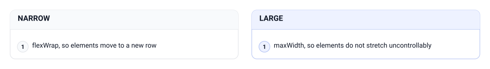

Aplikasi berjalan di ribuan perangkat; asumsi lebar tetap akan terlihat rusak di sebagian perangkat.

- **Flexbox** — dasar pembagian proporsi, sudah dikuasai di Bab 5
- Lebar persentase dan `flex` untuk membagi ruang secara relatif
- `useWindowDimensions` — lebar dan tinggi layar saat ini, ikut berubah saat diputar

<!--
Dipotong ke gambar (diagram yang mengatakan ini):
- `flexWrap` agar elemen pindah ke baris baru saat layar sempit
- `maxWidth` agar elemen tidak meregang tak terkendali di layar besar

Keduanya ujung gambar: panel SEMPIT menjawab dengan `flexWrap`, panel LEBAR dengan `maxWidth`.
Tiga alat tinggal di slide karena gambar tidak menempatkannya — Flexbox sebagai fondasi,
lebar persentase dan `flex` sebagai pembagi ruang, dan `useWindowDimensions` sebagai
pengukur yang memberi tahu layout sedang berada di ukuran mana.

Sebutkan trade-off-nya dengan jujur: kode responsif lebih rumit dan lebih sulit diuji, tetapi
harganya jauh lebih murah daripada aplikasi yang berantakan di tablet dosen.

Pertanyaan penuntun: "Alat mana yang membuat layar berubah saat HP diputar?"
(`useWindowDimensions` — hook ini berlangganan perubahan ukuran layar.)

Ingatkan untuk menguji di beberapa ukuran: emulator Android bisa meniru banyak perangkat, dan
Expo Go memungkinkan mencoba HP sungguhan (Bab 2).
-->

---

## Daftar Adaptif: Satu Kolom atau Dua?

`File: screens/DaftarMahasiswa.js`

```js
import { useWindowDimensions } from 'react-native';

const { width } = useWindowDimensions();
const jumlahKolom = width >= 700 ? 2 : 1;

<FlatList
  data={data}
  numColumns={jumlahKolom}
  keyExtractor={(mhs) => mhs.id}
  ...
/>
```

> Ambang 700 adalah keputusan desain yang harus diuji di perangkat nyata, bukan angka mutlak.

<!--
Tekankan hubungan dua baris terakhir kode: hook menyediakan lebar layar, lalu `numColumns`
memakai nilai itu untuk menentukan jumlah kolom.

Sebutkan pola lanjutannya: master–detail (daftar di kiri, detail di kanan) lazim di tablet;
di HP kedua panel itu menjadi dua layar terpisah, persis seperti layar Daftar dan Detail
yang sedang kita bangun.

Pertanyaan penuntun: "Apa yang terjadi kalau `useWindowDimensions` dipanggil di luar
component?" (Hook hanya sah di dalam function component.)
-->

---

## Aksesibilitas Dibangun Sejak Awal, Bukan Ditambal

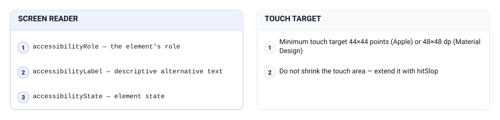

- `accessibilityRole` — peran untuk pembaca layar: `button`, `header`, `image`
- `accessibilityLabel` — teks alternatif yang menjelaskan, bukan "Ketuk di sini"
- `accessibilityState` — status elemen, misalnya `{ disabled: true }`

<!--
Dipotong ke gambar (diagram yang mengatakan ini):
- Target sentuh minimal 44×44 point (Apple) atau 48×48 dp (Material Design)
- Kalau ikonnya kecil, jangan kecilkan area sentuhnya — luaskan dengan `hitSlop`

Juga dipindah ke sini karena slide tidak punya ruang di atas footer (kutipan slide ini):
> Etika, hukum (layanan publik wajib mengakomodasi penyandang disabilitas), dan pasar — tiga alasan aksesibilitas wajib bagi mahasiswa sistem informasi.

Dua butir yang dipotong adalah panel kanan gambar: luas area yang dibutuhkan jari, sebagai
lawan dari tiga hal yang dibutuhkan pembaca layar. Tiga butir prop tinggal di slide karena
gambar hanya menyebut nama prop-nya dan menyerahkan nilainya kepada prosa — `button`,
"Ketuk di sini", dan `{ disabled: true }` adalah yang diketik mahasiswa.

Tekankan bahwa aksesibilitas dipasang sejak awal, bukan ditambal di akhir; menambahkannya
belakangan biasanya memaksa layout dirancang ulang.

Pertanyaan penuntun: "Kenapa label 'Ketuk di sini' buruk bagi pengguna pembaca layar?"
(Karena tidak menjelaskan apa yang akan terjadi.) Sebutkan VoiceOver di iOS dan TalkBack di
Android.

Salah paham yang umum: menganggap ikon kecil otomatis berarti area sentuh kecil. Justru itu
fungsi `hitSlop`.
-->

---

<!-- _class: center -->

## Apa yang Terjadi Jika…?

Satu layar menampilkan tombol **Hapus Riwayat** berwarna primary (biru) di samping tombol **Simpan**, keduanya berukuran 36×36.

- Prinsip dan standar mana yang dilanggar layar ini?
- Perbaikan apa yang kamu usulkan, dan apa alasan tiap perbaikan?

<!--
Beri dua menit untuk berpikir sendiri, lalu diskusikan. Jangan bocorkan jawabannya di slide
ini: jawabannya ada di slide berikutnya, dan ekspor PDF menampilkan keduanya.

Latihan ini setara dengan soal analisis di bagian Latihan bab ini; pakai sebagai pemanasan
sebelum mahasiswa mengerjakannya secara tertulis.

Kalau kelas diam, arahkan ke aturan "satu primary per layar" di subbab 6.2.
-->

---

<!-- _class: center -->

## Jawabannya: Empat Aturan Dilanggar Sekaligus

- Hierarki aksi: satu primary per layar — di sini dua aksi sama-sama menonjol
- Warna semantik: aksi merusak seharusnya `danger` (merah), bukan primary (biru)
- Target sentuh 36×36 berada di bawah minimum 44×44 point
- Perbaikan: Simpan tetap primary, Hapus jadi danger, ukurannya dinaikkan

<!--
Jawaban ini disusun dari aturan bab ini sendiri (6.2 untuk varian dan hierarki aksi, 6.6
untuk target sentuh), bukan dikutip langsung dari narasi bab.

Tekankan akibat psikologisnya: saat dua tombol sama-sama menonjol, pengguna ragu dan bisa
salah menekan aksi yang merusak.

Pertanyaan lanjutan: "Cukup dengan memperbesar ukurannya?" (Tidak — warna semantik dan
hierarki aksi juga harus diperbaiki.)
-->

---

## UI Dulu, Kode Kemudian

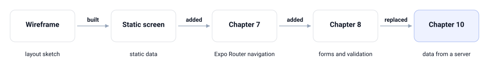

> Layar statis bukan produk setengah jadi — ia artefak desain yang sah dan alat komunikasi tim.

<!--
Jelaskan alasannya sebelum bentuknya: antarmuka adalah bagian yang kebutuhannya paling sering
salah dipahami, jadi pemangku kepentingan perlu melihat layar nyata lebih dulu.

Tegaskan bahwa urutan ini disengaja: Bab 7 menambahkan navigasi, Bab 8 menambahkan formulir,
Bab 10 mengganti data statis dengan data dari server.

Pertanyaan penuntun: "Apa manfaatnya menunjukkan layar statis ke staf akademik?" (Mereka bisa
memperbaiki alurnya sebelum biaya pembangunan naik.)
-->

---

## Layar Daftar: Satu Header, Lima Kartu Seragam

```plaintext
┌────────────────────────────────┐
│ Student Management     [Add]   │  ← header: title + action
│ Manage active student records  │
├────────────────────────────────┤
│ ┌────────────────────────────┐ │
│ │ Budi Santoso  [Information │ │  ← card: name + program badge
│ │ NIM 2201001 · Cohort 2022  │ │
│ │ GPA 3.45                   │ │
│ └────────────────────────────┘ │
│ (…four more cards follow)      │
│ ┌────────────────────────────┐ │
│ │ ● Home ○ Students ○ Profile│ │ ← bottom nav (concept, Ch. 7)
│ └────────────────────────────┘ │
└────────────────────────────────┘
```

> Kartu dipilih, bukan baris tabel: tiga informasi dengan bobot berbeda.

<!--
Bacakan *wireframe* dari atas ke bawah, seperti menuntun kelas menyusuri layar.

Sebutkan bahwa gambar hanya menggambarkan satu kartu sebagai contoh pola, sedangkan
jumlahnya lima (satu kartu tergambar ditambah empat lagi) sesuai data baku.

Tekankan dua keputusan yang terlihat sepele tetapi disengaja: lencana prodi memakai warna
lembut per prodi dan selalu disertai teks, dan IPK diberi warna semantik karena staf
akademik sering mencari "siapa yang IPK-nya bermasalah".

Pertanyaan penuntun: "Kalau *wireframe* ini ditunjukkan ke staf akademik, bagian mana yang
paling mungkin mereka komentari?" (Biasanya urutan informasi di dalam kartu.)
-->

---

## Layar Detail: Identitas Dulu, Data, Baru Aksi

```plaintext
┌────────────────────────────────┐
│ [← Back]  Student Detail       │ ← header with back action
├────────────────────────────────┤
│           ┌──────┐             │
│           │  BS  │             │ ← initials avatar
│           └──────┘             │
│          Budi Santoso          │
│      [Information Systems]     │
│ ┌────────────────────────────┐ │
│ │ NIM            2201001     │ │  ← label–value pair
│ │ GPA            3.45        │ │ ← sixth row from BARIS_INFORMASI
│ └────────────────────────────┘ │
│     [ Edit ]      [ Delete ]   │ ← actions: supporting + danger
└────────────────────────────────┘
```

> Hierarki layar: identitas mahasiswa paling menonjol, lalu data, lalu aksi.

<!--
Tunjukkan pola pasangan label–nilai: satu pola untuk enam baris, dirender dari array
`BARIS_INFORMASI` dengan `map` — konsistensi lewat data, bukan salin-tempel. *Wireframe*-nya
sengaja hanya menggambar dua baris sebagai contoh pola; enam barisnya datang dari array,
bukan dari gambar.

Tekankan keputusan aksesibilitasnya: avatar memakai inisial, bukan foto — pilihan yang sah
untuk aplikasi data statis selama setiap elemen diberi label yang benar.

Pertanyaan penuntun: "Kenapa Hapus tidak ditempatkan tepat di samping Simpan?" (Keduanya
aksi berlawanan dan berisiko, rawan salah tekan.)
-->

---

<!-- _class: compact -->

## Setiap Keputusan Wireframe Punya Dasar Prinsip

| Keputusan di wireframe | Dasar prinsip |
|---|---|
| Kartu seragam, jarak kelipatan 8 | Sistem 8pt dan pemindaian (6.1, 6.2) |
| Satu primary per layar, Hapus danger | Hierarki aksi dan warna semantik (6.2, 6.4) |
| Lencana prodi berwarna dan berteks | Kontras, tidak bergantung warna (6.4, 6.6) |
| IPK berwarna semantik | Pemindaian data yang cepat (6.4) |
| Kembali dan aksi di bawah | Ramah ibu jari (6.1) |
| Target sentuh ≥ 44×44, label jelas | Aksesibilitas (6.6) |

> *Wireframe* adalah kontrak visual sebelum kode: setiap keputusan bisa dilacak ke prinsipnya.

<!--
Cara mengajarkannya: tutup kolom kanan, minta kelas menebak prinsip di balik tiap keputusan,
lalu buka. Ini cara tercepat menguji pemahaman subbab 6.1 sebelum praktikum.

Sebutkan dengan suara keras satu keputusan yang tidak masuk tabel karena ruang: "header yang
konsisten di kedua layar" — dasar prinsipnya konsistensi (6.1), sama di layar Daftar dan
Detail.

Pertanyaan penuntun: "Kalau satu keputusan tidak bisa dilacak ke prinsip mana pun, apa
artinya?" (Artinya belum dirancang, baru disusun.)

Ingatkan bahwa tabel ini juga bisa dipakai sebagai daftar periksa saat mahasiswa meninjau
hasil praktikumnya sendiri.
-->

---

## Data Turun lewat Props, Event Naik lewat Fungsi

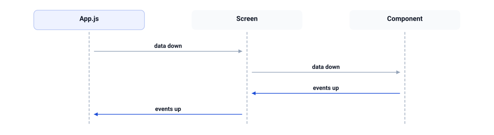

> Component tidak pernah mengimpor datanya sendiri — itulah yang membuatnya bisa dipakai ulang dan mudah diuji (Bab 14).

<!--
Telusuri satu perjalanan penuh: state di `App.js` berubah setelah kartu diketuk, React
me-render ulang, dan layar Detail muncul — semuanya tanpa navigasi.

Tekankan akibat arsitekturnya: karena data hanya mengalir lewat props, layar Detail nanti bisa
menerima data dari server (Bab 10) tanpa mengubah tampilannya.

Pertanyaan penuntun: "Apa yang terjadi kalau `onTekan` tidak diteruskan di salah satu
perantara?" (Kartunya sama sekali tidak merespons — rantai props-nya putus.)
-->

---

<!-- _class: compact -->

## Praktikum: Yang Dibangun Pertemuan Ini

Aplikasi Manajemen Data Mahasiswa tahap pertama: dua layar statis.

| # | File | Isi |
|---|---|---|
| 1 | `components/Tombol.js` | Empat varian, status ditekan dan nonaktif |
| 2 | `components/CardMahasiswa.js` | Nama, lencana prodi, NIM, angkatan, IPK |
| 3 | `screens/DaftarMahasiswa.js` | Header dan `FlatList` satu atau dua kolom |
| 4 | `screens/DetailMahasiswa.js` | Profil, pasangan label–nilai, Edit/Hapus |
| 5 | `App.js` | Lima data statis dan state pemilih layar |
| 6 | `npx expo start` | Uji gulir, ketuk kartu, Kembali, putar perangkat |

> Butuh `SafeAreaProvider` dari paket `react-native-safe-area-context`.

<!--
Urutkan penulisannya dari component terkecil (Tombol, Card), lalu layar, terakhir `App.js` —
pola ini mencegah mahasiswa menulis layar yang bergantung pada component yang belum ada.

Peringatkan bahwa `SafeAreaView` bawaan React Native sudah ditandai usang di versi terbaru,
karena itu buku ini memakai paket react-native-safe-area-context. Perintah pemasangannya:
`npx expo install react-native-safe-area-context`, lalu aplikasi dibungkus
`SafeAreaProvider`.
⚠ sensitif versi: periksa dokumentasi resmi terbaru (docs.expo.dev) sebelum bergantung pada
perilaku ini.

Kode lengkap kelima file ada di folder kode/bab-06-membangun-user-interface-mobile/ untuk
dibandingkan setelah mahasiswa mencoba menulisnya sendiri.
-->

---

<!-- _class: compact -->

## Yang Harus Teramati

| Yang kamu amati | Kriteria |
|---|---|
| Header daftar | Judul, subjudul, dan tombol "Tambah" di kanan |
| Lima kartu | Budi 3.45 · Siti 3.82 · Agus 3.20 · Dewi 3.61 · Rizky 2.95 |
| Ketuk satu kartu | Layar Detail: avatar "BS", enam baris label–nilai, Edit dan Hapus |
| Tekan satu tombol | Meredup (opacity 0,75) selama ditekan |
| Lebar ≥ 700 dan safe area | Daftar jadi dua kolom; isi tidak menabrak area status |
| Pembaca layar aktif | Kartu terbaca "Buka detail [nama], NIM [nim], tombol" |

<!--
Slide ini adalah lembar centang praktikum: minta mahasiswa mencocokkan apa yang terlihat di
perangkatnya dengan setiap baris sebelum mengumpulkan laporan.

Warna IPK adalah cara cepat menilai: hijau untuk IPK ≥ 3,5; abu untuk 3,0–3,49; merah untuk
di bawah 3,0.

Peringatkan bahwa pembaca layar hampir tidak pernah dicoba mahasiswa padahal mudah diuji:
nyalakan TalkBack atau VoiceOver, lalu susuri kartunya tanpa melihat layar.
-->

---

<!-- _class: center -->

## Kuis Kilat

- Prinsip apa yang menuntut elemen serupa tampil dan berperilaku serupa?
- Berapa rasio kontras WCAG level AA untuk teks normal?
- Berapa ukuran target sentuh minimum menurut industri?
- Apa yang dilakukan `useWindowDimensions` di layar Daftar Mahasiswa?

<!--
Kuis lisan empat menit: tampilkan pertanyaan, minta kelas menjawab, lalu lanjut ke slide kunci.
Jangan bocorkan jawaban di slide ini.

Kalau jawaban pertanyaan ketiga beragam, ulangi pembedaan dua rujukan industri: Apple memakai
44×44 point dan Material Design memakai 48×48 dp.
-->

---

<!-- _class: center -->

## Kunci Kuis Kilat

- Konsistensi — elemen serupa tampil dan berperilaku serupa
- 4,5:1 untuk teks normal; 3:1 untuk teks besar atau elemen antarmuka
- 44×44 point (Apple); Material Design memakai 48×48 dp
- Mengembalikan lebar dan tinggi layar, lalu memperbarui tampilan saat ukurannya berubah

<!--
Ulangi dua pembedaan yang paling sering tertukar: ambang kontras 4,5:1 untuk teks normal
berbeda dari 3:1 untuk teks besar atau elemen antarmuka, dan target sentuh punya dua rujukan
industri — 44×44 point dari Apple dan 48×48 dp dari Material Design; keduanya minimum, bukan
angka yang boleh diturunkan.

Kalau banyak yang salah di pertanyaan pertama, ulangi empat prinsip subbab 6.1 sebelum
menutup bagian ini — prinsip itu dipakai lagi di setiap bab berikutnya.
-->

---

## Ringkasan

1. Empat prinsip: konsistensi, hierarki visual, umpan balik, ramah ibu jari (6.1)
2. Jarak 8pt, skala tipografi, dan palet berlapis dengan kontras ≥ 4,5:1 (6.2, 6.4)
3. Card, Button empat varian, Form tampilan saja, dan List yang konsisten (6.2)
4. Header dan navigasi bawah: orientasi, aksi, dan jangkauan ibu jari (6.3)
5. Responsif, aksesibel, dan dibangun UI-first dengan lima data statis (6.5–6.7)

<!--
Jangan dibacakan. Minta mahasiswa memilih satu nomor dan menjelaskannya dengan kata-kata
sendiri — ini bekerja lebih baik daripada mengulang bacaan.

Pesan utamanya: keputusan desain yang tidak bisa dilacak ke prinsip mana pun belum dirancang,
baru disusun.

Ingatkan bahwa kelima butir ini dipakai lagi di Bab 7 (navigasi) dan Bab 8 (formulir), jadi
tidak perlu dihafal, cukup dipahami alasannya.
-->

---

## Latihan Menguji Penalaran, Bukan Hafalan

| Jenis | Tugas |
|---|---|
| Latihan | Tambahkan baris hijau "Status: Aktif" di kartu, selaraskan *wireframe*-nya |
| Tantangan | Pindahkan konstanta warna dan ukuran ke `tema/desain.js` tanpa mengubah render |
| Tantangan | *Master–detail* adaptif di lebar ≥ 900: daftar 40%, detail 60% |

- Kapan tabel padat (NIM–Nama–IPK) lebih tepat daripada kartu?
- Apa yang terjadi kalau dua tombol di satu layar sama-sama primary?
- Merancang *wireframe* lebih dulu: membuang waktu atau menghemat?

<!--
Soal pemahaman dan analisis lengkapnya ada di bagian Latihan bab ini; tiga baris tabel di sini
hanya contoh yang paling cepat dikerjakan dan didiskusikan di kelas.

Tantangan memusatkan token melatih *refactoring* yang aman: hasil render tidak boleh berubah
sama sekali. Tantangan *master–detail* menjadi jembatan ke Bab 7.

Beri tiga menit berpasangan untuk tiga pertanyaan terakhir, lalu tampung dua sampai tiga
jawaban. Yang dinilai adalah mutu penalarannya, bukan pilihan desainnya.
-->

---

<!-- _class: compact -->

## Referensi

| Sumber | Link |
|---|---|
| Dokumentasi React Native (2026) | reactnative.dev |
| Dokumentasi Expo (2026) | docs.expo.dev |
| Dokumentasi React (2026) | react.dev |
| JavaScript, MDN Web Docs (2026) | developer.mozilla.org |
| Krug, S. (2014). *Don't make me think, revisited* | New Riders |
| Tidwell dkk. (2021). *Designing interfaces* (3rd ed.) | O'Reilly Media |

**Bacaan lanjutan:** Bab 7 — Navigasi Aplikasi

**Versi teknologi:** Expo SDK 57 · React Native 0.86 · React 19.2 · Node.js ≥ 22

<!--
Rujukan lengkap ada di Lampiran D; glosarium istilah di Lampiran C membantu untuk istilah
seperti *wireframe*, Flexbox, dan Pressable.

Dua buku di tabel ini adalah sumber prinsip UI/UX yang dipakai bab ini; dokumentasi resmi
tetap menjadi rujukan utama untuk detail API dan perilaku versi terkini.
-->

---

<!-- _class: lead -->
<!-- _paginate: skip -->

# Siap ke Bab 7

**Tugas:** selesaikan Praktikum 6 — layar Daftar dan Detail Mahasiswa yang statis — serta Tugas 2, perancangan ulang UI aplikasi kampus.

Masih di pertemuan yang sama: navigasi multi-halaman dengan Expo Router.

<!--
Tutup dengan satu kalimat: "Antarmuka yang kita rancang hari ini akan dipakai apa adanya oleh
navigasi, formulir, dan data server di bab-bab sesudahnya."

Sebutkan tenggat Tugas 2 secara eksplisit dan aspek penilaiannya: rubrik praktikum di Lampiran
A mencakup pemahaman konsep 15%, implementasi 25%, kualitas kode 15%, UI/UX 15%, debugging
10%, dan dokumentasi 20%.

Ingatkan bahwa layar statis ini disimpan; Bab 7 menambahkan navigasi, Bab 8 formulir, dan Bab
10 data dari server, tanpa merombak tampilannya.
-->
