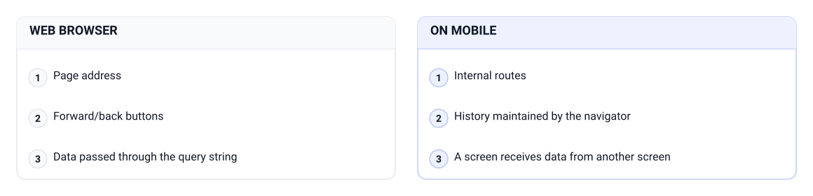
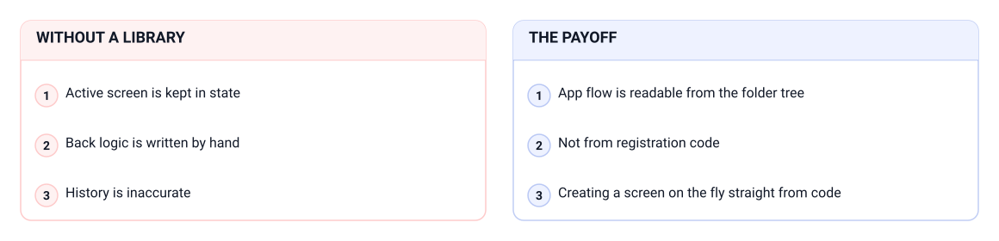
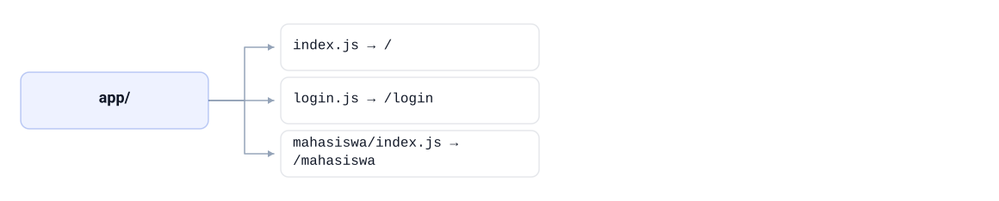
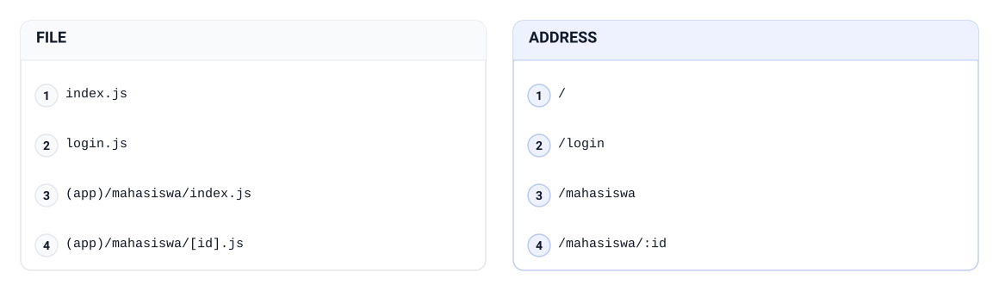
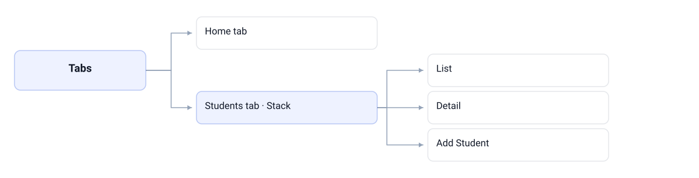
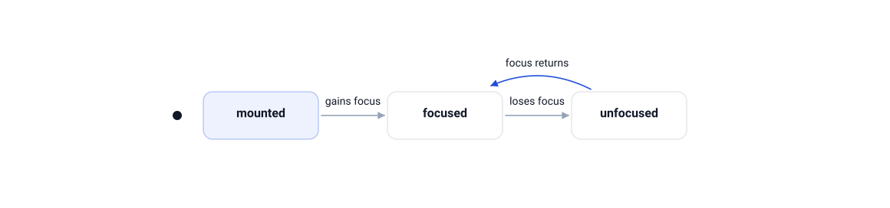
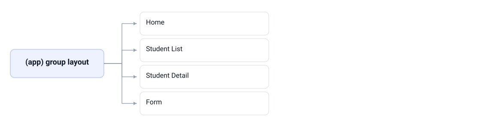
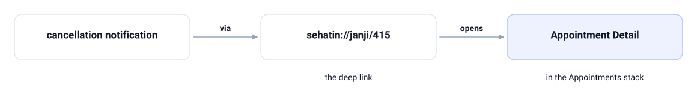

<!-- _class: lead -->
<!-- _paginate: skip -->
<!-- _footer: "" -->

# Bab 7 — Navigasi Aplikasi

Rute dari struktur folder · Pertemuan 7 · Sub-CPMK 4.1

<!--
Buka dengan satu kalimat: "Bab 5 dan Bab 6 menghasilkan layar; hari ini layar itu disambung
menjadi satu aplikasi yang bisa ditelusuri pengguna."

Sebutkan kaitan RPS: pertemuan 7 memuat Bab 6 (Sub-CPMK 3.1 dan 3.2) dan Bab 7 (Sub-CPMK
4.1). Deck ini hanya Bab 7; praktikumnya berlanjut ke Bab 8.

Pertanyaan pembuka: "Siapa yang pernah menekan tombol kembali lalu mendarat di layar yang
salah?" Simpan pertanyaan itu sampai slide layar terlindungi.
-->

---

## Tujuan Pembelajaran

Setelah bab ini, kamu bisa:

- Menjelaskan konsep navigasi mobile serta pola stack, tab, dan drawer
- Mengimplementasikan setup Expo Router pada project template blank
- Membedakan navigasi deklaratif (`<Link>`) dan imperatif (`router.push`)
- Menerapkan dynamic route dan pengiriman parameter antar layar
- Merancang nested navigation, `useFocusEffect`, dan layar terlindungi

<!--
Bacakan hanya kata kerjanya. Butir pertama adalah konsep yang diujikan di UTS; butir kedua
sampai kelima dinilai langsung di praktikum pertemuan ini.

Tegaskan bahwa butir kelima bersifat merancang, bukan menghafal: mahasiswa harus bisa memilih
struktur folder, bukan sekadar menyalin contoh.

Kaitkan dengan penilaian: rubrik praktikum Bab 7 ditambah soal uraian UTS tentang pola
navigasi.
-->

---

<!-- _class: lead -->
<!-- _paginate: skip -->

# Bagian 1 — Pola Navigasi Mobile

subbab 7.1 Konsep · 7.2 Stack · 7.3 Tab · 7.4 Drawer

<!--
Bagian paling konseptual. Kalau waktu pertemuan menipis, padatkan subbab 7.4 (drawer), tetapi
subbab 7.1 jangan dilewati karena seluruh bab bergantung padanya.

Peringatan: mahasiswa yang melewatkan Bagian 1 biasanya tersesat di Bagian 3, saat layout
bersarang harus dijelaskan.
-->

---

<!-- _class: compact -->

## Navigasi Mengatur Layar, Riwayat, dan Data



**Navigasi** adalah sistem yang mengatur tumpukan layar yang sedang aktif, riwayat kunjungan, dan cara sebuah layar menerima data dari layar lain.

**Yang menempel pada sistem operasi**

- Android: tombol atau gestur "kembali" milik perangkat
- iOS: gestur geser dari tepi kiri layar

<!--
Analogi browser memindahkan pengetahuan yang sudah dimiliki mahasiswa: alamat, riwayat, dan
data yang menempel pada alamat adalah konsep yang sama.

Pertanyaan penuntun: "Apa padanan tombol kembali browser di HP Android?" (Tombol atau gestur
kembali milik perangkat — dan itulah sebabnya navigasi yang salah terasa sangat mengganggu.)

Dipotong ke gambar (diagram yang mengatakan ini):
- Alamat halaman, tombol maju dan mundur, data yang dilewatkan lewat query string
- Di mobile: rute internal, riwayat dijaga oleh navigator

Judul kolom "Analogi: browser web" ikut pindah bersama keduanya: panel kiri gambar berjudul
WEB BROWSER, jadi analoginya dibaca dari gambar, bukan dari label di slide.

Butir sistem operasi sengaja tinggal di slide: tombol kembali Android dan gestur geser iOS
tidak ada di dalam gambar.
-->

---

## Salah Memilih Navigasi Terasa Langsung oleh Pengguna



- Hampir semua fitur bergantung pada navigasi; kesalahan di sini langsung terasa
- Tanpa library, layar aktif disimpan di state dan logika kembali ditulis tangan
- Akibatnya: state layar bercampur dengan data, riwayat tidak akurat, transisi tidak konsisten
- Hasilnya: alur aplikasi terbaca dari pohon folder, bukan dari kode pendaftaran
- Trade-off: membuat layar langsung dari kode menjadi lebih terbatas

<!--
Ini slide "kenapa", bukan slide "bagaimana". Tekankan bahwa pengelolaan riwayat dan gestur
kembali adalah pekerjaan yang selalu berulang, jadi wajar diserahkan ke library.

Pertanyaan penuntun: "Apa yang terjadi kalau riwayat dibangun sendiri dengan state?" (Aplikasi
makin besar, state bercampur, tombol kembali jadi tak terduga, dan pengguna mengeluh.)

Peringatan salah paham: Expo Router bukan sekadar library, ia menambah satu tingkat abstraksi
— rute didefinisikan lewat folder, bukan lewat kode.

Kaitkan dengan butir terakhir: batasan "setiap layar harus ada sebagai file" justru menjadi
keuntungan untuk aplikasi bisnis dan Project Akhir.
-->

---

## Tiga Pola, Tiga Cara Berpindah

| Pola | Ciri | Contoh pemakaian |
|---|---|---|
| **Stack** | Layar baru menutupi layar lama; tombol kembali membuka layar sebelumnya | Daftar → Detail → Form |
| **Tab** | Layar sejajar tanpa hierarki; layar tetap hidup saat berpindah | Beranda, Daftar, Profil |
| **Drawer** | Menu tersembunyi di sisi layar; hemat ruang | Pengaturan, menu admin |

> Ketiganya tidak saling meniadakan: aplikasi profesional memakai tab sebagai kerangka, stack di dalam tiap tab, dan drawer untuk menu sekunder.

<!--
Minta mahasiswa menyebut satu aplikasi di HP-nya untuk tiap baris tabel; pengalaman konkret
lebih menempel daripada definisi.

Peringatan salah paham: tab bukan versi sederhana dari stack. Keduanya menjawab masalah
berbeda, yaitu layar sejajar versus layar bertingkat.

Butir "tidak saling meniadakan" adalah jembatan ke slide nested navigation di Bagian 3.
-->

---

## Stack dan Tab: Tiga Perbedaan

| Aspek | Stack | Tab |
|---|---|---|
| Hierarki | Induk dan anak: layar baru menutupi layar lama | Sejajar: tidak ada layar yang menutupi |
| Kondisi layar | Layar tertutup bisa dilepas dari memori | Setiap layar tetap ter-*mount*, hanya kehilangan fokus |
| Cara berpindah | Push dan pop dengan transisi bertumpuk | Perpindahan seketika antar layar sejajar |

> Aturan praktis industri: tab untuk dua sampai lima fungsi utama yang selalu dibutuhkan cepat; stack untuk alur detail yang bertingkat dan sementara.

<!--
Baris kedua tabel ini adalah akar masalah "daftar basi" di subbab 7.7. Katakan bahwa kita akan
kembali ke baris itu nanti; jangan dijelaskan sekarang.

Pertanyaan penuntun: "Kenapa alur detail tidak cocok dijadikan tab?" (Langkah kembali menjadi
tidak wajar; tab tidak menyimpan hierarki langkah.)

Hubungkan baris ketiga dengan perkataan mahasiswa sendiri: stack punya langkah yang bisa
dikembalikan, tab hanya punya posisi.
-->

---

<!-- _class: compact -->

## Drawer Menyembunyikan Menu demi Menghemat Ruang

- Dibuka dengan geser dari tepi kiri atau menekan ikon hamburger
- Kuat untuk banyak menu sekunder: pengaturan, bantuan, laporan
- Kurang cocok untuk fungsi harian karena menunya tidak langsung terlihat

```js
import { Drawer } from 'expo-router/drawer';

export default function LayoutDrawer() {
  return (
    <Drawer screenOptions={{ drawerPosition: 'left' }}>
      <Drawer.Screen name="index" options={{ title: 'Beranda' }} />
      <Drawer.Screen name="pengaturan" options={{ title: 'Pengaturan' }} />
    </Drawer>
  );
}
```

<!--
Perkenalkan saja tanpa dipraktikkan: praktikum bab ini memakai stack dan tab karena keduanya
mencakup sebagian besar kebutuhan aplikasi bisnis.

Dipotong ke catatan (tidak muat di slide): `app/_layout.js` — pengenalan, bukan materi
praktikum. Sebutkan ini sebelum kode dibaca.

Ucapkan peringatan yang dulu tercetak di bawah kode, dengan kata-kata ini: sensitif versi —
drawer bergantung pada paket @react-navigation/drawer; periksa docs.expo.dev/router untuk versi
SDK yang kamu pakai.

Ingatkan penanda sensitif versi: nama impor drawer dan langkah pemasangannya bergantung pada
versi, jadi jangan menyalin dari tutorial lama.
-->

---

<!-- _class: center -->

## Latihan: Pilih Polanya

- **A.** Cari pasien → lihat detail janji → batalkan janji
- **B.** Beranda, Janji, dan Profil yang dibuka puluhan kali sehari
- **C.** Menu Pengaturan, Bantuan, dan Laporan yang jarang dibuka

Tentukan pola untuk tiap kebutuhan, lalu sebutkan alasannya.

<!--
Think-pair-share 3 menit, lalu tampung 2 sampai 3 jawaban. Jawabannya baru dibahas di slide
berikutnya, jadi jangan bocorkan dulu.

Kalau kelas menjawab tab untuk semuanya, ulangi pertanyaan penuntun: "Mana yang bertingkat dan
mana yang sejajar?"

Yang dinilai adalah alasannya, bukan pilihan polanya: jawaban "stack karena modern" belum
menjawab.
-->

---

## Jawaban: Pola dan Alasannya

| Kebutuhan | Pola | Alasan |
|---|---|---|
| A. Cari pasien → detail → batalkan | Stack | Bertingkat; kembali harus ke langkah sebelumnya |
| B. Beranda, Janji, Profil | Tab | Fungsi utama, diakses cepat, tidak saling menutupi |
| C. Pengaturan, Bantuan, Laporan | Drawer | Menu sekunder; hemat ruang layar |

> Pola yang sama dipakai aplikasi praktikum: tab Beranda dan tab Mahasiswa, dengan stack di dalam tab Mahasiswa.

<!--
Hubungkan jawaban kelas dengan praktikum bab ini: struktur tab berisi stack inilah yang
dibangun langkah kerja Praktikum 7.

Peringatan: menaruh "Detail, Pembayaran, Pengiriman" sebagai tiga tab adalah kekeliruan yang
dibahas di soal analisis bab ini.

Minta satu mahasiswa mengulang alasan baris pertama dengan kalimatnya sendiri sebelum lanjut.
-->

---

<!-- _class: lead -->
<!-- _paginate: skip -->

# Bagian 2 — Expo Router: Rute dari Folder

subbab 7.2 file-based routing · setup pada project blank

<!--
Bagian paling teknis: tiga penyesuaian konfigurasi. Pastikan mahasiswa menyelesaikan ketiganya
sebelum membuat file di folder app/, karena kesalahan di sini muncul sebagai layar kosong saat
aplikasi dijalankan.

Sediakan lima menit untuk mengerjakan ketiganya bersama, lalu periksa satu per satu.
-->

---

## Folder Menjadi Alamat, File Menjadi Layar



**Expo Router** adalah library navigasi resmi ekosistem Expo dan menerapkan **file-based routing**: setiap file di folder `app/` menjadi satu layar, dan nama file menjadi alamatnya.

**Bedanya dengan cara lama**

- Dulu setiap layar didaftarkan satu per satu di dalam kode
- Sekarang struktur aplikasi terlihat dari pohon folder

<!--
Tekankan akibat praktisnya: menambah layar berarti menambah file, bukan menambah baris
pendaftaran, sehingga dua pengembang tidak lagi berebut satu file rute.

Pertanyaan penuntun: "Kalau folder mahasiswa/ dipindah, berapa tempat yang harus diubah?"
(Jawaban: satu, struktur folder; alamatnya mengikuti otomatis.)

Dipotong ke gambar (diagram yang mengatakan ini):
- `app/index.js` menjadi `/`
- `app/login.js` menjadi `/login`
- `app/mahasiswa/index.js` menjadi `/mahasiswa`

Gambar sengaja hanya satu tingkat: folder mahasiswa/ baru berisi satu file di titik ini, dan
tiga chip itu adalah satu-satunya file layar yang disebut slide.
-->

---

## Tiga Penyesuaian Sebelum Folder `app/` Dipakai

1. Pasang paket navigasi dengan `npx expo install` pada project template blank (Bab 2)
2. Ubah properti `"main"` di `package.json` menjadi `"expo-router/entry"`
3. Tambahkan properti `"scheme"` di `app.json` untuk mendukung deep linking

**Deep linking** adalah link langsung yang membuka layar tertentu dari luar aplikasi, misalnya dari notifikasi (Bab 12).

> Setelah ketiganya selesai, `App.js` tidak lagi dimuat dan boleh dihapus.

<!--
Sebutkan akibat kalau langkah kedua terlewat: Metro masih mencari App.js yang sudah dihapus,
dan aplikasi menampilkan layar kosong. Itulah butir troubleshooting pertama di bab ini.

Deep linking cukup diperkenalkan di sini; penerapannya di Bab 12 bersama notifikasi.

Pertanyaan penuntun: "Kenapa nilai scheme harus konsisten di seluruh project?" (Supaya link
dari luar aplikasi, misalnya dari notifikasi, selalu diarahkan ke aplikasi yang benar.)
-->

---

## Paket dan Titik Masuk: Dua Perubahan Pertama

```bash
npx expo install expo-router react-native-safe-area-context react-native-screens expo-linking expo-constants expo-status-bar
```

`package.json` — potongan, hanya properti yang relevan

```json
{
  "main": "expo-router/entry"
}
```

> ⚠ sensitif versi: dokumentasi lama menulis `node_modules/expo-router/entry`; bentuk `expo-router/entry` yang dipakai di sini lebih baru.

<!--
Jelaskan peran paket pendukung: react-native-screens memakai komponen native untuk performa,
react-native-safe-area-context mengurus area aman layar, sedangkan expo-linking dan
expo-constants mendukung deep linking dan konfigurasi.

Ingatkan penanda sensitif versi pada nilai main: salin dari dokumentasi resmi untuk versi SDK
yang terpasang, bukan dari tutorial lama.

Peringatan: jangan menyalin seluruh isi package.json dari internet; yang berubah hanya satu
properti.
-->

---

## Satu Properti Lagi: `scheme` untuk Deep Linking

`app.json` — potongan, tambahkan `"scheme"` di dalam objek `"expo"`

```json
{
  "expo": {
    "name": "siakad-mobile",
    "slug": "siakad-mobile",
    "version": "1.0.0",
    "scheme": "siakad-mobile"
  }
}
```

> Nilai `scheme` bebas ditentukan, tetapi harus konsisten di seluruh project; inilah alamat aplikasi untuk deep linking, misalnya `siakad-mobile://...`.

<!--
Sebutkan bahwa slug siakad-mobile adalah nama project Aplikasi Manajemen Data Mahasiswa yang
dibangun sepanjang buku ini; nilai scheme-nya kebetulan sama dengan slug.

Peringatan: mahasiswa yang menyalin app.json dari tutorial akan membawa nama dan slug lain;
yang penting bukan nilainya, melainkan konsistensinya di seluruh project.

Ulangi satu kalimat penutup: setelah ketiga perubahan selesai, App.js tidak lagi dimuat dan
boleh dihapus — kalau langkah ini terlewat, aplikasi menampilkan layar kosong.
-->

---

<!-- _class: compact -->

## Tanda Kurung Mengelompokkan, Bukan Menambah Alamat



> Folder dalam tanda kurung adalah grup rute: ia tidak menambah segmen alamat, jadi `index.js` menjadi `/` dan `[id].js` menjadi `:id` dinamis.

<!--
Dipotong ke catatan (tidak muat di slide): kalimat penuh penjelas diagram — folder bertanda
kurung seperti `(app)` adalah grup rute: ia tidak menambah segmen alamat, sehingga `index.js`
adalah `/`, `login.js` adalah `/login`, `(app)/mahasiswa/index.js` adalah `/mahasiswa`, dan
`(app)/mahasiswa/[id].js` adalah dinamis `/mahasiswa/:id`.

Minta mahasiswa membacakan setiap baris: file mana menghasilkan alamat mana. Ini latihan
membaca struktur folder yang dipakai sepanjang sisa bab.

Kesalahan yang sering: mengira alamatnya menjadi /(app)/mahasiswa. Tegaskan bahwa tanda kurung
justru menghapus segmen itu dari alamat.

Pertanyaan penuntun: "Alamat mana yang akan muncul di deep linking?" (Alamat tanpa tanda
kurung, karena grup tidak menambah segmen.)
-->

---

<!-- _class: compact -->

## Enam File Cukup untuk Aplikasi Manajemen Data Mahasiswa

| Alur | File di folder `app/` | Alamat |
|---|---|---|
| Pengalihan awal | `index.js` | `/` |
| Login | `login.js` | `/login` |
| Beranda | `(app)/index.js` | `/` (di dalam grup) |
| Daftar mahasiswa | `(app)/mahasiswa/index.js` | `/mahasiswa` |
| Detail mahasiswa | `(app)/mahasiswa/[id].js` | `/mahasiswa/:id` |
| Form tambah/edit | `(app)/mahasiswa/tambah.js` | `/mahasiswa/tambah?edit=...` |

- Detail dan Form sengaja bukan tab: keduanya bergantung pada layar Daftar
- Login diletakkan di luar grup `(app)` supaya tidak ikut terlindungi

<!--
Tabel ini adalah peta kerja Praktikum 7 dan sekaligus peta rute Aplikasi Manajemen Data
Mahasiswa. Minta mahasiswa menandai file mana yang sudah mereka buat dan mana yang belum
sebelum praktikum dimulai.

Pertanyaan penuntun: "Kenapa Detail dan Form tidak dijadikan tab?" (Keduanya bertingkat dan
harus bisa kembali ke Daftar; tab tidak dirancang untuk hubungan bertingkat.)

Peringatan: perhatikan baris terakhir — kalau login.js diletakkan di dalam grup (app), alur
login akan berputar tanpa henti di Bagian 3 nanti.
-->

---

<!-- _class: lead -->
<!-- _paginate: skip -->

# Bagian 3 — Layar, Parameter & Perlindungan

subbab 7.5 parameter · 7.6 nesting · 7.7 lifecycle · 7.8 protected

<!--
Bagian terpadat. Kalau waktu tinggal sedikit, prioritaskan subbab 7.5 (parameter) dan 7.8
(layar terlindungi); subbab 7.7 bisa dilanjutkan sebagai tugas bacaan.

Peringatan: kesalahan konfigurasi dari Bagian 2 akan muncul di sini sebagai layar kosong, jadi
periksa package.json dulu sebelum menduga-duga soal kode.
-->

---

<!-- _class: compact -->

## Satu `<Stack />` di Layout Akar Menampung Semua Layar

`app/_layout.js` — satu stack untuk seluruh aplikasi

```js
import { Stack } from 'expo-router';
import { StatusBar } from 'expo-status-bar';
export default function LayoutRoot() {
  return (
    <>
      <StatusBar style="light" />
      <Stack screenOptions={{ headerTitleAlign: 'center' }}>
        <Stack.Screen name="(app)" options={{ headerShown: false }} />
        <Stack.Screen name="login" options={{ title: 'Masuk' }} />
      </Stack>
    </>
  );
}
```

<!--
Dipotong ke catatan (tidak muat di slide): layar yang tidak disebut pun tetap ikut ke dalam
stack: daftar `<Stack.Screen>` bersifat opsional.

Tekankan dua hal: screenOptions memberi gaya seragam untuk seluruh stack, dan grup (app)
disembunyikan headernya karena grup itu menampilkan tabnya sendiri.

Ingatkan bahwa file ini adalah panggung seluruh aplikasi; setiap layar muncul di atasnya. Versi
lengkapnya ada di kode/bab-07-navigasi-aplikasi/app/_layout.js.

Pertanyaan penuntun: "Kenapa (app) perlu headerShown: false?" (Karena tab di dalamnya sudah
punya header sendiri; kalau tidak, muncul dua bilah judul.)
-->

---

<!-- _class: compact -->

## Deklaratif untuk Link, Imperatif untuk Logika (1/2)

**Deklaratif** — link yang dilihat pengguna

```js
import { Link } from 'expo-router';

<Link href={{ pathname: '/profil', params: { id: '2201001' } }} asChild>
  <Pressable><Text>Buka profil (deklaratif)</Text></Pressable>
</Link>
```

> `asChild` wajib: tanpa itu, `Link` dan `Pressable` berebut gestur dan kartunya terasa mati.

<!--
Contoh ini mengikuti Contoh 7.2 di buku: dua gaya, hasil setara, peran berbeda. Slide ini
memuat gaya pertama; gaya kedua ada di slide berikutnya.
-->

---

<!-- _class: compact -->

## Deklaratif untuk Link, Imperatif untuk Logika (2/2)

**Imperatif** — dipicu logika program

```js
import { router } from 'expo-router';

<Pressable
  onPress={() => router.push({ pathname: '/profil', params: { id: '2201002' } })}
>
  <Text>Buka profil (imperatif)</Text>
</Pressable>
```

> Pakai `Link` untuk yang terlihat; pakai `router` untuk perpindahan yang lahir dari proses, misalnya `replace` setelah login dan `back` setelah menyimpan.

<!--
Contoh deklaratif dan asChild ada di slide sebelumnya.

Troubleshooting bab ini menyebut dua sebab: dua komponen sentuh berebut gestur, atau link
digambar sebagai teks tanpa gaya sentuh.
-->

---

## Nilai dari Alamat Selalu Berupa String

`app/(app)/mahasiswa/[id].js` — membaca nilai dari alamat

```js
import { Text } from 'react-native';
import { useLocalSearchParams } from 'expo-router';

export default function LayarDetail() {
  const { id } = useLocalSearchParams();
  return <Text>Detail mahasiswa dengan id: {String(id)}</Text>;
}
```

- Kurung siku menandai segmen dinamis: `/mahasiswa/2201001`
- Query parameter untuk nilai opsional: `/mahasiswa/tambah?edit=2201001`
- Setiap nilai dari alamat berupa string; `String(id)` menjaga nilai yang datang sebagai array
- Parameter yang tidak ada bernilai `undefined`, jadi periksa dulu sebelum dipakai

<!--
Demonstrasikan dengan dua alamat berbeda, misalnya 2201001 dan 2201003, pada file [id].js yang
sama. Inilah inti dynamic route.

Peringatan: nilai dari alamat selalu string. Mahasiswa yang membandingkannya langsung dengan
angka akan menemui "data tidak ditemukan" padahal datanya ada.

Pertanyaan penuntun: "Kenapa String(id) diperlukan kalau id hanya satu?" (Karena parameter yang
sama bisa datang sebagai array, misalnya /mahasiswa/[id]?id=1&id=2.)
-->

---

## Tab yang Berisi Stack Punya Riwayat Sendiri



- Tiap tab punya riwayatnya sendiri: berpindah tab tidak menghapus posisimu di stack
- Header ganda dicegah dengan `headerShown: false` pada Tabs, sehingga hanya satu pemilik yang menampilkan header
- Stack terdalam yang menampilkan judul tiap layar: Daftar, Detail, dan Tambah Mahasiswa

<!--
Bacakan gambar sebagai struktur folder: lapisan atas app/(app)/_layout.js memegang Tabs, dan
folder mahasiswa/ punya _layout.js sendiri yang memegang Stack.

Pertanyaan penuntun: "Apa yang terjadi kalau Tabs juga menampilkan header?" (Dua bilah judul
bertumpuk; masalah paling kentara di praktikum.)

Tegaskan bahwa label di gambar berbahasa Inggris dan tidak bisa dibangun ulang; teks slide yang
menjadi acuan istilah Indonesianya.
-->

---

## Kenapa Daftar Masih Basi Setelah Kembali?



> Layar tab tidak dilepas dari memori; `useEffect` biasa hanya berjalan saat *mount*, tidak saat fokus kembali.

<!--
Hubungkan dengan baris kedua tabel stack versus tab: karena layarnya tetap ter-mount, useEffect
tidak terpicu lagi saat pengguna kembali ke tab itu.

Pertanyaan penuntun: "Lalu kapan daftar mengambil data baru?" (Saat layar mendapat fokus. Itulah
sebabnya useFocusEffect ada.)

Peringatan: gejala ini tidak menimbulkan error apa pun, jadi mahasiswa sering menyimpulkan
datanya salah, padahal proses pengambilannya yang tidak dijalankan ulang.
-->

---

## `useFocusEffect` Butuh `useCallback`

`app/(app)/index.js` — pola pemantauan fokus

```js
import { useCallback } from 'react';
import { useFocusEffect } from 'expo-router';

useFocusEffect(
  useCallback(() => {
    // berjalan setiap layar mendapat fokus
    return () => {
      // pembersihan setiap layar kehilangan fokus
    };
  }, [])
);
```

- Argumennya wajib dibungkus `useCallback`; tanpa itu efek menyala berulang di setiap render
- Daftar dependency `useCallback` menentukan kapan efek dianggap berubah, misalnya `[id]`

<!--
Polanya punya dua bagian: fungsi efek dan fungsi pembersihan. Tunjukkan bahwa keduanya
berpasangan seperti masuk ruangan dan mematikan lampu saat keluar.

Peringatan dari troubleshooting bab ini: useFocusEffect tanpa useCallback membuat efek berjalan
terus-menerus; gejalanya muncul di konsol, bukan di layar.

Pertanyaan penuntun: "Kapan fungsi pembersihan dijalankan?" (Saat layar kehilangan fokus, dan
sekali lagi sebelum efek dijalankan ulang.)
-->

---

## `useEffect` atau `useFocusEffect`?

| Kebutuhan | Hook | Alasan |
|---|---|---|
| Mengambil data sekali saat component *mount* | `useEffect` | Berjalan sekali; tidak bergantung fokus |
| Menyegarkan daftar setiap layar terlihat lagi | `useFocusEffect` | Layar tab tetap ter-*mount*, jadi fokus harus dipantau |

> Praktikum bab ini memakai `useFocusEffect` di Beranda untuk menyimulasikan penyegaran; pola yang sama dipakai di Bab 10 saat datanya datang dari API.

<!--
Aturan pemilihan inilah yang paling sering ditanyakan: bedakan "berjalan sekali" dari "berjalan
setiap kali terlihat", bukan "baru" dari "lama".

Pertanyaan penuntun: "Beranda memperbarui waktu terakhir dilihat; hook mana yang tepat?"
(useFocusEffect, karena prosesnya harus diulang setiap layar terlihat.)

Peringatan: useEffect dengan dependency [] tidak akan menolong di sini, karena layar tab tidak
pernah di-mount ulang.
-->

---

## Perlindungan di Satu Titik Berlaku untuk Semua Layar



> Perlindungan berada di satu titik, yaitu layout grup `(app)`, dan berlaku otomatis untuk setiap layar di dalamnya, termasuk layar yang ditambahkan kemudian.

<!--
Tekankan prinsip satu titik kendali: pemeriksaan per layar mudah terlupa, terutama saat aplikasi
tumbuh dan satu layar baru tertinggal tanpa pemeriksaan.

Pertanyaan penuntun: "Kalau besok ditambah layar Laporan, perlu diperiksa status loginnya juga?"
(Tidak, selama layar itu ada di dalam grup (app).)

Bandingkan dengan kebiasaan menyalin pemeriksaan ke setiap layar: satu salinan yang terlewat
langsung menjadi celah keamanan.
-->

---

## Salah Menempatkan `login.js` Menghasilkan Redirect Loop

`app/(app)/_layout.js` — pemeriksaan sebelum tab digambar

```js
import { Redirect, Tabs } from 'expo-router';
import { isLoggedIn } from '../../lib/session';

export default function LayoutAplikasi() {
  if (!isLoggedIn()) {
    return <Redirect href="/login" />;
  }
  return <Tabs>...</Tabs>;
}
```

- `<Redirect />` lebih dipilih daripada navigasi manual: deklaratif dan aman saat render
- Layar login harus di luar grup terlindungi supaya redirect loop tidak terjadi

<!--
Jebakan utama bab ini: kalau login.js diletakkan di dalam grup (app), pengguna yang belum masuk
terlempar ke login, layar login ikut diperiksa autentikasinya, lalu perpindahan berulang tanpa
henti.

Sebutkan juga bahwa status masuk di memori (lib/session.js) hilang saat aplikasi ditutup;
penerapan sebenarnya ada di Bab 11 (penyimpanan) dan Bab 13 (token).

Peringatan: jangan menambal dengan setTimeout atau flag "sudah dicek"; perbaiki penempatan
filenya.
-->

---

<!-- _class: center -->

## Apa yang Terjadi Jika…?

- `useFocusEffect` dipakai tanpa `useCallback`?
- `login.js` diletakkan di dalam grup `(app)`?
- Tabs tidak menyembunyikan header di atas Stack?

Sebutkan gejala yang dilihat pengguna, bukan hanya nama error-nya.

<!--
Diskusi kelas empat menit: bagi menjadi tiga kelompok kecil, satu skenario per kelompok, lalu
tiap kelompok melaporkan satu gejala yang terlihat di layar.

Analisis lengkapnya ada di slide berikutnya, jadi jangan bocorkan lebih dulu.

Peringatan: jawaban "aplikasinya error" belum menjawab; minta gejala yang bisa difoto.
-->

---

<!-- _class: compact -->

## Tiga Skenario, Tiga Sebab, Tiga Gejala

| Skenario | Penyebab | Gejala yang terlihat |
|---|---|---|
| `useFocusEffect` tanpa `useCallback` | Fungsi baru dibuat di setiap render | Efek terus berjalan; ada peringatan di konsol |
| `login.js` di dalam grup `(app)` | Layar login ikut diperiksa autentikasi | Pengguna terlempar ke login berulang kali |
| Tabs tidak menyembunyikan header | Tabs dan Stack sama-sama menampilkan header | Dua bilah judul bertumpuk di layar Detail |

<!--
Untuk setiap baris, minta mahasiswa menyebutkan perbaikannya dalam satu kalimat: bungkus dengan
useCallback; pindahkan login ke luar grup; setel headerShown false pada Tabs.

Tegaskan bahwa ketiganya adalah kesalahan yang paling sering muncul di praktikum bab ini,
sehingga ketiganya juga masuk penilaian debugging.

Pertanyaan penuntun: "Gejala mana yang tidak menampilkan error sama sekali?" (Baris pertama;
itulah sebabnya ia paling lama tidak ditemukan.)
-->

---

## Studi Kasus: Klinik "SehatIn"



**Contoh ilustratif** di bab ini: klinik pratama di Semarang, tim tiga orang tanpa pengalaman mobile, harus memutuskan struktur navigasi sebelum menulis kode.

- **Pola:** tiga tab (Beranda, Janji, Profil) + stack di dalam tiap tab
- **Penjaga:** pemeriksaan akses di layout grup, bukan di setiap layar

> Kesimpulan bab: struktur navigasi adalah keputusan arsitektur. Salah memilih berarti pengguna tersesat, kode sulit dirawat, dan perbaikan menjadi mahal.

<!--
Bacakan sebagai kisah keputusan, bukan daftar fitur: tanpa tab, pasien yang ingin melihat jadwal
harus menekan kembali berkali-kali dari layar terdalam. Sebutkan bahwa ini contoh ilustratif di
buku, bukan sistem nyata yang berjalan.

Tegaskan bahwa pola yang diambil dari kasus ini dipakai ulang di Project Akhir, yaitu Sistem
Informasi Akademik Mobile: tab untuk fungsi utama, stack untuk detail, satu titik penjagaan.

Dipotong ke gambar (diagram yang mengatakan ini):
- **Deep linking:** notifikasi pembatalan membuka Detail Janji lewat `sehatin://janji/415`

SehatIn sengaja berdiri sendiri: ia aplikasi lain yang melakukan hal yang sama, bukan aplikasi
yang kamu bangun di bab ini.
-->

---

## Praktikum: Yang Dibangun Pertemuan Ini

1. Buka aplikasi; layar Login muncul karena pengalihan di `index.js`
2. Tekan Login dan mendarat di Beranda dengan dua tab: Beranda dan Mahasiswa
3. Tab Mahasiswa menampilkan lima kartu data statis; tekan satu kartu dan Detail terbuka
4. Tombol "Ubah data ini" membuka formulir dengan isian yang sudah terisi data lama
5. Tekan Logout, kembali ke Login, dan tombol kembali tidak membuka Beranda

> Data statis Aplikasi Manajemen Data Mahasiswa: Budi Santoso, Siti Aminah, Agus Wijaya, Dewi Lestari, dan Rizky Pratama.

<!--
Bacakan sebagai skenario uji yang dijalankan di laboratorium, bukan sebagai daftar fitur.
Tekankan langkah 2 dan 5 karena keduanya bergantung pada router.replace.

Peringatan: kalau langkah 5 gagal, periksa apakah layar login memakai router.push; dengan push,
pengguna masih bisa kembali ke layar login setelah masuk.

Sebutkan bahwa aplikasi ini adalah Aplikasi Manajemen Data Mahasiswa yang dibangun bertahap
sampai Bab 15; hari ini kerangka navigasinya yang berdiri.
-->

---

## Yang Harus Teramati

Untuk praktikum ini, catat empat hal:

- **Alur utuh** — Login → Beranda → Daftar → Detail → Form berjalan tanpa layar kosong
- **Riwayat tiap tab** — posisi di tab Mahasiswa tidak hilang setelah berpindah ke Beranda
- **Parameter terbaca** — Detail menampilkan `id` yang benar, formulir terisi data lama
- **Satu header** — tidak ada dua bilah judul bertumpuk di layar mana pun

> Bukti yang bisa diperiksa, bukan kesan: "tombol kembali di Detail membuka Daftar, bukan Login" lebih kuat daripada "navigasinya sudah jalan".

<!--
Empat hal inilah yang dinilai di praktikum, jadi bacakan perlahan. Yang paling sering hilang
adalah butir kedua: mahasiswa melaporkan alur, tetapi tidak menguji riwayat tiap tab.

Beri satu contoh buruk dan satu contoh baik di papan tulis, lalu minta mereka menilai mana yang
bisa diperiksa ulang oleh orang lain.

Kalau waktu memungkinkan, minta satu mahasiswa membuka aplikasinya di depan kelas dan
menunjukkan bukti untuk keempat butir ini.
-->

---

<!-- _class: compact -->

## Periksa Konfigurasi, Gestur, dan Tipe Data Dulu

| Gejala | Penyebab | Solusi |
|---|---|---|
| Layar kosong setelah ubah `package.json` | `main` belum `expo-router/entry`; Metro mencari `App.js` | Perbaiki `main`, lalu `npx expo start -c` |
| Kartu tidak bereaksi saat ditekan | `Link` tanpa `asChild` membungkus `Pressable` | Pakai `<Link asChild><Pressable>` |
| "Data mahasiswa tidak ditemukan" | Parameter string dibandingkan dengan `id` non-string | Normalkan dengan `String(id)` |

> Ketiga gejala ini mencakup sebagian besar pertanyaan Praktikum 7; daftar lengkapnya ada di bagian Troubleshooting bab ini.

<!--
Jangan dibacakan semuanya. Pilih satu gejala yang paling sering kamu temui di kelas, minta
mahasiswa menebak sebabnya, baru tampilkan kolom solusinya.

Kebiasaan yang sedang ditanamkan: baca pesan error dan periksa file konfigurasi sebelum minta
bantuan.

Peringatan: menghapus folder node_modules dan memasang ulang bukan solusi untuk ketiga gejala di
atas; itu hanya menghabiskan waktu praktikum.
-->

---

<!-- _class: center -->

## Kuis Kilat

- Alamat apa yang dibuka file `app/mahasiswa/[id].js`?
- Apa peran nilai `"main": "expo-router/entry"` di `package.json`?
- Kenapa layar tab butuh `useFocusEffect`, bukan `useEffect` biasa?
- Kenapa layar login diletakkan di luar grup `(app)`?

<!--
Kuis lisan lima menit: tampilkan pertanyaan, minta kelas menjawab serempak atau dengan mengangkat
tangan, lalu lanjut ke slide kunci.

Jangan menjawab di slide ini, karena ekspor PDF memperlihatkan semua slide ke mahasiswa.

Kalau jawaban kelas beragam di pertanyaan pertama, ulangi slide Folder Menjadi Alamat sebelum
menutup pertemuan.
-->

---

<!-- _class: center -->

## Kunci Kuis Kilat

- `/mahasiswa/<nilai>` untuk nilai apa pun, misalnya `/mahasiswa/2201001`
- Titik masuk aplikasi yang membaca folder `app/` dan menyiapkan navigator
- Karena layar tab tetap ter-*mount* di memori, efek sekali jalan tidak terpicu oleh fokus
- Supaya tidak ikut terlindungi; kalau ikut, pengguna terlempar ke login berulang kali

<!--
Ulangi dua pembedaan yang paling sering tertukar: parameter selalu berupa string, dan tab tidak
pernah melepas layarnya dari memori.

Minta satu nomor lagi secara acak untuk memastikan kelas benar-benar mengikuti, lalu hubungkan
jawaban keempat dengan jebakan redirect loop.

Kalau banyak yang salah di pertanyaan ketiga, ulangi diagram siklus hidup sebelum menutup
pertemuan.
-->

---

## Ringkasan (1/2)

1. Navigasi mengatur perpindahan antar layar, riwayat, dan data yang dilewatkan
2. Pola utamanya: stack (bertingkat), tab (sejajar), dan drawer
3. Expo Router memakai file-based routing: satu file di `app/` menjadi satu rute
4. Setup project blank: pasang paket, ubah `main`, lalu tambahkan `scheme`
5. `<Stack />` dan `<Tabs />` membangun navigator dengan perilaku berbeda

<!--
Jangan dibacakan. Minta mahasiswa memilih satu nomor dan menjelaskannya dengan kata-kata sendiri;
ini bekerja lebih baik daripada mengulang bacaan.

Tekankan nomor 3 sebagai pergeseran paradigma bab ini: dari mendaftarkan layar di dalam kode
menjadi menata file di dalam folder.

Pesan penutup untuk paruh pertama: peta rute Aplikasi Manajemen Data Mahasiswa di slide Enam File
adalah kontrak yang harus dipenuhi praktikum.
-->

---

## Ringkasan (2/2)

1. `<Link>` deklaratif untuk link yang terlihat; `router` imperatif untuk logika
2. Parameter dikirim lewat dynamic route `[id]` dan query `?edit=`, selalu berupa string
3. Nested navigation berarti tab yang berisi stack; `(app)` adalah grup rute tanpa alamat
4. `useFocusEffect` dengan `useCallback` memicu proses setiap layar mendapat fokus
5. Layar terlindungi di satu titik, layout grup, dengan `<Redirect />`

<!--
Hubungkan nomor 2 dengan troubleshooting "data tidak ditemukan": sebagian besar kasus berakar
pada tipe string, bukan pada datanya.

Kalau slide ini terasa terlalu padat, pilih nomor 1, 3, dan 5 untuk diucapkan; sisanya cukup
dibaca mahasiswa.

Tutup dengan pertanyaan reflektif: "Keputusan struktur mana yang paling mahal kalau salah dari
awal?" Pertanyaan itu dibahas di slide diskusi berikutnya.
-->

---

## Diskusi Kelas: Struktur yang Salah Sejak Awal

**Pertanyaan**

- Keputusan struktur mana yang paling mahal kalau salah sejak awal?
- Bagaimana kamu menguji bahwa tombol kembali berperilaku wajar?

**Yang dinilai**

- Ketepatan menghubungkan keputusan dengan riwayat dan fokus layar
- Kemampuan merancang satu skenario uji, bukan sekadar mengutip teori

> Struktur yang tepat membuat aplikasi tumbuh tanpa kehilangan arah; pola yang sama dipakai di Project Akhir.

<!--
Beri tiga menit berpasangan, lalu tampung dua sampai tiga jawaban. Jawaban kuat menyebut tab
untuk fungsi utama, stack untuk alur detail, dan satu titik penjagaan.

Kalau jawaban berhenti di "layarnya banyak", arahkan: "Apa akibatnya bagi tombol kembali
pengguna, dan bagi perawatan kode?"

Yang dinilai bukan panjang jawaban, melainkan kemampuan menghubungkan sebab dengan pencegahan.
-->

---

<!-- _class: compact -->

## Referensi

| Sumber | Link |
|---|---|
| Dokumentasi Expo (2026) | docs.expo.dev |
| Expo Router: Pengenalan (2026) | docs.expo.dev/router/introduction/ |
| Dokumentasi React Native (2026) | reactnative.dev |
| Dokumentasi React (2026) | react.dev |
| Dokumentasi Node.js (2026) | nodejs.org |

**Bacaan lanjutan:** Bab 2 — template blank, Expo Go, emulator; Bab 8 — formulir dan validasi; Bab 10 — data dari API

**Versi teknologi:** Expo SDK 57 · React Native 0.86 · React 19.2 · Node.js ≥ 22

<!--
Rujukan lengkap ada di Lampiran D; istilah Expo Router dan navigasi dijelaskan di glosarium
Lampiran C, sedangkan grup rute didefinisikan di slide Tanda Kurung Mengelompokkan (subbab
7.6).

Ingatkan bahwa dokumentasi daring sangat bergantung pada versi, jadi selalu cocokkan dengan
versi SDK 57 yang dipakai buku ini.

Sumber utama bab ini tetap docs.expo.dev/router, bukan tutorial pihak ketiga yang versinya tidak
diketahui.
-->

---

<!-- _class: lead -->
<!-- _paginate: skip -->

# Siap ke UTS, Lanjut Bab 8

**Praktikum:** selesaikan Praktikum Bab 6 dan Bab 7 sampai alur Login → Beranda → Daftar → Detail → Form berjalan.

Pertemuan 8 adalah **UTS** dengan materi Bab 1–7 (bobot 20%); Tugas 2 (redesain UI aplikasi kampus) masih berjalan sejak Bab 6.

<!--
Tutup dengan satu kalimat: "Bab ini memberi alamat pada layar; Bab 8 memberi isi pada alamat
itu."

Sebutkan cakupan UTS secara eksplisit (Bab 1 sampai 7, bobot 20% menurut RPS) dan rubrik
praktikum: pemahaman konsep 15%, implementasi 25%, kualitas kode 15%, UI/UX 15%, debugging
10%, dokumentasi 20% (Lampiran A).

Pesan terakhir: yang paling sering salah di UTS bukan istilah, melainkan membedakan tab dari
stack dan parameter string dari angka.
-->
