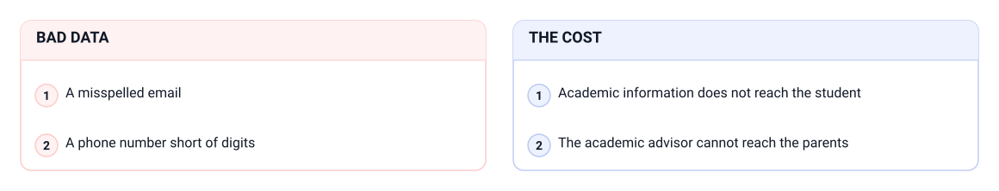
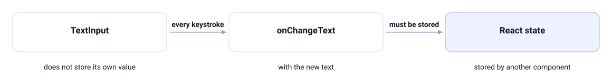
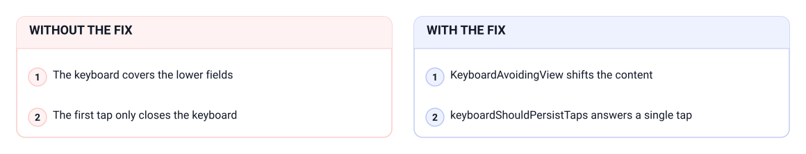
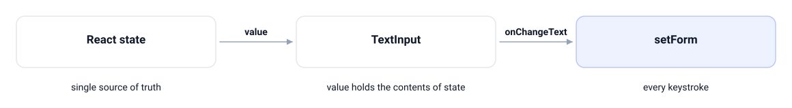
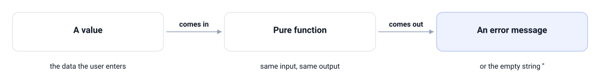
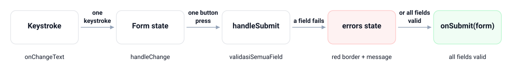
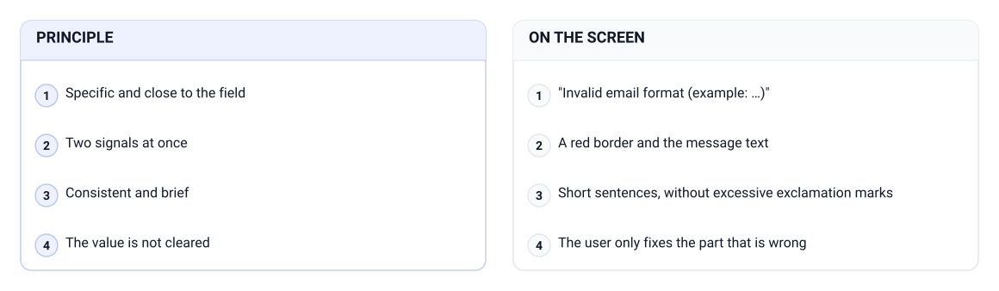
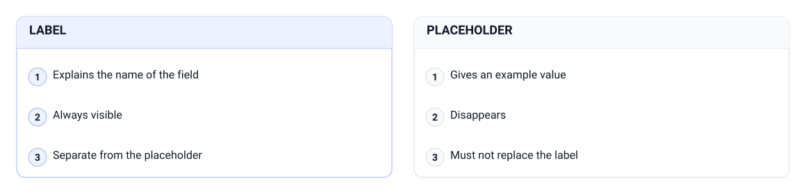
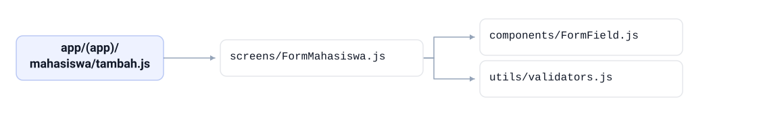
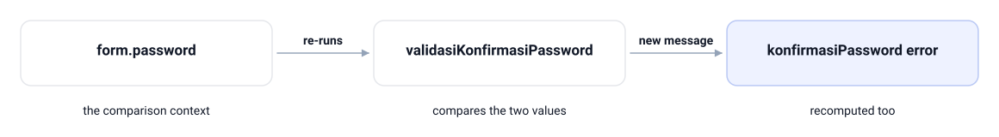

<!-- _class: lead -->
<!-- _paginate: skip -->
<!-- _footer: "" -->

# Bab 8 — Formulir, Input, dan Validasi

Dari ketikan pengguna menjadi data yang layak disimpan · Pertemuan 9 · Sub-CPMK 4.3

<!--
Buka dengan satu kalimat: "Bab 7 sudah memberi aplikasi ini alamat; hari ini kita isi alamat
itu, dan pastikan isinya benar sebelum dikirim."

Sebutkan kaitan RPS: pertemuan 9 membahas Bab 8 (Sub-CPMK 4.3) lalu berlanjut ke Bab 9
(Sub-CPMK 4.2) pada deck terpisah. Tiga formulir di bab ini melanjutkan langsung rute yang
sudah kamu buat di Bab 7.

Aplikasi yang kita bangun sepanjang mata kuliah ini bernama Aplikasi Manajemen Data
Mahasiswa; hari ini ia belajar menerima isian.
-->

---

## Tujuan Pembelajaran

Setelah bab ini, kamu bisa:

- Menjelaskan props utama `TextInput` dan strategi penanganan papan ketik mobile
- Menganalisis *controlled component* dan state sebagai sumber kebenaran tunggal
- Merancang form state satu objek dengan `handleChange` yang bisa dipakai ulang
- Mengimplementasikan validasi fungsi murni dan pesan error per field
- Mengevaluasi trade-off tombol submit nonaktif dan merancang `FormField`

<!--
Bacakan hanya kata kerjanya. Butir keempat dan kelima adalah inti pertemuan ini; butir kelima
sengaja memakai kata mengevaluasi karena mahasiswa harus bisa menjelaskan alasan sebuah
pilihan, bukan sekadar menyalin kode.

Pertanyaan pembuka: "Siapa yang pernah menekan tombol simpan lalu tidak terjadi apa-apa?"
Simpan pertanyaan itu untuk slide trade-off tombol nonaktif di Bagian 3.

Kaitkan dengan penilaian: pertemuan ini dinilai lewat rubrik Praktikum 8 (Lampiran A).
-->

---

<!-- _class: lead -->
<!-- _paginate: skip -->

# Bagian 1 — TextInput dan Papan Ketik

subbab 8.1 · Props utama, `keyboardType`, dan papan ketik virtual

<!--
Bagian ini terlihat teknis, tetapi di sinilah sebagian besar keluhan pengguna lahir: field
tertutup papan ketik dan tombol yang harus ditekan dua kali.

Kalau waktu pertemuan sempit, padatkan tabel props (mahasiswa bisa membacanya sendiri), tetapi
jangan lewati slide "Papan Ketik Virtual Menutupi Setengah Layar".
-->

---

## Data yang Salah Masuk Adalah Biaya



**Garbage in, garbage out** — data buruk yang masuk akan menghasilkan keluaran yang buruk pula.

- NIM yang salah format → laporan basis data harus diperbaiki berulang kali
- Validasi formulir adalah pertahanan pertama, bukan satu-satunya

> Pertahanan berlapis: klien (bab ini), server (Bab 10 dan Bab 13), dan skema basis data.

<!--
Jangan mulai dari kode. Mulai dari biaya: setiap koreksi data di bagian akademik memakan waktu
administrasi dan bisa menunda penerbitan KRS atau transkrip.

Pertanyaan penuntun: "Kalau satu mahasiswa salah mengetik email saat daftar ulang, siapa yang
dirugikan?" (Mahasiswa, dosen wali, staf akademik — satu rantai.)

Peringatan: mahasiswa sering menganggap validasi klien sudah cukup. Tegaskan bahwa aplikasi
bukan satu-satunya pintu masuk data.

Dipotong ke gambar (diagram yang mengatakan ini):
- Email yang salah eja → informasi akademik tidak sampai ke mahasiswa
- Nomor telepon yang kurang digit → dosen wali tidak dapat menghubungi orang tua
-->

---

## TextInput Tidak Menyimpan Nilainya Sendiri



**TextInput** adalah component inti React Native untuk menerima ketikan satu baris atau banyak baris (`multiline`) dari pengguna.

- Setiap ketikan memicu event `onChangeText` berisi teks baru
- Nilai yang diketik harus disimpan component lain, biasanya state React
- Sifat inilah yang melahirkan *controlled component* (subbab 8.2)

> `value`, `onChangeText`, dan `placeholder` adalah pasangan konseptual wajib di setiap field formulir.

<!--
Analogi: TextInput seperti papan tulis yang tidak menyimpan apa pun — kalau tidak ada yang
mencatat, tulisannya hilang begitu papan dihapus.

Pertanyaan penuntun: "Kalau TextInput tidak menyimpan nilainya, siapa yang menyimpan?"
(State React — itulah inti controlled component.)

Peringatan: mahasiswa sering menganggap `value` hanya menampilkan nilai awal, padahal `value`
mengikat field ke state sepanjang waktu.
-->

---

<!-- _class: compact -->

## Tabel 8.1 — Props Utama TextInput (1/2)

| Prop | Fungsi | Contoh nilai |
|---|---|---|
| `value` | Nilai teks dari luar | `{form.email}` |
| `onChangeText` | Dipanggil tiap teks berubah | `handleChange('email', teks)` |
| `placeholder` | Teks contoh saat kosong | `"contoh: 2201001"` |
| `keyboardType` | Jenis papan ketik | `"email-address"`, `"number-pad"` |
| `secureTextEntry` | Menyamarkan kata sandi | `secureTextEntry` |
| `autoCapitalize` | Kapitalisasi otomatis | `"none"`, `"sentences"`, `"words"` |

<!--
Jangan dibaca satu per satu. Tunjukkan bahwa tiga baris pertama adalah pasangan wajib setiap
field, lalu langsung ke `keyboardType`.

Pertanyaan penuntun: "Kenapa NIM sebaiknya memakai `number-pad`?" (Papan angka muncul, sehingga
kesalahan ketik berkurang.)

Peringatan: field email di bab ini memakai `autoCapitalize="none"` dan `autoCorrect={false}`
karena email peka huruf — jangan menyalin nilai `"words"` dari field nama.

Dipotong ke catatan (tidak muat di slide): sel Fungsi dibaca lengkap sebagai "Nilai teks yang
tampil, dikontrol dari luar", "Dipanggil setiap teks berubah", "Teks contoh saat field kosong",
"Jenis papan ketik yang muncul", "Menyamarkan ketikan kata sandi", dan "Kapitalisasi otomatis
teks". Contoh nilai `onChangeText` bentuk penuhnya: `(teks) => handleChange('email', teks)`.
-->

---

<!-- _class: compact -->

## Tabel 8.1 — Props Utama TextInput (2/2)

| Prop | Fungsi | Contoh nilai |
|---|---|---|
| `autoCorrect` | Koreksi ejaan otomatis | `autoCorrect={false}` |
| `returnKeyType` | Label tombol Enter di papan ketik | `"next"`, `"done"` |
| `maxLength` | Batas jumlah karakter | `maxLength={10}` |
| `multiline` | Mengizinkan lebih dari satu baris | `multiline` |
| `onSubmitEditing` | Dipanggil saat Enter ditekan | `{handleSubmit}` |
| `editable` | Mengunci field agar tidak diedit | `editable={false}` |

> Email memakai `autoCapitalize="none"` dan `autoCorrect={false}` karena alamat email peka huruf.

<!--
Hubungkan `autoCorrect` dengan kasus nyata: koreksi ejaan sering merusak alamat email.

Pertanyaan penuntun: "Field mana yang layak mendapat `editable={false}`?" (NIM pada mode edit —
kunci identitas tidak boleh berubah.)

Peringatan: `maxLength` membatasi jumlah karakter; ia tidak memvalidasi isinya. NIM tetap butuh
`validasiNim` supaya hanya berisi angka.

Dipotong ke catatan (tidak muat di slide): contoh nilai `onSubmitEditing` bentuk penuhnya
`onSubmitEditing={handleSubmit}`.
-->

---

## Papan Ketik Virtual Menutupi Setengah Layar



- Papan ketik virtual mengambil separuh layar dan menutupi field bawah
- `returnKeyType` `"next"` → `"next"` → `"done"` melewati field tanpa menyentuh layar

```jsx
// behavior berbeda antar platform, jadi polanya disesuaikan Platform.OS
behavior={Platform.OS === 'ios' ? 'padding' : 'height'}
```

> Tanpa `keyboardShouldPersistTaps`, tombol harus ditekan dua kali.

<!--
Demonstrasikan langsung: buka formulir, ketik di field paling bawah, lalu perhatikan apakah tombol
simpan tetap terlihat dan merespons satu ketukan.

Pertanyaan penuntun: "Kenapa perangkat tidak menyediakan cara alami untuk menutup papan ketik?"
(Tidak ada tombol fisik; satu-satunya jalan adalah tombol kembali sistem.)

⚠ sensitif versi: nilai `keyboardType` dan perilaku `behavior` bisa berbeda tipis antar versi SDK
dan platform — periksa reactnative.dev untuk nilai terkini.

Dipotong ke gambar (diagram yang mengatakan ini):
- `KeyboardAvoidingView` menggeser konten supaya field tetap terlihat
- `keyboardShouldPersistTaps="handled"` membuat tombol merespons satu ketukan

Kalimat lengkapnya untuk diucapkan: "Tanpa `keyboardShouldPersistTaps`, ketukan pertama hanya
menutup papan ketik dan tombol harus ditekan dua kali."
-->

---

<!-- _class: lead -->
<!-- _paginate: skip -->

# Bagian 2 — Controlled Component dan Form State

subbab 8.2 dan 8.3 · State sebagai sumber kebenaran tunggal

<!--
Bagian ini inti konseptual bab. Kalau mahasiswa hanya boleh memahami satu hal dari pertemuan ini,
biarlah bagian ini: seluruh pola formulir di bab-bab berikutnya berdiri di atasnya.

Tegaskan bahwa pola terkendali bukan soal gaya menulis kode, melainkan prasyarat supaya validasi
dan reset formulir mungkin dilakukan.
-->

---

## Satu Sumber Kebenaran, Tanpa Salinan Kedua



**Controlled component** adalah pola di mana nilai input sepenuhnya ditentukan state React: `value` berisi isi state, dan setiap ketikan hanya mengubahnya lewat `onChangeText`.

```jsx
<TextInput
  value={form.email}
  onChangeText={(teks) => setForm((s) => ({ ...s, email: teks }))}
  placeholder="nama.kecil@students.univ.ac.id"
/>
```

- Teks yang tampil dan state aplikasi selalu identik, tanpa salinan kedua
- Nilai di state bisa dibaca, divalidasi, diubah, dan direset kapan saja

<!--
Analogi: nilai input itu seperti saldo rekening — tidak ada "buku catatan kedua" yang boleh
berbeda; apa yang tampil harus berasal dari satu sumber.

Pertanyaan penuntun: "Apa yang membuat mode edit mungkin pada sebuah formulir?" (Karena nilai
formulir hidup di state, ia bisa diisi ulang secara programatik dari data lama.)

Peringatan: pola tak terkendali dengan `defaultValue` masih sah untuk kasus sangat sederhana,
tetapi formulir yang divalidasi hampir selalu memakai pola terkendali.
-->

---

## Satu Objek State, Satu `handleChange` untuk Tujuh Field

`screens/FormMahasiswa.js`

```jsx
const [form, setForm] = useState({
  nim: '', nama: '', prodi: '', angkatan: '',
  ipk: '', email: '', telepon: '',
});

function handleChange(namaField, nilai) {
  setForm((sebelumnya) => ({
    ...sebelumnya,
    [namaField]: nilai,
  }));
}
```

- Satu fungsi melayani semua field lewat kunci terhitung `[namaField]`
- Kunci objek persis sama dengan nama field dan struktur data mahasiswa

<!--
Kutipan yang dulu ada di slide ini, dipindah ke catatan supaya slide tetap muat satu halaman:
struktur bakunya `{ nim, nama, prodi, angkatan, ipk, email, telepon }` — dipakai sejak Bab 4
sampai Bab 8.

Tegaskan bahwa `[namaField]` adalah kunci terhitung dari Bab 3: nama kuncinya baru ditentukan saat
fungsi berjalan, sehingga satu fungsi cukup untuk tujuh field.

Pertanyaan penuntun: "Berapa fungsi `handleChange` yang dibutuhkan untuk tujuh field?" (Satu —
itulah manfaat utama pola ini.)

Peringatan: `...sebelumnya` wajib ada; tanpa itu semua field lain terhapus. Kesalahan ini dibahas
di slide "Apa yang Terjadi Jika…?" dua slide lagi.
-->

---

## Satu Objek Cepat Direset, tetapi Rapuh Kalau Lupa Menyebar

**Kelebihan**

- Reset formulir cukup dengan mengisi ulang objeknya
- Kirim ke server hanya perlu mengirim `form` (Bab 10)
- Validasi berjalan atas satu objek utuh

**Kekurangan**

- Setiap ketikan harus menyebar objek lama
- Lupa menyebar berarti field lain ikut tertimpa

> Untuk formulir kecil sampai sedang, keterbacaan dan kemudahan reset mengalahkan kerumitan barisnya.

<!--
Tunjukkan bahwa keputusan ini bukan benar-salah, melainkan trade-off — seperti analisis trade-off
di Bab 1.

Pertanyaan penuntun: "Kalau field hanya dua, apakah satu objek tetap lebih baik?" (Untuk
konsistensi pola, ya; batas pola ini baru terasa saat formulir menjadi sangat besar.)

Peringatan: kesalahan "lupa menyebar" tidak memunculkan error di layar — nilainya hilang diam-diam,
sehingga sulit dilacak saat debugging.
-->

---

<!-- _class: center -->

## Apa yang Terjadi Jika…?

- …`handleChange` menulis `setForm({ [namaField]: nilai })` tanpa menyebar objek lama?
- …`value` diberi teks tetap (`value="budi.santoso@students.univ.ac.id"`), bukan dari state?
- …pengguna menekan simpan sebelum menyentuh satu field pun?

Diskusikan 2 menit berpasangan, lalu hubungkan dengan validasi di Bagian 3.

<!--
Jangan bocorkan jawabannya; biarkan kelas bernalar. Jawaban yang diharapkan: (1) enam field lain
terhapus, hanya field yang diketik yang tersisa; (2) field menjadi hanya-baca — ketikan tidak
muncul karena state tidak pernah berubah; (3) semua field melaporkan "Field ini wajib diisi"
sekaligus karena validasi penuh berjalan saat submit.

Ini bukan kuis, jadi jawabannya boleh dibahas langsung di kelas; pertanyaannya menyiapkan
mahasiswa untuk pola validasi di Bagian 3.
-->

---

<!-- _class: lead -->
<!-- _paginate: skip -->

# Bagian 3 — Validasi, Pesan Error, dan UX Formulir

subbab 8.4 sampai 8.6 · Fungsi murni, pesan error, dan `FormField`

<!--
Ini bagian terpanjang dan bagian yang dinilai di praktikum. Kalau pertemuan dipecah dua, bagian
inilah yang paling layak mendapat waktu penuh.

Terus kaitkan dengan Bab 14: fungsi murni dipilih dengan sengaja supaya aturan validasi mudah
diuji otomatis tanpa menjalankan antarmuka.
-->

---

## Validasi: Nilai Masuk, Pesan Error Keluar



**Validasi** memastikan data yang masuk memenuhi aturan sebelum dipakai.

- Ditulis sebagai **fungsi murni**: masukan sama, keluaran sama, tanpa efek samping
- Semua fungsi validasi tinggal di satu file, `utils/validators.js`
- Kontrak: nilai masuk → pesan error (string) atau string kosong `''` keluar
- Kontrak satu arah membuat fungsi mudah dipakai ulang dan mudah diuji (Bab 14)

> Menambah aturan baru berarti menambah satu fungsi, bukan menambah logika validasi di dalam layar.

<!--
Tekankan kata murni: fungsi tidak mengubah state, tidak memanggil API, tidak menulis apa pun. Ia
hanya menjawab satu pertanyaan: "apakah nilai ini layak diterima?"

Pertanyaan penuntun: "Kenapa pesan error dikembalikan sebagai string, bukan boolean?" (Supaya layar
tinggal menampilkan pesannya — tidak perlu tabel penerjemah pesan.)

Peringatan: mahasiswa sering menaruh validasi di dalam `handleChange` layar. Akibatnya aturan tidak
bisa diuji ulang dan tidak bisa dipakai ulang oleh formulir lain.
-->

---

## Tiga Fungsi Inti di `validators.js`

`utils/validators.js`

```js
export function wajibDiisi(nilai = '') {
  return nilai.toString().trim() === '' ? 'Field ini wajib diisi' : '';
}
export function validasiEmail(nilai = '') {
  const teks = nilai.trim();
  if (teks === '') return '';
  const pola = /^[^\s@]+@[^\s@]+\.[^\s@]+$/;
  return pola.test(teks) ? '' : 'Format email tidak valid (contoh: nama@domain.com)';
}
export function validasiPassword(nilai = '') {
  if (nilai === '') return '';
  return nilai.length >= 6 ? '' : 'Kata sandi minimal 6 karakter';
}
```

> Ketiganya mengikuti kontrak yang sama, termasuk baris `if (teks === '') return ''`.

<!--
Tunjukkan hanya tiga hal: `trim()` membuat spasi dihitung sebagai kosong, pola reguler sengaja
sederhana (bukan spesifikasi RFC 5322), dan setiap fungsi mengembalikan string kosong saat nilainya
kosong — sehingga aturan "wajib diisi" yang lebih dulu yang tampil.

Pertanyaan penuntun: "Kenapa `validasiEmail('')` mengembalikan string kosong, bukan pesan error?"
(Supaya pemeriksaan kosong menjadi tugas `wajibDiisi`, dan urutan aturan yang menentukan pesan mana
yang muncul.)

Peringatan: pola ini menangkap 99% salah ketik, tetapi bukan validasi email yang sepenuhnya
mengikuti spesifikasi — nyatakan batas ini dengan jujur di kelas.
-->

---

<!-- _class: compact -->

## Tabel 8.2 — Aturan Validasi (1/2)

| Fungsi | Aturan | Contoh pesan error |
|---|---|---|
| `wajibDiisi` | Nilai tidak boleh kosong (spasi diabaikan) | "Field ini wajib diisi" |
| `validasiEmail` | Pola email sederhana | "Format email tidak valid" |
| `validasiPassword` | Minimal 6 karakter | "Kata sandi minimal 6 karakter" |
| `validasiKonfirmasiPassword` | Harus sama dengan kata sandi | "Konfirmasi kata sandi tidak cocok" |
| `validasiTelepon` | 10–13 digit angka | "Nomor telepon harus 10–13 digit" |

<!--
Jangan dibaca baris per baris. Kelompokkan: dua aturan pertama adalah "aturan dasar yang hampir
selalu ada", sisanya aturan yang lebih khusus.

Pertanyaan penuntun: "Aturan mana yang butuh dua argumen, dan kenapa?" (Konfirmasi kata sandi — ia
perlu nilai field lain sebagai pembanding.)

Peringatan: `validasiPassword` hanya menegakkan panjang minimal 6 karakter. Aturan kekuatan kata
sandi yang lebih ketat adalah keputusan kebijakan keamanan di Bab 13.
-->

---

<!-- _class: compact -->

## Tabel 8.2 — Aturan Validasi (2/2)

| Fungsi | Aturan | Contoh pesan error |
|---|---|---|
| `validasiPanjang` | Tidak melebihi panjang maksimal | "Maksimal 50 karakter" |
| `validasiNim` | Hanya angka, paling banyak 10 | "NIM hanya boleh berisi angka" |
| `validasiAngkatan` | 4 digit, rentang 2000–2030 | "Angkatan 4 digit, contoh: 2024" |
| `validasiIpk` | Angka desimal 0.00–4.00 | "IPK harus antara 0.00 dan 4.00" |

> `validasiTelepon` membuang setiap karakter bukan angka lebih dulu, sehingga `0812-3456-7890` terhitung 12 digit dan dinyatakan valid.

<!--
Bacakan blockquote perlahan — prinsipnya penting: yang divalidasi adalah maksud datanya, bukan gaya
mengetiknya. Pengguna menulis nomor dengan gaya berbeda, tetapi sistem hanya perlu jumlah digitnya
benar.

Pertanyaan penuntun: "Apa yang terjadi kalau kita memaksa format `08xx-xxxx-xxxx`?" (Pengguna yang
menulis `+62 812...` ditolak padahal nomornya benar — kekecewaan tanpa alasan.)

Peringatan: `validasiIpk` menormalkan koma desimal Indonesia menjadi titik sebelum konversi angka;
tanpa itu `3,45` menjadi `NaN`.
-->

---

## `jalankanAturan`: Berhenti di Pesan Pertama

`utils/validators.js`

```js
export function jalankanAturan(aturan, nilai, konteks) {
  for (const fungsi of aturan) {
    const pesan = fungsi(nilai, konteks);
    if (pesan !== '') return pesan;
  }
  return '';
}
```

- Tabel aturan per field: `email: [wajibDiisi, validasiEmail]`
- Pesan error pertama yang ditemukan langsung dikembalikan
- Argumen `konteks` dipakai aturan yang butuh nilai field lain

> Urutan aturan menentukan pesan mana yang muncul lebih dulu — "wajib diisi" selalu paling depan.

<!--
Jelaskan bahwa ini pola "aturan sebagai data": tabel aturan berisi fungsi, dan satu mesin kecil
menjalankannya. Menambah aturan baru tidak menyentuh kode tampilan.

Pertanyaan penuntun: "Kenapa pemeriksaan berhenti di pesan pertama, bukan mengumpulkan semua pesan
untuk satu field?" (Satu field cukup satu pesan agar layar tidak sesak; pengguna memperbaiki satu
masalah setiap kali.)

Peringatan: argumen `konteks` bersifat opsional — hanya aturan konfirmasi kata sandi yang memakainya
saat ini.
-->

---

## Kapan Validasi Berjalan, dan Pola yang Dipilih

| Momen | Karakter |
|---|---|
| Saat submit | Daftar error lengkap, tanpa mengganggu ketikan |
| Saat field ditinggalkan (*on blur*) | Umpan balik setelah pengguna selesai mengisi |
| Saat mengetik (*real-time*) | Responsif, tetapi mengganggu pada field yang baru disentuh |

> Pilihan bab ini: validasi penuh saat submit, lalu validasi real-time per ketikan setelah percobaan submit pertama (state `sudahDikirim`).

<!--
Tekankan frasa "setelah percobaan submit pertama": sebelum itu, tidak ada pesan error yang muncul
saat mengetik. Inilah yang membedakan formulir yang menolong dari formulir yang mengomeli.

Pertanyaan penuntun: "Berapa nilai `sudahDikirim` sebelum dan sesudah submit pertama?" (`false` lalu
`true` — dan hanya setelah itu `handleChange` memvalidasi ulang.)

Peringatan: mahasiswa sering menghitung error di `handleChange` tanpa syarat. Hasilnya, pesan "wajib
diisi" muncul begitu pengguna menyentuh field pertama.
-->

---

## Satu Ketukan Tombol Memeriksa Semua Field



> Satu ketikan memperbarui state; satu tekanan tombol memeriksa semua field sekaligus.

<!--
Diagram ini merangkum subbab 8.7 dalam satu gambar; penomoran 1–4b ada supaya mudah diikuti saat
presentasi, bukan bagian dari kode sumber.

Telusuri bersama kelas: mulai dari kiri, dan tekankan cabang terakhir — validasi menentukan apakah
data dilaporkan lewat `onSubmit` atau berhenti sebagai pesan error.

Peringatan: jalur 4a dan 4b tidak berjalan bersamaan. Kalau satu field gagal, `onSubmit` tidak
pernah dipanggil.
-->

---

## Pesan Error: Spesifik, Dekat, Dua Sinyal



- **Spesifik dan dekat dengan field** — "Format email tidak valid (contoh: …)"
- **Dua sinyal sekaligus** — border merah *dan* teks pesan

> Warna saja tidak cukup: sebagian pengguna buta warna dan screen reader tidak membacanya.

<!--
Kaitkan prinsip "dua sinyal" dengan aksesibilitas di Bab 6: warna adalah sinyal tambahan, teks pesan
adalah sinyal utama.

Pertanyaan penuntun: "Kenapa field yang gagal validasi tidak boleh dikosongkan?" (Pengguna harus
mengetik ulang dari awal dan justru akan menambah kesalahan baru.)

Peringatan: keempat prinsip ini bernomor di subbab 8.5; aturan label dan placeholder berasal dari
paragraf terpisah dan dibahas di slide berikutnya.

Dipotong ke gambar (diagram yang mengatakan ini):
- **Konsisten dan ringkas** — kalimat pendek, tanpa tanda seru berlebihan
- **Nilai tidak dihapus** — pengguna hanya memperbaiki bagian yang salah
-->

---

## Placeholder Bukan Pengganti Label

- **Label** ("Email") menjelaskan nama field dan selalu tampil
- **Placeholder** (`nama.kecil@students.univ.ac.id`) memberi contoh nilai, lalu hilang
- Placeholder tidak boleh menggantikan label
- Begitu pengguna mengetik, petunjuknya lenyap dan field kehilangan nama

> `FormField` selalu merender label di atas field, terpisah dari placeholder (subbab 8.6).

<!--
Tekankan pembedaan dua perannya: label menjelaskan field itu untuk apa, sedangkan placeholder hanya
memberi contoh nilai. Hanya label yang bertahan setelah pengguna mengetik.

Pertanyaan penuntun: "Apa yang hilang dari layar begitu pengguna mengetik di field yang hanya punya
placeholder?" (Nama field — pengguna kehilangan petunjuk isinya.)

Peringatan: placeholder sering dipakai menggantikan label karena terlihat rapi; tegaskan bahwa
petunjuknya lenyap begitu pengguna mulai mengetik.
-->

---

## Label Selalu Tampil, Placeholder Menghilang



<!--
Gambar ini adalah slide sebelumnya yang ditulis sebagai tiga baris berpasangan: untuk apa masing-
masing, kapan ia ada di layar, dan bagaimana keduanya berhubungan. Bacakan atas ke bawah di kiri,
lalu atas ke bawah di kanan — baris satu lawan baris satu, baris dua lawan baris dua — bukan panel
kiri lalu panel kanan.

Baris kedua membawa pelajarannya: label selalu terlihat, placeholder menghilang. Kalau sebuah field
hanya punya placeholder, namanya lenyap begitu pengguna mulai mengetik.
-->

---

<!-- _class: center -->

## Think-Pair-Share: Formulir yang Pernah Menjengkelkanmu

- Pilih satu formulir di aplikasi yang pernah membuatmu kesal
- Tentukan: kapan validasinya berjalan, dan bagaimana pesan errornya disajikan
- Nilai temuanmu dengan empat prinsip yang baru dibahas

2 menit berpasangan, lalu 2–3 pasangan melaporkan temuannya.

<!--
Beri waktu benar-benar 2 menit dan berkeliling. Tujuan latihan ini adalah membiasakan mahasiswa
menilai formulir sebagai perancang, bukan sekadar sebagai pengguna.

Jawaban kuat menyebut: pesan "input salah" tanpa petunjuk perbaikan (melanggar prinsip spesifik),
validasi real-time yang langsung membentak saat field baru disentuh, atau tombol yang tidak
merespons karena papan ketik masih terbuka.

Peringatan: kalau jawaban berhenti di "aplikasinya jelek", arahkan ke pertanyaan teknis — "kapan
validasinya berjalan, dan sinyal apa yang diberikannya?"
-->

---

## Trade-off: Tombol Nonaktif atau Validasi Saat Submit

| Strategi | Kapan unggul | Kelemahan |
|---|---|---|
| Tombol submit nonaktif | Pengiriman mahal, misalnya memanggil API langsung | Pesan error tidak pernah muncul saat tombol ditolak |
| Nonaktif + validasi *on blur* | Umpan balik tanpa menekan tombol | Dua mekanisme berjalan bersamaan |
| Validasi saat submit | Syarat formulir transparan lewat pesan per field | Tombol selalu aktif, data salah tetap dicoba |

- Contoh pola nonaktif: `FormSaran` dengan `disabled={!formValid}` dan `onBlur`

> Bab ini memilih validasi saat submit + real-time setelah percobaan pertama.

<!--
Sajikan sebagai perdebatan yang jujur, bukan sebagai "satu benar, satu salah". Tombol nonaktif
menjamin data yang dikirim selalu lolos validasi klien — itu keunggulan nyata.

Pertanyaan penuntun: "Kapan tombol kelabu justru merugikan pengguna?" (Pengguna tidak tahu syarat
mana yang belum terpenuhi, apalagi di formulir panjang; tombol kelabu juga kurang aksesibel.)

Peringatan: formulir di bab ini berukuran kecil sampai sedang dan tujuannya menguasai pola
penanganan error, bukan mencegah pengiriman. Nyatakan alasan itu ke kelas.
-->

---

<!-- _class: compact -->

## Satu Component FormField Melayani Tiga Formulir

```jsx
export default function FormField({ label, error, ...propsLain }) {
  const tampilkanError = error !== undefined && error !== '';
  return (
    <View style={styles.wadah}>
      <Text style={styles.label}>{label}</Text>
      <TextInput
        style={[styles.input, tampilkanError && styles.inputError]}
        {...propsLain} />
      {tampilkanError && <Text style={styles.pesanError}>{error}</Text>}
    </View>
  );
}
```

- `...propsLain` meneruskan sisa props ke `TextInput`
- Pemakaian: `<FormField label="Email" error={errors.email} />`

<!--
Tunjukkan dua teknik Bab 3 yang bertemu di sini: operator sisa mengumpulkan props yang tersisa, dan
spread mengirimkannya kembali ke TextInput — itulah kunci component ini bisa dipakai ulang.

Pertanyaan penuntun: "Apa yang harus diubah kalau warna border error berubah?" (Satu tempat:
`styles.inputError` — bukan tiga layar formulir.)

Peringatan: `label` dan `error` sengaja "dikonsumsi" oleh FormField supaya tidak diteruskan ke
TextInput; props lain sampai otomatis tanpa perlu didaftarkan.

Dipotong ke catatan (tidak muat di slide): berkas `components/FormField.js`, dan butir "Satu
sumber gaya untuk tiga formulir — konsistensi visual terjamin".
-->

---

<!-- _class: lead -->
<!-- _paginate: skip -->

# Bagian 4 — Implementasi dan Studi Kasus

subbab 8.7 · Formulir login, registrasi, dan data mahasiswa

<!--
Bagian ini merakit seluruh materi menjadi tiga formulir utuh. Begitu satu formulir dipahami, dua
lainnya terbaca tanpa usaha baru — itulah pesan utama bagian ini.

Ingatkan bahwa praktikum pertemuan ini berpusat pada FormMahasiswa dan rute
`app/(app)/mahasiswa/tambah.js` dari Bab 7.
-->

---

## Empat Lapisan dengan Tanggung Jawab Masing-Masing



> Empat lapisan: aturan validasi, tampilan field, logika formulir, dan pemilik data.

<!--
Jelaskan pemisahan tanggung jawab: rute mengatur posisi layar di navigasi, layar mengatur isi dan
perilakunya, FormField mengatur tampilan field, dan validators.js mengatur aturannya.

Catatan tambahan: diagram ini merangkum empat lapisan yang disebut di bagian Penjelasan Kode pada
buku, bukan gambar dari buku.

Pertanyaan penuntun: "Kapan pemisahan ini terasa manfaatnya?" (Saat penyimpanan lokal diganti API di
Bab 10 — kode formulirnya tidak perlu berubah.)
-->

---

## Tabel 8.3 — Pemetaan Formulir ke Rute

| Formulir | File layar | Rute (dibuat di Bab 7) |
|---|---|---|
| Login | `screens/FormLogin.js` | `app/login.js` — placeholder diganti |
| Registrasi | `screens/FormRegistrasi.js` | `app/registrasi.js` — rute baru |
| Data Mahasiswa | `screens/FormMahasiswa.js` | `app/(app)/mahasiswa/tambah.js` |

> Rute mengatur *posisi* layar di navigasi; layar mengatur *isi* dan perilakunya.

<!--
Tekankan bahwa pemisahan folder `screens/` dari file rute adalah penerapan pemisahan tanggung jawab,
bukan sekadar kerapian folder.

Pertanyaan penuntun: "Kenapa `app/registrasi.js` disebut rute baru?" (Bab 7 belum menyiapkannya;
polanya sama dengan `app/login.js`.)

Peringatan: nama file rute ditulis huruf kecil semua, mengikuti konvensi Bab 7.
-->

---

## Satu Pola Internal Melayani Ketiga Formulir

1. `ATURAN_*` — tabel aturan per field
2. `validasiSatuField` — menjalankan `jalankanAturan` untuk satu field
3. `validasiSemuaField` — mengumpulkan pesan menjadi objek `errors`
4. `handleChange` — memperbarui formulir; real-time saat `sudahDikirim`
5. `handleSubmit` — memvalidasi, mengisi `errors`, memanggil `onSubmit`

> Ketiganya hanya berbeda pada daftar field dan tabel aturannya.

<!--
Ini slide kunci untuk membaca kode dengan cepat: kalau mahasiswa sudah menguasai FormLogin,
FormRegistrasi dan FormMahasiswa hanya berisi daftar field yang lebih panjang.

Pertanyaan penuntun: "Bagian mana yang berbeda antara FormLogin dan FormMahasiswa?" (Daftar field
dan tabel aturan; lima mekanisme lainnya identik.)

Peringatan: `Object.values(hasil).every((pesan) => pesan === '')` adalah pemeriksaan seluruh
formulir — satu field gagal berarti formulir belum valid.
-->

---

## FormRegistrasi: Validasi yang Membaca Field Lain



`screens/FormRegistrasi.js`

```jsx
const ATURAN_KONFIRMASI = [wajibDiisi, validasiKonfirmasiPassword];

if (namaField === 'konfirmasiPassword') {
  return jalankanAturan(ATURAN_KONFIRMASI, nilai, form.password);
}
```

- Kalau `password` berubah, error `konfirmasiPassword` ikut dihitung ulang
- Sinkronisasi lintas field hanya mungkin berkat sumber kebenaran tunggal

<!--
Ini satu-satunya tempat di bab ini di mana validasi membutuhkan nilai field lain. Jelaskan
skenarionya: pengguna mengetik konfirmasi lebih dulu, lalu mengubah kata sandi — konfirmasi yang
tadinya benar menjadi salah.

Pertanyaan penuntun: "Kenapa error konfirmasi harus dihitung ulang saat kata sandi berubah?" (Karena
pembandingnya berubah, sehingga kesimpulan lama tidak lagi berlaku.)

Peringatan: aturan bernama `ATURAN_NAMA` memakai fungsi panah
`(nilai) => validasiPanjang(nilai, 50)` supaya aturan berparameter tetap cocok dengan
`jalankanAturan`.

Dipotong ke gambar (diagram yang mengatakan ini):
- `validasiKonfirmasiPassword` menerima kata sandi sebagai konteks pembanding
-->

---

## Chip Menggantikan Dropdown, Angka Dapat Papan Ketik

`screens/FormMahasiswa.js`

```jsx
<Pressable
  key={prodi}
  onPress={() => handleChange('prodi', prodi)}
  style={[styles.chip, aktif && styles.chipAktif]}
>
  <Text style={[styles.teksChip, aktif && styles.teksChipAktif]}>{prodi}</Text>
</Pressable>
```

- Chip lebih ramah layar sentuh daripada dropdown: tanpa menggulir, area ketuk luas
- Field NIM, angkatan, dan IPK memakai `keyboardType` + `maxLength` yang sesuai
- Field telepon menutup rantai dengan `returnKeyType="done"` dan `onSubmitEditing`

<!--
Jelaskan alasan chip dipilih: di layar kecil, daftar dropdown butuh gulir tambahan dan area ketuknya
sempit.

Pertanyaan penuntun: "Bagaimana nilai prodi yang dipilih disimpan?" (Lewat
`handleChange('prodi', prodi)`, sehingga ia divalidasi seperti field lain.)

Peringatan: field prodi tidak memakai FormField karena bukan input teks. Pesan errornya dirender
terpisah, dan bagian itu sering lupa ditambahkan mahasiswa.
-->

---

<!-- _class: compact -->

## Rute Tipis sebagai Pemilik Data

`app/(app)/mahasiswa/tambah.js`

```jsx
export default function TambahMahasiswa() {
  const [daftarMahasiswa, setDaftarMahasiswa] = useState([]);

  function simpanMahasiswa(dataForm) {
    const dataBaru = { id: Date.now(), ...dataForm };
    setDaftarMahasiswa((lama) => [...lama, dataBaru]);
    Alert.alert('Data Tersimpan', `${dataForm.nama} (${dataForm.nim}) masuk daftar lokal.`);
  }

  return <FormMahasiswa onSubmit={simpanMahasiswa} />;
}
```

- Layar formulir hanya melaporkan data valid lewat `onSubmit`
- Mengganti penyimpanan lokal dengan API (Bab 10) tidak menyentuh kode formulir

> Daftar ini hilang saat aplikasi ditutup — itulah alasan Bab 9, 10, dan 11 ada.

<!--
Tekankan pemisahan peran: rute memiliki datanya, formulir hanya melaporkan data yang valid. Formulir
tidak tahu, dan tidak perlu tahu, data itu dipakai untuk apa.

Pertanyaan penuntun: "Untuk apa `id: Date.now()` di sini?" (Memberi id unik untuk demo; basis data
sungguhan akan membuat id-nya sendiri.)

Peringatan: formulir memang sengaja dikosongkan setelah submit berhasil. Itu perilaku yang
dirancang, bukan bug — data barunya dibaca dari `daftarMahasiswa`.
-->

---

## Studi Kasus: Kualitas Data di Portal Akademik

**Keluhan yang sampai ke helpdesk**

- Email salah ketik saat daftar ulang → informasi tidak sampai
- Nomor telepon kurang digit → dosen wali tidak bisa menghubungi
- NIM dan angkatan tidak konsisten → laporan PDDikti diperbaiki berulang kali

**Pertahanan berlapis**

- Klien (bab ini): `wajibDiisi`, `validasiEmail`, `validasiTelepon`, `validasiNim`
- Server (Bab 10 dan Bab 13), skema basis data, dan *data cleansing* berkala

> Validasi klien membuat kesalahan terdeteksi lebih awal; ia tidak menggantikan validasi server. Formulir di **Aplikasi Manajemen Data Mahasiswa** adalah prototipe langsung solusinya.

<!--
Bacakan sebagai kisah kerugian, bukan sebagai daftar fitur: setiap koreksi data memakan waktu staf
akademik dan bisa menunda dokumen resmi seperti KRS dan transkrip.

Pertanyaan penuntun: "Kenapa pengguna diberi pesan per field, bukan tombol nonaktif, di portal yang
melayani ribuan mahasiswa?" (Karena pesan eksplisit mengajarkan syarat formulir, sedangkan tombol
kelabu membiarkan pengguna menebak-nebak.)

Peringatan: aplikasi bukan satu-satunya pintu masuk data, jadi data lama tetap perlu dibersihkan
berkala.

Kaitkan dengan spine: tiga formulir yang kamu bangun hari ini adalah versi kecil dari layar
tambah-mahasiswa di Aplikasi Manajemen Data Mahasiswa; di Project Akhir ia disambungkan ke server
dan autentikasi sungguhan.
-->

---

## Praktikum: Yang Dibangun Pertemuan Ini

- Buat `utils/validators.js` berisi seluruh fungsi validasi murni
- Buat `components/FormField.js` dengan label, border error, dan pesan
- Buat `screens/FormMahasiswa.js`: form state satu objek, `ATURAN_MAHASISWA`, chip prodi
- Ubah `app/(app)/mahasiswa/tambah.js` menjadi rute tipis yang menyimpan data
- Jalankan `npx expo start`, lalu uji keadaan kosong, tidak valid, dan valid

> Tidak ada dependency baru: seluruh materi bab ini memakai component inti React Native. Formulir ini melengkapi rute yang kamu buat di Bab 7 pada **Aplikasi Manajemen Data Mahasiswa**.

<!--
Ingatkan bahwa keempat file ini harus berada di folder yang benar sejak awal: `utils/`,
`components/`, `screens/`, dan rute di dalam `app/`. Salah folder adalah penyebab error impor
paling sering di praktikum ini.

Beri waktu untuk menyalin kode lebih dulu, baru menguji; jangan menguji sambil mengetik ulang.

Peringatan: jangan menambah dependency untuk formulir ini. Semua yang dibutuhkan sudah ada di React
Native inti, dan menambah library validasi justru menyembunyikan pola yang sedang dipelajari.
-->

---

## Yang Harus Teramati

Untuk praktikum ini, catat lima hal:

- Tujuh field menampilkan "Field ini wajib diisi" saat tombol ditekan tanpa isi
- Email salah format dan telepon 9 digit memberi pesan berbeda per field
- Memperbaiki satu field menghapus error field itu tanpa menekan tombol lagi
- Data Budi Santoso yang valid memunculkan Alert "Data Tersimpan"
- Field Telepon tetap terlihat saat papan ketik terbuka dan tombol merespons satu ketukan

> Laporan yang baik menyertakan tangkapan layar tiap keadaan, bukan hanya tulisan "berhasil".

<!--
Jadikan daftar ini lembar centang: mahasiswa mencentang setiap butir lalu melampirkan tangkapan layar
sebagai bukti praktikum sesuai rubrik.

Butir ketiga adalah bukti paling penting bahwa `sudahDikirim` bekerja; minta mahasiswa menunjukkan
butir itu secara langsung, bukan hanya melaporkannya.

Pertanyaan penuntun: "Kenapa error satu field bisa hilang tanpa menekan tombol?" (Karena
`handleChange` memvalidasi ulang field itu ketika `sudahDikirim` bernilai `true`.)
-->

---

<!-- _class: center -->

## Kuis Kilat

- Dari mana nilai yang ditampilkan `TextInput` pada controlled component berasal?
- Kombinasi props apa yang paling tepat untuk field kata sandi?
- Kenapa `validasiTelepon("0812-3456-7890")` dinyatakan valid?
- Kenapa error sebuah field bisa hilang otomatis setelah submit pertama?

<!--
Kuis lisan 5 menit: tampilkan pertanyaan, minta kelas menjawab serempak atau dengan mengangkat
tangan, lalu lanjut ke slide kunci. Jangan bocorkan jawaban di slide ini.

Keempat pertanyaan ini diambil dari bagian pilihan ganda Evaluasi Bab 8 di buku; pakai sebagai
pemeriksaan cepat sebelum menutup pertemuan.

Kalau jawaban kelas beragam di pertanyaan ketiga, ulangi prinsip "validasi maksudnya, bukan gaya
mengetiknya" sebelum menutup pertemuan.
-->

---

<!-- _class: center -->

## Kunci Kuis Kilat

- Dari state React yang disambungkan lewat prop `value`
- `secureTextEntry` dan `autoCapitalize="none"`
- Jumlah digitnya 12 setelah tanda hubung dibuang, masih di rentang 10–13
- `handleChange` memvalidasi ulang field yang berubah selama `sudahDikirim` bernilai `true`

<!--
Ulangi pembedaan yang paling sering tertukar: `value` memegang state, bukan nilai internal TextInput.

Kalau banyak mahasiswa salah di pertanyaan keempat, kembali ke slide "Kapan Validasi Berjalan"
sebelum menutup pertemuan.
-->

---

## Ringkasan

1. TextInput tidak menyimpan nilainya sendiri; state menjadi sumber kebenaran tunggal
2. Form state satu objek + `handleChange` generik menyederhanakan reset dan validasi
3. Validasi ditulis sebagai fungsi murni: nilai masuk, pesan error atau string kosong keluar
4. Pesan error harus spesifik, dekat field, memberi dua sinyal, dan tidak menghapus nilai pengguna
5. `FormField` menyeragamkan field; data formulir berlanjut di Bab 9, Bab 10, dan Bab 11

<!--
Jangan dibacakan. Minta mahasiswa memilih satu nomor dan menjelaskannya dengan kata-kata sendiri —
ini bekerja lebih baik daripada mengulang bacaan.

Hal yang tidak masuk ringkasan tetapi tetap penting: penanganan papan ketik (`KeyboardAvoidingView`,
`keyboardShouldPersistTaps`) dan rantai `returnKeyType`. Sebutkan secara lisan supaya tidak hilang.

Pesan penutup: bab ini membuat data masuk dengan benar; bab berikutnya menentukan siapa yang boleh
membacanya.
-->

---

<!-- _class: compact -->

## Referensi

| Sumber | Link |
|---|---|
| Dokumentasi React Native (2026) | reactnative.dev |
| TextInput (React Native) | reactnative.dev/docs/textinput |
| Dokumentasi Expo (2026) | docs.expo.dev |
| Dokumentasi React (2026) | react.dev |
| JavaScript, MDN Web Docs (2026) | developer.mozilla.org |

**Bacaan lanjutan:** Bab 9 — State Management

**Versi teknologi:** Expo SDK 57 · React Native 0.86 · React 19.2 · Node.js ≥ 22

<!--
Rujukan lengkap ada di Lampiran D; istilah controlled component, validasi, dan TextInput dijelaskan
di Lampiran C (glosarium).

Ingatkan bahwa `keyboardType` dan `behavior` sensitif versi: selalu cocokkan dengan dokumentasi
resmi reactnative.dev untuk versi yang dipakai.
-->

---

<!-- _class: lead -->
<!-- _paginate: skip -->

# Siap ke Bab 9

**Praktikum:** bangun `utils/validators.js`, `components/FormField.js`, dan `screens/FormMahasiswa.js`, lalu sambungkan ke rute `app/(app)/mahasiswa/tambah.js`.

Lanjutan pertemuan 9 (deck terpisah): Bab 9 — State Management (Sub-CPMK 4.2). Pertemuan 10: Bab 10 — REST API (Sub-CPMK 5.1 dan 5.2).

Kelompok Project Akhir dibentuk mulai pertemuan 9.

> Latihan: kembangkan `FormSaran` (Contoh 1), terapkan mode edit pada `FormMahasiswa`, dan tambahkan penghitung karakter di `FormField`.

<!--
Tutup dengan satu kalimat: "Bab ini membuat data masuk dengan benar; bab berikutnya menentukan siapa
yang boleh membacanya."

Sebutkan tindak lanjutnya secara eksplisit: Praktikum 8 dinilai dengan rubrik praktikum (pemahaman
konsep 15%, implementasi 25%, kualitas kode 15%, UI/UX 15%, debugging 10%, dokumentasi 20% —
Lampiran A), dan kelompok Project Akhir dibentuk sesuai RPS pertemuan 9.

Tunjuk ketiga butir latihan di slide sebagai pekerjaan rumah: Soal Praktik 1 sampai 3 di buku,
sedangkan Tantangan 1 sampai 3 disediakan untuk mahasiswa yang ingin mengambil area keamanan, data
statis, dan integrasi API.
-->
