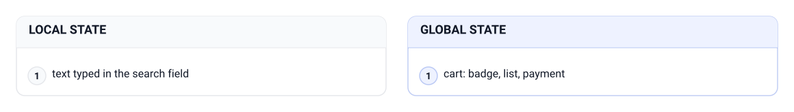
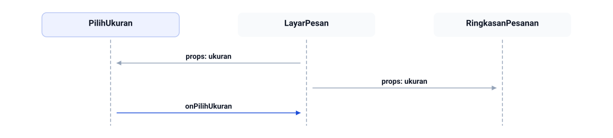
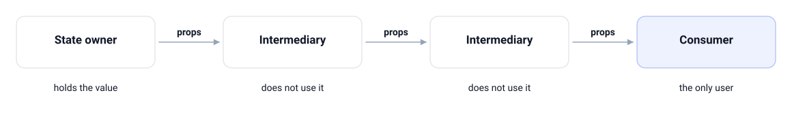
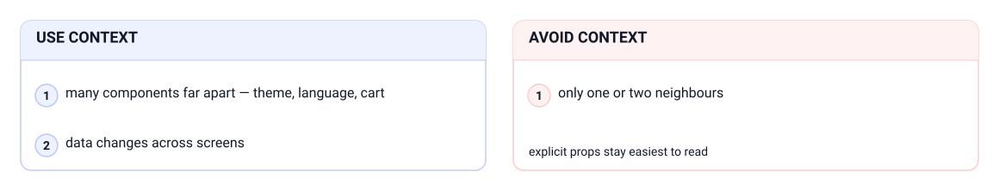
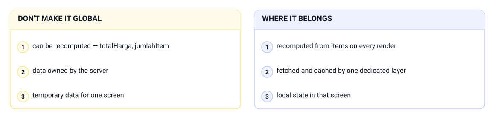
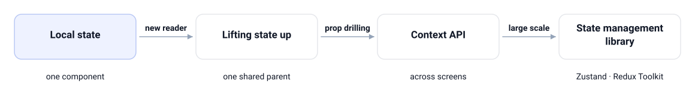
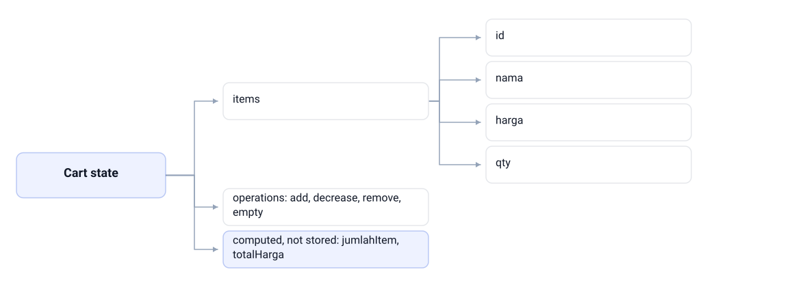
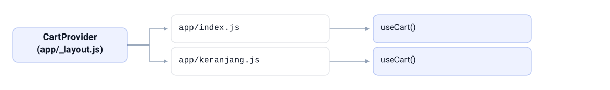
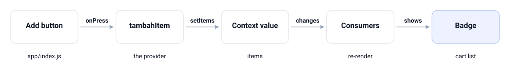
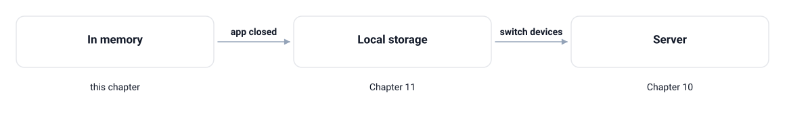

<!-- _class: lead -->
<!-- _paginate: skip -->
<!-- _footer: "" -->

# Chapter 9 — State Management

Local and global state, Context API, custom hook · Meeting 9 · Sub-CPMK 4.2

<!--
Opening hook: "Chapter 4 taught one component to remember its own data; today that data
has to be shared by many screens."

RPS link: meeting 9 covers Chapter 8 (Sub-CPMK 4.3) and Chapter 9 (Sub-CPMK 4.2); this deck
covers Chapter 9 only, and its practicum builds the TokoKu app on the Chapter 7 project.
-->

---

## Learning Objectives

- Explain the difference between local state and global state along with its trade-offs
- Identify the conditions that call for lifting state up or the Context API
- Assess when data stays local and when it deserves to become global state
- Implement the Context API with plain JavaScript
- Design the `useCart` custom hook and evaluate Zustand and Redux Toolkit

<!--
Read out only the verbs. Items 4 and 5 are the core of the practicum and the rubric
assessment material: conceptual understanding 15% and implementation 25% (Appendix A).

Stress that item 3 is the engineering question most often answered wrongly: putting all
data into global state from the start is not a solution, it is debt.
-->

---

<!-- _class: lead -->
<!-- _paginate: skip -->

# Part 1 — From Local State to Global State

Section 9.1 local vs global state · 9.2 lifting state up

<!--
This part is conceptual and becomes the basis for the whole chapter. If time is tight,
Section 9.1 still may not be skipped because its terms are used through Chapter 13.
-->

---

## Local State and Global State: Two Scopes



**State** is data that changes with user interaction and affects the display (Chapter 4). This chapter separates the two by the scope of their use.

<div class="grid2">
<div>

**Local state** — lives inside one component

- Open/closed panel status and the selection on a single button
- Known only to that component and its children

</div>
<div>

**Global state** — used by many components, usually across screens

- If each screen keeps its own copy, the data can go out of sync

</div>
</div>

<!--
Trimmed to the picture (the diagram says this):
- Example: text being typed in the search field
- Example: cart contents in the badge, the list, and the payment screen

Those two bullets are the picture's one row, one instance per scope. What stays below it is
prose the picture does not draw: a second local example, the rule about who can see a
component's own state, and the failure mode that makes the cart global in the first place.

Analogy from the chapter: local state is like a small note on your own desk, global state is
like the office notice board. The board helps many people, but its contents must be
maintained and its writers must be disciplined.

Ask: "If two screens each keep their own copy of the cart, which screen is
right?" (Answer: none can be certain; that is where the bug begins.)

Misconception warning: global state is not about "the data is big", but about the wide
scope of its users.
-->

---

<!-- _class: center -->

## Exercise: Local or Global?

- **A.** Text being typed in the product search field
- **B.** Cart contents read by the product screen and the cart screen
- **C.** Drink size selection used by two components on one screen
- **D.** Cart total price

Decide the right state level for each case, then state the reason.

<!--
Think-pair-share 3 minutes, then collect 2 to 3 answers. The answers are not on this slide;
they are discussed on the next slide.

Prompt if the class hesitates on case D: "Does the total price need to be stored, or can it
be recomputed at any time from the item list?"
-->

---

## Answer: Local or Global

| Case | State level | Reason |
|---|---|---|
| A. Search text | Local (`useState`) | Only one component uses it |
| B. Cart contents | Global (Context API) | Read across screens; the shared parent is the root layout |
| C. Size selection | Lifting state up | Two sibling components on one screen |
| D. Total price | Derived state | Recomputed from `items`, not stored |

> Practicum 9 uses the same pattern: the cart becomes global state, while the total price is always computed.

<!--
Connect the class answers to the practicum: case B gives rise to CartProvider, case C
appears in Example 1 (drink ordering), and case D explains why totalHarga is not
state.

The most common mistake: making the total price separate state and then forgetting
to update it in one of the operations.
-->

---

## Lifting State Up: Definition and Flow

**Lifting state up** is moving state to the nearest parent that is the common ancestor of every component that needs that data.



> The parent holds the state, passes it down through **props**, and every change is sent back through a **callback** function.

<!--
React data flow is one-way: from parent to child. To raise data up, React uses a
callback pattern, and lifting state up is its simplest application.

Ask: "If the size state lived inside PilihUkuran, how would RingkasanPesanan know the
user's choice?" (Answer: it would never know; that is why the state is raised.)

Stress the term single source of truth: one store, many readers.
-->

---

## The Limit of Lifting State Up: Prop Drilling



**Prop drilling** is passing props in a chain through intermediary components that do not use that data at all.

- Adding one new piece of data means changing the whole row of intermediary components
- The code becomes noisy and hard to maintain

> The appearance of prop drilling is the signal to switch to the next mechanism: the Context API.

<!--
Trimmed to the picture (the diagram says this):
- It happens when data has to pass through many component levels

The picture's whole shape is that bullet: the value starts at its owner and crosses two
components that never read it before reaching the one that does. What stays on the slide is
what a chain cannot show — that a single new field rewrites the row, and that the row is
noisy to keep.

How to explain it: imagine passing a message through five people, and four of them do
not care. Lifting state up is enough for two to three component levels.

Ask: "What symptom in the code tells us we have caught prop drilling?" (Answer: the same
props show up in components that do not use them.)

Warning: do not rush to conclude that every prop is prop drilling; explicit props
remain the easiest thing to read for two or three levels.
-->

---

## Example 1: Lifting State Up for Drink Ordering

`screens/LayarPesan.js` — owner of the `ukuran` state

```js
import { useState } from 'react';
import { StyleSheet, View } from 'react-native';
import PilihUkuran from '../components/PilihUkuran';
import RingkasanPesanan from '../components/RingkasanPesanan';
export default function LayarPesan() {
  const [ukuran, setUkuran] = useState('M');
  return (
    <View style={styles.layar}>
      <PilihUkuran ukuran={ukuran} onPilihUkuran={setUkuran} />
      <RingkasanPesanan ukuran={ukuran} />
    </View>
  );
}
const styles = StyleSheet.create({ layar: { flex: 1, padding: 16 } });
```

> `PilihUkuran` sends the choice through a callback; `RingkasanPesanan` reads it through props.

<!--
The complete example is three files: components/PilihUkuran.js (the S/M/L buttons),
components/RingkasanPesanan.js (the HARGA table: S 8000, M 10000, L 12000), and
LayarPesan.js on this slide. Only the title line <Text style={styles.judul}> and the
judul key in StyleSheet.create are cut; the rest of the snippet can be typed as is, and the
full version is in the chapter, Example 1. The cart practicum files are in kode/bab-09-state-management/.

Stress the line onPilihUkuran={setUkuran}: the state setter from useState is used directly
as a callback because its shape is (nilaiBaru) => void.

A common misconception: students put state in the child component and then "send its
value up" with props. That flow does not exist in React.
-->

---

<!-- _class: lead -->
<!-- _paginate: skip -->

# Part 2 — Context API & Custom Hook

Section 9.3 Context API · 9.4 custom hook · 9.5 when global · 9.6 modern libraries

<!--
This part is the core of the chapter and the part most likely to be tested. If little
time is left, Section 9.6 (Zustand and Redux Toolkit) may be read out briefly because it
is purely conceptual.
-->

---

## Context API: Three Main Parts

**Context API** is React's built-in mechanism for sharing data across every branch of the component tree without passing it down one by one through props.

| Part | Role |
|---|---|
| `createContext` | Creates the context object along with its initial value |
| `Provider` | Supplies a value to the whole subtree through the `value` prop |
| `useContext` | Hook for reading the context value from inside the subtree |

<!--
Fill the initial value with null so components outside the provider are easy to detect;
that is the pattern useCart uses on the next slide.

Guiding question: "If context changes the way data is distributed, does the way state is
stored change too?" (Answer: no, state is still declared with useState.)

Misconception warning: context is not a general replacement for props, but a direct
channel for data that is truly cross-region.
-->

---

## The Basic Context API Pattern

`context/BahasaContext.js` — the container, the provider, and its initial value

```js
import { createContext, useContext, useState } from 'react';

export const BahasaContext = createContext(null);

export function BahasaProvider({ children }) {
  const [bahasa, setBahasa] = useState('id');
  return (
    <BahasaContext.Provider value={{ bahasa, setBahasa }}>
      {children}
    </BahasaContext.Provider>
  );
}
```

> `value={{ bahasa, setBahasa }}` shares the value **and** its setter function in one object.

<!--
Read out only three lines: createContext(null), useState, and value={{ ... }}.

How to explain it: a provider is like a notice board mounted on one floor; every
room on that floor (children, however deep) can read it without props being handed down.

Misconception: students often write useMemo or state outside the provider. Remind them that
context changes distribution, not the place of storage.
-->

---

## When to Use Context — and When Not To



<div class="grid2">
<div>

**Use Context when**

- Prop drilling already feels painful

</div>
<div>

**Avoid Context when**

- Components become hard to reuse because their value is hidden

</div>
</div>

> When the context value changes, **every** component that calls `useContext` re-renders as well.

<!--
Trimmed to the picture (the diagram says this):
- Data is used by many components far apart (theme, language, cart)
- Data changes across screens
- Data is used by only one or two neighboring components

The picture took the one axis the two columns really share — how far apart the readers are —
plus the second signal on the use side. The bullets that stayed are the ones a picture cannot
carry: the pain signal that makes you switch, and the cost of hiding a value. The line below
keeps the re-render warning, so the picture does not repeat it.

Name real uses of context: light/dark theme, interface language, the signed-in user
profile (Chapter 13), and the shopping cart.

Stress the sentence under the slide: whole-tree re-rendering is fine for data
that rarely changes, such as theme or language, but heavy for data that changes often.

Ask: "If the entire app were wrapped in one giant provider, what is the risk?"
(Answer: every change triggers a re-render of all consumers.)
-->

---

## Custom Hook: Wrapping State Logic

**Custom hook** is a JavaScript function whose name starts with `use` and that calls one or more built-in hooks inside it.

`hooks/useTampilSembunyi.js` — the smallest useful hook

```js
import { useState } from 'react';

export function useTampilSembunyi(awal = false) {
  const [tampil, setTampil] = useState(awal);
  const ubah = () => setTampil((n) => !n);
  return { tampil, ubah };
}
```

- The function name must start with the word `use`
- Built-in hooks are called only at the top level of the function
- They may not be called inside a branch or a loop

<!--
Three benefits must be named: components are shorter and focus on the view, the logic
can be reused without copying code, and isolated logic is easier to test
(used again in Chapter 14).

The hook rules in items 2 and 3 are the same as Chapter 4 §4.8; mention that React tracks
the order of hook calls, so that order may not change.

Follow-up question: "Does a custom hook keep its own state?" (Answer: yes, the state
belongs to the component that calls it; every caller gets its own copy.)
-->

---

## useCart: One Door into Context

`hooks/useCart.js` — wraps context access and checks for errors at the same time

```js
import { useContext } from 'react';
import { CartContext } from '../context/CartContext';

export function useCart() {
  const ctx = useContext(CartContext);
  if (ctx === null) {
    throw new Error('useCart harus dipakai di dalam <CartProvider>.');
  }
  return ctx;
}
```

> Components need not know the context name, only call `useCart()`.

<!--
Explain the ctx === null check: the context initial value is indeed null, so a call
outside the provider is detected and the error message explains the fix. That message
is far easier to trace than "cannot read null".

Compare with Example 2 in the chapter (dark mode): there the component calls useContext
directly. Both are valid; a custom hook is chosen when the usage repeats and a
consistent error message is wanted.

Warning: this hook must be used inside the CartProvider subtree, not beside it.
-->

---

## Three Checks Before Making Data Global

- How many users? One component means local is enough
- Used across screens? Written on one screen and read on another means it deserves to be global
- Many parties writing the same data? One place prevents copies from clashing

> If the users are several neighboring components, try lifting state up first; the cart only needs Context because it is read across screens.

<!--
Order them as a filter, not a list to memorize: the first check filters out most
cases, and only what passes reaches the third check.

Tie it to the cart: the shared parent of two screens is the root layout, so raising
state through props means every screen has to pass the same props along.
-->

---

## Three Signs Global State Is Not Needed



- Data owned by the server — better fetched and cached by one dedicated layer (Chapters 10 and 11)
- Temporary data for one screen — form contents before saving are enough as local state

> Storing derived state opens the door to going out of sync: one operation that forgets to update it is enough to break the display.

<!--
Trimmed to the picture (the diagram says this):
- Data that can be recomputed — derived state such as `totalHarga` and `jumlahItem`

The picture's first row is this bullet and the home it does not name on the slide: derived
values are computed from `items` on every render, so they cannot fall behind. The other two
signs also stay on the slide next to the same picture — their destinations repeat what their
own sentences already say, which is why the pairing reads.

A concrete example from the chapter: the cart total price need not be stored because it
can always be computed from the item list.

Mention that beginners often copy server data raw into global state, even though its
source of truth stays on the server (Chapter 10).

Guiding question: "If the total price is computed on every render, does the app become
slow?" (Answer: not for a list as short as a cart; early optimization is not needed.)
-->

---

## State Decision Hierarchy



> Stop at the simplest level that still meets the need, and climb only when there is a new user.

<!--
Read this ladder from left to right and stress its direction: simple to complex, not
sophisticated to outdated. This is where this chapter's "decision ladder" lies.

The chapter's closing analogy: putting all data into global state from the start is the
same as making a notice board so full of notes that nobody wants to read it.

The misconception to stamp out: "professional apps always use Redux".
-->

---

## Modern Libraries: Zustand and Redux Toolkit

| Aspect | Zustand | Redux Toolkit |
|---|---|---|
| Store shape | Created with the `create` function | One global store, actions and reducers |
| How to use | Through a hook, without a provider | `createSlice` and `configureStore` |
| Strength | Concise, minimal code | Mature devtools, predictable flow |
| Cost | A pattern outside the component tree | A steep learning curve, more code |

> **Neither is used in this book** — the Context API plus a custom hook is already enough for a course project.

<!--
⚠ version-sensitive: the syntax of both libraries can change between versions; this chapter
flags it and asks students to check the official zustand and Redux Toolkit documentation
before using them.

Choosing a library is not about "which is best", but about matching it to the
application's complexity and the team size: Context for small to medium scale, Zustand for
teams that want brevity, Redux Toolkit for large apps with many collaborators.

Guiding question: "For one screen that only needs one toggle, is Redux Toolkit
worth it?" (Answer: no; this chapter calls it a cannon for shooting a mosquito.)
-->

---

<!-- _class: lead -->
<!-- _paginate: skip -->

# Part 3 — Case Study & Practicum: The Shopping Cart

Section 9.7 state design · Practicum 9 the TokoKu app

<!--
This part is a full practicum. If the meeting has two sessions, do Practicum 9
in the second session and use the state design slide to open the group work.
-->

---

## Designing the Cart State

Five questions that must be answered before writing code:



- Where should the state live? In `CartProvider` inside `app/_layout.js`, wrapping every route
- What about permanent storage? Still in memory; there is a TODO for Chapter 11

<!--
Trimmed to the picture (the diagram says this):
- What data is stored? The item list `{ id, nama, harga, qty }`
- What operations are needed? Add, decrease qty, remove, and empty
- What value is computed, not stored? `jumlahItem` and `totalHarga`

The picture answers the first three of the five questions: what is stored, what operations
are needed, and what is computed instead of stored. The two questions left on the slide are
the two no picture can hold — where the state lives is the provider tree, and permanence is
a plan for Chapter 11.

Stress that designing state first is a thinking exercise that separates a
developer from a code copier.

Name the important decision: the product catalog (data/produk.js) is static data, not
state, because it never changes while the app runs.

Give 5 minutes in pairs to answer all five questions before the code is opened.
-->

---

## CartContext.js: Provider and the Add Operation

`context/CartContext.js` — the cart's single source of truth

```js
export const CartContext = createContext(null);
export function CartProvider({ children }) {
  const [items, setItems] = useState([]);
  const tambahItem = (produk) => {
    setItems((sekarang) => {
      const ada = sekarang.find((i) => i.id === produk.id);
      if (ada) {
        return sekarang.map((i) =>
          i.id === produk.id ? { ...i, qty: i.qty + 1 } : i
        );
      }
      return [...sekarang, { ...produk, qty: 1 }];
    });
  };
```

> The functional update `setItems((sekarang) => …)` computes from the latest value.

<!--
This file also imports createContext and useState from react; the import lines are cut from
the slide so the code stays short, and the provider's return block is on the next slide.
The full version is in kode/bab-09-state-management/context/KrsContext.js — in this project the cart is the KRS selection, so the context is called `KrsContext` and the hook `useKrs` (same pattern, domain name).

Three decisions must be named: the functional update so it is safe when several updates
come in a row, find + map to raise the qty of an existing item, and the spread
{ ...produk, qty: 1 } for a new item.

Guiding question: "Why must the item lookup use id, not name?" (Answer:
id is unique and stable, while the name can change.)
-->

---

## CartContext.js: Decrease, Remove, and Derived Values

`context/CartContext.js` — the continuation snippet: operations and derived values computed on every render

```js
  const kurangiItem = (id) => {
    setItems((sekarang) =>
      sekarang
        .map((i) => (i.id === id ? { ...i, qty: i.qty - 1 } : i))
        .filter((i) => i.qty > 0)
    );
  };
  const hapusItem = (id) =>
    setItems((sekarang) => sekarang.filter((i) => i.id !== id));
  const jumlahItem = items.reduce((total, i) => total + i.qty, 0);
  const totalHarga = items.reduce((total, i) => total + i.qty * i.harga, 0);
```

> `jumlahItem` and `totalHarga` are recomputed from `items` on every render — there is no derived state that can fall behind.

<!--
Stress the order map then filter in kurangiItem: map lowers the qty, filter discards the
item whose qty becomes 0, so the qty is never zero or negative.

hapusItem is just one filtering line with filter; jumlahItem and totalHarga are computed
with reduce straight from items on every render, so they cannot fall behind the cart
contents.

Guiding question: "If totalHarga is computed on every render, can its value go out of sync
with items?" (Answer: no; the value always comes from the same items.)
-->

---

## CartContext.js: The Value the Provider Shares

`context/CartContext.js` — the close of the provider function: the persistence TODO comment and the `value` prop

```js
  // TODO (Bab 11): muat items dari AsyncStorage saat provider dibuat,
  // dan simpan items setiap kali berubah, agar keranjang bertahan
  // setelah aplikasi ditutup.

  return (
    <CartContext.Provider
      value={{ items, tambahItem, kurangiItem, hapusItem, jumlahItem, totalHarga }}
    >
      {children}
    </CartContext.Provider>
  );
}
```

> The provider shares `items`, `tambahItem`, `kurangiItem`, `hapusItem`, `jumlahItem`, and `totalHarga` through the `value` prop.

<!--
This return block is what makes the cart truly shared: without the value prop, the items
state lives only inside the provider function and no screen can read it.

Show the shape of value as an object with six keys, then compare it with the two-screens
slide: each screen takes only the part it needs through useCart().

The TODO comment marks the insertion point for Chapter 11 persistence: load items from
AsyncStorage when the provider is created, and save every time they change.
-->

---

## app/_layout.js: The Provider at the Root

`app/_layout.js` — one provider wraps every route (see Chapter 7 for the route structure)

```js
import { Stack } from 'expo-router';
import { CartProvider } from '../context/CartContext';

export default function RootLayout() {
  return (
    <CartProvider>
      <Stack screenOptions={{ headerTitleAlign: 'center' }} />
    </CartProvider>
  );
}
```

> Because the provider wraps `<Stack>`, every route is inside its subtree.

<!--
This is what makes the cart legitimately global state: not because the data is big,
but because the scope of its use covers every screen.

Name its consistency with Chapter 7: this file is the root layout of the Expo Router app,
and `<Stack>` registers every route from the app/ folder automatically.

Guiding question: "If the app later has a help page that does not need the
cart, what can be done?" (Answer: move the provider lower so that
re-rendering is not excessive.)

⚠ version-sensitive: the Expo Router supporting packages and configuration steps can
change between Expo SDK versions; use the list written in Chapter 7 §7.2 to 7.3.
-->

---

## Two Screens, One Data Source

| Screen | Reads from `useCart()` | Writes through |
|---|---|---|
| `app/index.js` | `jumlahItem` | `tambahItem` |
| `app/keranjang.js` | `items`, `jumlahItem`, `totalHarga` | `tambahItem`, `kurangiItem`, `hapusItem` |

**Additional explanation:** no screen calls `setItems`; every change goes through the provider's own functions, so the cart's behavior is easy to predict and to test.

> A third screen, for example a payment screen, only needs to call `useCart()` with no change to the provider.

<!--
This table summarizes the practicum code, it is not new material; open the files
app/index.js and app/keranjang.js on screen so students see the useCart call directly.

The product screen needs only two values (one reader, one writer), while the cart
screen needs six. Compare the two so students see the benefit of the hook.

Misconception: students often copy items into the screen's local state. Remind them that
the copy is exactly what creates two different carts.
-->

---

## Provider Structure and Its Scope



> The right provider scope reduces unnecessary re-renders.

<!--
Explain the diagram from left to right: the root layout mounts CartProvider, the provider
holds the items state, both screens read through useCart(), and CartContext is the
container that unites the two.

Stress that there is no arrow from a screen straight to CartContext: the only door
is useCart(), and that is why the context name can be changed without touching the screens.

Ask: "If CartContext.js is recreated with a different letter case, what is the symptom?"
(Answer: no badge increase and no error; that is the next troubleshooting topic.)
-->

---

## The Flow of a Single "Add" Button Press



> After 2 Buku and 1 Tipe-X: the badge "Cart (3)" and the total "Rp 102.000".

<!--
Read this one-way flow as a story: the touch calls tambahItem, the provider
updates the state, the context value changes, and then React re-renders the components that
use useCart(). The badge and the cart list change with it.

The expected result in the practicum: the badge "(0)" becomes "(2)" after pressing
Add twice; the cart row shows "Rp 45.000 x 2 = Rp 90.000" and "Rp 12.000 x 1
= Rp 12.000"; pressing "-" at qty 1 removes the row; the empty cart shows "Cart is
still empty."

Remind them that closing and reopening the app returns the cart to the empty
state, and that is expected because the storage is still in memory (Chapter 11).
-->

---

<!-- _class: center -->

## What Happens If…?

- The "Cart (0)" badge does not increase even though the "Add" button is pressed many times
- No error message appears either on the screen or in the terminal

What is the most likely cause, and how would you prove it?

<!--
This case is taken from Troubleshooting 9 and usually shows up in the practicum. Give 3
minutes in pairs to build a guess and a way to prove it.

Guide the reasoning: no error means the code runs, but writes to a different
context. Ask students to name the proof tool, not just the guess.

Do not leak the answer; it is discussed on the next slide.
-->

---

## Answer: Why the Badge Stays Empty

| Possible cause | How to prove it |
|---|---|
| Two copies of `CartContext` in different files | Make sure there is only one `context/CartContext.js` |
| The screen uses a different context from the provider | Compare the path and letter case of every `import` |
| An old bundle is still loaded by Metro | Press `r`, then restart with `npx expo start --clear` |

> Prevention: one location and one naming convention for every project file.

<!--
Rows 1 and 3 are the two causes from the single Troubleshooting 9 entry whose symptom is
a badge that does not increase without an error message (two copies of CartContext, or an
old bundle still loaded by Metro). The way to prove row 2 comes from the "Unable to resolve
../hooks/useCart" entry: compare the path and letter case of every import with the file
name on disk.

The provider-missing error that useCart throws appears when the provider is mounted on one
screen, not in app/_layout.js. That error is a help, not a nuisance.

The habit to instill: create files through VS Code so import paths resolve
automatically, and test the edge case (qty 1 then decrease) after rewriting any function.
-->

---

## Expected Result of the Practicum

- The badge "Cart (0)" becomes "(2)" after the "Add" button is pressed twice on Buku
- Line detail: "Rp 45.000 x 2 = Rp 90.000" and "Rp 12.000 x 1 = Rp 12.000"
- Bottom summary: "Total (3 items): Rp 102.000"
- Qty never becomes 0 or negative when the "-" button is pressed
- After every item is removed, the message "Cart is still empty." appears

<!--
Make this slide the practicum checklist: ask students to tick it off item by item and
take a screenshot as evidence for the rubric assessment.

Step 8 in this chapter's Work Steps contains the same test scenario, including emptying
the cart as an extra exercise (Practice Question 1).

Remind them that this result is observed in the app's flow; do not promise anything that
students have not tested themselves.
-->

---

## IS/IT Case Study: the "Primadona" Cooperative

**A fictional case with a real pattern.** A campus cooperative stationery shop serves thousands of students.

| Symptom | Root cause |
|---|---|
| A 15–20 minute cashier queue | The shopping total is computed manually with a calculator |
| Cash discrepancies | Miscounting or wrong entry |
| Stock quietly running low | Sales are recorded in a book, not captured in a structured way |
| Monthly reports arriving late | Manual recap from the daily book |

> The solution is a mobile cashier app: pick a product, the app computes the total, the transaction is sent to the server.

<!--
Read it as a story, not as a table. The aim is to make students see that
the shopping cart is the bridge between the cashier's interaction and the transaction data.

Map it to the material: the automatically computed total removes miscounting (the second
root cause), and useCart separates the logic so it can be tested and reused elsewhere.

A question before the next slide: "Should the cart be stored on the device or on the
server?" Let students guess first.
-->

---

## Client-side or Server-side?

| Consideration | Client-side cart | Server-side cart |
|---|---|---|
| Response speed | Fast, no waiting for the network | Depends on the connection |
| When the network drops | Keeps working | Cannot be used |
| Data risk | Lost if the device breaks | Stored centrally |
| Across devices | The cart does not move | The customer finds the same cart |

> The practicum chooses client-side in memory; migration to permanent storage (Chapter 11) and server sync (Chapter 10) does not change the state design.

<!--
The most interesting architecture decision in this case: a shop with an unstable network
and cheap devices benefits from a client-side cart, while a large online shop chooses
server-side so that customers switch devices without losing the cart.

Stress the essence of state design: it is not choosing one technology forever, but
understanding the trade-off and designing so the decision can change at low cost.

Guiding question: "If cashier A creates a cart and it is continued at cashier B, is the
Context API still enough?" (Answer: no; a server draft is needed, the analysis question.)
-->

---

<!-- _class: center -->

## Mini Quiz

- If state is used by only one component, how should it be stored?
- What is the correct order of use for the Context API?
- Which of these is a derived value (derived state) in the cart?
- Why is `CartProvider` placed in `app/_layout.js`?

<!--
A four-minute oral quiz: show the questions, ask the class to answer together or raise a
hand, then move to the answer slide. Do not leak the answers on this slide.

The four items are taken from the Chapter 9 Evaluation multiple-choice section
(numbers 1, 3, 5, and 8), so they can also serve as a warm-up before the written exercises.
-->

---

<!-- _class: center -->

## Answers

- Local state with `useState` — only one component uses it
- `createContext` → `Provider` → `useContext` — container, provider, then reader
- `totalHarga` — computed from `items`, so it need not be stored
- So that every route sits inside the provider subtree and can call `useCart()`

<!--
Repeat the distinction most often confused: derived state (computed) versus state (stored).

If many get the fourth item wrong, repeat the app/_layout.js slide and the provider scope
diagram before closing the meeting.

A quick correction for the answer "so the app loads faster": speed is not the reason,
the scope of use is the reason.
-->

---

## Summary

1. Start from local state; raise it only when another consumer truly needs it
2. Lifting state up creates a single source of truth through props and callbacks
3. Painful prop drilling is the signal to switch to the Context API
4. The Context API uses `createContext`, `Provider`, and `useContext`, wrapped by the `useCart` custom hook
5. Derived values are computed, not stored; Zustand and Redux are for large scale

> The cart in this chapter lives in memory; making it survive after the app is closed is Chapter 11 material.

<!--
Do not read it out. Ask students to pick one number and explain it in their own words;
this works better than repeating the reading.

The chapter's closing message: the hierarchy of local state, lifting state up, Context API,
then libraries is a sequence of discipline, not a ladder of prestige.
-->

---

## Class Discussion: Where Does the Cart Live?

<div class="grid2">
<div>

**Questions**

- Where should the campus shop's cart be stored, and what is the risk?
- What sign in the code shows that the Context API is already overused?

</div>
<div>

**What is assessed**

- Accuracy in connecting the storage choice to the network and device context
- The ability to recognize the symptom in the code, not just to quote theory

</div>
</div>



<!--
Trimmed to the picture (the diagram says this):

> A good state design holds up when requirements change: from memory to local storage, and then to the server.

The picture is that sentence and the risk on every arrow: memory is lost when the app is
closed, local storage does not move between devices, and the server is what lets cashier B
open the cart cashier A started. It is on the slide in place of the quote because the
ladder gives the discussion its vocabulary — the class can point at a step instead of
arguing in the abstract. Say the sentence out loud as you close the discussion.

Give 3 minutes in pairs, then collect 2 to 3 answers. A strong answer names a combination:
a local cart that is synced when online.

If the answer stops at "just use the server", redirect to the cooperative's unstable
network and its cheap cashier devices.

This is also the moment to mention Reflection 3: how to explain a technical decision to a
shop owner who does not understand technology.
-->

---

## References

| Source | Link |
|---|---|
| React documentation (2026) — Context and hooks | react.dev |
| React Native documentation (2026) | reactnative.dev |
| Expo documentation (2026) | docs.expo.dev |
| Banks & Porcello, *Learning React* (2020) | O'Reilly Media |
| MDN Web Docs — JavaScript (2026) | developer.mozilla.org |

<div class="grid2">
<div>

**Related chapters**

- Chapter 4 — `useState` and the rules of hooks
- Chapters 10 and 11 — server data and local storage

</div>
<div>

**Technology versions in this book**

- Expo SDK 57 · React Native 0.86 · React 19.2 · Node.js LTS ≥ 22

</div>
</div>

<!--
The complete references are in Appendix D; terms such as Context API, state, and hook
are explained in Appendix C (glossary).

Remind them of the version-sensitive marker: the Zustand and Redux Toolkit syntax can
change, so always match it against the official documentation before real use.
-->

---

<!-- _class: lead -->
<!-- _paginate: skip -->

# Ready for Chapter 10

**Practicum:** complete Chapter 8 and Chapter 9, including the "Empty Cart" feature and the 2 Buku + 1 Tipe-X test scenario.

Meeting 10: Chapter 10 — REST API (concepts and GET) with the book's `backend/` server. Final Project groups start forming at meeting 9.

<!--
Close with one sentence: "This chapter teaches the app to remember data; the next chapter
teaches the app to fetch data from somewhere else."

State the practicum deadline and the screenshot evidence submission explicitly, and
tie it to the practicum rubric (Appendix A): conceptual understanding 15%,
implementation 25%, code quality 15%, UI/UX 15%, debugging 10%, documentation 20%.
-->
