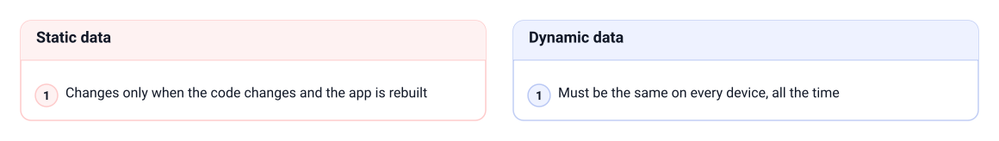
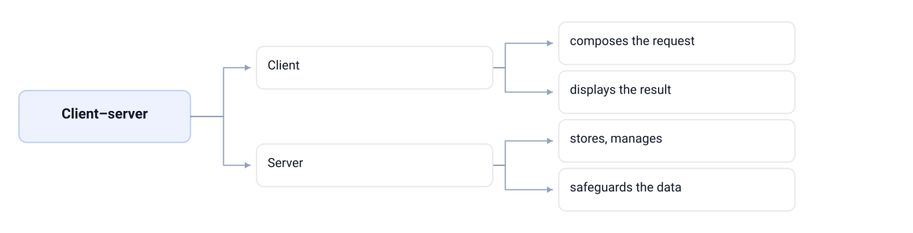
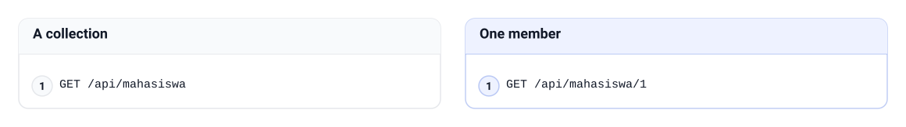
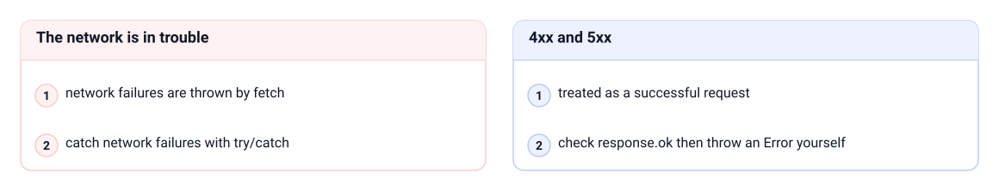
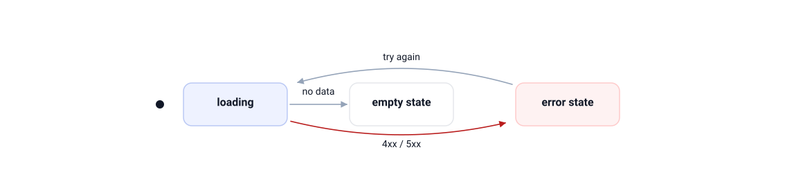
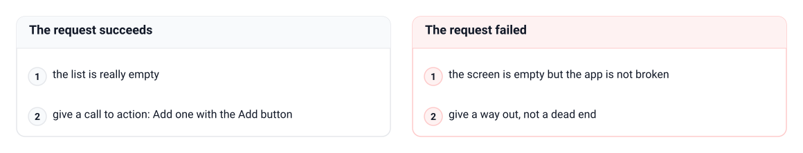
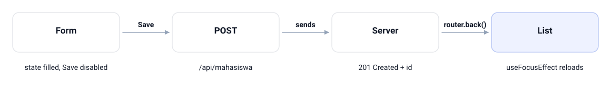
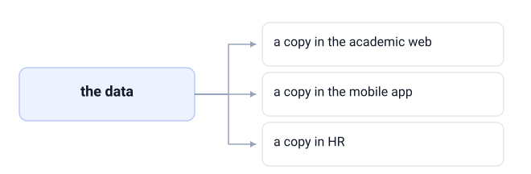
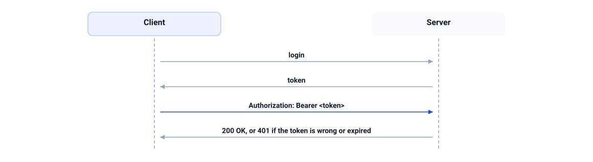

<!-- _class: lead -->
<!-- _paginate: skip -->
<!-- _footer: "" -->

# Chapter 10 — REST API and Backend Integration

From static data to data on the server · Meeting 10–11 · Sub-CPMK 5.1 & 5.2

<!--
Open with one hook sentence: "For nine meetings, your app's data was data you typed
yourself. Today that data moves to another machine, and the app has to learn to ask
for it politely."

Opening question: "Who has ever seen a failed-to-load-data message in an app and did not
know what to do?" Keep the answers to compare at the end of the meeting, when the three
interface states are discussed.
-->

---

## Learning Objectives (1/2)

- Explain the client–server architecture and the role of the API within it
- Identify the role of HTTP, REST, and JSON in data exchange
- Analyze the choice of HTTP method for each data operation
- Interpret the server response status codes, both success and failure

> **API** (Application Programming Interface) — an application programming interface: the intermediary between an app and a server.

<!--
Read out only the verbs, then stress that these four objectives are the content of Quiz 2
(HTTP and REST API material) according to the RPS for meeting 10.

These objectives are used again in Chapter 13: the ability to read status codes and
headers is the provision for handling authentication tokens.
-->

---

## Learning Objectives (2/2)

- Implement API requests with fetch and the `Content-Type` header
- Design the three interface states: loading, error, and empty state
- Integrate the app with the book's backend server (`backend/`)

> These three objectives are the core of the meeting 11 practicum: full CRUD with an honest user experience.

<!--
Stress the third objective: today the app stops using self-invented data and starts
reading data from the book's `backend/`.

Ask: "What is the difference between an app whose data is static and one whose data comes
from a server?" (Expected answer: the data changes without rebuilding the app, and it is
the same for all users.)
-->

---

<!-- _class: lead -->
<!-- _paginate: skip -->

# Part 1 — Concepts: Client, Server & HTTP

Section 10.1 Client–Server · 10.2 HTTP, REST, JSON · 10.3 HTTP Methods · 10.4 Status Codes

<!--
This part is conceptual and becomes the Quiz 2 material. If the meeting time is tight, the
history of REST (SOAP, GraphQL) in section 10.2 may be condensed, but the HTTP method table
and the status code groups may not be skipped.

This material is assessed through Quiz 2 (HTTP/REST, week 10 — RPS) and becomes the basic
language of API integration in the Final Project (UAS).
-->

---

## From Static Data to Dynamic Data

<div class="grid2">
<div>

**Static data (Chapters 6–8)**

- Written inside the code, the same for all users

</div>
<div>

**Dynamic data (an IS requirement)**

- New students are added, GPAs are updated, data is deleted

</div>
</div>



> The main question is not "where is the data stored", but "who is the source of truth".

<!--
Start from what they know: open `data/mahasiswa.js` (Chapter 7) and
`app/(app)/mahasiswa/index.js` — the list of five students is still written as a
constant inside the file, not fetched from a server.

Guiding question: "If Budi's GPA is updated at the academic office, how long does it take
to show up in the app?" (Answer: never, because the app holds its own copy.)

Trimmed to the picture (the diagram says this):
- Changes only when the code changes and the app is rebuilt
- Must be the same on every device, all the time
-->

---

## The Client–Server Concept

**Client–server** is a firm separation between the party requesting a service and the party providing it.

<div class="grid2">
<div>

**Client**

- The React Native Expo app running on a phone

</div>
<div>

**Server**

- An Express program in the `backend/` folder, port 3000

</div>
</div>



<!--
Use the restaurant analogy from Section 10.1: you order through the waiter, the kitchen
processes it, and you need not know how the kitchen works. The waiter is the API.

Misconception warning: students often think the server is "part of the app". Make clear
that the server is a separate program that must be started on its own and can go down on
its own.

Trimmed to the picture (the diagram says this):
- Composes the request and displays the result
- Stores, manages, and safeguards the data
-->

---

## The Benefits and the Price of a Client–Server Architecture

| Side | What you gain | What you pay |
|---|---|---|
| **Data source** | One source of truth for all users | The server becomes a single point of failure |
| **Security** | Sensitive data stays on a guarded server | Authentication and access control are required |
| **Updates** | Business rules change without reinstalling | Every data change must go through the API |
| **Network** | Data is consistent on every device | Depends on the network and introduces latency |

> See Chapter 11: local storage is born as the answer to this network dependency.

<!--
Stress the same trade-off mindset as Chapter 1: not "the server is better", but "the
server buys consistency with the network".

Guiding question: "Which part of this table will become a problem on a campus with
unstable Wi-Fi?" (Answer: the network row, and that answer is what motivates Chapter 11.)
-->

---

## HTTP: The Request–Response Pattern

**HTTP** (Hypertext Transfer Protocol) — the data exchange protocol between client and server.


<!--
Use the form-submission analogy: method and URL are the intent and the destination
address, headers are the remarks, body is the attached document, status code is the result
stamp on the reply sheet.

Ask: "In the example in the chapter, how do we know the message content is in JSON format?"
(Answer: from the Content-Type header.)
-->

---

## REST: Resource, Endpoint, and Stateless

**REST** (Representational State Transfer) — the transfer of state through representations; the most common API architectural style for mobile apps.

- **Resource** — data is viewed as a resource: students, courses, programs
- **Endpoint** — the unique address of each resource, e.g. `GET /api/mahasiswa`

> The verb and status tables on the next slides use the `mahasiswa` collection as a neutral
> illustration. The practicum project applies the same verbs to `krs` — see Part 2.
- **Stateless** — each request stands alone and carries all the information
- Methods map the operations: read GET, add POST, change PUT/PATCH, delete DELETE



<!--
Stress the two similar but different addresses: `GET /api/mahasiswa` requests a collection,
while `GET /api/mahasiswa/1` requests one member of the collection. Confusing the two
produces a puzzling 404 error.

Mention briefly that alternatives such as XML-based SOAP once dominated and that GraphQL
offers the flexibility of choosing fields; REST is studied first because it is the simplest
and the most widely used in industry.

Trimmed to the notes (prose; the picture needed the room):
> Statelessness makes the server easy to scale up and lets each request be stored temporarily (cached).
-->

---

## JSON: The REST Data Exchange Format

**JSON** (JavaScript Object Notation) — JavaScript object notation; the text format for exchanging REST data.

```json
{
  "id": 1,
  "nim": "2201001",
  "nama": "Budi Santoso",
  "prodi": "Sistem Informasi",
  "angkatan": 2022,
  "ipk": 3.45,
  "email": "budi.santoso@students.univ.ac.id",
  "telepon": "081234567890"
}
```

> JSON is JavaScript's "mother tongue": an object is converted with `JSON.stringify` and parsed back with `response.json()`.

<!--
Show that the fields in this JSON are exactly the same as the book's standard dataset in
Chapter 4 through Chapter 8, so students recognize their own data.

Guiding question: "Why is the ipk value not in quotes, while nim is?" (Answer: ipk is a
number, nim is text; this type mistake makes the server answer 400.)
-->

---

## HTTP Methods and CRUD Operations

**CRUD** (Create, Read, Update, Delete) — create, read, update, delete.

| Method | Meaning | Operation | Example endpoint | Idempotent (repeated, same result)? |
|---|---|---|---|---|
| GET | Reads data | Read | `GET /api/mahasiswa` | Yes |
| POST | Creates new data | Create | `POST /api/mahasiswa` | No |
| PUT | Replaces the whole record | Update | `PUT /api/mahasiswa/1` | Yes |
| PATCH | Changes part of the record | Update | `PATCH /api/mahasiswa/1` | Yes |
| DELETE | Deletes data | Delete | `DELETE /api/mahasiswa/1` | Yes |

> The book's server uses PUT for simplicity; PATCH saves more bandwidth when only one field changes.

<!--
Explain idempotent in plain language: "done a hundred times, the result is the same as
once". GET and DELETE satisfy that, POST does not.

Important warning before the practicum: never map a delete operation to GET, because a link
or an initial page load could delete data by accident.
-->

---

## Status Codes: Five Groups

| Group | Meaning | Example |
|---|---|---|
| **1xx** | Informational, being processed | 100 Continue |
| **2xx** | Success | 200, 201, 204 |
| **3xx** | Redirection | 301, 304 |
| **4xx** | An error on the client side | 400, 401, 404 |
| **5xx** | An error on the server side | 500, 503 |

> The status code is the industry's "common language": anyone reading the log immediately understands what happened.

<!--
Ask students to guess the meaning of the codes they have seen in a browser (for example
404) before the table is shown.

Teach how to read only the first digit: 4 means "your request is the problem", 5 means "the
server is the problem". That distinction decides who has to fix it.
-->

---

## Status Codes You Meet Often

| Code | Meaning | Appears when |
|---|---|---|
| **200** | OK | A successful GET or PUT |
| **201** | Created | A POST successfully creates a new resource |
| **204** | No Content | A successful DELETE, with no response content |
| **400** | Bad Request | The body is not valid JSON or a required field is empty |
| **401** | Unauthorized | The token is missing, wrong, or expired |
| **404** | Not Found | The resource does not exist, e.g. `GET /api/mahasiswa/999` |

> Outside the table: **500 Internal Server Error** means the server itself failed, not the client.

<!--
Connect each row with what students do during the practicum: 400 appears when the
Content-Type is forgotten, 404 appears when the endpoint address is mistyped, and 204
appears after a successful delete.

Guiding question: "The server is running but the student data with id 999 does not exist.
Which code should the server answer with?" (Answer: 404, not 500.)
-->

---

## One Complete HTTP Exchange

`POST /api/mahasiswa` — adds a student from the form

```http
POST /api/mahasiswa HTTP/1.1
Host: 10.0.2.2:3000
Content-Type: application/json

{ "nim": "2201001", "nama": "Budi Santoso", "prodi": "Sistem Informasi",
  "angkatan": 2022, "ipk": 3.45,
  "email": "budi.santoso@students.univ.ac.id", "telepon": "081234567890" }

HTTP/1.1 201 Created
Content-Type: application/json

{ "id": 1, "nim": "2201001", "nama": "Budi Santoso", … }
```

Three things are read from this example: the header conveys metadata, the body holds the data, the status code states the result.

<!--
Read it from top to bottom like reading a receipt: the opening line names the method and
the address, the headers explain the kind of content, the first block is what the app
sends, the second block is the server's reply.

Show that the response is almost the same as the request, and the only important addition
is the `id` issued by the server. That is the proof the data was really stored.
-->

---

<!-- _class: center -->

## What Happens If…?

- The **Save** button is pressed twice before the response arrives?
- Data is deleted through a `GET` request?
- A POST request is sent without the `Content-Type: application/json` header?

<!--
Discuss in order, one answer per question, and collect the students' guesses first: a POST
sent twice produces two records; a GET that changes state is dangerous because a preview
link can trigger it; without the header, the server receives a body it does not recognize
and generally answers 400.

Connect the first answer with the practicum solution: the Save button is disabled while the
process runs (see the practicum slide later).
-->

---

<!-- _class: lead -->
<!-- _paginate: skip -->

# Part 2 — Practice: fetch, Three UI States & CRUD

Section 10.5 fetch · 10.6 Loading, Error, Empty State · 10.7 REST Case Study · 10.8 Authentication

<!--
This part takes up the most practicum time. If only a little time is left, prioritize
sections 10.5 and 10.6; section 10.8 is enough read aloud as a bridge to Chapter 13.

Remind them that the `backend/` folder is provided by the book's repo and must be run
first before the app is tested.
-->

---

## fetch: The GET Pattern

`kode/bab-10-rest-api-dan-backend-integration/api/krs.js` — reads the saved KRS from the server

```js
const BASE_URL = 'http://10.0.2.2:3000';

async function ambilKrs(nim) {
  const response = await fetch(`${BASE_URL}/api/krs?nim=${nim}`); // 1. kirim GET
  if (!response.ok) {                                             // 2. periksa status
    throw new Error(`Permintaan gagal (HTTP ${response.status})`);
  }
  const json = await response.json();                             // 3. urai JSON
  return { daftar: json.data, totalSks: json.totalSks };
}
```

> `fetch` is a built-in JavaScript function: no package needs to be installed, and in an Expo app it is available straight away.

<!--
Walk through the three steps in the code comments: send, check, parse. Stress that
`response.ok` is true only for 2xx statuses, so there is no need to compare statuses one
by one.

Mention one trap in the notes: some servers wrap the list in a `data` property, others send
the array directly. The book's code normalizes both with `Array.isArray(json) ? json :
json.data`.
-->

---

## fetch: The POST Pattern

`kode/bab-10-rest-api-dan-backend-integration/api/krs.js` — takes one course into the KRS

```js
async function simpanKrs({ nim, kode, kelas = 'A' }) {
  const response = await fetch(`${BASE_URL}/api/krs`, {
    method: 'POST',
    headers: { 'Content-Type': 'application/json' },
    body: JSON.stringify({ nim, kode, kelas }),
  });
  if (!response.ok) {
    // Server menjawab 409 bila mata kuliah sudah ada atau kuota penuh,
    // 422 bila batas SKS terlampaui — pesannya ikut dikirim di body.
    const galat = await response.json().catch(() => ({}));
    throw new Error(galat.pesan ?? `HTTP ${response.status}`);
  }
  return await response.json();
}
```

> The returned value is the new record complete with the `id` from the server — proof the data was really stored.

<!--
Explain the three options in pairs with a question: method changes the nature of the
request, headers tell the kind of content, body carries the data. An HTTP body only holds
text, which is why JSON.stringify must be used.

Guiding question: "What happens if the Content-Type header is mistyped?" (Answer: the server
rejects or misreads the body, generally 400 Bad Request.)
-->

---

## fetch: DELETE and 204 No Content

`kode/bab-10-rest-api-dan-backend-integration/api/krs.js` — cancels one KRS row

```js
async function batalkanKrs(id) {
  const response = await fetch(`${BASE_URL}/api/krs/${id}`, { method: 'DELETE' });
  if (!response.ok) throw new Error(`HTTP ${response.status}`);
  return await response.json(); // server ini menjawab 200 + { pesan, id }
}
```

> A server may also answer `204 No Content` with an empty body. Calling `response.json()` on
> that response throws — check the status (or the body length) first. The book's server
> answers `200` with JSON so the app can reuse the message, but both shapes exist in the wild.

<!--
This is the misconception slide that most often makes student code fail during the
delete-data practicum. Show that after success, this function deliberately does not call
`response.json()` because the response body is indeed empty.

Ask: "If we only need to know whether it worked, what return value makes the most sense?"
(Answer: a boolean value, as in the book's code.)
-->

---

## fetch Fails Only When the Network Is in Trouble

<div class="grid2">
<div>

**What fetch does not do**

- There is no automatic error when the server answers 500

</div>
<div>

**What you have to do**

- Catch network failures with `try/catch` in the caller

</div>
</div>



<!--
Give a network failure example students recognize: the server has not been started so the
message `TypeError: Network request failed` appears. Make the difference clear: network
failures are thrown by fetch, status code failures must be caught yourself.

Repeat once more — this mistake and the base URL mistake are the two sources of failure
that appear most often in the practicum.

Trimmed to the picture (the diagram says this):
- 4xx and 5xx statuses are still treated as a successful request
- Check `response.ok` then throw an `Error` yourself

Trimmed to the notes (prose; the picture needed the room):
> Axios (an alternative) throws HTTP errors automatically and has interceptors; this book uses fetch consistently so that the concept stays visible.
-->

---

<!-- _class: center -->

## Mini Quiz

- Which HTTP method is right for the CRUD "Create" operation?
- Which status code signals that a new resource was successfully created?
- Why does the Save button need to be disabled while the request runs?
- Which base URL does the Android emulator use to reach the host computer?

<!--
Five-minute oral quiz: show the questions, ask the class to answer together or raise their
hands, then move to the answer slide. Do not leak the answers on this slide.

Note which question is most often wrong; that question is repeated in the closing summary
of the meeting.
-->

---

<!-- _class: center -->

## Mini Quiz Answers

- `POST` — creates a new resource at the collection address
- `201 Created` — the data is stored and the response carries the new `id`
- Because POST is not idempotent: two requests mean two records
- `http://10.0.2.2:3000` — `localhost` points to the emulator itself

<!--
Reinforce the third answer with a practical habit: the button is disabled and its text
changes to "Saving…" until the request finishes.

If many get the fourth answer wrong, go straight to the base URL slide so it is not
postponed until the practicum.
-->

---

## The Three Interface States



<!--
Draw this branching as an honest question to the user: "what is happening, and what can I
do right now?"

Remind them that ActivityIndicator has been familiar since Chapter 5, so there is no new
component to learn here.
-->

---

## Loading and Error State

`kode/bab-10-rest-api-dan-backend-integration/hooks/useMuat.js` (simplified for the slide) — the `try/catch/finally` pattern

```js
const [data, setData] = useState(null);
const [memuat, setMemuat] = useState(true);
const [galat, setGalat] = useState(null);

async function muatUlang() {
  setMemuat(true);
  try {
    setData(await pemuat());   // pemuat = () => ambilKrs(nim)
    setGalat(null);
  } catch (e) {
    setGalat({ kode: e.kode, pesan: e.message }); // pesan untuk developer
  } finally {
    setMemuat(false);           // selalu berjalan, sukses maupun gagal
  }
}
```

<!--
Stress the choice of the `finally` block: if `setLoading(false)` is placed in the try
block, the screen spins forever every time the request fails.

The version in the practicum file wraps this function with `useCallback` (required for
`useFocusEffect`, see Section 7.7) and also runs `setMemuatUlang(false)` in the `finally`
block; this slide only highlights the pattern.

Misconception warning: showing a raw `e.message` to users makes them panic. The message for
users is written in a friendly way, while technical details are still logged to the console.
-->

---

## Empty State and Pull-to-Refresh

- Give a call to action, for example "No student data yet. Add one with the Add button."
- **Pull-to-refresh** uses `RefreshControl` on the `FlatList`: pull down to reload



> Messages for users are written in human language; technical details are logged through `console.error`.

<!--
Draw a firm distinction between two states students often mix up: an empty list because the
data really does not exist yet, and an empty list because the request failed. Both need a
different message.

Ask students to name a favorite app that feels good to use when its data is empty, then have
them state the reason.

Trimmed to the picture (the diagram says this):
- **Empty state** appears when the request succeeds but the list is really empty
- An empty screen does not mean the app is broken: give a way out, not a dead end
-->

---

## Base URL: One Question, Three Answers

| Where the app runs | The correct base URL | Reason |
|---|---|---|
| Android emulator | `http://10.0.2.2:3000` | A special alias to the host computer |
| Physical device (phone) | `http://<computer-LAN-IP>:3000` | The phone is a separate machine on the same Wi-Fi |
| iOS Simulator | `http://localhost:3000` | The simulator shares the network with the Mac |

> The principle: the base URL points to the machine where the server runs, seen from the point of view of the machine running the app.

<!--
Repeat the principle in the quote as one sentence to memorize: "the server address as seen
from where the app stands".

Mention the practical solution: store the base URL in one constant and write the three
options as comments above it, so a mistake only needs to be fixed in one place.
-->

---

## Mapping Endpoints to App Screens

| Operation | Method + Endpoint | Use in the app |
|---|---|---|
| Read the list | `GET /api/krs?nim=` | KRS tab, section "Tersimpan di server" |
| Read one | `GET /api/matakuliah/:kode` | Course detail screen (`matakuliah/[kode]`) |
| Add | `POST /api/krs` | "Kirim keranjang ke server" on the KRS summary screen |
| Change | `PATCH /api/krs/:id` | Class chips (A/B/C) on each saved row |
| Delete | `DELETE /api/krs/:id` | "Batalkan" on each saved row |

> The server is run from the book's folder: `cd backend && npm install && npm start`, then it runs on port 3000.

<!--
Show that every screen from Chapters 7–8 gets one row in this table: the Student Data
Management app only has to swap its data source.

⚠ version-sensitive: the `backend/` folder was put together alongside this book; the
endpoint paths and response shapes follow `backend/README.md` and the standard REST design.
If they differ, just adjust `API_URL` and the response normalization in one file.
-->

---

## Client Layer Architecture

| Layer | Example file | Responsibility |
|---|---|---|
| View | `screens/DaftarMahasiswa.js` | Renders the list together with the three UI states |
| API client | `api/mahasiswa.js` | All network matters and fetch requests |
| Route | `app/(app)/mahasiswa/index.js` | Connects the Expo Router route to the screen |
| Server | `backend/` Express port 3000 | Stores and manages the student data |

> This separation is called **separation of concerns**: one file for one responsibility.

<!--
Stress the three reasons for separating them: the component stays clean, the request logic
can be used by many screens, and if the server address changes only one file is touched.

Follow-up question: "If the app grows to twenty screens, what happens if fetch is written
directly in every screen?" (Answer: a small change has to be fixed in twenty places.)
-->

---

## Integration Flow: Form → Server → List



1. The form fills the state, then the Save button is pressed and disabled
2. `POST /api/mahasiswa` sends the result of `JSON.stringify(form)`
3. The server stores it and replies `201 Created` together with the new `id`
4. `router.back()` returns the user to the list screen
5. `useFocusEffect` reloads the list, then the `FlatList` shows the latest data

<!--
Read it as the story of one transaction: fill the form, save, go back, and the list refreshes
itself. The key is `useFocusEffect` from Expo Router (see Chapter 7), not a manual reload
call.

Guiding question: "Why does the list need to reload when it comes back into focus?" (Answer:
so that changes from another screen are visible immediately without a manual reload.)
-->

---

## From Chapter 10 to the Next Chapters


<!--
Connect forward, not backward: once students understand the fetch flow and the three UI
states, they use the same pattern until the Final Project.

Guiding question: "Which part of Chapter 10 will be used directly in Chapter 11?" (Answer:
storing a copy of the last data when a request fails, that is the fetch pattern plus a local
cache.)
-->

---

## Application: Three Systems That Are Not in Sync



<div class="grid2">
<div>

**Symptoms**

- The GPA differs in every system: there is no single source of truth

</div>
<div>

**The decision**

- One central REST API becomes the only door to the data
- Three clients of different technologies speak one HTTP/JSON language

</div>
</div>

<!--
Read it as a case story from the chapter's Case Study section, not as a list. Stress that
the root of the problem is duplicated data, not the technology.

Ask: "If the central API goes down during course-registration hours, who is harmed the most,
and what is the mitigation?" (Answer: students; the mitigation is keeping availability on
the server side and the three UI states on the app side.)

Trimmed to the picture (the diagram says this):
- The academic web, the mobile app, and HR each store a copy of the data

Trimmed to the notes (prose; the picture needed the room):
> The risk: the central API becomes a single point of failure; its contract must be documented and later given a version number (`/api/v1/`).
-->

---

## Introduction to API Authentication

- This chapter's practicum server is open; a production API is almost always protected
- The flow: login → the server issues a **token** → the token is included in every request
- The token is sent through the `Authorization: Bearer <token>` header
- No token, a wrong token, or an expired token → the server answers `401 Unauthorized`

> The login → token → protected request → logout cycle is covered in full in Chapter 13.

<!--
Only two things need remembering from this slide: where the token is conveyed, and what
status 401 means. The rest belongs to Chapter 13.

Guiding question: "Why should the GPA value not be left readable by anyone?" (Answer: it is
personal data; the server must know who is asking before it answers.)
-->

---

## Diagram: Introduction to API Authentication



<!--
Picture only, so the four bullets on the previous slide stay whole. Read it downwards:
login, token, the Bearer header on every later request, and the two answers the server
can give. The blue arrow is the line the slide asks them to remember.
-->

---

<!-- _class: center -->

## Class Discussion: A Good API Client

- When does separating `api/mahasiswa.js` pay off, and when does it become a burden?
- Which data in your favorite app is dynamic (from an API) and which is static?
- What do you design as a developer for when the server is down during busy hours?

Each group presents **one** claim and **one** piece of evidence from the experience of using an app.

<!--
Give 3 minutes in pairs, then collect only two groups so that the time stays in check.

What is assessed is the quality of the reasoning, not the conclusion (see Chapter 10
Analysis Questions). Steer it if the direction drifts: banking apps store the last profile
on the device, while the balance is always taken from the server.
-->

---

## Summary (1/2)

1. The client–server architecture separates the app from the data: one source of truth
2. REST views data as a resource with a unique endpoint and is stateless
3. HTTP methods map CRUD: GET, POST, PUT/PATCH, and DELETE
4. GET is safe and idempotent; POST is not, so the Save button needs to be disabled
5. Status codes are the common language: 2xx success, 4xx client error, 5xx server

<!--
Do not read it out. Ask students to pick one number and explain it in their own words; this
works better than repeating the reading.

If the class seems unsure about number 4, repeat the example of the Save button pressed
twice.
-->

---

## Summary (2/2)

1. JSON is the main exchange format: `JSON.stringify` and `response.json()`
2. `fetch` only throws an error on a network failure — check `response.ok`
3. Three UI states: loading, error with an action, and an empty state that explains
4. The base URL follows where the app runs: emulator, device, simulator
5. A production API uses a token in the `Authorization: Bearer` header

<!--
Close the summary by tying it to the next chapter: this fetch pattern and the three UI
states are used again when local storage is added in Chapter 11.

Mention that the same pattern becomes the Final Project assessment rubric on the API
integration aspect (10%).
-->

---

## Exercises, Challenges, and Practicum

- **Practicum 10** — a student list from the API with the three UI states
- **Exercise** — change `ubahMahasiswa` to use `PATCH` that sends only the `ipk` field
- **Exercise** — create `screens/DetailMahasiswa.js` that calls `ambilMahasiswaById`
- **Challenge** — store the last list with AsyncStorage as a backup (see Chapter 11)
- **Challenge** — move the student data into Context so it is shared between screens (see Chapter 9)

> Final Project milestone: API integration in your group's app.

<!--
Read out only the practicum item and its deadline; the exercise and challenge items are in
the chapter to be done independently.

Expected practicum result: five standard student cards appear from the server, and the
server terminal logs every GET, POST, PUT, and DELETE request.
-->

---

## References

| Source | Link |
|---|---|
| MDN Web Docs — HTTP, fetch, and JSON (2026) | developer.mozilla.org |
| Express documentation (2026) | expressjs.com |
| React Native documentation (2026) | reactnative.dev |
| Expo documentation (2026) | docs.expo.dev |

<div class="grid2">
<div>

**Further reading**

- Chapter 11 — Local Data Storage
- Chapter 13 — Authentication and Security

</div>
<div>

**Technology versions in this book**

- Expo SDK 57 · React Native 0.86 · React 19.2 · Node.js LTS ≥ 22

</div>
</div>

<!--
The complete references are in Appendix D; terms such as endpoint, status code, and loading
state are explained in Appendix C (glossary) with their chapter reference numbers.

The endpoint contract of the book's server is in `backend/README.md` and must be read before
the practicum; the online documentation is version-dependent, so always match it against
SDK 57 as used in this book.
-->

---

<!-- _class: lead -->
<!-- _paginate: skip -->

# Ready for Chapter 11

**Practicum:** run `cd backend && npm install && npm start`, then connect the student list to the API.

Next meeting: storing data on the device with AsyncStorage so the app stays useful when the network is gone.

<!--
Close with one sentence: "This chapter gives the app a data source; the next chapter gives
the app a memory."

State the Practicum 10 deadline and the Final Project milestone explicitly, along with the
practicum rubric: conceptual understanding 15%, implementation 25%, code quality 15%, UI/UX
15%, debugging 10%, documentation 20% (Appendix A).
-->
