<!-- _class: lead -->
<!-- _paginate: skip -->
<!-- _footer: "" -->

# Bab 11 — Penyimpanan Data Lokal

AsyncStorage, JSON, dan catatan yang bertahan · Pertemuan 12 · Sub-CPMK 6.1

<!--
Buka dengan satu kalimat: "Bab 10 membuat aplikasi kita bisa memanggil server; hari ini kita
membuat aplikasi itu berhenti kehilangan data begitu ditutup."

Sebut konteks RPS: pertemuan 12 membahas Bab 11 (Sub-CPMK 6.1). Materi ini dipakai lagi di
Bab 12 (profil mahasiswa yang tersimpan) dan Bab 13 (token di secure storage).
-->

---

## Tujuan Pembelajaran

Setelah bab ini, kamu bisa:

- Menjelaskan kebutuhan penyimpanan lokal dibandingkan state di memori
- Mengidentifikasi karakteristik AsyncStorage
- Menerapkan penyimpanan, pembacaan, dan penghapusan data dengan JSON
- Menganalisis pola cache: snapshot, timestamp, dan TTL
- Mengevaluasi risiko menyimpan token di AsyncStorage
- Merancang aplikasi catatan yang datanya tetap ada setelah ditutup

<!--
Bacakan hanya kata kerjanya. Butir 3–6 dinilai lewat Praktikum 11 (rubrik di Lampiran A);
butir 1–2 lewat soal pemahaman bab ini — lihat baris RPS.

Tegaskan butir 6: aplikasi catatan bukan latihan mengetik, melainkan bukti bahwa data
bertahan setelah aplikasi ditutup — dan itulah yang harus dilaporkan mahasiswa.
-->

---

<!-- _class: lead -->
<!-- _paginate: skip -->

# Bagian 1 — Kebutuhan & AsyncStorage

subbab 11.1 Kebutuhan · 11.2 Menyimpan, Membaca, Menghapus

<!--
Bagian ini paling konseptual. Kalau waktu pertemuan menipis, pembahasan pilihan penyimpanan
(SQLite dan expo-file-system) boleh dipadatkan, tetapi subbab 11.2 tidak boleh dilewati
karena seluruh praktikum bab ini berdiri di atasnya.
-->

---

## State Hanya Bertahan Sampai Aplikasi Ditutup

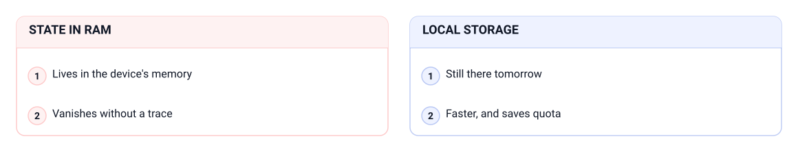

State React hidup di memori perangkat (RAM), dan memori bersifat **volatil** (mudah menguap): begitu aplikasi ditutup atau prosesnya dimatikan sistem, semua nilainya lenyap tanpa jejak.

- Sistem bisa mematikan proses aplikasi kapan saja untuk mengambil memorinya
- Jaringan tidak selalu tersedia: sinyal buruk, kuota habis, server gagal
- Tidak semua data perlu ke server — lokal lebih cepat dan hemat kuota
- Menyimpan data di perangkat juga lebih menghormati privasi pengguna

<!--
Analogi: state itu papan tulis kelas (cepat ditulis, cepat dihapus), penyimpanan lokal itu
buku catatan (harus dibuka dan ditutup, tetapi isinya masih ada besok pagi).

Tanya: "Kapan terakhir kali aplikasi di HP-mu kehilangan data yang sedang kamu isi?"
(Biasanya draf yang hilang setelah proses aplikasi dimatikan sistem.)

Peringatan salah paham: menekan tombol Home tidak berarti aplikasi berhenti. Prosesnya tetap
hidup sampai sistem membutuhkan memorinya kembali.
-->

---

<!-- _class: compact -->

## Lima Jenis Data yang Harus Bertahan

| Jenis data | Contoh di aplikasi |
|---|---|
| Preferensi pengguna | Tema gelap, bahasa antarmuka, ukuran huruf |
| Draf formulir | Isian formulir Bab 8 yang belum selesai |
| Cache isi server | Salinan data API Bab 10 agar tetap tampil |
| Data operasional offline | Catatan atau pesanan yang dibuat tanpa sinyal |
| Kredensial sesi | Token agar pengguna tidak login berulang |

<!--
Minta mahasiswa memilih satu baris dan menyebut aplikasi nyata yang memakainya; pengalaman
konkret lebih menempel daripada definisi.

Baris "cache" dan "data operasional offline" adalah isi subbab 11.4 dan bahan studi kasus;
sekarang cukup ditandai, jangan dijelaskan dulu. Sebut juga bahwa baris ketiga itulah yang
nanti dipakai Aplikasi Manajemen Data Mahasiswa untuk menyimpan daftar mahasiswanya.

Peringatan: draf formulir bukan urusan penyimpanan biasa — ia juga soal kepercayaan pengguna.
Data yang hilang sekali sering membuat pengguna berhenti memakai aplikasi.
-->

---

## Tiga Pilihan Penyimpanan Lokal di Expo

| Pilihan | Sifat | Paling cocok untuk |
|---|---|---|
| AsyncStorage | Pasangan kunci–nilai sederhana | Preferensi, cache, daftar pendek |
| SQLite | Basis data relasional | Data besar dengan kueri rumit |
| `expo-file-system` | Penyimpanan file | Gambar dan media (Bab 12) |

> Android punya SharedPreferences dan SQLite, iOS punya UserDefaults dan Core Data — AsyncStorage menyatukan perbedaan itu.

<!--
Analogi dari buku: memakai SQLite untuk menyimpan preferensi itu boros, seperti membawa truk
untuk mengangkut satu kotak. Prinsip pemilihannya "alat paling sederhana yang memadai".

Tanya: "Untuk 50 foto produk, pilih yang mana?" (expo-file-system) dan "untuk 10.000 baris
transaksi yang dicari menurut tanggal?" (SQLite) — jangan pernah AsyncStorage.
-->

---

## AsyncStorage Bukan Database, Hanya Kunci dan Nilai

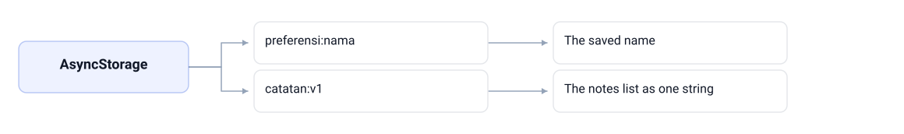

**AsyncStorage** adalah library **penyimpanan kunci–nilai** asinkron untuk React Native: dirawat komunitas, didukung penuh Expo, dan berjalan di Android, iOS, serta web.

- Setiap data disimpan di bawah satu kunci, nama unik yang dipakai untuk membacanya
- Berbeda dari `npm install`: `npx expo install` memilih versi yang cocok dengan SDK

```bash
npx expo install @react-native-async-storage/async-storage
```

<!--
Tegaskan beda perintah pemasangan: memasang dengan `npm install` dan versi bebas adalah
keluhan paling sering di forum, dan muncul lagi di baris troubleshooting bab ini.

Peringatan salah paham: AsyncStorage bukan basis data. Tidak ada tabel, tidak ada relasi,
tidak ada kueri — hanya pasangan kunci dan nilai.

Tanya: "Apa yang terjadi kalau nama kunci berbeda saat menyimpan dan saat membaca?" (Datanya
terlihat hilang padahal tersimpan di kunci yang lain.)

Dipotong ke gambar (diagram yang mengatakan ini):
- Konsepnya seperti lemari arsip: satu laci, satu label, dan isinya dibaca lewat label itu
-->

---

<!-- _class: compact -->

## Metode AsyncStorage, Semuanya Promise

| Metode | Fungsi | Nilai kembalian |
|---|---|---|
| `setItem(key, value)` | Menyimpan pasangan kunci | `Promise<void>` |
| `getItem(key)` | Membaca nilai satu kunci | `Promise<string \| null>` |
| `removeItem(key)` | Menghapus satu kunci | `Promise<void>` |
| `multiGet([k1, k2])` | Membaca beberapa kunci | `Promise<[key, value][]>` |
| `multiSet([[k, v]])` | Menyimpan banyak pasangan | `Promise<void>` |
| `getAllKeys()` | Daftar semua kunci | `Promise<string[]>` |

- `clear()` menghapus seluruh data aplikasi — jangan asal pakai

<!--
Jangan dibaca baris per baris. Kelompokkan: tiga metode satu kunci, dua metode banyak kunci,
dua metode pengelolaan seluruh penyimpanan.

Tegaskan kolom ketiga: semuanya mengembalikan Promise, jadi semuanya harus di-await.
`multiGet` lebih efisien daripada memanggil `getItem` berulang kali.

Peringatan: di aplikasi nyata `clear()` menghapus semua preferensi dan sesi pengguna —
panggil hanya pada alur logout atau reset yang disengaja.
-->

---

## Pola Dasar: Simpan dengan `await`, Baca dengan Cek `null`

`App.js` — pola dasar `setItem` dan `getItem`

```js
import AsyncStorage from '@react-native-async-storage/async-storage';

async function simpanNamaPengguna(nama) {
  try {
    await AsyncStorage.setItem('preferensi:nama', nama);
  } catch (error) {
    console.warn('Gagal menyimpan:', error);
  }
}
async function bacaNamaPengguna() {
  const nama = await AsyncStorage.getItem('preferensi:nama');
  console.log(nama === null ? 'Belum ada nama tersimpan' : nama);
}
```

> `getItem` mengembalikan `null`, bukan string kosong, untuk kunci yang belum disimpan.

<!--
Tunjukkan tiga hal saja: `await` yang menunggu penulisan dan pembacaan selesai, `try/catch`
yang menjaga aplikasi tidak berhenti, dan pemeriksaan `null` sebelum data dipakai.

Tanya: "Kalau `await` dihapus, apa yang terjadi?" (Baris berikutnya berjalan sebelum data
tertulis — inilah asal bug "data tidak tersimpan".)

Peringatan: pola kunci berawalan seperti `preferensi:nama` mencegah tabrakan antarfitur;
jadikan kebiasaan sejak contoh pertama.
-->

---

<!-- _class: compact -->

## Lima Prinsip yang Menentukan Cara Pakainya

| Prinsip | Arti praktisnya |
|---|---|
| **Asinkron** | Semua metode mengembalikan Promise; pakai `await` |
| **Hanya string** | Kunci dan nilai harus string; objek harus diserialisasi |
| **Nilai `null`** | Artinya belum ada; periksa dengan `=== null`, bukan string kosong |
| **Tidak terenkripsi** | Data tersimpan apa adanya di dalam sandbox aplikasi |
| **Bukan data besar** | Untuk preferensi, cache, dan daftar pendek |

> Di balik layar: SQLite di Android, file kecil di iOS, `localStorage` di web — semuanya terhapus saat aplikasi di-uninstall.

<!--
⚠ sensitif versi: dokumentasi resmi menyebut batas ukuran per entri sekitar 6 MB di Android
karena implementasi SQLite di belakangnya; angka pastinya bisa berubah antarversi — periksa
halaman dokumentasi resmi library sebelum menyebut angkanya di kelas.

Minta kelas menebak akibat pelanggaran setiap baris sebelum dijelaskan. Baris "tidak
terenkripsi" adalah pintu masuk subbab 11.5; sekarang cukup disentuh.

Peringatan salah paham: data lokal tidak abadi. Uninstall, membersihkan data aplikasi, atau
berganti perangkat menghapusnya tanpa pemberitahuan.
-->

---

<!-- _class: center -->

## Berpikir Berpasangan: Daftar yang Kosong

- Setelah aplikasi di-restart, daftar catatan kosong — sebutkan tiga kemungkinan penyebabnya
- Penyebab mana yang bisa kamu buktikan dari kode, dan mana yang masih dugaan?

Dua menit berpasangan, lalu 2–3 pasangan menyampaikan hasilnya.

<!--
Jangan beri jawabannya. Setelah 2 menit, tampung jawaban dan tulis di papan; setiap jawaban
akan diverifikasi di paruh kedua pertemuan ini.

Jawaban yang diharapkan: `await` yang hilang; nama kunci berbeda antara menyimpan dan
membaca; penyimpanan terhapus karena uninstall; `JSON.parse` gagal sehingga daftar kosong;
data hanya dimuat sekali sehingga layar tidak menyegarkan tampilannya.

Pertanyaan penuntun kalau kelas diam: "Data yang terlihat hilang — apa benar tidak pernah
tersimpan?"
-->

---

<!-- _class: lead -->
<!-- _paginate: skip -->

# Bagian 2 — JSON, Cache & Token

subbab 11.3 Serialisasi JSON · 11.4 Caching · 11.5 Menyimpan Token

<!--
Bagian ini yang paling sering keluar di ujian: serialisasi, tiga lapis pengaman saat membaca,
komponen cache, dan larangan menyimpan token.

Sebut bahwa subbab 11.5 sengaja berhenti di tingkat pengantar; penerapannya dilanjutkan di
Bab 13 supaya tidak ada dua penjelasan yang saling bertentangan.
-->

---

## JSON: Jembatan dari Objek ke String

- `JSON.stringify(data)` — mengubah objek atau array menjadi string JSON
- `JSON.parse(teks)` — mengubah string JSON kembali menjadi objek atau array
- **Serialisasi** mengubah data menjadi string; **deserialisasi** adalah kebalikannya

`storage/notesStorage.js` — menyimpan dan membaca daftar catatan

```js
const daftarCatatan = [
  { id: '1', judul: 'Belanja mingguan', isi: 'Beras 5 kg', createdAt: '2026-09-02T08:30:00.000Z' },
  { id: '2', judul: 'Ide tugas akhir', isi: 'Aplikasi presensi', createdAt: '2026-09-02T09:00:00.000Z' },
];

const teks = JSON.stringify(daftarCatatan);
await AsyncStorage.setItem('catatan:v1', teks);
const tersimpan = await AsyncStorage.getItem('catatan:v1');
const daftarLagi = tersimpan === null ? [] : JSON.parse(tersimpan);
```

- Kunci diberi akhiran versi (`catatan:v1`) — praktik baik yang disebut versi kunci

<!--
Tunjukkan bahwa satu kunci menyimpan seluruh daftar: satu string JSON panjang, bukan satu
kunci per catatan. Itulah sebabnya strategi tulis-ulang di subbab 11.6 masuk akal.

Versi kunci dijelaskan sebagai asuransi: kalau struktur catatan berubah, kunci baru
(`catatan:v2`) dibuat dan logika migrasi ditambahkan, tanpa merusak data lama.

Peringatan soal tanggal: `createdAt` disimpan sebagai string ISO 8601 karena aman
diserialisasi dan otomatis terurut secara kronologis.
-->

---

## Objek Masuk, String Keluar, Objek Kembali

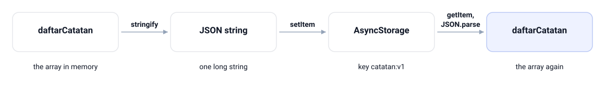

<!--
Slide gambar saja, supaya tiga aturan, potongan kode, dan butir versi kunci di slide
sebelumnya tetap utuh. Bacakan dari kiri ke kanan: daftarCatatan adalah array di memori;
stringify mengubahnya menjadi string JSON, satu string panjang yang bisa ditampung satu
kunci; setItem menyimpan string JSON itu di AsyncStorage di bawah kunci catatan:v1; lalu
getItem, JSON.parse, dan array-nya kembali.

Tunjuk keping pertama dan terakhir saat mengucapkannya: yang masuk dan yang keluar punya nama
yang sama, dan string JSON di tengah adalah satu-satunya bentuk yang pernah dilihat
AsyncStorage. Itulah sebabnya objek yang dikirim langsung ke setItem menjadi
[object Object] — tabel troubleshooting bab ini kembali ke gambar ini.
-->

---

<!-- _class: compact -->

## Membaca Data Lokal dengan Tiga Lapis Pengaman

`storage/notesStorage.js` — tiga lapis pengaman saat membaca

```js
export async function muatCatatan() {
  try {
    const teks = await AsyncStorage.getItem('catatan:v1');
    if (teks === null) return [];
    const data = JSON.parse(teks);
    return Array.isArray(data) ? data : [];
  } catch (error) {
    console.warn('Gagal membaca catatan:', error);
    return [];
  }
}
```

- Lapis 1: `null` dikembalikan sebagai array kosong `[]`
- Lapis 2: error parsing ditangkap dan dicatat, fungsinya tetap mengembalikan `[]`
- Lapis 3: hasilnya diperiksa dengan `Array.isArray` supaya bentuk tak terduga ditolak

<!--
Ajarkan sebagai urutan pemeriksaan, bukan sebagai blok yang dihafal: (1) ada isinya? (2) bisa
dibaca? (3) bentuknya benar?

Tegaskan `console.warn` sebagai jejak diagnosis — Bab 14 memakai jejak yang sama saat
menelusuri kegagalan aplikasi.

Peringatan salah paham: `catch` yang menelan error tanpa jejak sama buruknya dengan tidak
menangani error sama sekali. Selalu catat, lalu kembalikan nilai bawaan yang aman.
-->

---

<!-- _class: center -->

## Apa yang Terjadi Jika…?

- Data catatan rusak: tersimpan terpotong karena prosesnya berhenti di tengah
- Aplikasi dibuka dan langsung memanggil `JSON.parse` tanpa `try/catch`
- Apa yang dialami pengguna, dan apa yang seharusnya dilakukan pengembangnya?

<!--
Beri satu menit untuk berpikir, lalu minta dua jawaban sebelum melanjutkan. Jangan bocorkan
akibatnya di slide ini; pembahasannya ada di slide berikutnya.

Jawaban yang diharapkan: `JSON.parse` melempar `SyntaxError`, aplikasi crash begitu dibuka,
dan pengguna tidak punya jalan masuk sama sekali. Perbaikannya bukan menghapus data, melainkan
menangkap error dan memakai nilai bawaan.

Kaitkan dengan Berpikir Berpasangan tadi: inilah salah satu penyebab "daftar kosong".
-->

---

## Data Rusak Tidak Boleh Membuat Aplikasi Crash

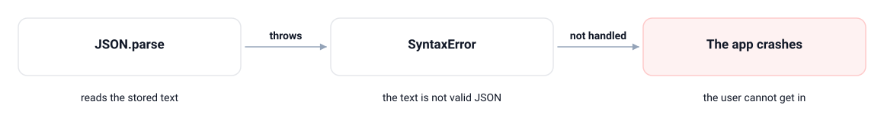

- `JSON.parse` melempar `SyntaxError` bila teksnya bukan JSON yang sah
- Tanpa penanganan, aplikasi crash begitu dibuka — pengguna tidak bisa masuk sama sekali
- Sumber kerusakan: penyimpanan terputus, data terpotong, atau struktur versi lama
- Data lokal juga terhapus saat aplikasi di-uninstall atau datanya dibersihkan

> Prinsip: penyimpanan lokal adalah sumber yang tidak selalu bisa dipercaya — aplikasi harus menghadapinya dengan tenang.

<!--
Tegaskan kalimat prinsipnya: aplikasi harus tahan terhadap datanya sendiri yang rusak. Inilah
bedanya aplikasi yang jalan dengan aplikasi yang siap dipakai orang lain.

Tanya: "Kalau datanya rusak, apakah menghapus seluruh data pengguna bisa dibenarkan?" (Bisa,
tetapi itu jalan terakhir dan pengguna harus diberi tahu.)

Peringatan: untuk data bernilai tinggi, kehilangan data lokal harus dijawab dengan cadangan
atau sinkronisasi ke server — masalah yang muncul lagi di studi kasus nanti.
-->

---

## Cache: Salinan agar Aplikasi Tetap Berguna

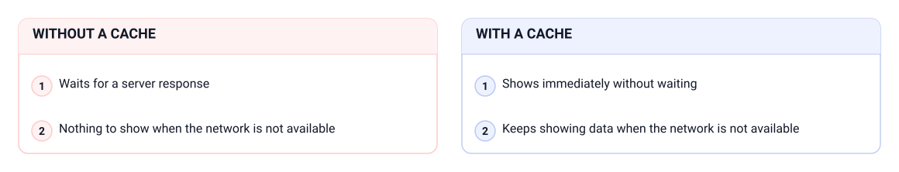

**Cache** adalah salinan data yang disimpan lebih dekat ke pemakainya supaya bisa diakses lebih cepat atau tanpa sumber aslinya.

- Kecepatan: salinan lokal tampil seketika tanpa menunggu jawaban server
- Hemat kuota: data yang jarang berubah tidak diunduh berulang kali

> Trade-off: yang dikorbankan kesegaran — yang tampil belum tentu terbaru.

<!--
Hubungkan dengan Bab 10: pola simpan saat berhasil, baca salinan saat gagal adalah lanjutan
langsung dari fetch dan penanganan error bab sebelumnya.

Tanya: "Aplikasi apa di HP-mu yang masih bisa dibuka dalam mode pesawat?" (Jawaban: aplikasi
yang menyimpan salinan datanya, bukan yang selalu menunggu server.)

Dipotong ke gambar (diagram yang mengatakan ini):
- Ketersediaan: aplikasi tetap menampilkan data saat jaringan tidak tersedia
-->

---

## Tiga Komponen Cache: Snapshot, Timestamp, TTL

- **Snapshot** — salinan data hasil jawaban API yang disimpan
- **Timestamp** — waktu penyimpanan, ditulis sebagai string ISO 8601
- **TTL** (time to live) — batas umur cache sebelum dianggap kedaluwarsa
- Larangan tegas: jangan pernah meng-cache data sensitif seperti token

`storage/apiCache.js` — bentuk paket cache (dipakai `simpanCache` dan `ambilCache`)

```js
const paket = {
  data: [],                              // snapshot jawaban API
  timestamp: '2026-09-02T08:30:00.000Z', // kapan disimpan
};
```

<!--
Gambar satu paket di papan: data dan waktu, tidak lebih. Setiap keputusan cache dibangun dari
dua informasi itu.

Tanya soal trade-off TTL: "TTL pendek atau panjang untuk daftar mata kuliah per semester?"
(Panjang, karena datanya stabil. Untuk harga pasar jawabannya sebaliknya.)

Peringatan: larangan meng-cache data sensitif diletakkan di sini supaya mahasiswa tidak
menyimpulkan "asal ada TTL berarti aman" — TTL mengatur umur, bukan perlindungan.
-->

---

## Alur Cache Saat Jaringan Gagal

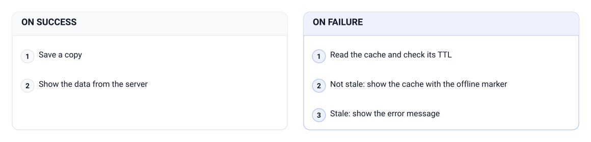

> Aplikasi yang profesional tidak diam-diam menampilkan data basi: beri penanda "Menampilkan data tersimpan (mode offline)".

<!--
Bacakan gambar sebagai alur keputusan: coba server, kalau berhasil simpan salinan, kalau gagal
periksa cache, dan hanya bila cache sudah kedaluwarsa tampilkan pesan error.

Tanya: "Di cabang mana aplikasi boleh sedikit berbohong?" (Tidak ada. Cabang cache wajib
membawa penanda offline supaya pengguna tahu seberapa andal datanya.)

**Penjelasan tambahan:** bab ini memilih cabang "TTL habis → pesan error"; menampilkan data
basi dengan penanda lebih tegas adalah alternatif desain yang dibahas di Soal Analisis 2,
bukan perilaku yang diwajibkan bab ini.
-->

---

## Modul Cache: Menyimpan dan Memeriksa Umur

`storage/apiCache.js` — mengimpor `AsyncStorage` seperti pola sebelumnya

```js
export async function simpanCache(nama, data) {
  const paket = { data, timestamp: new Date().toISOString() };
  try {
    await AsyncStorage.setItem(`cache:${nama}`, JSON.stringify(paket));
  } catch (error) {
    console.warn('Gagal menyimpan cache:', error);
  }
}

export function cacheKadaluarsa(paket, batasMs) {
  if (!paket) return true;
  const umur = Date.now() - new Date(paket.timestamp).getTime();
  return umur > batasMs;
}
```

<!--
Tegaskan bahwa nama cache menjadi bagian dari kunci: satu modul melayani katalog, jadwal, dan
daftar mahasiswa sekaligus tanpa saling menimpa.

Sebutkan bahwa `ambilCache(nama)` mengikuti pola pembacaan catatan — `getItem` dan `JSON.parse`
di dalam `try/catch`, mengembalikan `null` bila gagal.

⚠ sensitif versi: contoh pemakaian di bab ini memakai alamat server pengembangan (10.0.2.2
untuk emulator Android); sesuaikan alamatnya dengan lingkunganmu dan periksa dokumentasi
Bab 10 bila perilakunya berbeda.
-->

---

## Token Tidak Boleh Tinggal di AsyncStorage

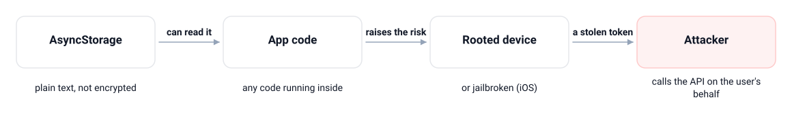

**Token** adalah data yang diberikan server setelah login: semacam "kartu identitas" yang dikirim pada setiap permintaan API berikutnya (subbab 10.8).

- Kode apa pun yang berjalan di dalam aplikasi bisa membacanya
- Perangkat yang di-root (Android) atau di-jailbreak (iOS) menaikkan risikonya

<!--
Bacakan sebagai risiko, bukan sebagai aturan: siapa yang bisa membacanya, bagaimana caranya,
dan apa akibatnya bagi pengguna.

Tanya: "Menyimpan token di AsyncStorage berarti pengguna tidak perlu login lagi. Apakah
kemudahan itu sepadan?" (Tidak — akun yang dibajak jauh lebih mahal daripada satu kali login.)

Peringatan salah paham: "aplikasi saya tidak penting, jadi tidak akan diserang" adalah alasan
yang paling sering menyesatkan di praktikum.

Dipotong ke gambar (diagram yang mengatakan ini):
- Data AsyncStorage tidak terenkripsi: nilainya tersimpan sebagai teks biasa
- Token yang dicuri: penyerang bisa memanggil API atas nama pengguna
-->

---

## Secure Storage: Kunci yang Menempel pada Perangkat

**Secure storage** memakai keamanan perangkat keras sistem operasi: **Keychain** di iOS, **Android Keystore** di Android. Library Expo-nya `expo-secure-store`, dibahas penuh di Bab 13.

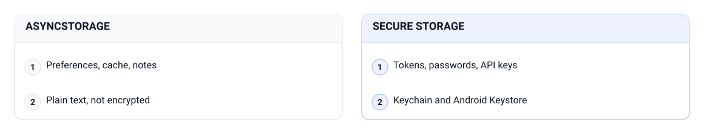

- Pisahkan data menurut sensitivitas; kalau ragu, jangan disimpan sama sekali
- Keputusan tempat penyimpanan adalah keputusan keamanan, bukan sekadar teknis

<!--
Analogi: AsyncStorage seperti lemari tanpa kunci di dalam kamar, secure storage seperti peti
yang kuncinya menempel pada perangkat kerasnya.

Tegaskan prinsip terakhir: data yang tidak pernah disimpan tidak bisa dicuri. Prinsip ini lebih
kuat daripada library apa pun.

Peringatan: bab ini hanya memperkenalkannya; alur login, token, dan logout yang lengkap ditulis
di Bab 13 supaya mahasiswa tidak mencampur dua penjelasan dari versi yang berbeda.
-->

---

<!-- _class: lead -->
<!-- _paginate: skip -->

# Bagian 3 — Proyek Aplikasi Catatan

subbab 11.6 · Praktikum 11 · Troubleshooting

<!--
Bagian ini praktikum. Kalau pertemuan ini dipakai untuk mengerjakan proyek, tampilkan tiga
slide kode (notesStorage, daftar, formulir) lalu dampingi mahasiswa mengetik ulang.

Sebelum praktikum dimulai, pastikan library AsyncStorage sudah terpasang dengan
`npx expo install` di setiap proyek.
-->

---

## Praktikum: Yang Dibangun Pertemuan Ini

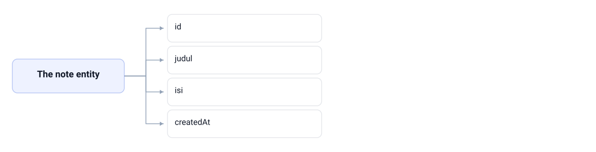

- Tambah, edit, dan hapus catatan dengan dialog konfirmasi
- Cari catatan lewat judul atau isinya
- Semua data masih ada setelah aplikasi ditutup dan dibuka lagi

> Ujiannya satu: tutup aplikasi sepenuhnya, buka lagi — catatan masih ada.

<!--
Tegaskan bahwa butir terakhir adalah bukti bab ini berhasil. Tanpa uji restart, aplikasi bisa
terlihat benar hanya karena datanya masih ada di state.

Minta mahasiswa menyiapkan bukti untuk laporan praktikum: catatan sebelum aplikasi ditutup dan
sesudah dibuka lagi.

Peringatan: menutup aplikasi dengan tombol Home belum cukup sebagai uji persistensi — tutup
prosesnya dari daftar aplikasi yang berjalan. Menekan `r` di Metro untuk memuat ulang juga
sah sebagai bukti cepat karena state React ikut direset, tetapi menutup aplikasi sepenuhnya
tetap uji yang paling meyakinkan.

Dipotong ke gambar (diagram yang mengatakan ini):
- Entitas catatan `{ id, judul, isi, createdAt }` mengikuti kontrak data buku ini
-->

---

<!-- _class: compact -->

## Struktur Proyek: Satu File, Satu Tanggung Jawab

| File atau folder | Tanggung jawab |
|---|---|
| `app/_layout.js` | Stack navigator tiga layar (Bab 7) |
| `app/index.js` | Rute `/`: daftar catatan |
| `app/catatan/buat.js` | Formulir catatan baru |
| `app/catatan/[id].js` | Formulir edit catatan |
| `storage/notesStorage.js` | API kecil penyimpanan |
| `screens/DaftarCatatan.js` | Layar daftar dan pencarian |
| `screens/FormCatatan.js` | Layar formulir tambah dan edit |
| `utils/formatTanggal.js` | Pemformat timestamp ISO |

<!--
Navigasi adalah materi Bab 7 dan tidak diulang di sini — cukup tunjukkan bahwa nama di
`Stack.Screen` harus sama dengan nama file rute, termasuk tanda kurung siku pada `[id]`.

Dipotong ke catatan (tidak muat di slide): dua rute memakai komponen `FormCatatan` yang
sama; mode tambah atau edit ditentukan oleh ada tidaknya parameter `id`. Ucapkan saat
menunjuk baris `catatan/buat.js` dan `catatan/[id].js`.

Tanya: "Kenapa logika penyimpanan diletakkan di folder storage/, bukan di dalam layar?"
(Satu perubahan format data cukup di satu file; layarnya tetap fokus.)

Peringatan: menaruh `AsyncStorage.setItem` langsung di layar adalah kebiasaan yang harus
dibongkar sejak pertemuan ini.
-->

---

## Alur Data: Layar, API Kecil, Lalu Penyimpanan

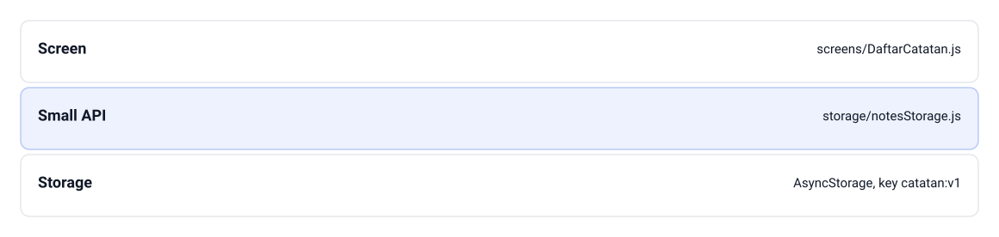

> Keuntungan pemisahannya: struktur data berubah, satu file ikut berubah; logika penyimpanan bisa diuji tanpa antarmuka (Bab 14).

<!--
Istilah "API kecil" dijelaskan di sini: kumpulan fungsi dengan satu tanggung jawab yang dipakai
layar tanpa perlu tahu detail penyimpanan.

Sebutkan pola datanya: setiap perubahan mengubah penyimpanan lebih dulu, lalu memperbarui state
supaya tampilannya ikut berubah — simpan dahulu, tampilkan kemudian.

Tanya: "Kalau urutannya dibalik, apa risikonya?" (Tampilan menunjukkan data yang sebenarnya
gagal disimpan.)
-->

---

## API Kecil: Menyimpan dan Menghapus

`storage/notesStorage.js` — menyimpan (tulis ulang) dan menghapus

```js
const KUNCI_CATATAN = 'catatan:v1';
export async function simpanCatatan(daftarCatatan) {
  try {
    await AsyncStorage.setItem(KUNCI_CATATAN, JSON.stringify(daftarCatatan));
  } catch (error) {
    console.warn('Gagal menyimpan catatan:', error);
  }
}
export async function hapusCatatan(id) {
  const daftar = await muatCatatan();
  const tersaring = daftar.filter((catatan) => catatan.id !== id);
  await simpanCatatan(tersaring);
  return tersaring;
}
```

<!--
Jelaskan strategi tulis-ulang: setiap perubahan membaca seluruh daftar, mengubahnya di memori,
lalu menyimpan seluruhnya kembali. Untuk daftar pendek ini paling sederhana; untuk ribuan baris
kamu butuh penyimpanan per baris atau basis data.

Sebutkan bahwa identitas catatan dibuat dari `Date.now().toString()` — cukup untuk praktikum,
sedangkan di produksi UUID lebih baik supaya tidak bertabrakan.

Peringatan: nilai kembalian `hapusCatatan` sengaja berupa daftar terbaru supaya layar bisa
memperbarui state tanpa membaca ulang.
-->

---

## Daftar Catatan: Pencarian dan Pemuatan Ulang

`screens/DaftarCatatan.js` — potongan inti

```jsx
const [daftar, setDaftar] = useState([]);
const [kataKunci, setKataKunci] = useState('');

// Muat ulang setiap kali layar kembali mendapat fokus
useFocusEffect(useCallback(() => { muatCatatan().then(setDaftar); }, []));

const daftarTersaring = daftar.filter((catatan) => {
  const kunci = kataKunci.trim().toLowerCase();
  if (kunci === '') return true;
  return catatan.judul.toLowerCase().includes(kunci) ||
         catatan.isi.toLowerCase().includes(kunci);
});
```

- Hapus selalu lewat konfirmasi `Alert.alert` agar tidak terhapus tak sengaja

<!--
Dipotong ke catatan (tidak muat di slide): mengetuk kartu membuka formulir edit lewat
`router.push` (Bab 7).

Bedah pencariannya: buang spasi di tepi, kecilkan kedua sisi, lalu bandingkan dengan `includes`.
Kasus "belanja" tidak menemukan "Belanja mingguan" adalah butir troubleshooting berikutnya.

Tegaskan pemisahan area sentuh: tombol Hapus diletakkan terpisah dari area tekan kartu supaya
dua aksi itu tidak bertumpuk.

Peringatan: menghapus data selalu lewat konfirmasi — penghapusan yang keliru tidak bisa
dibatalkan karena penyimpanan lokal sederhana tidak punya riwayat.
-->

---

## Formulir Catatan: Satu Komponen, Dua Mode

`screens/FormCatatan.js` — modenya ditentukan oleh ada tidaknya parameter rute `id`

```jsx
const idCatatan = typeof params.id === 'string' ? params.id : null; // null = tambah

const simpan = async () => {
  const daftar = await muatCatatan();
  const daftarBaru = idCatatan === null
    ? [...daftar, catatanBaru]                                  // mode tambah
    : daftar.map((item) => (item.id === idCatatan               // mode edit
        ? { ...item, judul: judulBersih, isi: isi.trim() } : item));
  await simpanCatatan(daftarBaru);
  router.back();
};
```

- Judul kosong ditolak lewat `Alert.alert` sebelum data disimpan
- `keyboardShouldPersistTaps` menjaga tombol Simpan tetap aktif saat papan ketik terbuka

<!--
Bandingkan dua mode dalam satu komponen: `idCatatan` bernilai null di rute `/catatan/buat`, dan
berisi sebuah id di rute `/catatan/[id]`.

Tanya: "Kenapa tidak dibuat dua file layar yang terpisah?" (Karena sebagian besar kode
formulirnya sama; satu komponen berarti perbaikan validasi cukup di satu tempat.)

Peringatan: `useLocalSearchParams` bisa mengembalikan array, jadi tipenya diperiksa dengan
`typeof params.id === 'string'` — jangan langsung dipercaya.
-->

---

## Kapan Data Harus Dimuat Ulang?

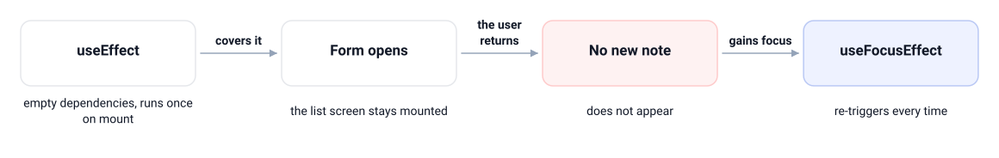

- Layar daftar tetap ter-mount selama formulir menutupinya (navigasi Stack, Bab 7)
- `useFocusEffect` memicu ulang setiap kali layar kembali mendapat fokus — persis yang dibutuhkan

> `useCallback` dipakai supaya effect tidak dibuat ulang di setiap render.

<!--
Inilah bug klasik bab ini; bahas sebagai cerita: catatannya tersimpan, tetapi layar tidak tahu
karena sudah lama tidak dimuat ulang.

Analogi: pintu kamar tetap terbuka, tetapi kita tidak lagi melihat ke dalam. Fokus layar adalah
saatnya menengok.

Peringatan salah paham: masalahnya bukan penyimpanan, melainkan kapan datanya dibaca.
Mahasiswa sering menyalahkan AsyncStorage saat gejala ini muncul.

Dipotong ke gambar (diagram yang mengatakan ini):
- `useEffect` dengan dependency kosong hanya berjalan sekali saat layar ter-mount
- Akibatnya catatan baru tidak muncul saat pengguna kembali dari formulir
-->

---

<!-- _class: compact -->

## Lima Masalah yang Paling Sering Muncul

| Masalah | Penyebab | Solusi |
|---|---|---|
| Catatan baru tidak muncul | Pemuatan hanya sekali (`useEffect`) | Pakai `useFocusEffect` |
| Tampil `[object Object]` | Objek disimpan tanpa `JSON.stringify` | Selalu lewat modul penyimpanan |
| `Module not found` async-storage | Dipasang lewat `npm install` | `npx expo install`, lalu restart |
| Pencarian tidak menemukan | Perbandingan peka huruf besar-kecil | `.toLowerCase()` dan `.trim()` |
| Data terasa "hilang" | Di-uninstall atau kuncinya beda | Satu konstanta kunci di satu modul |

<!--
Bahas baris pertama (lima sampai sepuluh menit) karena paling sering terjadi di praktikum;
sisanya bisa dibaca mahasiswa sendiri sambil bekerja.

Untuk baris "kuncinya beda", tunjukkan bahwa praktikum memakai satu konstanta `KUNCI_CATATAN`
sehingga salah ketik nama kunci menjadi mustahil.

Peringatan: jangan menambal gejalanya dengan memaksa render ulang. Temukan dulu di mana datanya
sebenarnya sebelum mengubah kode.
-->

---

## Studi Kasus: Tetap Bekerja Tanpa Sinyal

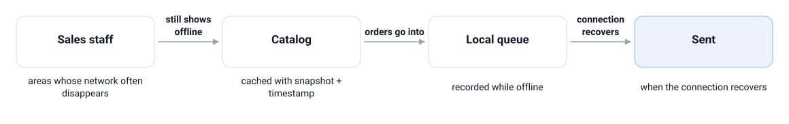

**Masalahnya**

- Katalog tidak bisa dibaca dan pesanan tidak bisa dicatat saat offline

**Keputusan: offline-first**

- Token penjualan disimpan di secure storage, bukan di AsyncStorage

> Tiga trade-off: ketersediaan, kesegaran, dan keamanan.

<!--
Ceritakan sebagai kisah perusahaan, bukan sebagai daftar; tujuannya agar mahasiswa merasa bahwa
keputusan penyimpanan adalah keputusan produk.

Sebut pasangan trade-off-nya satu per satu: ketersediaan dilawankan dengan konsistensi,
kesegaran dengan keandalan, kemudahan dengan keamanan.

Sebut konflik yang muncul saat sinkronisasi: aturan "penulis terakhir menang" memakai
timestamp, atau meminta konfirmasi pengguna.

Risiko terbesar pendekatan ini adalah kehilangan data saat aplikasi di-uninstall atau
perangkatnya rusak — itulah sebabnya strategi cadangan dan sinkronisasi harus dirancang
seawal mungkin, bukan ditambahkan belakangan.

Dipotong ke gambar (diagram yang mengatakan ini):
- Petugas penjualan mendatangi wilayah yang jaringannya sering hilang
- Katalog di-cache dengan snapshot + timestamp, dan tetap tampil offline
- Pesanan masuk antrean lokal, dikirim saat koneksi pulih
-->

---

## Yang Harus Teramati

Untuk praktikum ini, catat lima hal:

- Daftar catatan tetap ada setelah aplikasi ditutup penuh, lalu dibuka lagi
- Satu kunci `catatan:v1` menyimpan seluruh daftar, bukan satu kunci per catatan
- Yang tampil di layar berasal dari `muatCatatan()`, bukan dari data contoh di dalam file
- Pencarian berhuruf kecil menemukan judul yang berhuruf kapital
- Catatan yang dihapus tidak muncul lagi setelah layar dimuat ulang

> Laporan yang baik melampirkan tangkapan layar sebelum dan sesudah aplikasi dibuka ulang.

<!--
Jadikan daftar ini lembar centang: mahasiswa mencentang setiap butir lalu melampirkan buktinya.

Yang paling sering hilang adalah butir pertama: mahasiswa menutup aplikasi dengan tombol Home
lalu mengira sudah menguji persistensi.

Pertanyaan penuntun: "Bukti apa yang paling sulit dipalsukan di praktikum ini?" (Jawaban:
tangkapan layar yang menunjukkan jam perangkat berbeda sebelum dan sesudah restart.)
-->

---

<!-- _class: compact -->

## Pola Bab Ini Muncul di Lima Kebutuhan Aplikasi

| Kebutuhan aplikasi | Pola dari bab ini |
|---|---|
| Preferensi dan pengaturan | `setItem`/`getItem` dengan kunci `preferensi:*` |
| Draf formulir yang tidak boleh hilang | Serialisasi JSON dan penyimpanan tulis-ulang |
| Jadwal dan katalog tetap terbaca | Cache snapshot + timestamp + TTL |
| Antrean transaksi tanpa sinyal | Daftar JSON lokal, disinkronkan saat online |
| Sesi pengguna | Secure storage (Bab 13), bukan AsyncStorage |

> Aplikasi Manajemen Data Mahasiswa memakai baris ketiga dan keempat: daftar mahasiswa dari `GET /api/mahasiswa` tetap terbaca saat jaringan kampus putus.

<!--
Tunjukkan bahwa lima baris tabel ini adalah lima keputusan desain yang akan diminta di Project
Akhir, lengkap dengan alasan pemilihannya.

Tanya: "Baris mana yang paling sering diabaikan aplikasi kampus?" (Biasanya draf formulir:
pengguna kehilangan isian KRS atau pendaftaran karena sesinya terputus.)

Ingatkan bahwa penyimpanan lokal tidak menggantikan server: ia melengkapinya, dengan batas
ketersediaan dan kesegaran yang harus disadari pengembang.
-->

---

## Latihan dan Diskusi: dari Satu Penghitung ke Kebiasaan

**Latihan (dari buku)**

- Menambah penghitung catatan yang ikut bertahan
- Menandai catatan penting dengan versi kunci `catatan:v2`

**Diskusi kelas**

- Pernah kehilangan draf karena aplikasinya tertutup?
- Fitur apa di aplikasimu yang membuktikan cache benar-benar ada?
- Bagaimana menjadikan keamanan sebagai kebiasaan sejak awal, bukan setelah dipakai?

<!--
Tiga menit berpikir berpasangan untuk pertanyaan diskusi, lalu tampung dua sampai tiga jawaban.
Jangan menilai benar atau salah; nilai kemampuan memberikan alasan.

Latihan pertama dan kedua dinilai pada pemahaman versi kunci dan penanganan data lama yang
harus tetap terbaca. Tantangan lain (fitur arsip, sinkronisasi sederhana) ada di buku.

Yang dinilai dalam diskusi: kesadaran bahwa keputusan penyimpanan adalah keputusan desain
produk, bukan sekadar pilihan library.
-->

---

<!-- _class: center -->

## Kuis Kilat

- Kalau `{ nama: 'Budi' }` dikirim langsung ke `setItem`, apa yang tersimpan?
- Apa nilai kembalian `getItem` untuk kunci yang belum pernah disimpan?
- Kenapa token autentikasi tidak boleh disimpan di AsyncStorage?
- Apa peran TTL dalam pola caching?

<!--
Kuis lisan lima menit: tampilkan pertanyaan, minta kelas menjawab serempak atau mengangkat
tangan, lalu lanjut ke slide kunci. Jangan bocorkan jawaban di slide ini.

Kalau jawaban kelas beragam di pertanyaan pertama, ulangi aturan "hanya string" sebelum
menutup pertemuan.
-->

---

<!-- _class: center -->

## Kunci Kuis Kilat

- `[object Object]` — nilai non-string harus diserialisasi lebih dulu
- `null` — bukan string kosong, jadi diperiksa dengan `=== null`
- Karena tidak terenkripsi; pakai secure storage seperti di Bab 13
- Batas umur cache sebelum datanya dianggap kedaluwarsa

<!--
Ulangi dua pembedaan yang paling sering tertukar: `null` versus string kosong, dan TTL (batas
umur data) versus timeout (batas waktu menunggu jawaban server).

Kalau banyak yang salah di pertanyaan ketiga, ulangi risiko perangkat yang di-root sebelum
menutup pertemuan.
-->

---

## Ringkasan

1. State React hidup di memori yang volatil; data yang harus bertahan disimpan di penyimpanan lokal
2. AsyncStorage: kunci–nilai, asinkron, hanya string, persisten, tidak terenkripsi
3. Nilai non-string harus lewat `JSON.stringify` dan `JSON.parse` di dalam `try/catch`
4. Cache = snapshot + timestamp + TTL; beri penanda saat data berasal dari cache
5. Token masuk secure storage; logika penyimpanan dipisah ke modul API kecil

<!--
Jangan dibacakan. Minta lima mahasiswa memilih satu nomor dan menjelaskannya dengan kalimatnya
sendiri; butir yang tidak bisa dijelaskan adalah butir yang harus diulang.

Pesan penutup: aplikasi yang baik bukan yang tidak pernah gagal, melainkan yang tetap berguna
saat gagal — tidak kehilangan data, dan jujur soal kesegaran datanya.

Sambungkan ke bab berikutnya: penyimpanan yang baru dipelajari ini dipakai lagi saat kamera,
lokasi, dan notifikasi menghasilkan file dan data yang harus ditahan di perangkat.
-->

---

<!-- _class: compact -->

## Referensi

| Sumber | Link |
|---|---|
| Dokumentasi Expo (2026) | docs.expo.dev |
| Dokumentasi React Native (2026) | reactnative.dev |
| MDN Web Docs — JavaScript (2026) | developer.mozilla.org |
| Dokumentasi library AsyncStorage | dokumentasi resmi library |

**Bacaan lanjutan:** Bab 12 — Mengakses Fitur Perangkat · Bab 13 — Autentikasi dan Keamanan Aplikasi

**Versi teknologi:** Expo SDK 57 · React Native 0.86 · React 19.2 · Node.js ≥ 22

<!--
Rujukan lengkap ada di Lampiran D; glosarium istilah di Lampiran C memuat entri AsyncStorage,
JSON, dan Secure Storage beserta padanan istilahnya.

⚠ sensitif versi: dokumentasi library AsyncStorage bisa berubah antarversi — termasuk batas
ukuran data dan perilakunya di platform web. Selalu periksa halaman dokumentasi resmi library,
bukan blog atau jawaban forum lama.
-->

---

<!-- _class: lead -->
<!-- _paginate: skip -->

# Siap ke Bab 12

**Tugas:** bangun Aplikasi Catatan (tambah, edit, hapus, cari) dan buktikan datanya bertahan setelah aplikasi di-restart; kumpulkan laporan Praktikum 11.

Pertemuan berikutnya: mengakses fitur perangkat — kamera, lokasi, dan notifikasi.

<!--
Tutup dengan satu kalimat: "Hari ini aplikasi kita belajar mengingat; pertemuan berikutnya ia
belajar melihat dan merasakan."

Sebutkan tenggat pengumpulan laporan praktikum secara eksplisit beserta aspek penilaiannya:
lihat Lampiran A — rubrik praktikum (pemahaman konsep 15%, implementasi 25%, kualitas kode 15%,
UI/UX 15%, debugging 10%, dokumentasi 20%).
-->
