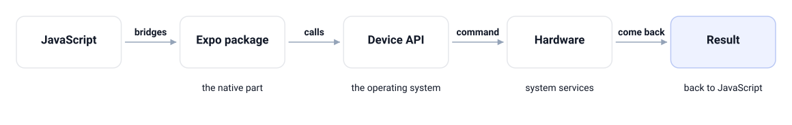
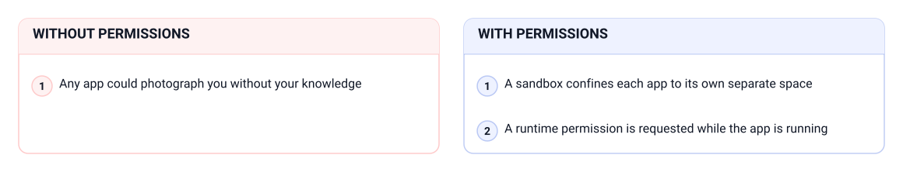
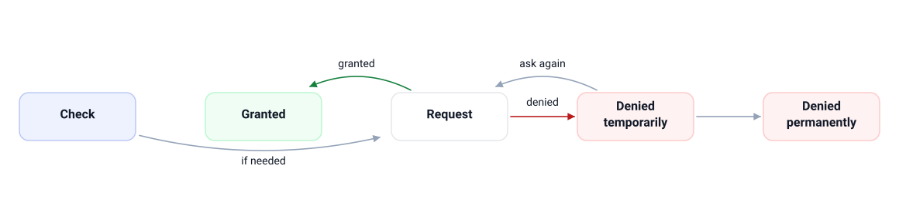
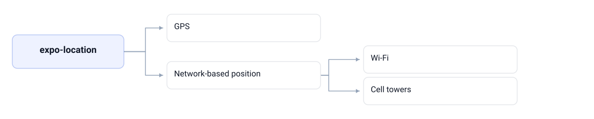
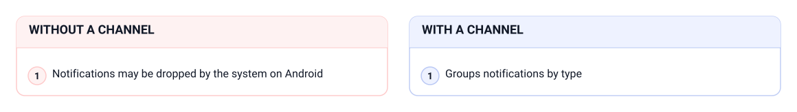
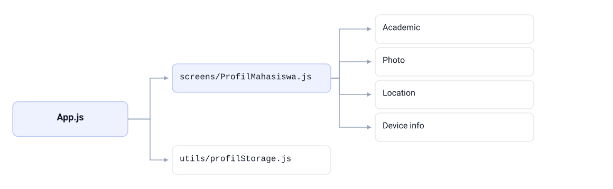
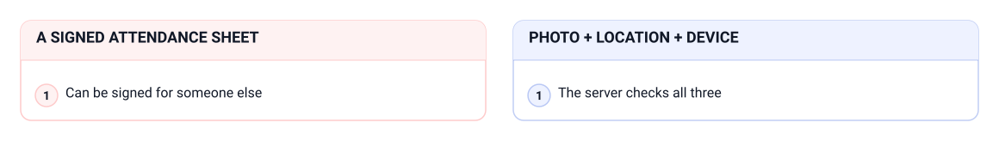
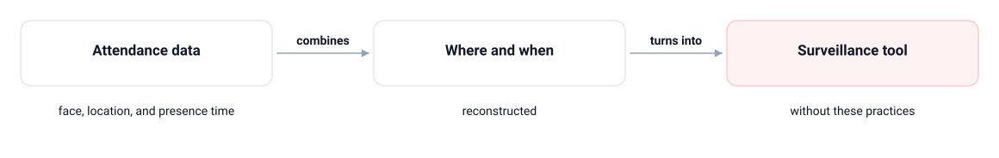

<!-- _class: lead -->
<!-- _paginate: skip -->
<!-- _footer: "" -->

# Bab 12 — Mengakses Fitur Perangkat

Kamera, lokasi, notifikasi, dan izin · Pertemuan 13

<!--
Buka dengan satu kalimat: "Hari ini aplikasi kita mulai menyentuh dunia nyata — kamera,
titik lokasi, dan laci notifikasi di HP-mu."

Pertanyaan pembuka, tanpa dikoreksi dulu: "Sebutkan izin yang diminta aplikasi kampus di
HP-mu." Tampung dua atau tiga jawaban sebagai bahan subbab 12.1.

Sebutkan sekali di awal bahwa tidak semua fitur bisa diuji di emulator: GPS dan kamera
paling baik diuji di perangkat fisik.
-->

---

## Tujuan Pembelajaran

Setelah bab ini, kamu bisa:

- Menjelaskan API perangkat dan model izin runtime Android serta iOS
- Mengidentifikasi peran enam paket Expo untuk fitur perangkat
- Menerapkan permintaan izin dan penanganan penolakannya
- Mengambil foto dan membaca koordinat beserta nilai ketelitiannya
- Menganalisis privasi data perangkat dan membangun Aplikasi Profil Mahasiswa

<!--
Bacakan hanya kata kerjanya. Tegaskan bahwa butir kelima yang dinilai di praktikum:
aplikasi harus tetap bekerja saat izin ditolak, bukan hanya saat izin diberikan.

Kaitkan dengan RPS: pertemuan ini memetakan Sub-CPMK 6.2 ke luaran Aplikasi Profil Mahasiswa,
dan penilaiannya mengikuti rubrik praktikum (Lampiran A).

Peringatan waktu: lima butir ini bisa dibacakan dalam satu menit; jangan berhenti
menjelaskan satu per satu di sini.
-->

---

<!-- _class: lead -->
<!-- _paginate: skip -->

# Bagian 1 — API Perangkat & Izin

subbab 12.1 API perangkat · config plugin · permintaan izin runtime

<!--
Bagian ini fondasi bab. Kalau waktu pertemuan menipis, subbab 12.5 yang boleh pindah ke
pertemuan berikutnya, tetapi 12.1 jangan dipadatkan.

Ingatkan bahwa pola izin ini berlaku untuk paket apa pun yang nanti mereka pakai setelah
lulus — modelnya sama di seluruh ekosistem mobile.
-->

---

## API Perangkat: JavaScript yang Menyuruh Perangkat Keras

**API perangkat** adalah antarmuka yang disediakan sistem operasi agar program bisa memerintah perangkat keras atau layanan sistem.



> React Native hanya menjembatani: kamu menulis JavaScript, bagian native-nya dikerjakan paket Expo.

<!--
Analogi: paket Expo seperti resepsionis yang mengurus perizinan; kamu cukup mengisi
formulir, tanpa perlu berbicara langsung dengan petugas keamanan.

Tegaskan bahwa bagian "native" di React Native adalah antarmuka penggunanya (Bab 1),
sedangkan di sini yang dibungkus adalah kemampuan perangkat kerasnya.

Bacakan rantai gambar dari kiri ke kanan: JavaScript memanggil paket Expo, paket itu
menjembatani ke API perangkat milik sistem operasi, API memerintah perangkat keras, lalu
hasilnya kembali ke JavaScript.

Pertanyaan penuntun: "Kenapa hasilnya harus kembali ke JavaScript?" (Jawaban: karena semua
keputusan tampilan dan penyimpanan ada di kode JavaScript kita.)
-->

---

## Sandbox: Kenapa Izin Harus Ada



- Android memakai model ini sejak versi 6 (Marshmallow), begitu juga iOS
- iOS menuntut **usage description** di `Info.plist`; tanpa itu aplikasi berhenti

<!--
Dipotong ke gambar (diagram yang mengatakan ini):
- Tanpa izin, aplikasi mana pun bisa memotretmu tanpa kamu sadari
- **Sandbox** mengurung setiap aplikasi di ruangnya sendiri yang terpisah
- **Izin runtime** diminta saat aplikasi sedang berjalan

Dua panel gambar itu adalah argumen yang dulu ditulis berderet: panel kiri adalah keadaan
tanpa mekanisme, panel kanan dua mekanisme yang menjawabnya. Dua butir yang tinggal membawa
fakta platform yang tidak dimuat gambar.

Tegaskan beda Android dan iOS di sini: Android memunculkan dialog sistem, sedangkan iOS
menuntut teks alasan di Info.plist — dan bila teks itu tidak ada, aplikasi iOS langsung
berhenti, bukan sekadar menolak fiturnya.

Inilah salah paham yang paling sering muncul: mahasiswa menyimpulkan "izin ditolak" padahal
aplikasinya berhenti karena penggunaan fitur tidak dideklarasikan.

Pertanyaan penuntun: "Siapa yang bisa menyalakan kamera HP-mu tanpa kamu ketahui?"
(Jawaban: seharusnya tidak ada, karena sandbox dan izin.)
-->

---

<!-- _class: compact -->

## Izin Dideklarasikan Saat Build, Diminta Saat Dipakai

| Lapis | Kapan | Siapa yang mengerjakan |
|---|---|---|
| Config plugin | Saat build | Daftar `plugins` di `app.json` |
| Deklarasi iOS | Saat build | Kunci `NS…UsageDescription` di `Info.plist` |
| Deklarasi Android | Saat build | Entri di `AndroidManifest.xml` |
| Periksa | Sebelum dipakai | `getPermissionsAsync()` |
| Minta | Saat aplikasi jalan | `requestPermissionsAsync()` |

> Di Expo Go, sebagian besar izin sudah dideklarasikan Expo Go; daftar `plugins` tetap harus ditulis untuk build mandiri.

<!--
Bandingkan dua baris pertama dengan tiga baris terakhir: baris atas berurusan dengan file
konfigurasi, baris bawah berurusan dengan pengguna.

Akibat praktis yang harus diingat: uji cepat di Expo Go tidak akan membongkar kesalahan
config plugin, jadi kesalahan itu baru muncul saat build (Bab 15).

Pertanyaan penuntun: "Kalau izinnya sudah dideklarasikan, apakah pengguna otomatis
memberikannya?" (Jawaban: tidak — deklarasi hanya menyiapkan pintunya.)

Peringatan sensitif versi: nama opsi config plugin mengikuti versi SDK; periksa daftar opsi
paket di docs.expo.dev sebelum menjalankan build.
-->

---

## Config Plugin: Izin Ditulis Sebelum Aplikasi Dibangun

`app.json` — potongan blok `plugins`

```json
"plugins": [
  ["expo-image-picker", {
    "photosPermission": "Aplikasi membutuhkan akses galeri untuk memilih foto profil.",
    "cameraPermission": "Aplikasi membutuhkan akses kamera untuk mengambil foto profil."
  }],
  ["expo-location", {
    "locationWhenInUsePermission": "Aplikasi membutuhkan lokasi Anda untuk mengisi data profil."
  }],
  "expo-notifications"
]
```

> Teks izin ditulis dalam bahasa Indonesia dan menjelaskan tujuannya — bagian dari praktik privasi yang baik.

<!--
Tunjukkan strukturnya, bukan hurufnya: entri pertama dan kedua berbentuk array karena punya
opsi, sedangkan expo-notifications cukup berupa string.

Saat prebuild atau EAS Build, Expo menyuntikkan nilai photosPermission sebagai kunci
NSPhotoLibraryUsageDescription di Info.plist dan menambahkan izinnya ke AndroidManifest.xml.

Peringatan sensitif versi: nama opsi mengikuti versi SDK — cocokkan dengan dokumentasi resmi
sebelum menjalankan build.

Pesan yang harus dibawa pulang: teks izin bukan formalitas, melainkan kalimat yang dibaca
pengguna tepat sebelum ia menekan Izinkan atau Tolak.
-->

---

## Alur Permintaan Izin Punya Tiga Pintu Keluar



> Pola "periksa dulu, minta kalau perlu" ini dipakai berulang di sepanjang bab.

<!--
Telusuri gambar bersama kelas, simpul demi simpul, dengan satu keadaan nyata: tombol "Ambil
Foto" ditekan untuk kedua kalinya.

Tegaskan bahwa pintu keluarnya tiga, bukan dua: diberikan, ditolak sementara, dan ditolak
permanen. Pintu ketiga yang paling sering dilupakan mahasiswa.

Peringatan salah paham: getPermissionsAsync() tidak akan memunculkan dialog apa pun — ia
hanya membaca status.

Pertanyaan penuntun: "Kalau statusnya ditolak permanen, apa yang masih bisa dilakukan
aplikasi?" (Jawaban: menjelaskan alasannya dan mengantar pengguna ke Pengaturan.)
-->

---

## Periksa Dulu, Minta Kalau Perlu

`utils/polaIzin.js` — pola "periksa dulu, minta kalau perlu"

```js
import * as ImagePicker from 'expo-image-picker';

export async function pastikanIzinGaleri() {
  const statusSekarang = await ImagePicker.getPermissionsAsync();
  if (statusSekarang.granted) {
    return true;
  }
  const hasilPermintaan = await ImagePicker.requestPermissionsAsync();
  return hasilPermintaan.granted;
}
```

> Fungsi ini memakai pola yang sama untuk semua paket: periksa status, minta bila perlu, kembalikan hasilnya.

<!--
Bacalah sebagai alur keputusan, bukan sebagai sintaksis: izin sudah ada, maka langsung
disetujui tanpa dialog; izin belum ada, sistem menampilkan dialog satu kali.

Fungsi ini sengaja mengembalikan boolean supaya layar pemanggil tidak perlu tahu isi objek
PermissionResponse.

Pertanyaan penuntun: "Kenapa harus memeriksa dulu, bukan langsung meminta?" (Jawaban: agar
pengguna tidak diganggu dialog berulang setiap kali fiturnya dipakai.)

Peringatan: fungsi ini tidak menyimpan status di state; layar tetap perlu tahu hasilnya untuk
memutuskan tampilan.
-->

---

## Tiga Nilai yang Menentukan Keputusan di Layar

| Properti | Artinya |
|---|---|
| `granted` | Apakah izin diberikan atau tidak (boolean) |
| `status` | `granted`, `denied`, atau `undetermined` |
| `canAskAgain` | Masih bisa diminta, atau pengguna sudah memilih "jangan tanya lagi" |

> Tiga nilai ini menentukan keputusan di layar: pakai fiturnya, minta sekali lagi, atau antar pengguna ke Pengaturan lewat `Linking.openSettings()`.

<!--
Tegaskan bahwa status izin bukan dua keadaan melainkan tiga — dan keadaan ketiga menuntut
rancangan layar yang berbeda.

Kaitkan dengan kebiasaan profesional: baca isi objek hasil API sebelum memutuskan, jangan
hanya memeriksa satu properti.

Pertanyaan penuntun: "Apa yang terjadi kalau canAskAgain bernilai false dan kita tetap
memanggil requestPermissionsAsync?" (Jawaban: dialog tidak muncul lagi; fungsi langsung
mengembalikan status ditolak.)
-->

---

<!-- _class: center -->

## Apa yang Terjadi Jika…?

**Apa yang terjadi jika** aplikasi meminta lima izin sekaligus saat pertama dibuka, lalu pengguna memilih "jangan tanya lagi" untuk kamera?

- Apa yang pengguna lihat di detik pertama memakai aplikasi?
- Apa yang masih bisa dilakukan aplikasi setelah itu?
- Bagaimana urutan permintaan izin seharusnya disusun?

<!--
Beri 3 menit berpasangan. Jawaban yang diharapkan: pengguna bingung karena tidak tahu
konteksnya, tingkat penolakan naik termasuk penolakan permanen, dan aplikasi tidak bisa lagi
memunculkan dialog sehingga harus menyediakan jalan ke Pengaturan.

Kalau jawaban berhenti di "pengguna menolak", dorong ke pertanyaan ketiga — bagian itulah
yang dinilai pada soal analisis subbab 12.6.

Peringatan: jangan beri jawabannya sekarang; slide setelah ini adalah jawabannya.
-->

---

## Penolakan Adalah Keadaan Normal, Bukan Jalan Buntu

| Keadaan | Yang muncul | Tindakan aplikasi |
|---|---|---|
| Sudah diberikan | Tanpa dialog | Pakai fiturnya langsung |
| Ditolak sementara | Dialog sistem sekali | Jelaskan alasannya, minta lagi saat perlu |
| Ditolak permanen | Dialog tidak muncul lagi | Tampilkan penjelasan dan tombol "Buka Pengaturan" |

- Izin tidak permanen — pengguna bisa mencabutnya kapan saja
- Minta izin saat dibutuhkan, bukan sekaligus saat aplikasi dibuka
- Periksa ulang izin sebelum memakai fitur yang sensitif

<!--
Slide ini jawaban pertanyaan sebelumnya. Tegaskan baris terakhir tabel: satu-satunya jalan
adalah mengantar pengguna ke sana secara manual, jadi aplikasi harus menjelaskan lebih dulu
mengapa izin itu dibutuhkan.

Analogi: seperti pintu yang terkunci dari dalam — mengetuk berkali-kali tidak menolong, kamu
harus meminta pemiliknya membukakan.

Peringatan salah paham: menampilkan pesan "izin ditolak" tanpa jalan keluar sama saja
membiarkan aplikasi buntu.

Cek pemahaman: "Kalau izin kamera dicabut saat aplikasi sedang terbuka, apa yang terjadi
pada tombol Ambil Foto?" (Jawaban: permintaan berikutnya memunculkan dialog lagi.)
-->

---

<!-- _class: lead -->
<!-- _paginate: skip -->

# Bagian 2 — Kamera, Lokasi, Notifikasi & File

subbab 12.2 Kamera dan galeri · 12.3 Lokasi · 12.4 Notifikasi · 12.5 File dan perangkat

<!--
Bagian ini praktis dan padat: empat paket Expo. Kalau waktu tinggal sedikit, kerjakan
subbab 12.2 dan 12.3 di kelas, lalu 12.4 dan 12.5 sebagai praktikum mandiri.

Ingatkan bahwa setiap paket dipasang dengan npx expo install, bukan npm install, supaya
versinya cocok dengan SDK 57.
-->

---

<!-- _class: compact -->

## Dua Paket Kamera untuk Dua Kebutuhan Berbeda

| Aspek | `expo-camera` | `expo-image-picker` |
|---|---|---|
| Tampilan | Pratinjau langsung lewat `<CameraView>` | Antarmuka kamera sistem |
| Alur | Izin dan rana kamu kelola | `launchCameraAsync()` |
| Hasil | Kendali penuh atas bidikan | Satu file gambar (`uri`) |
| Cocok | Pemindai kode QR, filter | Foto profil, bukti pembayaran, lampiran |

> `expo-image-picker` bila hasilnya cukup satu file gambar; `expo-camera` bila bidikan harus tampil langsung.

<!--
Tegaskan bahwa untuk kebutuhan "ambil satu foto lalu tampilkan", expo-camera justru
berlebihan — mahasiswa cenderung memilih paket paling lengkap, padahal ukuran yang tepat
lebih penting daripada kelengkapan.

Lengkapi secara lisan sel yang dipendekkan: expo-camera menampilkan pratinjau lewat komponen
CameraView, dan seluruh alur izin, pratinjau, serta tombol rana kamu kelola sendiri; kelompok
yang cocok dengannya termasuk filter real-time dan deteksi wajah.

Kaitkan dengan analisis trade-off Bab 1: memilih paket adalah trade-off antara kendali dan
kesederhanaan.

Peringatan sensitif versi: komponen CameraView menggantikan komponen Camera lama yang tidak
lagi disarankan; periksa dokumentasi resmi expo-camera versi terbaru.

Pertanyaan penuntun: "Paket mana yang kamu pilih kalau layarnya hanya perlu satu foto
profil?" (Jawaban: image-picker, karena antarmuka kameranya diserahkan ke sistem.)
-->

---

## Paket Mana untuk Tiga Kebutuhan Ini?

- Foto profil mahasiswa untuk aplikasi kampus
- Pemindai kode QR pada kartu ujian
- Filter kamera yang harus terlihat langsung

**Tugas:** tentukan paketnya untuk setiap keadaan dan sebutkan alasannya.

<!--
2 menit berpasangan, lalu tampung dua atau tiga jawaban. Jawaban yang diharapkan:
image-picker untuk foto profil; expo-camera untuk dua keadaan lain karena keduanya butuh
bidikan langsung.

Nilailah alasannya, bukan jawabannya: mahasiswa yang berkata "karena hasil akhirnya hanya
satu file gambar" sudah memahami subbab 12.2.

Peringatan: jangan biarkan kelas menjawab "expo-camera karena lebih canggih" tanpa alasan
kebutuhan.
-->

---

## `expo-camera` Menampilkan Pratinjau Langsung

`screens/LayarKamera.js` — kamera dengan penanganan izinnya sendiri

```js
import { CameraView, useCameraPermissions } from 'expo-camera';
export default function LayarKamera() {
  const [izin, mintaIzin] = useCameraPermissions();
  if (!izin || !izin.granted) {
    return (
      <View style={styles.halaman}>
        <Pressable style={styles.tombol} onPress={mintaIzin}>
          <Text style={styles.teksTombol}>Berikan Izin</Text>
        </Pressable>
      </View>
    );
  }
  return <CameraView style={styles.halaman} facing="back" />;
}
```

<!--
Tunjuk hanya tiga hal: hook useCameraPermissions mengembalikan pasangan status dan fungsi
permintaan, cabang if menentukan apa yang digambar, dan CameraView komponen yang menampilkan
bidikan. Catatan yang tidak lagi muat di slide: kode lengkap beserta StyleSheet ada di bab,
dan slide ini hanya memuat bagian keputusannya.

Perhatikan bahwa izin diminta saat layar dibuka, bukan saat aplikasi mulai — inilah penerapan
"minta izin saat dibutuhkan" dari subbab 12.1.

Peringatan: beberapa baris disederhanakan untuk slide; mahasiswa menyalin versi lengkap dari
bab agar komponen Text, View, dan Pressable serta styles-nya ikut terdefinisi.
-->

---

<!-- _class: compact -->

## `expo-image-picker`: Satu Panggilan, Satu File

`screens/ProfilMahasiswa.js` — mengambil foto lewat kamera sistem

```js
async function ambilFotoDariKamera() {
  const izin = await ImagePicker.requestCameraPermissionsAsync();
  if (!izin.granted) {
    Alert.alert('Izin Ditolak', 'Aplikasi tidak dapat menggunakan kamera tanpa izin Anda.');
    return;
  }
  const hasil = await ImagePicker.launchCameraAsync({
    mediaTypes: ['images'], allowsEditing: true, aspect: [1, 1], quality: 0.6,
  });
  if (!hasil.canceled) setFotoUri(hasil.assets[0].uri);
}
```

- Hasilnya objek: `canceled` menandai batal, `assets[0].uri` alamat gambar
- `allowsEditing: true` dengan `aspect: [1, 1]` memotong foto menjadi persegi
- `uri` menunjuk file sementara di cache sistem, bukan file permanen

<!--
Bandingkan panjang kode ini dengan expo-camera di slide sebelumnya — bedanya, seluruh
antarmuka kamera diserahkan ke sistem.

Tegaskan pengujian !hasil.canceled sebelum mengakses assets: kalau pengguna menekan batal,
assets kosong dan mengaksesnya langsung memunculkan error.

Peringatan sensitif versi: sejak SDK yang lebih baru opsi mediaTypes ditulis sebagai array
string, misalnya ['images'], menggantikan konstanta MediaTypeOptions yang lama.

Pertanyaan penuntun: "Masih bolehkah uri ini disimpan ke AsyncStorage sebagai satu-satunya
rujukan foto?" (Jawaban: tidak — file di cache bisa dibersihkan; salin ke folder dokumen.)
-->

---

## Lokasi Datang dari Dua Sumber yang Berbeda



- **GPS** menghitung posisi dari sinyal satelit
- Paling akurat di ruang terbuka; di dalam ruangan sering meleset ratusan meter
- Posisi berbasis jaringan (Wi-Fi dan menara seluler) lebih cepat, kurang tepat
- `expo-location` menyatukan kedua sumber dan mengembalikan koordinat

Aplikasi cukup memilih tingkat ketelitian yang dibutuhkan.

<!--
Analogi: GPS seperti mengukur dengan penggaris panjang dari langit, sedangkan posisi berbasis
jaringan seperti menebak dari tetangga terdekat — lebih cepat, kurang tepat.

Pertanyaan penuntun: "Kenapa aplikasi presensi tidak boleh memakai ketelitian Balanced?"
(Jawaban: radius ketidakpastiannya terlalu besar untuk memastikan mahasiswa benar-benar di
dalam kelas.)

Sebutkan sekali bahwa izin lokasi latar belakang ada, lebih ketat, dan tidak dibahas di buku
ini — supaya mahasiswa tidak memakainya tanpa alasan.

Peringatan: uji lokasi di perangkat fisik; emulator hanya memberi koordinat tiruan.
-->

---

## Koordinat Tidak Pernah Datang Tanpa Ketelitian

`utils/ambilLokasi.js` — isi fungsi `ambilKoordinat()`

```js
const izin = await Location.requestForegroundPermissionsAsync();
if (!izin.granted) {
  return null;
}
const posisi = await Location.getCurrentPositionAsync({
  accuracy: Location.Accuracy.Balanced,
});
return {
  latitude: posisi.coords.latitude,
  longitude: posisi.coords.longitude,
  akurasi: posisi.coords.accuracy,
  waktu: new Date(posisi.timestamp).toLocaleString('id-ID'),
};
```

<!--
Pola ini sama dengan pastikanIzinGaleri di slide sebelumnya: izin, ambil posisi, lalu
kembalikan objek ringkas — hanya nama fungsinya yang berbeda.

Perhatikan urutannya: izin dulu, baru membaca posisi. Kalau izin ditolak, fungsi mengembalikan
null dan layar yang memutuskan apa yang ditampilkan.

Tegaskan nama requestForegroundPermissionsAsync: "foreground" berarti lokasi hanya dibaca
selama aplikasi terbuka di layar.

Pertanyaan penuntun: "Kenapa fungsi ini mengembalikan null, bukan menampilkan pesan error?"
(Jawaban: agar lapisan tampilan yang menentukan pesannya — pemisahan tanggung jawab.)
-->

---

## Pilih Ketelitian Terendah yang Masih Memenuhi Kebutuhan

| Nilai | Ketelitian perkiraan | Cocok untuk |
|---|---|---|
| `Lowest` | Paling kasar, hemat baterai | Sekadar tahu wilayahnya |
| `Balanced` | Sekitar 100 meter | Menampilkan koordinat profil |
| `High` | Sekitar 10 meter | Presensi yang butuh ketepatan |

- `accuracy` adalah perkiraan radius ketidakpastian dalam meter, bukan titik pasti
- Tampilkan nilai ketelitian bersama koordinatnya — koordinat tanpa ketelitian menyesatkan

<!--
Tegaskan angka 35 pada contoh keluaran di bab (`+/- 35 meter`): artinya posisi sebenarnya ada di suatu tempat di
dalam lingkaran selebar 70 meter, bukan tepat di titik itu.

Inilah salah paham terbesar di aplikasi presensi: koordinat diperlakukan sebagai titik pasti,
padahal ia pusat lingkaran ketidakpastian.

Pertanyaan penuntun: "Kenapa menampilkan koordinat lima angka di belakang koma tanpa
ketelitian bisa menyesatkan?" (Jawaban: angka desimal memberi kesan presisi yang tidak dimiliki
datanya.)

Peringatan: ketelitian tinggi menguras baterai; pilih yang paling rendah yang masih memenuhi
kebutuhan.
-->

---

<!-- _class: compact -->

## Notifikasi Lokal Dijadwalkan Perangkat, Push Dikirim Server

| Aspek | Notifikasi lokal | Push notification |
|---|---|---|
| Pengirim | Perangkat itu sendiri | Server pengirim |
| Jaringan | Tidak butuh jaringan | Butuh layanan push |
| Contoh | Pengingat jadwal kuliah | Pemberitahuan nilai baru |
| Penanganan | `expo-notifications` | Expo Push Service, FCM (Android), APNs (iOS) |

> Push tidak bisa ditangani `expo-notifications` sendirian; bab ini hanya membahas notifikasi lokal.

<!--
Tegaskan alasan notifikasi ada: aplikasi tidak selalu terbuka saat momen penting terjadi, jadi
pengingat naik ke tingkat sistem operasi.

Salah paham yang sering muncul di praktikum: mahasiswa mengira scheduleNotificationAsync bisa
mengirim pesan ke HP mahasiswa lain. Push butuh server pengirim (Expo Push Service, FCM,
APNs) dan tidak bisa ditangani expo-notifications sendirian — di luar cakupan bab ini;
kaitkan dengan pola API Bab 10 bila ada yang bertanya lebih jauh.

Pertanyaan penuntun: "Kalau perangkat tidak punya internet, notifikasi mana yang tetap
muncul?" (Jawaban: notifikasi lokal.)
-->

---

## Kanal Notifikasi Bukan Pilihan Gaya, Melainkan Syarat



`utils/kirimNotifikasi.js` — langkah pertama, membuat kanal

```js
await Notifications.setNotificationChannelAsync('pengingat-kuliah', {
  name: 'Pengingat Kuliah',
  importance: Notifications.AndroidImportance.DEFAULT,
});
```

- Pengguna mengatur suara dan tingkat gangguan per kanal
- Android 13 ke atas meminta izin notifikasi terpisah

<!--
Dipotong ke gambar (diagram yang mengatakan ini):
- **Kanal notifikasi** mengelompokkan notifikasi menurut jenisnya
- Tanpa kanal, notifikasi bisa dibuang sistem di Android

Dua panel gambar itu adalah pasangan syarat dan mekanismenya: kiri akibat bila kanal tidak
ada, kanan cara kanal bekerja. Dua butir yang tinggal adalah fakta yang tidak dimuat gambar —
apa yang dilakukan pengguna per kanal, dan gerbang izin Android 13 yang terpisah.

Analogi kanal: seperti folder surel — pengguna bisa membisukan satu folder tanpa mematikan
seluruh notifikasi aplikasi.

Tegaskan bahwa kanal adalah syarat di Android, bukan pilihan gaya: notifikasi tanpa kanal bisa
dibuang sistem, dan gejalanya membingungkan karena penjadwalannya terlihat berhasil.

Kaitkan dengan bagian Troubleshooting bab ini: notifikasi yang "tidak muncul" biasanya karena
kanalnya belum dibuat atau izinnya ditolak, bukan karena penjadwalannya.

Lengkapi secara lisan butir kedua: di Android 13 ke atas dialog izin notifikasi muncul seperti
izin lain, sedangkan versi lama memberikannya otomatis tanpa dialog.
-->

---

<!-- _class: compact -->

## Pengingat Butuh Izin, Isi Pesan, dan Pemicu

`utils/kirimNotifikasi.js` — langkah kedua dan ketiga

```js
const izin = await Notifications.requestPermissionsAsync();
if (!izin.granted) {
  return false;
}
await Notifications.scheduleNotificationAsync({
  content: { title: judulPesan, body: isiPesan },
  trigger: {
    type: Notifications.SchedulableTriggerInputTypes.TIME_INTERVAL,
    seconds: detik,
    channelId: 'pengingat-kuliah',
  },
});
return true;
```

> Nilai kembalian `false` memberi tahu layar bahwa pengguna menolak notifikasi.

<!--
Bacakan tiga bagiannya: permintaan izin, isi pesan, dan pemicu. Jelaskan bahwa TIME_INTERVAL
berarti "muncul setelah N detik", bukan jam tertentu dalam sehari.

Peringatan sensitif versi: bentuk pemicu bertipe bernama diperkenalkan di SDK yang lebih baru;
pada versi lama cukup trigger: { seconds: 5 }. Periksa dokumentasi resmi expo-notifications
sebelum menyalin.

Pertanyaan penuntun: "Kenapa fungsi ini mengembalikan boolean, bukan langsung menampilkan
pesan?" (Jawaban: agar layar yang memutuskan umpan baliknya.)

Peringatan: kanal harus dibuat sebelum penjadwalan; urutan pemanggilan menentukan berhasil
atau tidaknya notifikasi di Android.
-->

---

<!-- _class: compact -->

## Folder Privat Aplikasi: Tanpa Izin, tetapi Cache Bisa Dibersihkan

`utils/catatanBerkas.js` — API `File` dan `Paths` yang berorientasi objek

```js
import { File, Paths } from 'expo-file-system';

export async function simpanCatatan(isian) {
  const berkas = new File(Paths.document, 'catatan-saya.txt');
  await berkas.write(isian);
  return berkas.uri;
}
export async function bacaCatatan() {
  const berkas = new File(Paths.document, 'catatan-saya.txt');
  if (!berkas.exists) return '';
  return await berkas.text();
}
```

- `Paths.document` untuk file permanen; cache bisa dibersihkan sistem
- Tidak butuh izin karena privat; salin `uri` pemilih gambar agar foto bertahan

<!--
Analogi sandbox file: seperti lemari pribadi yang terkunci di dalam rumahmu sendiri — aplikasi
bebas keluar masuk tanpa izin, tetapi aplikasi lain tidak bisa membukanya.

Tegaskan beda dua direktori: documentDirectory bertahan, cacheDirectory bisa dibersihkan
sistem kapan saja. Inilah akar kasus foto profil yang menghilang.

Peringatan sensitif versi: API File dan Paths menggantikan fungsi lama seperti
writeAsStringAsync; periksa dokumentasi resmi expo-file-system untuk bentuk terkini.

Pertanyaan penuntun: "Kalau foto profil disimpan hanya sebagai uri dari pemilih gambar, apa
yang terjadi seminggu kemudian?" (Jawaban: berkas sementaranya dibersihkan sistem dan fotonya
hilang.)
-->

---

<!-- _class: compact -->

## Data Perangkat Berguna Sekaligus Berisiko

| Properti | Isinya |
|---|---|
| `deviceName` | Nama perangkat |
| `modelName` | Model, misalnya "Pixel 7" |
| `osName` dan `osVersion` | Sistem operasi dan versinya |
| `isDevice` | Membedakan perangkat fisik dari emulator |

- Berguna untuk menyesuaikan tampilan dan menolak fitur tertentu di emulator
- ⚠ Kombinasi data ini bisa dipakai untuk **fingerprinting** (identifikasi unik pengguna)
- Dalam praktik tunduk pada prinsip minimalisasi data di subbab 12.6

<!--
Hubungkan isDevice dengan aplikasi presensi: server bisa menolak presensi dari emulator, dan
data inilah yang dipakai untuk memutuskan.

Tegaskan bahwa data perangkat bukan data teknis yang netral: kombinasinya bisa menunjuk satu
orang secara unik, jadi ia menjadi persoalan privasi.

Pertanyaan penuntun: "Apakah aplikasi profil kita benar-benar perlu semua properti
perangkat?" (Jawaban: tidak — hanya yang ditampilkan di layar.)

Peringatan: menampilkan seluruh data perangkat di layar debug tanpa alasan adalah kebiasaan
yang sebaiknya dihentikan sebelum rilis.
-->

---

<!-- _class: lead -->
<!-- _paginate: skip -->

# Bagian 3 — Privasi & Proyek Mini

subbab 12.6 Keamanan dan privasi · 12.7 Aplikasi Profil Mahasiswa

<!--
Bagian ini pembeda antara mahasiswa yang bisa menulis kode dan calon analis sistem: siapa pun
bisa memanggil kamera, tetapi tidak semua orang memikirkan akibatnya.

Kalau waktu pertemuan hampir habis, kerjakan 12.6 di kelas sebagai diskusi dan 12.7 sebagai
praktikum mandiri dengan laporan.
-->

---

## Tiga Prinsip yang Membatasi Data yang Boleh Diambil

1. **Minta izin dengan penjelasan (informed consent)** — jelaskan "untuk apa" izin itu dipakai
2. **Jangan unggah tanpa persetujuan** — hanya atas tindakan eksplisit pengguna
3. **Minimalkan data (data minimization)** — ambil sesedikit yang masih berfungsi

- AsyncStorage bukan tempat data sensitif; token disimpan di `expo-secure-store` (Bab 13)

> "Data yang tidak pernah dikumpulkan adalah data yang tidak bisa bocor."

<!--
Jelaskan setiap prinsip dengan satu contoh salah dan satu contoh benar: izin "baca lokasi"
dibandingkan "lokasi untuk mengisi alamat profil".

Tegaskan prinsip ketiga sebagai yang paling praktis: ketelitian kasar bila sudah cukup, simpan
koordinat terakhir alih-alih jejak pergerakan, satu gambar alih-alih seluruh galeri.

Pertanyaan penuntun: "Kenapa aplikasi yang sudah terbit wajib punya kebijakan privasi?"
(Jawaban: Google Play dan App Store menuntutnya, dan pengguna makin sering membacanya.)

Kutipan penutup diucapkan perlahan — ini kalimat yang paling layak dibawa pulang.
-->

---

<!-- _class: compact -->

## Modul Profil: Empat Kelompok Data, Satu Layar



- Bagian dari **Aplikasi Manajemen Data Mahasiswa** sejak Bab 5
- Empat kelompok data: akademik, foto, lokasi, info perangkat
- Bukti berhasil: tutup aplikasi, buka lagi, data masih tampil

<!--
Bacakan gambar sebagai rangka file: App.js sebagai pintu masuk, layar
screens/ProfilMahasiswa.js memegang empat kelompok data itu, dan utils/profilStorage.js
berdiri di sampingnya untuk urusan penyimpanan.

Sebutkan bahwa modul ini adalah bagian Aplikasi Manajemen Data Mahasiswa sejak Bab 5; di bab
ini ia dibangun sebagai project terpisah bernama profil-mahasiswa agar bisa diuji sendiri.

Tunjukkan pola yang berulang di setiap cabang: minta izin, pakai fiturnya, simpan hasilnya.
Pola inilah yang akan terus dipakai di aplikasi nyata.

Tegaskan bahwa arsitekturnya sengaja sederhana — satu layar, logika penyimpanan dipisah ke
utils, dan komponen kecil InfoBaris dipakai ulang (latihan komponen dari Bab 5).

Pertanyaan penuntun: "Apa yang terjadi kalau pemulihan data dijalankan pada setiap render,
bukan sekali di useEffect?" (Jawaban: data tersimpan menimpa isian pengguna.)

Peringatan: project profil-mahasiswa ini dipakai lagi di Bab 13 saat token masuk ke
penyimpanan aman.
-->

---

## Simpan dan Muat Profil: Layar Tidak Perlu Tahu Caranya

`kode/bab-11-penyimpanan-data-lokal/utils/cache.js` (Bab 11)

```js
import AsyncStorage from '@react-native-async-storage/async-storage';

const KUNCI_PROFIL = 'profil-mahasiswa';
export async function simpanProfil(profil) {
  const teksJson = JSON.stringify(profil);
  await AsyncStorage.setItem(KUNCI_PROFIL, teksJson);
}
export async function muatProfil() {
  const teksJson = await AsyncStorage.getItem(KUNCI_PROFIL);
  if (!teksJson) {
    return null;
  }
  return JSON.parse(teksJson);
}
```

<!--
Tegaskan pemisahan tanggung jawab: layar mengurus tampilan, file ini mengurus penyimpanan.
Kalau suatu hari penyimpanan pindah ke server, hanya file ini yang berubah.

Yang tidak lagi tertulis di slide: layar tidak perlu tahu nama kunci atau detail serialisasi
JSON — sama seperti pembungkus AsyncStorage di Bab 11.

Ingatkan pola pemulihan di layar: hasil muatProfil diuji dengan if, lalu setiap state diisi
nilai bawaan seperti || '' supaya layar tidak pernah menerima undefined.

Peringatan: objek profil lama yang belum punya lokasi harus tetap bisa dimuat — itulah alasan
nilai bawaan tadi penting.

Rujukan kode/bab-11 tidak ada di repositori ini; sebutkan di kelas bahwa isinya sama dengan
pembungkus AsyncStorage yang dibahas di Bab 11.
-->

---

<!-- _class: compact -->

## Studi Kasus: Presensi Foto dan Lokasi Menutup Celah Kecurangan



| Yang diperiksa server | Fitur perangkat yang dipakai |
|---|---|
| Foto diambil dalam jendela waktu sesi | Kamera atau galeri (subbab 12.2) |
| Koordinat dalam radius 100 meter | Lokasi `High` (subbab 12.3) |
| Tidak ada dua presensi dari perangkat yang sama | Info perangkat (subbab 12.5) |

- Pengingat sesi kuliah dikirim lewat notifikasi lokal (subbab 12.4)
- Hasilnya, praktik titip absen di kertas menjadi jauh lebih sulit

<!--
Ceritakan sebagai masalah nyata: daftar hadir yang ditandatangani bisa dititipkan ke orang
lain, sehingga integritas akademiknya lemah. Fitur perangkat menutup celah itu.

Tegaskan angka radius 100 meter: nilai itu menuntut ketelitian High, bukan Balanced — inilah
alasan subbab 12.3 membahas ketelitian sedetail itu.

Sebutkan sekali bahwa studi kasus ini calon modul presensi untuk Aplikasi Manajemen Data
Mahasiswa di Project Akhir.

Pertanyaan penuntun: "Apa yang terjadi kalau server hanya memeriksa foto tanpa koordinat?"
(Jawaban: foto lama bisa dikirim ulang dari rumah.)
-->

---

## Sisi Lain: Presensi yang Sama Bisa Menjadi Alat Pengawasan



- Pembatas risiko: izin jujur, data minimal, unggah atas tindakan pengguna
- Satu koordinat titik masuk cukup, bukan jejak lokasi terus-menerus
- Batasi masa penyimpanan data sesuai kebijakan kampus

> Tanpa praktik ini, solusi yang dimaksudkan menjaga integritas akademik berubah menjadi alat pengawasan yang menimbulkan masalah baru.

<!--
Dipotong ke gambar (diagram yang mengatakan ini):
- Data presensi menggabungkan wajah, lokasi, dan waktu kehadiran seorang mahasiswa
- Dari tiga titik itu, gambaran "di mana dan kapan" seseorang bisa direkonstruksi

Gambar membaca rantainya satu arah: tiga kolom data itu menyatu, lalu menjadi rekonstruksi
kehadiran, lalu — bila praktik pembatasnya tidak ada — menjadi alat pengawasan. Tiga butir
yang tinggal adalah penangkalnya, yang tidak punya tempat di dalam gambar dan justru menjadi
jawaban slide ini.

Slide terpenting bagi mahasiswa Sistem Informasi. Tegaskan bahwa teknologi yang sama bisa
menjadi solusi atau masalah, tergantung keputusan rancangannya.

Beri contoh konkret: menyimpan riwayat koordinat setiap lima menit akibatnya sangat berbeda
dengan menyimpan satu koordinat saat tombol presensi ditekan.

Pertanyaan penuntun: "Kalau kamu analis sistemnya, syarat apa yang kamu ajukan ke vendor
sebelum data mahasiswa diserahkan?" Inilah pemicu diskusi penutup.
-->

---

## Praktikum: Yang Dibangun Pertemuan Ini

- Pasang paketnya dengan `npx expo install expo-image-picker expo-location expo-notifications expo-file-system expo-device @react-native-async-storage/async-storage`
- Tambahkan blok `plugins` di `app.json` beserta teks izinnya
- Buat layar `ProfilMahasiswa.js`, komponen `InfoBaris.js`, dan `utils/profilStorage.js`
- Mulai ulang bundler dengan `npx expo start -c` agar paket baru terbaca
- Uji berurutan: ambil foto, dapatkan lokasi, simpan profil, lalu tutup dan buka lagi aplikasinya

> Kalau aplikasi berhenti saat izin ditolak, praktikumnya belum selesai — penolakan adalah keadaan yang harus ditangani.

<!--
Sebutkan bahwa GPS bekerja jauh lebih baik di perangkat fisik; emulator hanya memberi
koordinat tiruan yang tidak membuktikan apa pun.

Peringatan: npx expo install, bukan npm install — versi paket harus cocok dengan SDK 57.

Mahasiswa di komputer laboratorium kampus perlu izin pengelola lab untuk memasang paket
tambahan; siapkan perangkat fisik minimal satu per kelompok.

Tenggat praktikum: kumpulkan bukti tangkapan layar sebelum aplikasi ditutup dan sesudahnya
dibuka ulang, sesuai rubrik praktikum di Lampiran A.
-->

---

## Yang Harus Teramati

Untuk praktikum ini, catat lima hal:

- Dialog izin muncul saat fitur dipakai, bukan saat aplikasi dibuka
- Foto tetap tampil setelah aplikasi ditutup lalu dibuka lagi
- Koordinat tampil bersama nilai ketelitiannya, bukan angkanya saja
- Notifikasi pengingat muncul meski aplikasi sedang tertutup
- Menolak izin tidak membuat layar kosong atau aplikasi berhenti

> Laporan yang baik menyebut keadaan yang diuji beserta hasilnya, bukan hanya tulisan "berhasil".

<!--
Jadikan daftar ini lembar centang: mahasiswa mencentang setiap butir lalu melampirkan
tangkapan layar sebagai bukti.

Butir kelima yang paling sering hilang, padahal inilah inti tujuan pembelajaran: uji juga
keadaan ditolak, bukan hanya keadaan diizinkan.

Pertanyaan penuntun: "Bagaimana kamu membuktikan bahwa penolakan izin ditangani dengan
benar?" (Jawaban: cabut izin lewat Pengaturan, buka layarnya, lalu tunjukkan penjelasan dan
tombol Buka Pengaturan.)
-->

---

<!-- _class: center -->

## Kuis Kilat

- Apa dua lapis penanganan izin di proyek Expo?
- Paket mana yang tepat untuk memindai kode QR?
- Apa arti `accuracy: 35` pada pembacaan lokasi?
- Kenapa `uri` dari pemilih gambar tidak aman untuk penyimpanan jangka panjang?
- Apa beda notifikasi lokal dengan push notification?

<!--
Kuis lisan 5 menit: tampilkan pertanyaan, minta kelas menjawab serempak atau dengan mengangkat
tangan, lalu lanjut ke slide kunci. Jangan bocorkan jawaban di slide ini.

Kalau jawaban kelas beragam di pertanyaan ketiga, ulangi penjelasan lingkaran ketidakpastian
sebelum menutup pertemuan.

Peringatan: jangan menambah pertanyaan baru di sini; lima butir ini sudah mewakili seluruh
subbab bab ini.
-->

---

<!-- _class: center -->

## Kunci Kuis Kilat

- Deklarasi lewat `plugins` di `app.json`, dan permintaan saat aplikasi berjalan
- `expo-camera` — aplikasi harus menampilkan dan mengolah bidikan langsung
- Perkiraan radius ketidakpastian sekitar 35 meter dari posisi sebenarnya
- Filenya sementara di cache sistem dan bisa dibersihkan kapan saja
- Push dikirim server pengirim; lokal dijadwalkan perangkat sendiri

<!--
Ulangi pembedaan yang paling sering tertukar: accuracy adalah radius ketidakpastian, bukan
tingkat kecepatan atau jumlah satelit.

Kalau banyak yang salah di pertanyaan pertama, ulangi tabel dua lapis izin sebelum menutup
pertemuan.

Minta satu nomor lagi secara acak untuk memastikan kelas benar-benar mengikuti.
-->

---

## Ringkasan

1. API perangkat dijembatani paket Expo; sandbox dan izin melindungi pengguna
2. Izin dua lapis: `plugins` di `app.json` dan permintaan saat runtime
3. Penolakan adalah keadaan normal; antar ke Pengaturan bila `canAskAgain` bernilai false
4. `expo-image-picker` untuk satu foto, `expo-camera` untuk bidikan langsung
5. Lokasi selalu datang dengan ketelitian; pilih yang terendah yang masih memadai
6. Kanal notifikasi wajib di Android; push butuh server pengirim, lokal tidak
7. Salin foto ke `Paths.document`; AsyncStorage hanya untuk teks
8. Privasi: izin yang dijelaskan, tanpa unggahan diam-diam, minimalisasi data

<!--
Jangan dibacakan. Minta mahasiswa memilih satu nomor dan menjelaskannya dengan kata-kata
sendiri — ini bekerja lebih baik daripada mengulang bacaan.

Ulangi nomor tujuh karena kesalahan inilah yang paling sering muncul di praktikum: mahasiswa
menyimpan uri sementara ke AsyncStorage, lalu kehilangan fotonya beberapa hari kemudian.

Pesan penutup: kemampuan memanggil fitur perangkat mudah dipelajari, kebijakan memakainya
itulah yang membedakan pengembang profesional.
-->

---

## Diskusi dan Latihan: Setelah Fitur Boleh Dipakai

**Diskusi kelas**

- Pernahkah kamu menolak izin sebuah aplikasi? Apa alasannya?
- Kriteria apa yang kamu tetapkan untuk vendor aplikasi presensi?

**Latihan**

- Tampilkan nama tempat dengan `reverseGeocodeAsync()`
- Kirim notifikasi otomatis setelah profil tersimpan
- Tambahkan tombol "Hapus Profil"

<!--
Beri 3 menit berpasangan untuk pertanyaan pertama, lalu tampung dua atau tiga jawaban.
Jawaban yang kuat menyebut konteks permintaan yang tidak jelas dan rasa tidak nyaman.

Untuk kriteria vendor, arahkan ke empat hal: data apa yang dikumpulkan, berapa lama disimpan,
siapa yang bisa mengakses, dan bagaimana datanya dihapus.

Latihan ketiga menggabungkan pekerjaan Bab 11: hapus data di AsyncStorage, kosongkan seluruh
state, dan tampilkan foto kosong kembali.
-->

---

<!-- _class: compact -->

## Referensi

| Sumber | Link |
|---|---|
| Dokumentasi Expo (2026) | docs.expo.dev |
| Expo SDK: ImagePicker, Location, Notifications (2026) | docs.expo.dev |
| Dokumentasi React Native (2026) | reactnative.dev |
| Dokumentasi React (2026) | react.dev |
| MDN Web Docs: JavaScript (2026) | developer.mozilla.org |

**Bacaan lanjutan:** Bab 11 — Penyimpanan Data Lokal (serialisasi JSON) · Bab 13 — Autentikasi dan Keamanan Aplikasi (`expo-secure-store`)

**Versi teknologi:** Expo SDK 57 · React Native 0.86 · React 19.2 · Node.js ≥ 22

<!--
Rujukan lengkap ada di Lampiran D, dan glosarium istilah di Lampiran C memuat entri seperti
izin, sandbox, dan penyimpanan aman.

Ingatkan bahwa dokumentasi SDK sangat bergantung pada versi — selalu cocokkan dengan SDK 57
yang dipakai buku ini, dan perhatikan penanda sensitif versi di bab.

Halaman SDK yang perlu dibuka mahasiswa: ImagePicker, Location, Notifications, FileSystem, dan
Device di dokumentasi Expo; semuanya berada di bawah docs.expo.dev.
-->

---

<!-- _class: lead -->
<!-- _paginate: skip -->

# Siap ke Bab 13

**Praktikum:** bangun Aplikasi Profil Mahasiswa sampai foto, lokasi, dan info perangkat tetap tampil setelah aplikasi dibuka ulang, termasuk saat izin ditolak.

Pertemuan berikutnya: Bab 13 — Autentikasi dan Keamanan Aplikasi (Pertemuan 14).

<!--
Tutup dengan satu kalimat: "Bab ini membuat aplikasi meminjam mata dan telinga HP; bab
berikutnya membuatnya memastikan siapa yang sedang memakainya."

Sebutkan tenggat praktikum Bab 12 secara eksplisit dan ingatkan rubriknya (Lampiran A):
pemahaman konsep 15%, implementasi 25%, kualitas kode 15%, UI/UX 15%, debugging 10%,
dokumentasi 20%.

Tinggalkan satu tugas persiapan: mahasiswa membawa catatan tentang izin apa saja yang diminta
aplikasi kampusnya, untuk dibahas di awal Bab 13.
-->
