<!-- _class: lead -->
<!-- _paginate: skip -->
<!-- _footer: "" -->

# Bab 13 — Autentikasi dan Keamanan Aplikasi

Login → token → simpan aman → akses API → logout · Pertemuan 14

<!--
Buka dengan menyambung pengalaman mahasiswa: "Aplikasi apa di HP-mu yang masih membiarkanmu
masuk padahal aplikasinya sudah ditutup? Itulah yang kita bangun hari ini."

Pertanyaan pembuka: "Kalau login sudah aman, apa lagi yang perlu diamankan?" (Jawaban: tempat
token disimpan, perlindungan endpoint, dan saluran komunikasinya.)

Ingatkan bahwa praktikum pertemuan ini juga menjadi tonggak autentikasi Project Akhir, jadi
hasilnya dipakai lagi sampai Bab 15.
-->

---

## Tujuan Pembelajaran

Setelah bab ini, kamu bisa:

- Menjelaskan beda autentikasi dan otorisasi pada aplikasi sistem informasi
- Membandingkan mekanisme session dan token beserta akibatnya pada skalabilitas
- Menganalisis struktur JWT (*JSON Web Token*): header, payload, dan signature
- Menerapkan protected route dan penyimpanan token dengan SecureStore
- Mengevaluasi prinsip keamanan API: validasi server, HTTPS, least privilege

<!--
Bacakan verba tiap butir dengan tempo cepat, jangan dijelaskan satu per satu sekarang.
Tegaskan bahwa butir ketiga dan kelima adalah inti cara berpikirnya: token tidak diamankan
oleh aplikasi, melainkan oleh signature di server dan kebijakan hak akses.

Kaitkan dengan penilaian: pertemuan ini dinilai dari Praktikum Bab 13 dan sekaligus menjadi
tonggak autentikasi Project Akhir dengan bobot keamanan 5% (Lampiran B).

Pertanyaan penuntun: "Butir kedua dan ketiga bedanya apa?" (Jawaban: kedua soal memilih
mekanisme, ketiga soal memahami isi token yang dipilih.)
-->

---

<!-- _class: lead -->
<!-- _paginate: skip -->

# Bagian 1 — Autentikasi, Session & Token

subbab 13.1 autentikasi vs otorisasi · 13.2 login, register, dan session · 13.3 token dan JWT

<!--
Bagian ini konseptual dan menjadi bahan ujian. Kalau waktu pertemuan sempit, subbab 13.1
boleh dipadatkan, tetapi tidak boleh dilewati karena ia pangkal seluruh bab.

Subbab 13.3 yang paling sering disalahpahami — sisakan waktu paling banyak di situ.
-->

---

## Autentikasi Membuktikan Identitas, Otorisasi Menentukan Hak

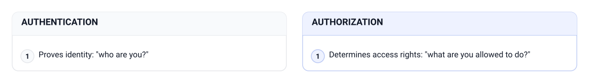

- Kredensial dicocokkan dengan data yang tersimpan
- Otorisasi dibaca dari **peran** pengguna yang identitasnya sudah terbukti

> Urutannya selalu tetap: autentikasi lebih dulu, otorisasi sesudahnya.

<!--
Dipotong ke gambar (diagram yang mengatakan ini):
- Membuktikan identitas: "siapa kamu?"
- Menentukan hak akses: "apa yang boleh kamu lakukan?"
- **Autentikasi**
- **Otorisasi**

Dua butir itu adalah dua baris panel gambar, karena itu keduanya keluar dari slide. Yang
tinggal di layar adalah separuh yang tidak digambar panel: bagaimana autentikasi dikerjakan
(kredensial dicocokkan dengan data tersimpan) dan dari mana otorisasi berasal (peran dari
identitas yang sudah terbukti). Blockquote di bawah menjaga tugasnya sendiri, yaitu urutan
yang tetap — hal yang tidak bisa dikatakan gambar dua kolom.

Analogi bab ini: masuk gedung kantor. Petugas membaca kartu identitasmu (autentikasi), lalu
badge akses menentukan lantai mana yang boleh kamu masuki (otorisasi). Kartu identitas tidak
otomatis membuka pintu ruang server.

Salah paham tersering: menganggap "login" sudah mencakup keduanya. Tanya: "Kalau saya sudah
login sebagai mahasiswa, bolehkah saya membuka nilai mahasiswa lain?" (Tidak, dan yang
melarang bukan login, melainkan otorisasi di server.)
-->

---

## Peran di SIAKAD Menentukan Apa yang Boleh Dibuka

| Peran | Yang boleh dilakukan |
|---|---|
| `mahasiswa` | Melihat nilai sendiri |
| `dosen` | Mengisi nilai mata kuliah yang diampu |
| `admin` | Mengelola data seluruh pengguna |

- Autentikasi sama untuk semua peran; yang berbeda adalah hasil otorisasi
- Pemeriksaan `role` di klien hanya kenyamanan; server yang memutuskan otorisasi

<!--
Tekankan baris terakhir: itulah kalimat yang paling sering dilanggar mahasiswa saat
membangun Project Akhir, misalnya menyembunyikan tombol admin di klien lalu menganggap
datanya sudah aman.

Pertanyaan penuntun: "Kalau tombol Tambah Data disembunyikan dari mahasiswa, apakah datanya
aman?" (Belum: mahasiswa masih bisa memanggil endpoint POST langsung dengan curl.)

Peringatkan bahwa keputusan otorisasi yang mengikat selalu berada di server.
-->

---

<!-- _class: compact -->

## Register dan Login: Dua Endpoint, Satu Tiket Masuk

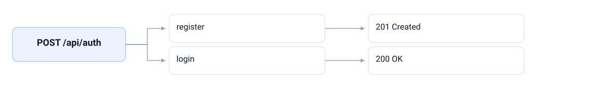

| Endpoint (`POST`) | Fungsi | Jawaban berhasil |
|---|---|---|
| `/api/auth/register` | Membuat akun baru | `201 Created` |
| `/api/auth/login` | Mencocokkan kredensial, memberi token | `200 OK` |

- Kredensial yang salah dijawab server dengan `401 Unauthorized`
- Server buku ini dijalankan dengan `cd backend && npm install && npm start`

<!--
Tunjukkan bahwa dua endpoint ini adalah pintu masuk; setiap endpoint data sesudahnya menuntut
token. Ingatkan bahwa cara menjalankan server dibahas di Bab 10.

Peringatan sensitif versi: bentuk persis jawabannya (misalnya nama field token dan user)
mengikuti backend/README.md. Kalau berbeda, sesuaikan kode di slide berikutnya.

Pertanyaan cepat: "Apa arti 401 Unauthorized bagi aplikasi?" (Jawaban: identitas pengguna
belum terbukti, jadi aplikasi harus mengembalikan pengguna ke layar login — lihat 13.7.)
-->

---

## Password Tidak Pernah Disimpan sebagai Teks Polos

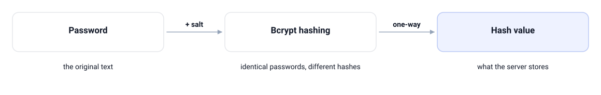

- **Kredensial** adalah identitas pengguna: biasanya email dan password
- Di buku ini password selalu ditulis sebagai placeholder `••••••••`
- Password tidak pernah dicetak ke layar, disimpan, atau ditulis ke log

<!--
Dipotong ke gambar (diagram yang mengatakan ini):
- Server menyimpan hasil **hashing** satu arah (misalnya bcrypt), bukan teks aslinya
- **Salt** membuat dua password yang sama menghasilkan nilai hash berbeda

Dua butir itu adalah rantainya sendiri — teks asli, hashing satu arah dengan salt, dan nilai
hash sebagai satu-satunya yang disimpan. Yang tinggal di layar adalah hal yang tidak bisa
dibawa satu tahap pun: apa itu kredensial, kesepakatan `••••••••` di buku ini, dan aturan
bahwa password tidak pernah dicetak, disimpan, atau dicatat.

Tekankan sifat satu arah: password asli tidak bisa dipulihkan dari nilai hash, sehingga
kebocoran basis data tidak langsung membuka akun pengguna.

Analogi: hash seperti memotong foto menjadi kepingan kecil yang tidak bisa disusun kembali,
sedangkan salt seperti memberi setiap orang pola potongan berbeda, sehingga dua password
yang sama tetap terlihat berbeda di basis data.

Tanya: "Kalau saya lupa password, kenapa aplikasi mengirim link reset, bukan mengirim
password saya?" (Karena server sendiri tidak menyimpannya.)
-->

---

<!-- _class: center -->

## Apa yang Terjadi Jika…?

- …password disimpan sebagai teks polos di basis data server?
- …token disimpan di AsyncStorage lalu perangkat di-*root*?
- …login sudah aman, tetapi endpoint daftar mahasiswa tidak dilindungi?

<!--
Jangan langsung dijelaskan; minta tiga mahasiswa menjawab satu skenario masing-masing, lalu
lanjut ke slide berikutnya yang memuat mekanismenya.

Jawaban yang diharapkan: (1) seluruh akun terbuka begitu basis data bocor; (2) token mudah
dibaca dan ikut tersalin ke cadangan perangkat; (3) siapa pun bisa menarik data tanpa login,
padahal layar loginnya rapi.

Catat jawaban yang keliru untuk diperbaiki di subbab 13.5 dan 13.6.
-->

---

<!-- _class: compact -->

## Tabel 13.1 — Session Menyimpan State, Token Tidak

| Aspek | Session | Token |
|---|---|---|
| State di server | Tersimpan (basis data/memori) | Tidak tersimpan (stateless) |
| Pencabutan | Mudah: hapus session di server | Sulit: tunggu token kedaluwarsa |
| Skalabilitas | Session harus dibagi antar server | Server bisa ditambah bebas |
| Cocok untuk | Aplikasi web tradisional | REST API dan aplikasi mobile |

- Aplikasi mobile dan REST API memilih token karena tidak bergantung pada *cookie* browser

<!--
Bandingkan dua kolom yang paling kontras, jangan dibaca baris per baris: session menang di
pencabutan, token menang di skalabilitas.

Sambungkan dengan Bab 10 yang sudah menyinggung tema ini sebagai pengantar; di sini polanya
dibahas penuh.

Tanya: "Kalau aplikasi kampus menambah tiga server API, apa yang harus berubah pada mekanisme
session?" (Session harus dibagi antar server, misalnya lewat penyimpanan bersama.)
-->

---

## Server yang Mengingat Butuh Tempat Berbagi, yang Stateless Cukup Satu Kunci

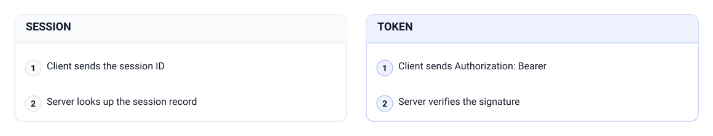

> Token membuat server mudah digandakan; session menuntut penyimpanan session yang dibagi.

<!--
Minta mahasiswa menunjukkan perbedaan terpenting di gambar: pada baris token, adakah langkah
"cari catatan" di server? Tidak ada. Ketiadaan itulah arti stateless.

Peringatan salah paham: stateless bukan berarti server tidak memeriksa apa pun. Server tetap
memeriksa signature dan klaim exp pada setiap permintaan.

Analogi: session seperti resepsionis yang mencatat setiap tamu; token seperti stempel resmi
yang keasliannya diperiksa tanpa membuka buku catatan.
-->

---

## JWT: Tiga Bagian, Dua Titik Pemisah

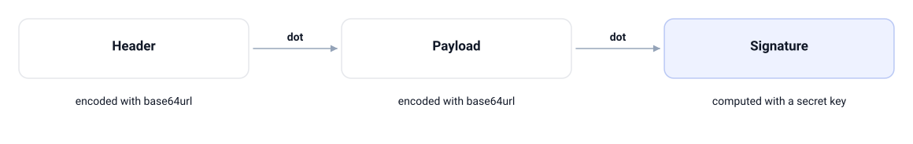

- **JWT** adalah tiket masuk berformat JSON yang ditandatangani
- Header dan payload hanya *encoded* dengan **base64url** (pengodean yang membuat karakter JSON tetap aman), bukan dienkripsi
- Signature dihitung dengan **secret key** yang hanya diketahui server

<!--
Tulis bentuknya di papan sebagai tiga blok berurutan supaya mahasiswa melihat bahwa token
hanyalah satu string panjang dengan dua titik sebagai pemisah.

Jelaskan klaim satu per satu hanya bila ditanya: sub adalah subjek atau identitas pengguna,
iat adalah waktu diterbitkan, exp adalah waktu kedaluwarsa.

Tanya: "Bagian mana yang membuat token tidak bisa dipalsukan?" (Jawaban: bagian ketiga, yaitu
signature.)
-->

---

## Contoh 13.1: Membongkar Tiga Bagian Token

`utils/pemeriksaJwt.js` — Contoh 13.1, hanya untuk belajar

```js
// Memecah JWT menjadi tiga bagian untuk keperluan pembelajaran
export function periksaJwt(token) {
  const bagian = token.split('.');
  if (bagian.length !== 3) {
    return { keterangan: 'Bukan JWT yang valid' };
  }
  return {
    header: bagian[0],    // berisi algoritma
    payload: bagian[1],   // berisi klaim pengguna
    signature: bagian[2], // penanda keaslian
  };
}
```

> Verifikasi token yang sebenarnya tetap dikerjakan server, bukan aplikasi klien.

<!--
Tunjukkan tiga hal saja: pemecahan dengan split('.'), pemeriksaan jumlah bagian, dan penamaan
bagian agar cocok dengan header, payload, signature.

Ingatkan bahwa fungsi ini hanya untuk belajar; di aplikasi produksi verifikasi sepenuhnya di
server, dan bila klien perlu membaca klaim, pakai library yang mapan seperti jwt-decode
(sensitif versi: periksa dokumentasi library-nya).

Demonstrasi singkat: tempel token contoh dari bab ke alat decoding daring, lalu tunjukkan
bahwa isi payload terbaca sebagai teks biasa.
-->

---

## JWT Bukan Enkripsi

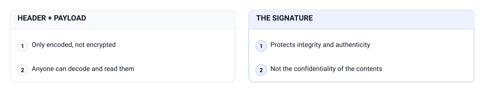

- Mengubah satu huruf di header atau payload membuat signature tidak cocok
- Jangan pernah menaruh password atau data rahasia di dalam payload

<!--
Dipotong ke gambar (diagram yang mengatakan ini):
- Header dan payload hanya *encoded*: siapa pun bisa membongkar dan membacanya
- Signature melindungi **integritas** dan **keaslian**, bukan **kerahasiaan** isinya

Dua butir itu adalah dua baris panel gambar, karena itu keduanya pindah ke sini. Yang tinggal
di slide adalah uji satu huruf — fakta tentang pemalsuan, bukan tentang pengodean — dan aturan
payload yang lahir darinya. Judul tetap menyebut kesimpulannya; gambar yang menjelaskan
alasannya.

Inilah salah paham nomor satu di bab ini: mahasiswa menganggap JWT "terenkripsi" sehingga
aman diisi data apa saja. Ulangi kalimat penutupnya dua kali bila perlu.

Pertanyaan penuntun: "Kalau saya menaruh nomor KTP seseorang di payload, amankah?" (Tidak:
payload bisa dibaca siapa pun yang memegang token.)

Hubungkan ke belakang: karena itulah jawaban login tidak boleh mengirim seluruh profil, yang
dibahas lagi di subbab 13.6 dan studi kasus.
-->

---

## Kenapa JWT Membuat Server Tidak Menyimpan Apa pun

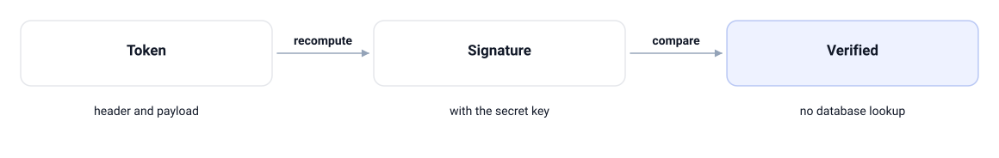

- Tidak ada pencarian ke basis data untuk memeriksa daftar token yang sah
- Verifikasi hanya butuh secret key, aritmetika, dan pemeriksaan klaim `exp`
- Server mana pun yang memegang secret key bisa memverifikasi token yang sama

<!--
Dipotong ke gambar (diagram yang mengatakan ini):
- Server menghitung ulang signature dari header dan payload yang diterimanya

Tiga tahap itu adalah butir tersebut. Yang tinggal di layar adalah hal yang tidak ditunjukkan
satu tahap pun: bahwa sejak awal tidak ada yang perlu dicari (daftar token yang sah), tiga hal
yang dibutuhkan verifikasi — secret key, aritmetika, klaim `exp` — dan akibatnya bahwa server
mana pun yang memegang kunci bisa memverifikasi token yang sama.

Tekankan tidak ada langkah "cari token ini di basis data". Yang ada hanya penghitungan ulang
signature, lalu pembandingan.

Analogi: seperti memeriksa keaslian segel pada surat. Petugas hanya perlu tahu bentuk segel
yang benar; tidak perlu daftar seluruh surat yang pernah diterbitkan.

Pertanyaan penuntun: "Jadi apa bedanya logout pada arsitektur token dengan logout pada
session?" (Server tidak punya catatan untuk dihapus; yang dihapus adalah token di sisi klien.)
-->

---

## Harga Stateless: Token yang Dicuri Hidup Sampai `exp`

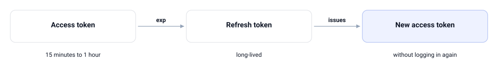

- Server tidak punya daftar token yang dicabut: token curian tetap sah sampai `exp`
- *Refresh token* cukup dipahami sebagai gambaran umum; penerapannya ada di Tantangan

<!--
Dipotong ke gambar (diagram yang mengatakan ini):
- Pola umumnya: access token berumur pendek, misalnya 15 menit sampai 1 jam
- **Refresh token** berumur panjang menerbitkan access token baru tanpa login ulang

Dua butir itu adalah tiga tahap beserta dua panah di antaranya. Yang tinggal di slide adalah
harga yang harus dibayar — tidak ada daftar token yang dicabut, sehingga token curian hidup
sampai `exp` — dan itu justru ketiadaan yang tidak bisa digambar rantai, ditambah catatan
cakupan soal Tantangan.

Sampaikan sebagai trade-off, bukan cacat desain: setiap pilihan punya harga, dan harga
stateless adalah pencabutan yang tidak seketika.

Skenario yang mudah dibayangkan: mahasiswa kehilangan HP yang masih dalam keadaan login.
Tanya: "Apa yang bisa dilakukan server selama tokennya masih hidup?" (Sedikit: menunggu exp,
atau memperpendek umur access token.)

Tekankan bahwa karena itulah klaim exp tidak boleh dibuat terlalu panjang.
-->

---

<!-- _class: lead -->
<!-- _paginate: skip -->

# Bagian 2 — Perlindungan, Penyimpanan & Keamanan API

subbab 13.4 protected route · 13.5 penyimpanan token · 13.6 keamanan API · 13.7 alur lengkap

<!--
Bagian ini bagian praktis. Kalau pertemuan ini dipakai untuk laboratorium, subbab 13.4 sampai
13.5 dikerjakan sambil mengetik kode, sedangkan 13.6 cukup dibacakan dengan satu contoh untuk
tiap prinsip.

Sisakan paling sedikit 20 menit untuk praktikum di akhir.
-->

---

## Protected Route Mengatur Tampilan, Bukan Mengunci Data

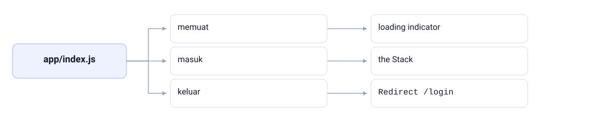

- **Protected route** adalah layar yang hanya boleh dibuka pengguna yang sudah login
- Perlindungan di klien adalah lapisan pengalaman pengguna, bukan keamanan data
- Keamanan data ditentukan **middleware** server pada header `Authorization`
- Selama status `memuat`, tampilkan indikator agar layar tidak berkedip

<!--
Dipotong ke gambar (diagram yang mengatakan ini):
- Halaman pengarah `app/index.js` menentukan arah berdasarkan status autentikasi

Butir itu adalah gambarnya: satu penentu, tiga status, tiga tujuan. Yang tinggal di layar
adalah separuh yang tidak bisa dibawa satu cabang pun — apa itu protected route, bahwa
penjagaan di klien hanya pengalaman pengguna, dan bahwa middleware server yang melindungi
data. Butir `memuat` juga tinggal, karena alasannya ("agar layar tidak berkedip") adalah fakta
yang tidak ditunjukkan gambar.

Ulangi pola dari Bab 7, lalu jelaskan yang baru di bab ini: pemeriksaannya bukan lagi statis,
tetapi memakai state autentikasi sungguhan dari penyimpanan token.

Tekankan pembagian peran: klien mengarahkan pengguna, server menolak permintaan. Keduanya
bukan pengganti satu sama lain.

Pertanyaan penuntun: "Kalau proteksi klien saya matikan, datanya masih aman?" (Masih aman bila
endpoint-nya dilindungi server; itulah inti slide berikutnya.)

Sebutkan struktur baku dari Bab 7: grup route `app/(app)/` memuat Home, Daftar Mahasiswa,
Detail, dan Formulir; di luar grup itu hanya ada `app/login.js` dan halaman pengarah.
-->

---

## Klien Mengarahkan, Server Memutuskan

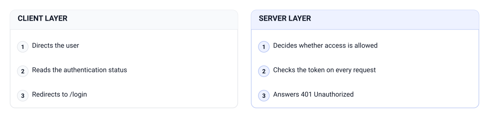

> Klien mengarahkan pengguna; server yang memutuskan boleh atau tidaknya akses.

<!--
Minta mahasiswa menebak apa yang terjadi bila hanya lapisan server yang aktif, dan bila hanya
lapisan klien yang aktif. Jawabannya: tanpa lapisan klien aplikasi terasa membingungkan
tetapi datanya aman; tanpa lapisan server datanya terbuka walau tampilannya sudah rapi.

Sebutkan bahwa di backend buku ini proteksi tersedia sebagai middleware opsional, dan cara
mengaktifkannya ada di backend/README.md (sensitif versi: nama dan cara aktivasi middleware
mengikuti README itu).

Peringatan: jangan menuliskan nama header atau nama fungsi middleware sendiri yang tidak ada
di README.
-->

---

## Satu File Layout Melindungi Seluruh Grup Route

`app/(app)/_layout.js` — versi ringkas dari Kode 8

```js
import { Redirect, Stack } from 'expo-router';
import { ActivityIndicator } from 'react-native';
import { useAuth } from '../../context/AuthContext';

export default function LayoutTerproteksi() {
  const { status } = useAuth();

  if (status === 'memuat') return <ActivityIndicator size="large" />;
  if (status === 'keluar') return <Redirect href="/login" />;
  return <Stack />;
}
```

> Satu file `_layout.js` melindungi Home, Daftar, Detail, dan Formulir tanpa menyentuh layarnya.

<!--
Tunjukkan bahwa tiga status menentukan tiga keluaran berbeda: `memuat` menampilkan indikator,
`keluar` mengalihkan, dan `masuk` menampilkan Stack.

Jelaskan alasan indikator pemuatan: tanpanya, aplikasi sempat "berkedip" ke login sebelum
token selesai dibaca dari SecureStore.

Catatan penulisan: kode di slide ini diringkas dari Kode 8 di buku (pembungkus View yang
memusatkan indikator dibuang agar muat di layar); arahkan mahasiswa ke buku untuk versi
lengkapnya.

Pertanyaan penuntun: "Kenapa `Redirect`, bukan memindahkan pengguna dengan tombol?" (Karena
status bisa berubah sendiri saat aplikasi dibuka, bukan hanya saat pengguna menekan sesuatu.)
-->

---

## Token Kedaluwarsa: Tunggu Jawaban 401 dari Server

`context/AuthContext.js` — Contoh 13.3

```js
// Dipanggil ketika server menjawab 401 (token ditolak)
async function keluarKarenaKedaluwarsa() {
  await hapusToken();
  setToken(null);
  setUser(null);
  setStatus('keluar'); // protected route akan Redirect ke /login
}
```

> Cara pakai: ketika `response.status === 401`, panggil fungsi ini dari pemanggil API.

<!--
Tekankan bahwa fungsi ini hampir sama dengan signOut, bedanya tanpa konfirmasi pengguna, karena
kondisinya bukan atas permintaan pengguna.

Jelaskan manfaatnya dari sisi pengalaman: pengguna yang tokennya kedaluwarsa tidak terjebak
menatap pesan error berulang di layar yang sama.

Pertanyaan penuntun: "Kenapa aplikasi perlu menunggu jawaban 401 dari server, bukan menghitung
sendiri umur tokennya?" (Karena server adalah pemegang wewenang yang memutuskan keabsahan
token.)
-->

---

<!-- _class: compact -->

## Tabel 13.2 — AsyncStorage vs SecureStore

| Aspek | AsyncStorage (Bab 11) | SecureStore (bab ini) |
|---|---|---|
| Enkripsi | Tidak (teks polos) | Ya (Keystore/Keychain) |
| Ikut backup perangkat | Ya | Tidak disarankan |
| Ukuran nilai | Besar (bebas) | ±2 KB per nilai |
| Cocok untuk | Data tidak sensitif, cache | Token, PIN, rahasia kecil |

- Token itu seperti uang tunai digital: tempat menyimpannya menentukan keamanannya

<!--
Ringkas pembagian tugas penyimpanan: data besar dan tidak sensitif tetap di AsyncStorage
(Bab 11), sedangkan token dan rahasia kecil masuk ke SecureStore.

Jelaskan mekanismenya sesederhana mungkin: Android memakai kunci dari Keystore, iOS memakai
Keychain; kunci kriptografisnya tidak pernah keluar dari area aman perangkat.

Peringatan sensitif versi: batas ukuran dan perilaku platform SecureStore bisa berubah antar
versi SDK; periksa docs.expo.dev sebelum memakainya di kode produksi.

Tanya: "Kenapa cache daftar mahasiswa tidak perlu SecureStore?" (Karena isinya bukan rahasia
dan ukurannya bisa besar.)
-->

---

## SecureStore: Tiga Fungsi Sudah Cukup

`utils/tokenStorage.js` — Kode 1

```js
import * as SecureStore from 'expo-secure-store';
const KUNCI_TOKEN = 'token_mahasiswa_app';

export async function simpanToken(token) {
  await SecureStore.setItemAsync(KUNCI_TOKEN, token);
}
export async function bacaToken() {
  return await SecureStore.getItemAsync(KUNCI_TOKEN); // null bila belum ada
}
export async function hapusToken() {
  await SecureStore.deleteItemAsync(KUNCI_TOKEN);
}
```

- Pasang dengan `npx expo install expo-secure-store` supaya versinya sesuai SDK

<!--
Tunjukkan manfaat pembungkus ini: hanya file ini yang tahu nama kuncinya, sehingga salah ketik
nama kunci tidak mungkin terjadi di layar lain.

Jelaskan bahwa getItemAsync mengembalikan null bila nilainya belum ada, jadi pemeriksaan
"sudah login atau belum" cukup memeriksa nilai itu.

Sebutkan masalah praktikum yang paling sering muncul di sini: pesan "Cannot find native module
ExpoSecureStore". Penyebabnya paket belum terpasang atau versinya tidak cocok; solusinya
npx expo install expo-secure-store lalu npx expo start -c.
-->

---

<!-- _class: center -->

## Kuis Kilat

- Apa yang menjamin keaslian sebuah JWT?
- Kenapa server tetap disebut stateless padahal memakai token?
- Kapan keunggulan session paling dibutuhkan?
- Fungsi `expo-secure-store` mana yang menghapus token saat logout?

<!--
Kuis lisan empat menit: tampilkan pertanyaan, minta kelas menjawab serempak atau mengangkat
tangan, lalu lanjut ke slide kunci. Jangan bocorkan jawaban di slide ini.

Kalau jawaban kelas beragam di pertanyaan kedua, ulangi penjelasan verifikasi signature sebelum
menutup pertemuan.
-->

---

<!-- _class: center -->

## Kunci Kuis Kilat

- Signature yang dihitung dengan secret key milik server
- Verifikasi hanya butuh secret key, aritmetika, dan klaim `exp`
- Saat pencabutan akses harus berlaku seketika: hapus session di server
- `deleteItemAsync`

<!--
Ulangi pembedaan yang paling sering tertukar: stateless bukan berarti tanpa verifikasi, dan
session menang bukan di skalabilitas melainkan di kemudahan pencabutan.

Pertanyaan lanjutan bila waktu tersisa: "Kapan aplikasi mobile masih memilih session?" (Jarang,
biasanya saat pencabutan seketika wajib, misalnya aplikasi internal perbankan.)
-->

---

## Prinsip 1: Klien Tidak Bisa Dipercaya, Server Harus Memvalidasi

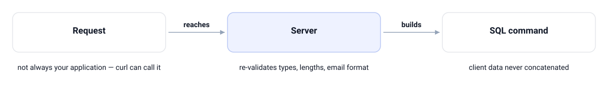

- Validasi formulir (Bab 8) hanya memberi umpan balik cepat kepada pengguna
- Satu kalimat aturannya: klien adalah lingkungan yang tidak bisa dipercaya

<!--
Dipotong ke gambar (diagram yang mengatakan ini):
- Pengirim permintaan tidak selalu aplikasimu: endpoint bisa dipanggil dengan curl
- Server memvalidasi ulang tipe data, panjang, format email, dan field wajib
- Data klien tidak pernah dirangkai langsung menjadi perintah SQL (**SQL injection**)

Tiga butir itu adalah rantai beserta dua panahnya: permintaan datang dari mana saja, server
memvalidasi ulang, lalu server menyusun kueri tanpa pernah merangkai kiriman klien. Tahap
tengah gambar adalah judul slide ini. Yang tinggal adalah penilaian yang tidak bisa dibuat
satu tahap pun — bahwa validasi formulir hanya umpan balik (dengan rujukan Bab 8 yang tidak
bisa dibawa tahap mana pun), dan bahwa klien adalah lingkungan yang tidak bisa dipercaya.

Tekankan bahwa validasi klien tidak pernah dihapus, hanya perannya berubah: untuk kenyamanan
pengguna, bukan untuk keamanan.

Demonstrasi murah: kirim satu permintaan lewat alat penguji API dengan field yang salah, lalu
tunjukkan server menolaknya. Pesan penolakan itu bukti validasi server bekerja.

Peringatan: jangan pernah menulis "validasi klien sudah cukup" di laporan praktikum; di rubrik
Project Akhir ini termasuk aspek keamanan.
-->

---

## Prinsip 2: Secret Key Tidak Pernah Ikut ke dalam APK

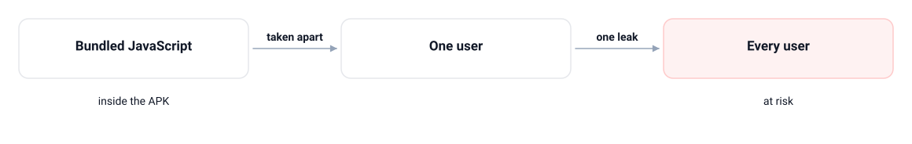

- Secret key penanda tangan JWT dan API key pihak ketiga hanya hidup di server
- Klien hanya boleh menyimpan hasil autentikasi, dan hanya lewat SecureStore

<!--
Dipotong ke gambar (diagram yang mengatakan ini):
- Kode JavaScript dibundel menjadi file dan bisa dibongkar dari APK
- Begitu satu pengguna membongkar aplikasinya, seluruh pengguna terancam

Dua butir itu adalah rantainya: kode ikut dikirim di dalam APK, satu pengguna membongkarnya,
dan karena file itu sama di setiap perangkat, satu kebocoran menjadi kebocoran semua pengguna.
Gambar menggambar eskalasinya; dua butir yang tinggal di slide menyebut aturan yang lahir
darinya — di mana kunci boleh hidup, dan satu-satunya hal yang boleh disimpan klien.

Tekankan ketidakseimbangan risikonya: satu kebocoran di klien mengenai semua pengguna, bukan
hanya pengguna yang membongkar aplikasinya.

Sambungkan dengan Bab 15: yang boleh hidup di klien adalah konfigurasi publik seperti
EXPO_PUBLIC_API_URL, bukan rahasia; rahasia server disimpan sebagai environment variable di
sisi server.

Soal uraian 2 di buku memakai skenario ini; pakai sebagai latihan lanjutan.
-->

---

## Prinsip 3: Tanpa HTTPS, Password Dibaca dari Jaringan yang Sama

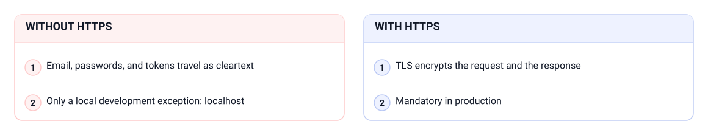

- Penyadap di jaringan yang sama bisa membacanya: serangan `man-in-the-middle` (MITM)
- Android 9 (API 28) memblokir lalu lintas *cleartext* pada build produksi

<!--
Dipotong ke gambar (diagram yang mengatakan ini):
- Tanpa HTTPS, email, password, dan token dikirim sebagai **cleartext** (teks polos)
- **TLS** (*Transport Layer Security*) mengenkripsi permintaan dan jawabannya
- HTTP ke `localhost` hanyalah pengecualian pengembangan lokal, bukan untuk produksi

Tiga butir itu adalah dua panel beserta kedua barisnya: bentuk data di jaringan dengan dan
tanpa TLS, dan di mana koneksi tanpa enkripsi masih boleh dipakai. Yang tinggal di slide
adalah serangannya sendiri (orang di tengah membaca password orang lain — gambar dua pesan
tidak bisa menunjukkan pihak ketiga) dan blokir Android 9 / API 28, yang merupakan aturan
platform dengan nomor versi.

Skenario yang membuatnya konkret: Wi-Fi kampus yang sama, seorang mahasiswa menjalankan alat
penyadap jaringan, dan password temannya tampil sebagai teks. Tanya: "Siapa yang bersalah di
skenario ini?" (Pengembang yang membiarkan produksi berjalan tanpa HTTPS.)

Jawab pertanyaan yang sering muncul di praktikum: kenapa praktikum boleh memakai HTTP? Karena
Expo Go mengizinkan HTTP ke localhost untuk pengembangan. Tandai sensitif versi: kebijakan
cleartext Expo Go bisa berubah antarversi, jadi cocokkan dengan dokumentasi resmi sebelum
semester berjalan.

Ringkas dalam satu kalimat: HTTP hanya untuk mesin pengembanganmu sendiri, HTTPS untuk semua
yang lain.
-->

---

## Prinsip 4: Least Privilege Mempersempit Sasaran Serangan

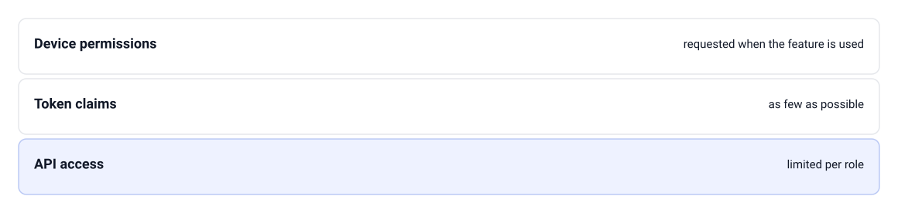

- Beri pengguna, fungsi, dan aplikasi hanya hak yang benar-benar dibutuhkan
- Aplikasi mahasiswa tidak menerima hak admin hanya karena login berhasil
- Least privilege mempersempit permukaan serangan

<!--
Dipotong ke gambar (diagram yang mengatakan ini):
- Izin perangkat diminta saat fiturnya dipakai, bukan sekaligus saat aplikasi dibuka
- Klaim token dibuat sesedikit mungkin; akses API dibatasi per peran

Dua butir itu adalah tiga pita gambar: izin di perangkat, klaim di dalam token, dan akses yang
diizinkan server. Yang tinggal di slide adalah prinsipnya sendiri, contoh lawan yang semua
orang kenali (hak admin karena login berhasil bukan hak, melainkan bug), dan hasil yang dibeli
aturan ini — permukaan serangan yang lebih sempit. Ketiganya bukan pita.

Sambungkan dengan Bab 12 untuk izin perangkat: kamera diminta saat pengguna menekan tombol
foto, bukan saat aplikasi dibuka.

Tekankan bahwa prinsip ini berlaku di tiga lapisan sekaligus: izin perangkat, klaim di dalam
token, dan data yang dikirim server pada setiap jawaban.

Pertanyaan penuntun: "Aplikasi hanya menampilkan nama dan peran, tetapi jawaban login memuat
nomor KTP dan alamat. Prinsip apa yang dilanggar?" (Least privilege; kasus ini muncul lagi di
studi kasus setelah ini.)
-->

---

## Lima Langkah, Satu Token: dari Login sampai Logout

1. Pengguna mengirim email dan password lewat layar Login
2. Server autentikasi menjawab dengan token JWT bila kredensialnya sah
3. Aplikasi menyimpan token di SecureStore (terenkripsi, bukan AsyncStorage)
4. Setiap panggilan API menyertakan header `Authorization: Bearer <token>`
5. Logout menghapus token dari SecureStore lalu `Redirect` ke `/login`

> Logout pada arsitektur token berarti membuang kunci di sisi klien; server tidak punya session untuk ditutup.

<!--
Jadikan slide ini peta praktikum: setiap langkah punya filenya sendiri, dan mahasiswa bisa
menunjuk kode mana mengerjakan langkah mana.

Sebutkan empat keputusan desain di dalam alur ini: token hanya diterima dari server yang sah,
disimpan terenkripsi, dikirim ulang lewat header Authorization dengan skema Bearer, dan dihapus
saat logout.

Satu cabang yang tidak tampak di lima langkah di atas: bila token hilang atau kedaluwarsa,
permintaan berikutnya ditolak dengan 401 dan pengguna diarahkan kembali ke layar login.
-->

---

## Diagram: Siapa Berbicara ke Siapa, dan di Mana Token Disimpan

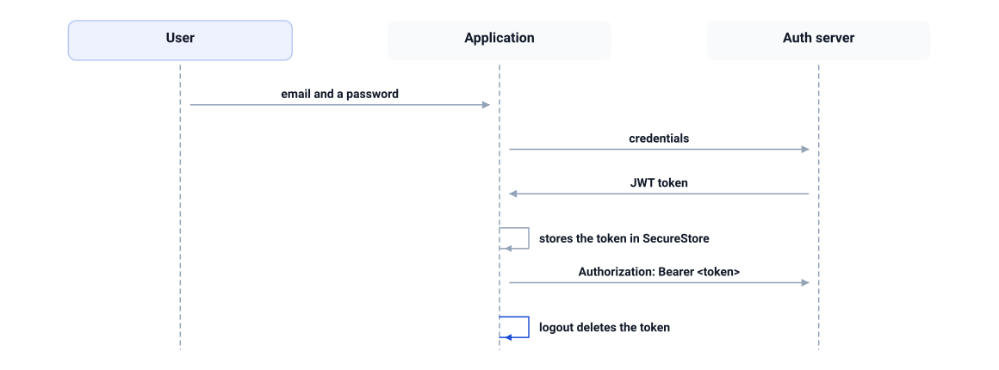

<!--
Gambar saja, supaya lima langkah di slide sebelumnya tetap utuh. Bacalah dari atas ke bawah:
siapa berbicara kepada siapa, dan di mana token hidup di antara dua pesan.

Tunjuk lingkaran terakhir: tidak ada panah yang keluar dari aplikasi, karena di server tidak
ada session untuk ditutup. Itulah seluruh biaya dan seluruh manfaat stateless dalam satu baris.
-->

---

<!-- _class: compact -->

## Studi Kasus: e-Kampus, Empat Temuan Audit

**Contoh ilustratif** — kasus di bab ini, dengan pola kelemahan yang nyata.

| Temuan | Prinsip yang dilanggar |
|---|---|
| Token disimpan di AsyncStorage | Menyimpan rahasia di media tidak aman (13.5) |
| Endpoint profil dan daftar mahasiswa terbuka | Perlindungan route tidak konsisten (13.4) |
| Komunikasi HTTP biasa di Wi-Fi kampus | Tanpa HTTPS (13.6) |
| Jawaban login memuat profil lengkap (NIK, alamat) | Least privilege (13.6) |

<!--
Sampaikan sebagai cerita, bukan sebagai daftar: kampus punya aplikasi e-Kampus, enam bulan
kemudian muncul pemberitaan kebocoran data, dan audit menemukan empat pola kelemahan yang
sebenarnya umum di banyak sistem.

Minta mahasiswa menebak prinsip mana yang dilanggar sebelum kolom kanan dibuka. Cara ini
menguji pemahaman 13.5 dan 13.6 sekaligus.

Peringatan: kasus ini disusun sebagai cerita pembelajaran; jangan menyampaikannya sebagai
laporan insiden lembaga pendidikan tertentu.

Hubungkan ke aplikasi kita: tiga dari empat temuan ini bisa terjadi di Aplikasi Manajemen Data
Mahasiswa bila praktikum Bab 10 disalin tanpa perubahan.
-->

---

## Studi Kasus: Auditor Memperbaiki yang Paling Murah Dulu

1. Pindahkan token ke SecureStore, buang data sensitif dari jawaban login
2. Lindungi setiap route server yang membawa data pribadi, bukan hanya sebagian
3. Wajibkan HTTPS di produksi; batasi HTTP untuk pengembangan lokal saja
4. Terapkan permintaan data minimal: hanya field yang benar-benar ditampilkan

> Keamanan itu sistem, bukan satu fitur.

<!--
Tekankan urutannya dan alasannya: perbaikan terbesar dengan perubahan terkecil dikerjakan
lebih dulu. Memindahkan penyimpanan token dan memangkas jawaban login hanya menyentuh beberapa
file, tetapi menutup risiko terbesar.

Pertanyaan penuntun: "Kalau anggaran hanya cukup untuk satu perbaikan, mana yang dipilih?"
(Jawaban: perbaikan pada butir pertama.)

Sambungkan dengan cara berpikir Project Akhir: setiap keputusan desain diuji dengan pertanyaan
"bagaimana kalau perangkat ini dipegang orang jahat?".
-->

---

## Praktikum: Yang Dibangun Pertemuan Ini

- Melanjutkan **Aplikasi Manajemen Data Mahasiswa** dari praktikum Bab 10
- Daftarkan akun lewat `/api/auth/register`, masuk lewat `/api/auth/login`
- Token disimpan di SecureStore; daftar mahasiswa hanya muncul bila ada token
- Uji pertama: aplikasi dibuka tanpa token → layar Login yang muncul, bukan Home
- Uji kedua: setelah logout, akses ke `/(app)/mahasiswa` ditolak dan dialihkan ke `/login`

<!--
Praktikum ini adalah tonggak autentikasi Project Akhir, jadi minta mahasiswa menyimpan
tangkapan layar sebagai bukti: layar Login pada pembukaan pertama, sapaan dengan nama pengguna
di Home, dan penolakan akses setelah logout.

Sebutkan hasil lain yang ada di buku tetapi tidak diuji di kelas karena waktu: menutup lalu
membuka aplikasi tanpa logout seharusnya tetap membuat pengguna masuk (token dibaca dari
SecureStore), dan memasang ulang aplikasi menghapus token karena tersimpan di area aman
perangkat.

Peringatan waktu: langkah praktikum menuntut penulisan utilitas penyimpanan, pemanggil API,
penyedia autentikasi, dan tiga file route sekaligus, sehingga tidak selesai dalam satu
pertemuan bila diketik dari nol; minta mahasiswa menyiapkan file dasarnya sebelum praktikum.
-->

---

## Kode Inti: Token Disisipkan di Satu Tempat

`api/client.js` — Kode 2 (diringkas agar muat di slide)

```js
export const BASE_URL = 'http://localhost:3000'; // emulator Android: http://10.0.2.2:3000

async function kirim(method, path, { body, token } = {}) {
  const headers = { 'Content-Type': 'application/json' };
  if (token) {
    headers.Authorization = `Bearer ${token}`; // token disisipkan di sini
  }
  const response = await fetch(`${BASE_URL}${path}`, {
    method, headers, body: body ? JSON.stringify(body) : undefined,
  });
  const data = await response.json().catch(() => null);
  if (!response.ok) throw new Error((data && data.pesan) || `Permintaan gagal (status ${response.status})`);
  return data;
}
```

<!--
Tekankan satu baris saja: penyisipan header Authorization dengan skema Bearer. Di situlah token
berpindah dari penyimpanan ke dalam permintaan.

Jelaskan alasan memusatkan panggilan fetch di satu file: penanganan 401 dan pesan error server
cukup ditulis sekali, dan semua layar mendapat perilaku yang sama.

Sebutkan masalah praktikum "Network request failed" dari buku: penyebabnya BASE_URL yang salah,
server belum berjalan, atau emulator Android yang tidak bisa memakai localhost. Untuk emulator
pakai http://10.0.2.2:3000; untuk Expo Go di perangkat pakai localhost atau IP komputer.

Catatan penulisan: versi lengkapnya ada di buku (Kode 2); slide ini hanya menampilkan fungsi
kirim dan baris yang menentukan alur token, sedangkan loginApi, registerApi, dan ambilMahasiswa
yang memanggilnya dibaca langsung di buku.
-->

---

## Yang Harus Teramati

- Layar Login muncul pada pembukaan pertama, sebelum ada token
- Sapaan dengan nama pengguna tampil di Home setelah login berhasil
- Akses `/(app)/mahasiswa` ditolak setelah logout dan dialihkan ke `/login`
- Aplikasi ditutup lalu dibuka lagi tanpa logout: pengguna tetap masuk
- Pasang ulang aplikasi menghapus token, karena tersimpan di area aman perangkat

> Laporan yang baik menyertakan tangkapan layar tiap butir, bukan hanya tulisan "berhasil".

<!--
Jadikan daftar ini lembar centang: mahasiswa mencentang setiap butir lalu melampirkan tangkapan
layar sebagai bukti tonggak autentikasi sesuai rubrik Project Akhir.

Dua butir terakhir sengaja ada di sini dan tidak diuji di kelas karena waktu; keduanya bisa
dikerjakan mandiri dan justru paling sering membedakan mahasiswa yang memahami penyimpanan
token dari yang hanya menyalin kode.

Pertanyaan penuntun: "Kenapa memasang ulang aplikasi menghapus token, padahal token tidak ikut
tercadang?" (Jawaban: token ada di area aman perangkat yang ikut dibersihkan saat aplikasi
dicopot.)
-->

---

<!-- _class: compact -->

## Sebelum Rilis, Jawab Dulu Empat Pertanyaan Ini

| Prinsip | Pertanyaan uji sebelum rilis |
|---|---|
| Penyimpanan rahasia | Bagaimana jika perangkat ini dipegang orang jahat? |
| Perlindungan server | Endpoint mana yang membawa data pribadi dan belum dilindungi? |
| Saluran | Apakah server produksi masih menerima HTTP biasa? |
| Least privilege | Data dan klaim mana yang tidak benar-benar dibutuhkan? |

- Empat pertanyaan ini menjadi bagian daftar periksa QA di Bab 14

<!--
Tunjukkan bahwa empat pertanyaan ini bisa dipakai sebagai daftar periksa pada Project Akhir, dan
hasilnya menjadi bahan laporan QA di Bab 14.

Tekankan bahwa bobot keamanan di rubrik Project Akhir memang kecil, tetapi kebocoran data
membatalkan nilai komponen lain: aplikasi yang datanya terbuka tidak bisa disebut selesai.

Bila waktu tersisa, minta setiap kelompok menulis satu jawaban untuk satu pertanyaan tentang
aplikasinya sendiri.
-->

---

## Yang Paling Sering Lupa Dikunci di Aplikasi Sendiri

**Diskusi kelompok (5 menit)**

- Prinsip mana yang paling mudah kamu lupakan saat membangun aplikasi sendiri?
- Keputusan mana yang akan kamu perjuangkan di tim kampus: penyimpanan token atau HTTPS?

**Latihan pilihan**

- Soal pemahaman 4: kenapa perlindungan di klien saja tidak cukup?
- Soal praktik 1: keluar otomatis saat server menjawab 401
- Soal analisis 1: menilai password yang disimpan di dalam payload JWT

> Soal pemahaman, praktik, analisis, dan tantangan bab ini menjadi bahan Latihan Bab 13, dinilai lewat rubrik praktikum di Lampiran A.

<!--
Beri 5 menit berpasangan untuk pertanyaan di atas, lalu tampung dua sampai tiga jawaban.
Jawaban yang kuat menyebut alasannya, bukan hanya nama prinsipnya.

Untuk soal analisis, jawaban yang diharapkan menyentuh tiga hal: password bisa dibaca siapa pun
dari payload, perbaikan yang benar adalah memanggil endpoint profil, dan dampaknya bila token
bocor sebelum kedaluwarsa.

Pengingat penilaian: soal praktik 1 dan 3 di buku adalah kandidat kuat untuk dinilai di
praktikum berikutnya.
-->

---

## Ringkasan

1. Autentikasi membuktikan identitas; otorisasi menentukan hak akses
2. Session menyimpan state di server; token membuat server stateless
3. JWT = header.payload.signature; keaslian dijamin signature, bukan enkripsi
4. Protected route mengatur pengalaman; keamanan data ditentukan server
5. Token disimpan dengan `expo-secure-store`, bukan AsyncStorage

<!--
Jangan dibacakan. Minta lima mahasiswa menjelaskan satu nomor dengan kata-kata sendiri; bila
keliru, perbaiki saat itu juga sebelum pertemuan ditutup.

Yang belum tertulis di slide dan perlu diucapkan: empat prinsip keamanan API, dan makna logout
sebagai membuang kunci di sisi klien.

Pesan penutup: ajukan pertanyaan "bagaimana kalau perangkat ini dipegang orang jahat?" pada
setiap keputusan desain sesudah ini.
-->

---

<!-- _class: compact -->

## Referensi

| Sumber | Link |
|---|---|
| Dokumentasi Expo — SecureStore (2026) | docs.expo.dev |
| Dokumentasi Expo — Expo Router (2026) | docs.expo.dev |
| Dokumentasi React Native (2026) | reactnative.dev |
| Dokumentasi Express (2026) | expressjs.com |
| MDN Web Docs — HTTP dan JavaScript (2026) | developer.mozilla.org |

**Bab terkait:** Bab 7 (protected screen, grup route) · Bab 10–11 (fetch, penyimpanan lokal) · Bab 12 (izin perangkat, least privilege)

**Bacaan lanjutan:** Bab 14 — Debugging, Testing, dan Quality Assurance

**Versi teknologi:** Expo SDK 57 · React Native 0.86 · React 19.2 · Node.js ≥ 22

<!--
Rujukan lengkap ada di Lampiran D; istilah seperti JWT, Secure Storage, dan Token dijelaskan di
glosarium Lampiran C.

Ingatkan bahwa dokumentasi Expo dan MDN bersifat sensitif versi: periksa ulang versi SecureStore
dan perilaku cleartext sebelum memakainya di kode produksi.

Empat bab terkait itu sudah dibahas sebelumnya dan hanya dipakai ulang di sini: Bab 7 untuk grup
route, Bab 10 untuk fetch, Bab 11 untuk penyimpanan lokal, dan Bab 12 untuk izin perangkat.

Bacakan versi teknologi apa adanya, jangan disesuaikan sendiri bila library di komputer
mahasiswa lebih baru; ketidakcocokan versi adalah penyebab kesalahan praktikum yang paling
umum.
-->

---

<!-- _class: lead -->
<!-- _paginate: skip -->

# Siap ke Bab 14

**Praktikum:** selesaikan alur login → token → akses API → logout, lalu kumpulkan bukti tangkapan layar sebagai tonggak autentikasi Project Akhir.

Pertemuan berikutnya: Bab 14 — Debugging, Testing, dan Quality Assurance bersama Bab 15 — Build dan Deployment.

<!--
Tutup dengan satu kalimat: "Bab ini mengajari aplikasi menjaga pintu; bab berikutnya mengajari
kita memeriksa setiap ruang sebelum diserahkan ke pengguna."

Sebutkan tenggat pengumpulan tangkapan layar secara eksplisit, lalu kaitkan dengan rubrik
praktikum (Lampiran A): pemahaman konsep 15%, implementasi 25%, kualitas kode 15%, UI/UX 15%,
debugging 10%, dokumentasi 20%.
-->
