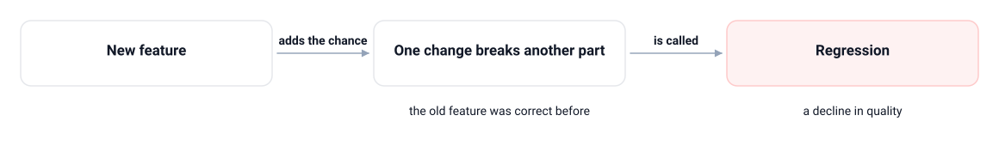
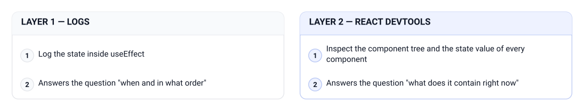
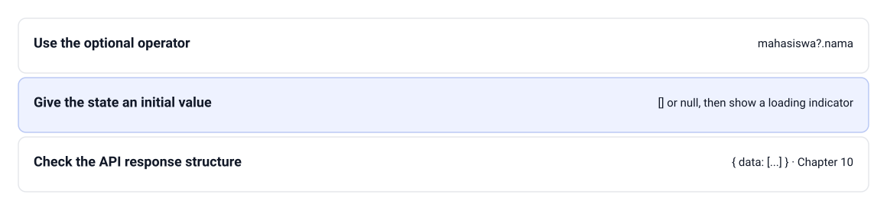
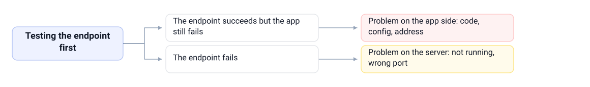
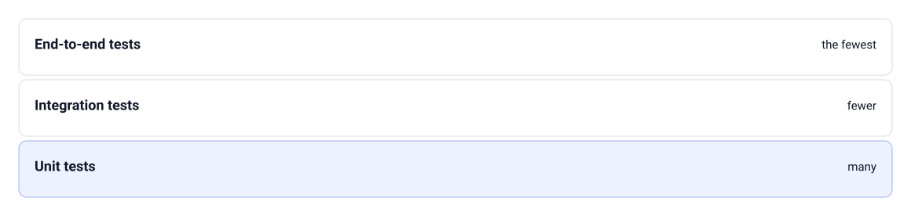
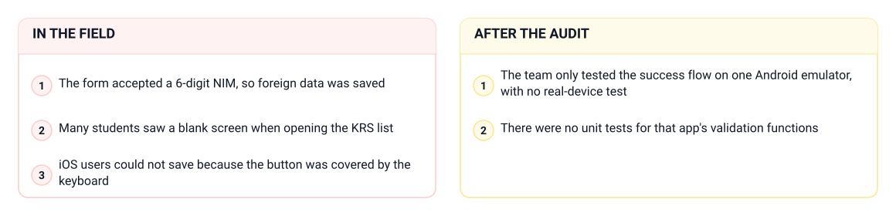

<!-- _class: lead -->
<!-- _paginate: skip -->
<!-- _footer: "" -->

# Chapter 14 — Debugging, Testing, and Quality Assurance

From an app that "runs" to an app that is correct · Meeting 15

<!--
Open with one sentence: "This chapter adds no feature at all, but it decides whether the
features you have already built are worth trusting."

Opening question: "If your app runs smoothly in your own emulator, does that mean the app
is correct?" Collect 2–3 answers without correcting them yet — the answers are in
Sections 14.6 and 14.7.
-->

---

## Learning Objectives

- Explain the role of debugging, testing, and QA in the application life cycle
- Identify the functions of the console and the features of React Native DevTools
- Analyze common React Native errors together with their causes and solutions
- Apply unit tests to pure functions with `node:test`
- Distinguish unit, integration, manual, and usability testing

<!--
Read out only the verbs. Stress that the sixth objective of the chapter (evaluating test
results through a checklist) is this meeting's real product: a filled-in QA checklist and a
unit test that can actually be run.

Tie it to the assessment: the debugging aspect at 10% and documentation at 20% in the
practicum rubric (Appendix A) draw on this chapter.
-->

---

## Why This Chapter Exists



- Without a way to trace and test, the team spends its time guessing
- A bug that reaches users costs more than one caught before release

<!--
Trimmed to the picture (the diagram says this):
- Every new feature adds the chance that one change breaks another part
- That condition is called **regression** (a decline in quality)

Read the three chips left to right: a new feature, the part it breaks, and the name that
condition carries. The last chip is red because a regression is the thing this chapter
exists to catch, not a fault of the feature that introduced it.

Stress that a regression is not a new bug: an old feature that used to be correct breaks
because of a change somewhere else.

Analogy: like adding a floor to a house without inspecting the old foundation — what
collapses is not the new floor.

Guiding question: "Has your app ever failed after you added code in another file?"
(Answer: that is a regression, and this chapter provides a way to catch it earlier.)
-->

---

<!-- _class: lead -->
<!-- _paginate: skip -->

# Part 1 — Debugging

Section 14.1 Console & DevTools · 14.2 Common errors · 14.3 Network debugging

<!--
This part is the most practical and the most frequently used in the workplace: tracing
problems in code that already exists, not writing new features.

If time is tight, Section 14.3 may be compressed; Sections 14.1 and 14.2 must not be
skipped, because both become tools for every practicum that follows.
-->

---

## Debugging, Testing, and QA

| Term | What it does | Nature of the activity |
|---|---|---|
| **Debugging** | Finding and fixing mistakes (bugs) in the code | Reacting to a bug that has already appeared |
| **Testing** | Checking software behavior in a planned way | Planned: test cases are prepared in advance |
| **Quality assurance (QA)** | Ensuring the product meets user needs | Systematic: preventing bugs from the start |

> QA does not only hunt for bugs, it prevents them through standards, checklists, and procedures.

<!--
Separate the three by asking: "who works earliest?" Debugging comes last, testing in
the middle, QA first — that is why QA is called assurance, not repair.

Quick comprehension check: "Putting together a checklist before writing code belongs to
which activity?" (Answer: QA, because it prevents rather than repairs.)

Warn about the common misconception: QA is not "another team" — on a small project, QA is
the developer's own attitude.
-->

---

## Console: Three Kinds of Messages

| Call | What it is for | Example from this chapter |
|---|---|---|
| `console.log` | Seeing a variable's value or the flow of execution | Printing the number of student records |
| `console.warn` | A value beyond what was expected, the app keeps running | Students with a GPA below 3.0 |
| `console.table` | An array of objects as a table with columns | Student list: NIM, name, program, GPA |

> Every message is given a text label, for example "Jumlah data mahasiswa:", so it is easy to find when the logs are mixed together.

<!--
Stress the habit of labelling: one good label saves hours of searching for the right log
line among dozens of messages.

Ask: "If you want to check five students at once, which one do you use?" (Answer:
console.table, because the columns line up, so a wrong value is immediately visible.)
-->

---

## Console for Student Data

`console-demo.js` — can be run directly with Node, without an emulator

```js
const mahasiswa = [
  { nim: '2201001', nama: 'Budi Santoso', prodi: 'Sistem Informasi', ipk: 3.45 },
  // … empat data baku lainnya (lihat Bab 4–10)
];
console.log('Jumlah data mahasiswa:', mahasiswa.length);
console.log('IPK tertinggi:', Math.max(...mahasiswa.map((m) => m.ipk)));
console.warn('Mahasiswa dengan IPK di bawah 3.0:', mahasiswa
  .filter((m) => m.ipk < 3.0)
  .map((m) => m.nama));
console.table(mahasiswa.map((m) => ({
  NIM: m.nim, Nama: m.nama, Prodi: m.prodi, IPK: m.ipk,
})));
```

> The complete file is in this chapter; on the slide, the four other static records are elided with a comment.

<!--
Show only three things: the label on every log, console.warn for an abnormal condition, and
console.table which turns an array of objects into tidy columns.

Mention the spread operator `...` from Chapter 3, which passes every GPA to Math.max.

Guiding question: "What is the use of printing the number of records first?" (Answer: to
make sure the data actually arrives before suspecting any other part.)
-->

---

## Developer Menu and DevTools

| Key | Function |
|---|---|
| `m` | Opens or closes the developer menu in the app |
| `r` | Reloads the app with the latest code |
| `j` | Opens the JavaScript debugger |

> ⚠ version-sensitive: the key combinations may change between Expo SDK versions; follow the key list the terminal prints when you run `npx expo start`.

<!--
Lay it out as one procedure: npx expo start, press m, open the developer menu, choose the
debugger for SDK 57.

Remind them what React Native DevTools contains: source code, breakpoints (the stopping
point where execution pauses), and the Network tab. React DevTools is separate and shows
the component tree and state values.

The version-sensitive warning must be said out loud: do not memorize key combinations from
a book — the Expo terminal is the source of truth for the version you are using.
-->

---

## Debugging State in Two Layers

<div class="grid2">
<div>

**Layer 1 — logs at the point of change**

- Write `console.log('state berubah:', nilai)` inside `useEffect`

</div>
<div>

**Layer 2 — React DevTools**

- Can change state without writing code

</div>
</div>

<!--
Trimmed to the picture (the diagram says this) — the picture is the next slide,
"Diagram: Debugging State in Two Layers", which prints each of these word for word:
- Answers the question "when and in what order"
- Inspect the component tree and the state value of every component
- Answers the question "what does it contain right now"

What stays on the slide is the mechanism each layer offers; what moved to the picture is
the question only that layer can answer. Say the two questions out loud here, then let the
next slide show them side by side.

The main message: the two layers complement each other, they do not replace each other. The
logs answer the order of events, DevTools answers the current contents.

Analogy: logs are like a traffic camera recording, React DevTools is like a photo of the
current condition.

Remind them that useState and useEffect were covered in Chapter 4; here both are used as
tools, not studied again.
-->

---

## Diagram: Debugging State in Two Layers



<!--
Read the two columns as one table: row 1 is the mechanism each layer offers, row 2 is the
question only that layer can answer. The pair of questions is the point — the log tells you
the order of events, DevTools tells you what the state contains right now. Neither column
replaces the other. The DevTools capability that the picture leaves out (changing state
without writing code) is the third bullet on the previous slide.
-->

---

## Example 1 — Labelled Logs on State

`app/TampilkanIPK.js` — the state and `useEffect` pattern from Chapter 4

```js
import { useEffect, useState } from 'react';
import { Text, View } from 'react-native';

export default function TampilkanIPK() {
  const [ipk, setIpk] = useState(null);

  useEffect(() => {
    console.log('useEffect berjalan, ipk saat ini:', ipk);
    // Simulasi pemuatan data; ganti dengan fetch dari Bab 10.
    const idTimeout = setTimeout(() => setIpk(3.45), 1000);
    return () => clearTimeout(idTimeout);
  }, [ipk]);
  return <View><Text>IPK: {ipk === null ? 'memuat...' : ipk}</Text></View>;
}
```

> The state starts as `null` — this is the most common cause of the "undefined is not an object" error.

<!--
Read out the order printed in the terminal: null, then 3.45. That is what a log at the
point of change is for.

Show that the log label names the component and the variable, so the log is easy to find
when many components are active at once.

Warn that the clearTimeout cleanup prevents a state update after the component is
unmounted.
-->

---

## Six Common React Native Errors

| # | Error message (shortened) | Nature |
|---|---|---|
| 1 | Unable to resolve module | Fatal |
| 2 | Invalid hook call | Fatal |
| 3 | 'undefined' is not an object | Fatal |
| 4 | Text strings must be rendered within a `<Text>` | Fatal |
| 5 | VirtualizedLists should never be nested inside plain ScrollViews | Warning |
| 6 | Each child in a list should have a unique 'key' prop | Warning |

> A fatal error appears on a full red screen called RedBox, which always carries the file name and the line number. Read that part first.

<!--
The main message: recognizing an error message matters as much as recognizing the syntax of
a language. An error message is a direction sign, not a failure announcement.

Ask the class to guess the nature of each error before the right column is discussed: the
first four stop the app, the last two are only warnings but signal a design that is prone
to bugs.

The habit to stress: read the line location on the RedBox before guessing the cause.
-->

---

## Fatal Errors 1 and 2

| Error | Typical cause | Solution |
|---|---|---|
| **Unable to resolve module** | A wrong path or file name; a difference in capital letters | Fix the path; for an npm package run `npx expo install`, then press `r` |
| **Invalid hook call** | A hook called inside an `if`, a callback, or a plain function | Move the hook call to the top level of the component |

> Golden rule: never call a hook inside an `if`, a `for`, or a nested function.

<!--
Error 1 often appears on Windows because of a difference in capital letters:
KartuMahasiswa.js versus kartumahasiswa.js, so Metro cannot find it. Metro is the React
Native bundler.

Error 2 is the most common beginner mistake: a hook that slips into a branch looks
reasonable but breaks the rule of hook order.

Ask: "Why does React care where a hook is called?" (Answer: React pairs state by the order
of hook calls, which must be the same on every render.)
-->

---

## Error 3 — undefined is not an object



- You read a property from a value that does not exist yet, usually data that has not loaded
- Use the optional operator `mahasiswa?.nama` so access is safe while the object is absent

> Print the API response with `console.log` before mapping it to the view.

<!--
Trimmed to the picture (the diagram says this):
- Give the state an initial value of `[]` or `null`, then show a loading indicator
- Also check the API response structure: this book uses the form `{ data: [...] }` (Chapter 10)

The picture stacks the three defences at the three depths of one data path, and it carries
both of those bullets in full: the state band says "Give the state an initial value" with
"[] or null, then show a loading indicator" beside it, and the bottom band says "Check the API
response structure" with "{ data: [...] } · Chapter 10". The two bullets left on the slide are
the ones the picture does not state: the cause (reading a property of a value that is not
there yet) and the reason the optional operator works (access stays safe while the object is
absent).

Connect it to Example 1 on the previous slide: the ipk state starts as null and the screen
shows "memuat..." — a pattern that prevents this error.

Warn about two hidden causes: misspelling a property name (nama versus name) and an API
response that is not shaped the way you assumed.

Guiding question: "How do you know the structure of an API response before writing it
down?" (Answer: by printing the response once during the first integration.)
-->

---

## Fatal Error 4 and Two Warnings

| Error | Meaning and solution |
|---|---|
| **Text strings must be rendered within a `<Text>`** | Plain text inside a `View`; wrap it with `<Text>Halo</Text>` (the rule from Chapter 5) |
| **VirtualizedLists should never be nested inside plain ScrollViews** | A `FlatList` inside a same-direction `ScrollView`; use `ListHeaderComponent` or `map` |
| **Each child in a list should have a unique 'key' prop** | Give `key={item.nim}` to the first element returned by `map`; do not use the array index |

<!--
Error 4 is the Chapter 5 rule that got forgotten: all text visible on the screen must sit
inside a Text.

Warning 5 signals a fragile design: React Native cannot compute content height when two
components that scroll in the same direction are stacked. The cheapest solution is one main
list component per page.

Warning 6 does not stop the app, but React can render the wrong data or lose row state when
the data is updated.
-->

---

<!-- _class: center -->

## What Happens If…?

- What happens if `useState` is called inside an `if` branch?
- What happens if a `FlatList` is placed inside a same-direction `ScrollView`?
- What happens if the result of `map` is not given a `key` property?

<!--
Do not answer. Ask three students to guess first, then state that the answers are on the
next slide.

The goal is to train reasoning from symptom to cause, not to memorize error names.
-->

---

<!-- _class: center -->

## Answers

- React reports "Invalid hook call" because the hook order differs on each render
- The content height cannot be computed; scrolling becomes strange and performance drops
- React has trouble tracking which elements changed, so data can be rendered wrongly

<!--
Repeat the golden rule: hooks are only at the top level of a component. If a value needs to
be conditional, compute it after the hook is called, not inside the branch.

Stress that the last two answers are only warnings: the app keeps running, but the symptoms
show up later as bugs that are hard to trace.
-->

---

## Test the Endpoint Before Integration

- Check the endpoint from a browser, `curl`, or the `fetch` built into Node.js 22
- Make sure the book's backend server is running first (see Chapter 10)
- The test result separates two possible sources of the problem: the server or the app

```bash
curl http://localhost:3000/api/mahasiswa
```

<!--
Analogy: check the tap first before taking apart the pipes inside the house.

The pattern of proof: if curl succeeds but the app fails, the problem is on the app side
(code, configuration, address); if curl also fails, the problem is on the server — not
running, wrong port, or a 404/500 status.

Mention that curl is a command-line program that sends an HTTP request. An alternative on
Windows: open that address in a browser, or run the fetch built into Node.js 22 from
Example 2 in the chapter.
-->

---

## Server or App? Decision Flow



> Testing the endpoint first separates the two possible sources of the problem before you start guessing.

<!--
Read the diagram as a procedure: one command, two different conclusions.

Stress the condition on the left branch: the conclusion "the problem is on the app side" is
only valid if the endpoint succeeds BUT the app still fails. An endpoint that answers 200
while the app runs normally is not a problem at all.

Connect it to "Network request failed" on the next slide: that message appears in the app,
but it does not necessarily mean the server is dead.
-->

---

## Target Addresses and the Network Tab

| Target | Backend server address |
|---|---|
| Developer computer | `http://localhost:3000` |
| Android emulator | `http://10.0.2.2:3000` |
| Physical device | The computer's IP on the local network (LAN) |

> The message "Network request failed" most often means the address is wrong for the target, the server is down, or the device and the computer are on different networks.

<!--
These address details were covered in Chapter 10; here they are used as the first step of
network debugging, not as new material.

The Network tab in React Native DevTools shows every fetch request, its response status
(200, 404, 500), and the JSON body returned. A version-sensitive marker: the availability
and layout of the Network tab depend on the DevTools that ship with SDK 57, so printing the
response yourself in code is always a safe alternative.

Establish the habit: put console.warn in the catch block and in the !response.ok branch so
every failure leaves a trace, then print JSON.stringify(data) once during the first
integration.
-->

---

<!-- _class: lead -->
<!-- _paginate: skip -->

# Part 2 — Testing and QA

Section 14.4 Unit testing · 14.5 Integration · 14.6 Manual & usability · 14.7 Checklist

<!--
This part answers the objection that comes up most often: "why test when my code already
runs in my emulator?".

If time is tight, Section 14.5 only needs its concept explained; Sections 14.4 and 14.7
must not be skipped, because both produce the artefact that is assessed in the practicum.
-->

---

## Unit Testing and Its Easiest Target

- Unit testing tests one unit of code, usually one function, in isolation
- Manual testing cannot be repeated consistently: people forget steps and rush
- A unit test can be run repeatedly and quickly, the main weapon against regression
- Trade-off: writing tests costs time up front and they must be maintained
- The easiest target is a **pure function**, whose result is determined only by its arguments

> This book uses `node:test`, a module built into Node.js. Jest with the `jest-expo` preset is the React Native industry standard.

<!--
Stress the deterministic nature of a pure function: the same input always gives the same
output, so a test never "sometimes passes, sometimes fails". A pure function also does not
read files and does not call an API.

Version-sensitive warning: the jest-expo version is always tied to the SDK; check the Unit
testing page on docs.expo.dev for SDK 57 before installing it.

Guiding question: "Why is a test that tests the implementation rather than the behavior
considered bad?" (Answer: an implementation change that does not change behavior makes the
test fail falsely, so its maintenance cost is greater than its benefit.)
-->

---

## utils/validators.js from Chapter 8

`utils/validators.js` — pure functions with no dependencies, an ideal candidate for a unit test

```js
function validateNim(nim) {
  const pesanWajib = required(nim);
  if (pesanWajib) return pesanWajib;
  return /^\d{7}$/.test(String(nim).trim()) ? '' : 'NIM harus terdiri dari tepat 7 digit angka';
}
function validateEmail(email) {
  const pesanWajib = required(email);
  if (pesanWajib) return pesanWajib;
  return /^[^\s@]+@[^\s@]+\.[^\s@]+$/.test(String(email).trim()) ? '' : 'Format email tidak valid';
}
// … validateNama, validateTelepon, validatePassword: pola yang sama
```

> Every function returns an error message as a string, or the empty string `''` when the data is valid.

<!--
Explain the convention "an empty string means valid": that is what makes the result easy to
check in a test, for example assert.strictEqual(fungsi('2201001'), '').

Warning: this slide and the next show only three of the seven functions (there are still
required, validateNama, validateTelepon, and validatePassword). The complete file is in
Chapter 8 and is repeated in full in this chapter.

Ask: "Why does this function not touch state, storage, or the network?" (Answer: that is
why it is pure, so it can be tested even without running the app.)
-->

---

## validateFormMahasiswa: All Errors at Once

`utils/validators.js` — validating the whole form by reusing the functions above

```js
function validateFormMahasiswa({ nim, nama, email, telepon } = {}) {
  const errors = {};
  const pesanNim = validateNim(nim);
  if (pesanNim) errors.nim = pesanNim;
  const pesanNama = validateNama(nama);
  if (pesanNama) errors.nama = pesanNama;
  // … email dan telepon: pola yang sama
  return { valid: Object.keys(errors).length === 0, errors };
}
```

> `valid` is `true` only when `errors` is empty; this `{ valid, errors }` shape is what the form in Chapter 8 consumes.

<!--
Stress that this function does not copy the validation rules; it calls validateNim,
validateNama, and so on, then collects every message into the errors object.

Analogy: like a counter clerk who checks four documents one by one and attaches a note to
every incomplete document — the check does not stop at the first document.

Guiding question: "Why are all messages collected instead of returned one at a time?"
(Answer: the form must show every mistake at once, not ask the user to fix one field at a
time.)

The two lines for email and phone are elided with a comment; the pattern is exactly the same
as the nim and nama lines shown. The code on screen must still show that errors are filled
in, so students do not copy a function that always returns valid: true.
-->

---

## First Test File with node:test

`__tests__/validators.test.js` — one test for one behavior

```js
const { test } = require('node:test');
const assert = require('node:assert/strict');
const { validateNim, validateFormMahasiswa } = require('../utils/validators.js');
test('validateNim menerima NIM 7 digit', () => {
  assert.strictEqual(validateNim('2201001'), '');
});
test('validateNim menolak NIM bukan 7 digit', () => {
  assert.notStrictEqual(validateNim('22010'), '');
});
test('validateFormMahasiswa mengumpulkan semua error sekaligus', () => {
  const hasil = validateFormMahasiswa({ nim: 'abc', nama: '', email: 'budi', telepon: '081' });
  assert.strictEqual(hasil.valid, false);
  assert.deepStrictEqual(Object.keys(hasil.errors).sort(), ['email', 'nama', 'nim', 'telepon']);
});
```

> Run `node --test` from the project folder, or `node __tests__/validators.test.js` for this file only.

<!--
Point out three things: node:test and node:assert/strict are available with no installation
at all, test descriptions written in Indonesian make the failure report easy to read, and
assert.strictEqual checks a value while deepStrictEqual checks an object's structure.

Mention the correct result: all 13 tests pass with the summary pass 13 and fail 0. The
complete file in the chapter holds 13 test cases; on the slide only three are shown.

Stress the one-test-one-behavior pattern: a failure points straight at the rule that was
broken. If a test fails, decide which is wrong — the function or the test itself; that is
part of the debugging skill.
-->

---

## Unit vs Integration Testing

| Aspect | Unit testing | Integration testing |
|---|---|---|
| What is checked | One function in isolation | Cooperation between parts |
| The typical question | Does `validateNim` reject a wrong NIM? | Does the Save button really send data to the API? |
| Scope and cost | Fast, cheap, easy to set up | Slower, more fragile, harder to set up |
| Mistakes caught | Wrong logic rules | Mismatched interface contracts |

<!--
The core difference is the level of scope: a unit separates one unit from its surroundings,
integration connects the unit with state, fetch, and the view.

An example of a fragile joint: the data format the form sends is not the same as the one the
list reads, or the Chapter 13 authentication token is not sent along on the next request.

Version-sensitive warning: React Native integration tests generally use a library such as
React Native Testing Library, which renders real components while faking the network; the
library and its configuration change quickly, so follow the official documentation for
SDK 57. This chapter deliberately does not implement them in depth.
-->

---

## Testing Pyramid



> Unit tests that all pass do not guarantee the app works: mistakes often appear at the joints between parts.

<!--
Read the pyramid from the bottom: many unit tests as the base, fewer integration tests in
the middle, and the fewest end-to-end tests at the top — that is industry practice because
cost and fragility increase upward.

Stress that the number is not a matter of style: a slow and fragile test will be abandoned
by the team if there are too many of them.
-->

---

## Manual Testing: Three Case Categories

| Category | Content | Example in this book's app |
|---|---|---|
| **Functional** | The main flows that were designed | Login succeeds, the student list appears, the form saves data |
| **Edge case** | Unusual input | An empty form, an email without `@`, an NIM with letters, an empty API, a dead connection |
| **Platform** | Behavior that differs by device | The Android back button, a small screen, rotation, a denied device permission |

> Test on at least one emulator and one physical device: an emulator does not reproduce the memory, network, and sensors of a real device.

<!--
The strength of manual testing is catching problems that automated tests never thought of:
a stuttering animation, text cut off on a small screen, a button that is hard to press.

Its weakness is that it takes time and depends on human thoroughness, so manual testing must
be guided by a checklist so it does not jump around without a plan.

Guiding question: "Which case do students forget most often?" (Answer: edge cases —
especially turning off the connection in the middle of a request.)
-->

---

## Usability Testing: Around 5 Users

- Manual testing judges correctness; usability testing judges ease of use
- The classic principle: test with around 5 users to find the majority of the problems
- A session in three parts: 3–5 real tasks, thinking aloud while working, then observation
- Record task success, time, the places where the user hesitated, and the mistakes made
- Help only when the user is truly stuck, and record it as a finding

<!--
Stress the distinction that is most often confused: manual testing asks "does the feature
work?", usability testing asks "can the user find it and use it easily?". An app that is
technically correct can still be confusing.

An example of a real task from the chapter: "register a new student named Dewi Lestari
without looking at any manual".

Mention the trade-off: adding users beyond five adds only a few findings, so the cost is not
worth it. The observation results are prioritized into UI improvements in the next
development cycle.
-->

---

## Mobile App Testing Checklist

| Area | Test case | Actual result | Status |
|---|---|---|---|
| Login | A wrong password shows an error message, no redirect | — | ☐ Pass ☐ Fail |
| Student List | Data from the API appears complete (NIM, name, program, GPA) | — | ☐ Pass ☐ Fail |
| Student List | The API turned off shows an error message, the app does not crash | — | ☐ Pass ☐ Fail |
| Student Form | A 6-digit NIM is rejected with a validation message | — | ☐ Pass ☐ Fail |
| Navigation | The Android back button leaves the form without saving | — | ☐ Pass ☐ Fail |
| Network | A loading state appears when the response is slow | — | ☐ Pass ☐ Fail |

<!--
The complete table in the chapter holds ten test cases including a successful login, a phone
number not starting with 08, and the display on a small screen of around 360 dp; on this
slide are the six most representative cases.

The filling rule that must be stressed: the actual result column is filled with what you
really observed, not what you expected, and the status is marked only after the result has
been verified.

A failed test case is not deleted: it is recorded, fixed, and then tested again.
-->

---

## A Living Checklist and Regression Test Cases


> A checklist is the team's working document: a bug that slips through means there was a test case that should have existed.

<!--
Explain the economic value of this cycle: every bug that ever slipped through becomes a
permanent guard, so the same mistake does not repeat in the next release.

Remind them that the checklist is reused during release preparation in Chapter 15.

Stress a realistic division of QA work for a student project: unit tests for pure logic,
which are cheap to automate, and a manual checklist for app behavior that is hard to
automate.
-->

---

## This Meeting's Practicum

- Make sure you have Node.js LTS version 22 or newer with `node --version`
- Copy `utils/validators.js` and `__tests__/validators.test.js` into the `praktikum14` folder
- Run `node --test` until all 13 tests pass
- Test the endpoint from the terminal, then turn the server off and repeat to read the failure
- Fill in a testing checklist of at least 5 test cases for your own app

<!--
Remind them of the correct folder order: utils/ and __tests__/ are created first, and the
command is run from inside praktikum14 because the path ../utils/validators.js is resolved
from the __tests__ folder.

The expected result: a summary of pass 13 and fail 0 from node:test, a five-row table from
console.table, a 200 status when the endpoint is tested, and a message from the catch block
when the server is turned off.

If a step fails, point students to the chapter's Troubleshooting section: a Node version that
is too old, a wrong relative path, AssertionError, the developer menu not appearing, and
fetch not being recognized.
-->

---

## Case Study: The KRS Online Incident

**A SIAKAD mobile app for filling in the KRS failed on the first day of registration.**



<div class="grid2">
<div>

**Symptoms in the field**

- The form accepted a 6-digit NIM, so foreign data was saved

</div>
<div>

**Root cause after the audit**

- There were no unit tests for that app's validation functions

</div>
</div>

<!--
Trimmed to the picture (the diagram says this):
- The team only tested the success flow on one Android emulator, with no real-device test
- Many students saw a blank screen when opening the KRS list
- iOS users could not save because the button was covered by the keyboard

The picture draws both columns of this case — the three symptoms in the field and the two root
causes the audit found — as numbered rows side by side, and it sits directly under the lead
line because it is the whole case in one picture. One bullet of each column stays on the
slide, because a slide that had bullets keeps at least two: the first symptom, and the second
cause (the shorter of the two, which keeps its second line clear of the page number). Those
two therefore repeat one row of the picture each — the price of the two-bullet floor, paid
rather than deleting them. The picture's panels are tagged "IN THE FIELD" and "AFTER THE
AUDIT" (both fragments of this slide's own headings) so the figure does not repeat the two
heading lines verbatim underneath itself.

Read it as a story, not as a list. The goal is to make students recognize this pattern of
failure in their own project.

Mention that the app in this case follows the same flow as the Student Data Management App
built in Chapters 6–10: login, list, and input form.

Question before the next slide: "Of those three symptoms, which is most likely to happen in
your group project?" Let them guess first.
-->

---

## Incident Analysis: The Stage That Should Have Caught It

| Symptom | Stage from this chapter's material | Why it can catch it |
|---|---|---|
| A 6-digit NIM is accepted | Unit test for `validators.js` | The 7-digit NIM rule is tested repeatedly without running the app |
| A blank screen and "undefined is not an object" | Common error 14.2 and the manual checklist | There was no loading state and no check of the response structure |
| The save button covered by the iOS keyboard | Manual and usability testing | An Android emulator does not reproduce the iOS keyboard |

> The cost of three days of helpdesk is far higher than the cost of writing a number of unit tests and a one-page checklist.

<!--
Ask students to judge the cheapest order in which to apply QA if the team only has one day:
unit tests for validation first because they are cheapest and fastest to run, then a
functional manual checklist, then usability testing.

Mention that the app in this case study is exactly the Final Project "Mobile Academic
Information System", so the testing equipment from this chapter will be used again.
-->

---

<!-- _class: center -->

## Mini Quiz

- What is the activity of finding and fixing mistakes in code called?
- Which console function is most appropriate for a student list with columns?
- Which property of a pure function makes it ideal for a unit test?
- What is the main difference between unit testing and integration testing?

<!--
A five-minute oral quiz: show the questions, ask the class to answer together or raise
hands, then move to the answer slide. Do not leak the answers on this slide.

If the class's answers vary, note the numbers and repeat the distinction before the meeting
is closed.
-->

---

<!-- _class: center -->

## Answers

- Debugging — not testing, and not quality assurance
- `console.table` — arranges an array of objects into tidy columns
- Deterministic: its result is determined only by its arguments
- The level of scope: one isolated unit versus cooperation between parts

<!--
Repeat the key sentence for number 4 because this is the concept most often confused in
exams.

If many students got number 2 wrong, repeat the table of three console message types before
closing the meeting.
-->

---

## Class Discussion and Exercises

<div class="grid2">
<div>

**Class discussion**

- Which symptom of the KRS Online incident is most likely to happen in your project?
- If the team only has one day to test, which QA order is the cheapest?

</div>
<div>

**Exercises and challenges**

- Add three new test cases for NIM, email, and phone
- Write a unit test for one pure function from the Chapter 9 project
- Keep a one-week bug journal: error, cause, solution, the test case that prevents it

</div>
</div>

<!--
Give 5 minutes in pairs for the two discussion questions, then collect 2–3 answers. A strong
answer names the cost and risk reasons, not only the order of activities.

For the bug journal challenge, explain that its output is the addition of test cases to the
checklist — this is the regression test case principle.

Assessment reminder: a testing checklist of at least five test cases is part of Assignment 3
in this meeting's RPS.
-->

---

## Summary

1. Debugging finds and fixes; testing checks in a planned way; QA prevents from the start
2. `console.log`, `console.warn`, and `console.table` are useful when every message is given a label
3. The six common React Native errors each have a typical cause and solution
4. Test the endpoint first; pay attention to the `localhost`, `10.0.2.2`, and LAN IP addresses (Chapter 10)
5. `node:test` runs unit tests without dependencies; the QA checklist is this chapter's product

<!--
Do not read it out. Ask five students to explain one number each in their own words; if
wrong, correct it on the spot before the meeting ends.

What is not yet written on the slide and needs to be said out loud: the testing pyramid, the
difference between manual and usability testing, and the around-five-users principle.

Closing message: professional habits start from reading the error message and recording test
results, not from memorizing tools.
-->

---

## References

| Source | Link |
|---|---|
| React Native documentation (2026) | reactnative.dev |
| Expo documentation (2026) | docs.expo.dev |
| Node.js documentation — `node:test` (2026) | nodejs.org |
| MDN Web Docs — HTTP and JavaScript (2026) | developer.mozilla.org |

<div class="grid2">
<div>

**Related chapters**

- Chapter 8 — form validation that is tested in this chapter
- Chapter 10 — REST API, status codes, and the book's backend

</div>
<div>

**Technology versions in this book**

- Expo SDK 57 · React Native 0.86 · React 19.2 · Node.js LTS ≥ 22

</div>
</div>

<!--
The complete references are in Appendix D; terms such as Metro Bundler, Debugging, and
Status Code are explained in Appendix C (glossary).

Remind them that documentation pages are version-sensitive: re-check the behavior of
DevTools, jest-expo, and React Native Testing Library for SDK 57 before using them in
production code.
-->

---

<!-- _class: lead -->
<!-- _paginate: skip -->

# Ready for Chapter 15

**Assignment 3 (see the RPS for meeting 15):** a QA report — a testing checklist filled in with at least 5 test cases + `node --test` evidence; the build report follows in Chapter 15.

Meeting 15 (continued): Chapter 15 — Build and Deployment.

<!--
Close with one sentence: "This chapter taught us to inspect the house before it is handed
over; the next chapter teaches us to hand it over to the occupants."

State the Assignment 3 submission deadline explicitly and tie it to the practicum rubric
(Appendix A): conceptual understanding 15%, implementation 25%, code quality 15%, UI/UX 15%,
debugging 10%, documentation 20%.

Remind them that Assignment 3 covers two reports — the QA report from this meeting and the
build report that follows in Chapter 15 — because meeting 15 contains both of those chapters
(RPS meeting 15).
-->
