<!-- _class: lead -->
<!-- _paginate: skip -->
<!-- _footer: "" -->

# Bab 15 — Build dan Deployment

Dari emulator ke toko aplikasi · Pertemuan 15

<!--
Buka dengan satu kalimat: "Sepanjang Bab 1 sampai 14 kita hanya menjalankan aplikasi di
emulator sendiri; hari ini kita menghasilkan satu file yang bisa dipasang siapa saja."

Pertanyaan pembuka: "Apa yang kamu lakukan kalau temanmu minta mencoba aplikasimu?" Tampung
dua atau tiga jawaban tanpa dikoreksi dulu, karena jawaban itu akan dibandingkan dengan jalur
rilis resmi di akhir pertemuan.

Sebutkan bahwa pertemuan ini digabung dengan Bab 14 dan dinilai lewat Tugas 3: laporan QA dan
laporan build.
-->

---

## Tujuan Pembelajaran

Setelah bab ini, kamu bisa:

- Membedakan development build dan production build beserta pemakaiannya
- Menjelaskan peran EAS Build dan tiga profil build beserta produknya (APK/AAB)
- Mengonfigurasi `app.json`: name, slug, application ID, versi, ikon, splash screen
- Menganalisis peran environment variable `EXPO_PUBLIC_` dan batasannya terhadap secret
- Mengidentifikasi konsep signing dan risiko kehilangan kunci penandatanganan
- Merancang strategi distribusi Google Play dan memahami alur App Store

<!--
Bacakan hanya kata kerjanya, lalu tekankan butir ketiga: app.json adalah akta lahir aplikasi,
dibaca toko aplikasi dan layanan build.

Pertanyaan: "Berapa nilai salah di app.json yang membuat build gagal?" (Jawaban: satu saja
sudah cukup — path ikon yang keliru, atau plugin yang tidak dikonfigurasi.)

Butir keempat paling sering diremehkan: mahasiswa mengira environment variable sama dengan
"menyembunyikan rahasia". Peringatkan sejak awal bahwa nilai berawalan EXPO_PUBLIC_ justru ikut
tertanam di dalam bundle aplikasi.

Pertanyaan: "Kalau bukan untuk secret, lalu environment variable ini untuk apa?" (Jawaban:
memisahkan alamat server per lingkungan tanpa mengubah kode.)

Butir pertama dan ketiga paling mungkin muncul di ujian akhir; ingatkan bahwa keduanya
berbasis perbandingan, bukan hafalan.

Butir kelima dan keenam konseptual; praktikum pertemuan ini hanya sampai build Android, jadi
untuk alur iOS cukup dipahami urutannya.
-->

---

<!-- _class: lead -->
<!-- _paginate: skip -->

# Bagian 1 — Dari Kode ke File yang Bisa Dipasang

subbab 15.1 Build · 15.2 EAS Build · 15.3 APK & AAB · 15.4 iOS

<!--
Bagian ini menutup fase pertama: bagaimana kode menjadi file yang bisa dipasang. Beri waktu
sekitar 35 menit.

subbab 15.4 (iOS) bersifat konseptual dan tidak dipraktikkan; kalau waktu sempit, bagian itu
cukup dibacakan singkat tanpa kehilangan keterampilan praktikum.
-->

---

## Build Bukan `npx expo start`

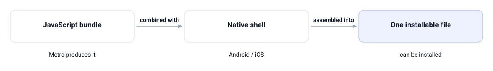

**Build** adalah hasil akhir proses kompilasi: kode JavaScript, aset, dan konfigurasi native dirakit menjadi satu file yang bisa dipasang.

**Yang bukan build**

- `npx expo start` hanyalah server pengembangan
- Expo Go adalah aplikasi milik Expo, bukan hasil build proyekmu

<!--
Dipotong ke gambar (diagram yang mengatakan ini):
- Metro menghasilkan bundel JavaScript (Bab 2)
- Bundel digabung dengan kerangka native Android/iOS

Analogi: build seperti memasak makanan untuk dibawa pulang, tidak lagi dicicipi di dapur
pengembang. Selama ini mahasiswa hanya mencicipi di dapur.

Demonstrasi: singgung Metro yang selama ini melayani bundle lewat npx expo start. Pertanyaan
penuntun: "Kalau Metro dimatikan, aplikasi hasil production build bagaimana?" (Jawaban: tetap
jalan, karena bundelnya tersimpan di dalam aplikasi.)

Salah paham paling umum: mengira Expo Go adalah hasil build proyeknya sendiri. Tegaskan bahwa
Expo Go adalah aplikasi milik Expo yang menjalankan bundle dari server pengembangan.
-->

---

<!-- _class: compact -->

## Build Development dan Production Bukan Dua Aplikasi Berbeda

| Aspek | Development build | Production build |
|---|---|---|
| Kecepatan iterasi | Cepat, perubahan langsung tampil lewat Fast Refresh | Dibuat hanya saat akan rilis atau diuji |
| Sumber bundle | Diambil dari Metro di komputer pengembang | Tersimpan di dalam aplikasi, tanpa Metro |
| Debugging | Pesan error lengkap, tersambung DevTools (Bab 14) | Diminifikasi, tanpa alat debugging |
| Ukuran dan kecepatan | File besar dan lebih lambat | Lebih kecil dan lebih cepat, aset dioptimalkan |
| Kapan dipakai | Setiap hari oleh pengembang dan penguji | Saat rilis, pengujian, atau dibagikan terbatas |

<!--
Bandingkan kolom per kolom, jangan baris per baris; baris terakhir adalah kesimpulannya.

Tegaskan bahwa trade-off ini disengaja: kemudahan debugging ditukar dengan ukuran, kecepatan,
dan keamanan. Pengguna akhir tidak perlu membaca pesan error internal.

Pertanyaan: "Kenapa production build tidak menyertakan alat debugging?" (Jawaban: pengguna
akhir tidak membutuhkannya, dan menyertakannya membuat file lebih besar serta startup lebih
lambat.)

Salah paham: mengira production build adalah "versi lain" aplikasi. Keduanya produk proses
build yang sama, hanya tujuannya berbeda.

Signing sengaja tidak dijadikan baris tabel: subbab 15.1 hanya menyebut bahwa production build
ditandatangani sebagai bukti keaslian, dan tidak membandingkan status tanda tangan kedua jenis
build — konsepnya dibahas terpisah di subbab 15.7.
-->

---

## EAS Build: Kerja Beratnya Dipindah ke Cloud

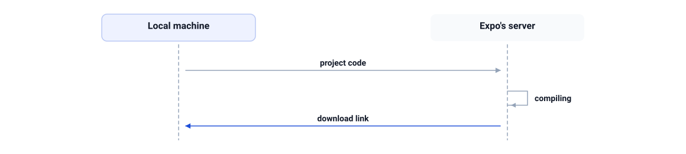

- **EAS** — layanan cloud dari Expo untuk membangun, menandatangani, dan mengirim aplikasi
- Build Android butuh Android SDK, JDK, dan Gradle; build iOS butuh macOS dan Xcode
- Server Expo yang mengompilasi; kamu cukup mengirim kode proyek
- Hasilnya berupa link unduhan dan kode QR yang muncul di terminal
- Build juga bisa dijalankan di mesin lokal, tetapi EAS yang menyiapkannya

<!--
Tegaskan alasan praktisnya bagi mahasiswa: tidak semua laptop di ruang praktikum sanggup
memasang Android SDK, apalagi macOS dan Xcode untuk iOS.

Analogi: EAS seperti jasa percetakan profesional — kamu mengirim desain, hasilnya kembali
berupa link unduhan; mesin cetaknya bukan milikmu.

Peringatkan akibatnya: karena seluruh proyek diunggah ke server, konfigurasi yang keliru ikut
terkirim. Itu sebabnya di praktikum ada langkah pemeriksaan konfigurasi.

Sebutkan bahwa durasi build, antrean, dan kebijakan paket gratis atau berbayar EAS ditandai
peka versi di bab ini.
-->

---

## Tiga Profil Build, Tiga Hasil Berbeda

| Profil | Kegunaan | Hasil di Android |
|---|---|---|
| development | Pengembangan harian dan modul native | development build dengan `expo-dev-client` |
| preview | Uji calon rilis oleh penguji internal | APK (`distribution: internal`) |
| production | Rilis ke toko aplikasi | AAB bertanda tangan, `autoIncrement` |

> Profil `development` memakai `developmentClient: true` dan dijalankan bersama `npx expo start --dev-client`.

<!--
Hubungkan dengan slide sebelumnya: profil development menghasilkan development build, profil
production menghasilkan production build. Ini istilah yang sama, bukan dua hal berbeda.

Pertanyaan: "Profil mana yang kamu pakai untuk mengirim versi beta ke dosen?" (Jawaban:
preview, karena hasilnya APK yang bisa dipasang langsung tanpa lewat toko aplikasi.)

Tegaskan hasil praktikum bab ini: app.json, eas.json, dan satu APK dari EAS Build.
-->

---

## `eas.json`: Pusat Kendali Build

`kode/bab-15-build-dan-deployment/eas.json` — tiga profil dan satu bagian submit

```json
{
  "build": {
    "development": { "developmentClient": true, "distribution": "internal" },
    "preview": { "distribution": "internal", "android": { "buildType": "apk" } },
    "production": { "autoIncrement": true }
  },
  "submit": { "production": {} }
}
```

> Isi di atas sama dengan Contoh 2 di bab, hanya dipadatkan agar terbaca di slide.

<!--
Tunjukkan tiga hal: developmentClient true menghasilkan dev client, preview dengan
distribution internal menghasilkan APK untuk penguji, dan production dengan autoIncrement
menaikkan nomor versi mesin secara otomatis.

Peringatkan: npx eas-cli build:configure bisa menambahkan bagian cli berisi versi eas-cli;
jangan hapus bagian itu saat file ditimpa dengan versimu sendiri.

Pertanyaan: "Apa yang terjadi kalau versionCode tidak naik pada unggahan AAB kedua?"
(Jawaban: Google Play menolaknya dengan pesan bahwa version code sudah dipakai.)

Sebutkan bahwa skema eas.json ditandai peka versi di bab: percayai keluaran build:configure
sebagai kebenaran untuk versimu.
-->

---

## Urutan Perintah Build Tidak Boleh Ditukar

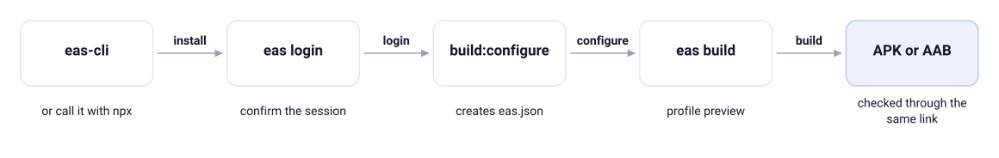

1. Pasang `eas-cli` secara global, atau panggil dengan `npx eas-cli`
2. `eas login`, lalu `eas whoami` untuk memastikan sesi aktif
3. `eas build:configure` membuat `eas.json` di akar proyek
4. `eas build --platform android --profile preview`

<!--
Urutannya wajib: periksa konfigurasi, autentikasi, siapkan profil, lalu build. Perintah npx
expo config bertipe public adalah jendela mengintip terakhir sebelum kode dikirim ke cloud;
kalau name atau application ID sudah salah di sini, hasil build-nya ikut salah.

Tegaskan bahwa eas whoami adalah cara termurah memastikan sesi login aktif sebelum menunggu
build yang panjang.

Peringatkan: build berjalan di server, jadi proses unggah tidak boleh diputus; setelah tahap
unggah selesai, laptop boleh ditutup dan hasilnya diperiksa lewat link yang sama.
-->

---

<!-- _class: compact -->

## APK Bisa Dipasang, AAB Harus Lewat Play

| Aspek | APK | AAB |
|---|---|---|
| Peran | File instalasi yang siap dipasang | File pengepakan untuk toko aplikasi |
| Cara pakai | Bisa dipasang langsung (sideload) | Tidak bisa dipasang langsung |
| Yang merakit | Kamu, sekali | Google Play merakit split APK dari AAB |
| Kapan dipakai | Uji internal dan bagi langsung | Unggah ke Play, wajib sejak 2021 |

<!--
Dua format ini paling sering tertukar di ujian. Pembedanya sederhana: APK adalah file yang
dipasang, AAB adalah file yang diunggah.

Pertanyaan: "Kalau AAB tidak bisa dipasang, bagaimana penguji internal mendapat file
instalasi?" (Jawaban: lewat profil preview yang menghasilkan APK.)

Sebutkan bahwa kewajiban AAB untuk aplikasi baru sejak Agustus 2021 adalah kebijakan yang
ditandai peka versi di bab ini: format unggahan bisa berubah, periksa Play Console.
-->

---

## Kenapa AAB Ada: Satu File, Banyak APK

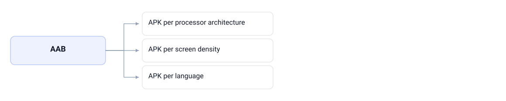

> Satu split APK hanya memuat arsitektur prosesor, kerapatan layar, dan bahasa perangkat itu — ukuran unduhan pengguna turun drastis.

<!--
Jelaskan alasan historisnya: dulu pengembang merakit satu APK universal yang memuat semua
varian perangkat, sehingga ruang dan waktu unduh terbuang.

Tegaskan bahwa yang merakit split APK adalah Google, bukan pengembang. Justru di situ
keuntungannya, karena infrastruktur Google lebih tahu kebutuhan tiap perangkat.

Pertanyaan: "Bagian apa yang dipangkas dari unduhanmu?" (Jawaban: kode untuk arsitektur
prosesor lain, grafis untuk kerapatan layar lain, dan terjemahan bahasa lain.)
-->

---

## Build iOS Butuh Keanggotaan yang Tidak Bisa Dilewati

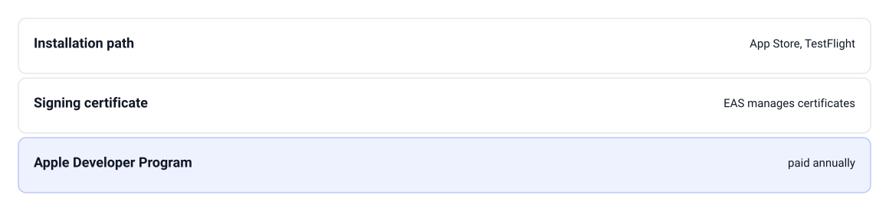

- EAS menyediakan server macOS, jadi build iOS bisa jalan dari Windows sekalipun
- Syarat mutlak: keanggotaan Apple Developer Program yang dibayar tiap tahun
- Tanpa keanggotaan itu, sertifikat penandatanganan tidak bisa diterbitkan
- EAS mengelola sertifikat dan provisioning profile secara otomatis
- Tidak ada jalur pasang langsung: hanya App Store, TestFlight, atau perangkat terdaftar

<!--
Tegaskan dua syarat yang tidak bisa dilewati: keanggotaan Apple Developer Program dan
pendaftaran aplikasi di App Store Connect sebelum dibangun.

Sebutkan bahwa biaya tahunan dan kuota penguji TestFlight ditandai peka versi di bab: pahami
polanya, jangan hafal angkanya.

Peringatkan: di iOS tidak ada jalur "pasang dari mana saja" seperti APK di Android. Bagi
mahasiswa tanpa akun berbayar, memahami alurnya sudah cukup karena praktikum memakai jalur
Android.
-->

---

<!-- _class: center -->

## Setiap Kebutuhan Rilis Punya Kanal Sendiri

- APK lewat grup chat — murah dan cepat, tanpa kendali versi
- Jalur internal testing Play — paling banyak 100 penguji, tanpa peninjauan
- Rilis production Play — semua pengguna, melewati peninjauan Google
- Tugas: tentukan kanal untuk (a) uji harian tim, (b) beta untuk 20 teman, (c) rilis kampus

<!--
Think-pair-share, 4 menit: setiap pasangan memilih satu kanal untuk tiap kebutuhan dan
menyebut alasannya, lalu dua atau tiga pasangan melapor.

Jawaban yang diharapkan: (a) internal testing, karena rilis tanpa peninjauan dan cocok untuk
uji harian; (b) closed testing, karena penguji diundang lewat link; (c) production, karena
menyasar semua pengguna dan melewati peninjauan.

Tegaskan bahwa APK lewat grup chat bukan sekadar kurang rapi: versi yang beredar tidak
terkendali dan tidak ada jalur pembaruan terpusat.

Nilai kualitas jawaban dari alasannya, bukan dari nama kanalnya.
-->

---

<!-- _class: lead -->
<!-- _paginate: skip -->

# Bagian 2 — Identitas, Keaslian & Distribusi

subbab 15.5 app.json · 15.6 Environment variable · 15.7 Signing · 15.8–15.10

<!--
Bagian ini menutup fase kedua dan ketiga: bagaimana aplikasi dijamin asli, dan lewat kanal apa
ia sampai ke pengguna.

Beri waktu sekitar 45 menit. subbab 15.5 sampai 15.7 wajib; 15.9 (App Store) boleh dipadatkan
kalau waktu mendesak karena seluruhnya konseptual.
-->

---

## `app.json`: Dua Pembaca Versi yang Sering Tertukar

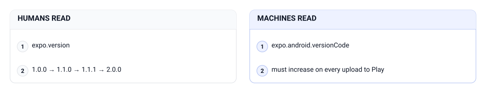

- `expo.name` — nama di bawah ikon dan di toko aplikasi; boleh berubah kapan saja
- `expo.slug` — identitas internal di ekosistem Expo; tanpa spasi dan huruf besar
- `autoIncrement: true` di profil production menaikkan nomor versi mesin

> Perjalanan versi: `1.0.0` → `1.1.0` (fitur baru) → `1.1.1` (perbaikan bug) → `2.0.0` (perombakan besar).

<!--
Dipotong ke gambar (diagram yang mengatakan ini):
- `expo.version` — versi semantik major.minor.patch yang dibaca manusia
- `expo.android.versionCode` — bilangan bulat yang harus naik tiap unggahan ke Play

Buka file kode/bab-15-build-dan-deployment/app.json yang asli saat menjelaskan slide ini;
abstraksi tanpa file nyata membuat kunci-kunci ini terasa seperti hafalan.

Tegaskan bahwa ada dua pembaca versi: manusia membaca version, mesin membaca
android.versionCode dan ios.buildNumber. Inilah pembedaan yang paling sering tertukar.

Pertanyaan: "Versi naik dari 1.1.1 ke 2.0.0 — biasanya apa yang berubah?" (Jawaban:
perombakan besar yang tidak kompatibel dengan versi sebelumnya.)

Peringatkan: slug sebaiknya stabil karena menjadi bagian dari link proyek di ekosistem Expo,
sedangkan name bebas diubah kapan saja.
-->

---

## Application ID: Sekali Terbit, Tidak Bisa Diganti

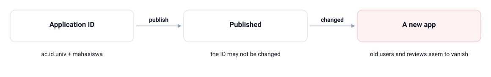

- `android.package` dan `ios.bundleIdentifier` — identitas unik aplikasi di seluruh dunia
- Ditulis dengan aturan reverse-domain: `ac.id.univ` + `mahasiswa`
- Aturannya: huruf kecil, angka, dan titik; tiap segmen dimulai huruf

<!--
Dipotong ke gambar (diagram yang mengatakan ini):
- Setelah terbit, ID tidak boleh diubah — aplikasi dianggap baru
- Akibatnya pengguna dan ulasan lama seolah hilang bersama ID lama

Latih aturan reverse-domain di papan: politeknik.ac.id ditambah siakad menjadi
ac.id.politeknik.siakad. Minta kelas mencoba satu contoh lagi sebelum lanjut.

Tegaskan sifat permanennya: mengganti application ID berarti toko menganggapnya aplikasi
berbeda, lengkap dengan hilangnya pengguna dan ulasan yang sudah terkumpul.

Peringatkan aturan penulisan yang sering dilanggar: tidak boleh ada dua titik berurutan, dan
setiap segmen harus dimulai huruf, bukan angka.

Pertanyaan: "Kapan waktu termurah untuk menentukan application ID?" (Jawaban: sebelum build
pertama yang terbit.)
-->

---

## Ikon Adaptif: Dua Lapis agar Tidak Terpotong

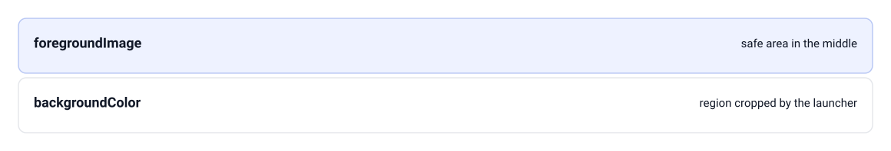

- **Splash screen** — layar pembuka yang tampil sebentar saat aplikasi dibuka
- `expo.icon` — PNG persegi 1024×1024 piksel sebagai ikon aplikasi
- `adaptiveIcon` — `foregroundImage` (safe area di tengah) + `backgroundColor`
- Splash diatur lewat plugin `expo-splash-screen` di dalam `plugins`
- Parameter splash: `image`, `imageWidth`, `resizeMode`, `backgroundColor`

<!--
Tegaskan kenapa ikon adaptif punya dua lapis: Android modern memotong ikon sesuai bentuk
peluncur perangkat, sehingga latar depan dan latar belakang harus dipisah. foregroundImage
adalah gambar depan dengan safe area di tengah, sedangkan backgroundColor mengisi wilayah yang
dipotong peluncur.

Definisikan splash screen lebih dulu sebelum masuk ke konfigurasinya (subbab 15.5): layar yang
tampil sebentar saat aplikasi dibuka, menutupi proses pemuatan kerangka native.

Peringatkan soal safe area di foregroundImage: teks atau logo yang melewatinya akan terpotong
di sebagian peluncur. Spesifikasi safe area dan ukuran yang dianjurkan ditandai peka versi di
bab, jadi rujuk pedoman aset Android saat menyiapkan ikon.

Pertanyaan: "Kenapa splash dianjurkan memakai warna latar yang sama dengan tema aplikasi?"
(Jawaban: agar peralihan ke halaman pertama terasa mulus, tanpa kedip.)

Sebutkan bahwa cara mengatur splash berubah antar-SDK: bab ini mengikuti pola config plugin di
SDK 57, bukan kunci splash yang lama.
-->

---

## Contoh `app.json`: Identitas Aplikasi Kita

`kode/bab-15-build-dan-deployment/app.json` — identitas yang dibaca toko aplikasi

```json
{
  "expo": {
    "name": "Aplikasi Mahasiswa",
    "slug": "aplikasi-mahasiswa",
    "version": "1.0.0",
    "icon": "./assets/icon.png",
    "ios": { "bundleIdentifier": "ac.id.univ.mahasiswa" },
    "android": {
      "package": "ac.id.univ.mahasiswa",
      "versionCode": 1,
      "adaptiveIcon": { "foregroundImage": "./assets/adaptive-icon.png" }
    }
  }
}
```

<!--
Tunjukkan bahwa setiap kunci di slide ini sudah dibahas: name, slug, version, icon,
application ID, versionCode, dan adaptiveIcon. Tidak ada kunci baru.

Tegaskan bahwa ios dan android memakai ID yang sama, ac.id.univ.mahasiswa, karena keduanya
adalah reverse domain kampus contoh.

Ingatkan bahwa file lengkapnya memuat orientation, scheme, buildNumber, plugin expo-router,
dan konfigurasi expo-splash-screen penuh; potongan di slide sengaja dipendekkan agar terbaca
dari baris belakang, sedangkan versi lengkapnya ada di kode/bab-15-build-dan-deployment/app.json
dan Contoh 1.
-->

---

## Environment Variable: Konfigurasi di Luar Kode

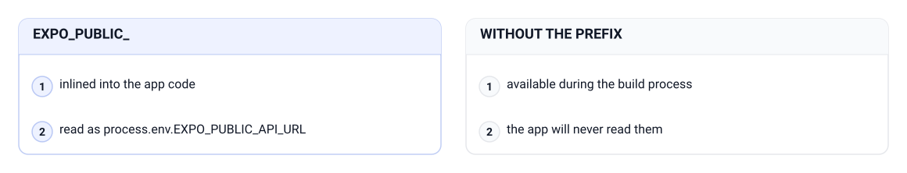

- Nilai konfigurasi disimpan di luar kode, biasanya di file `.env`
- Expo membaca `.env`, `.env.local`, `.env.development`, dan `.env.production`
- Setelah `.env` diubah, jalankan ulang `npx expo start` supaya nilai baru terpakai

<!--
Dipotong ke gambar (diagram yang mengatakan ini):
- Hanya variabel berawalan `EXPO_PUBLIC_` yang disisipkan ke dalam kode aplikasi
- Di dalam kode nilainya dibaca sebagai `process.env.EXPO_PUBLIC_API_URL`

Analogi: environment variable seperti label lokasi pada kotak perkakas. Isi kotaknya sama;
yang berbeda tiap lokasi kerja adalah labelnya.

Tegaskan aturan awalannya: hanya nilai berawalan EXPO_PUBLIC_ yang sampai ke kode aplikasi.
Variabel tanpa awalan tetap tersedia selama proses build, misalnya untuk app.config.js, tetapi
aplikasi tidak akan pernah membacanya.

Peringatkan: nilai disisipkan saat bundle dibuat, bukan saat aplikasi berjalan. Mengubah .env
tanpa menjalankan ulang server pengembangan adalah penyebab paling umum nilai lama masih
dipakai.

Sebutkan bahwa emulator Android memanggil backend di 10.0.2.2 seperti di Bab 10, sedangkan
produksi memakai domain https.
-->

---

## Nilai `EXPO_PUBLIC_` Ikut Terbaca Semua Pengguna

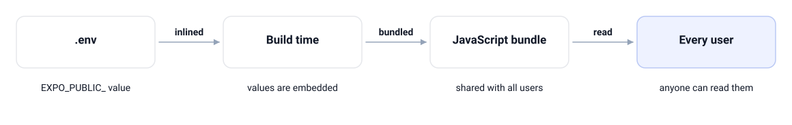

> Nilai `EXPO_PUBLIC_*` tertanam di bundle JavaScript yang dibagikan ke semua pengguna: siapa pun bisa membacanya.

<!--
Ini slide keamanan terpenting di bab ini. Tegaskan panah terakhir: file yang dibagikan ke
setiap pengguna memuat nilai itu apa adanya.

Pertanyaan: "Jadi di mana kunci API yang melindungi server disimpan?" (Jawaban: di sisi
server, misalnya file .env backend dari Bab 10, atau token JWT yang dikelola Bab 13.)

Salah paham: mengira awalan EXPO_PUBLIC_ membuat nilainya tersembunyi atau aman. Justru
sebaliknya — nilainya ikut dibundel dan bisa dibaca siapa pun, jadi jangan pernah memuat kata
sandi, token, kunci API, atau nomor kartu.
-->

---

## Signing: Tanda Tangan yang Membuktikan Keaslian

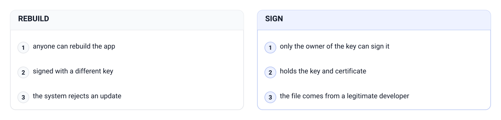

- **Signing** — tanda tangan digital yang menandai file berasal dari pengembang sah
- Android: sebuah **keystore** (`.jks` atau `.keystore`) menyimpan kunci dan sertifikat
- EAS membuat dan menyimpan keystore di akunmu; unduh lewat `eas credentials`

<!--
Dipotong ke gambar (diagram yang mengatakan ini):
- Siapa pun bisa membangun ulang aplikasi, tetapi hanya pemilik kunci yang bisa menandatanganinya
- Sistem menolak pembaruan yang ditandatangani dengan kunci berbeda

Analogi: tanda tangan digital seperti segel notaris. Isi dokumennya boleh sama, tetapi
segelnya hanya bisa dibuat pemegang kunci.

Tegaskan dua peran tanda tangan: memastikan keaslian saat pemasangan, dan memastikan
kesinambungan identitas saat pembaruan. Peran kedua itulah yang membuat kehilangan kunci
berbahaya.

Pertanyaan: "Kenapa sistem menolak pembaruan yang ditandatangani dengan kunci berbeda?"
(Jawaban: karena dianggap aplikasi lain, bukan versi baru aplikasi yang sama.)

Sebutkan bahwa membangun di mesin lokal memerlukan keystore sendiri lewat keytool, dan
rincian sintaksnya ditandai peka versi di bab.
-->

---

<!-- _class: center -->

## Kalau Keystore Hilang, Apa yang Terjadi?

- Laptop pengembang rusak dan keystore lokal tidak punya salinan
- Versi lama aplikasi sudah terpasang di sejumlah perangkat pengguna
- Minggu depan kamu harus merilis perbaikan bug

**Pertanyaan:** apa yang terjadi saat build baru dipasang di perangkat lama?

<!--
Jangan jawab di slide ini; jawabannya ada di slide berikutnya. Beri 60 detik think-pair-share,
lalu tampung dua atau tiga dugaan sebelum lanjut.

Kalau tidak ada yang menjawab, pancing: "Bisakah pengguna menghapus aplikasi lama lalu
memasang yang baru?" (Jawaban: bisa, tetapi datanya hilang dan sebagian besar tidak akan
melakukannya.)

Skenario ini diangkat dari insiden di studi kasus bab ini; kaitkan sesudah jawabannya muncul.
Bab sumber tidak menyebut jumlah perangkat terpasang — hanya lima penguji mahasiswa (Budi,
Siti, Agus, Dewi, Rizky) dan distribusi lewat grup WhatsApp kelas — jadi jangan mengarang
angka.
-->

---

## Kunci yang Hilang Menutup Jalan Pembaruan

- Aplikasi yang sudah terpasang tidak pernah bisa diperbarui — tanda tangannya tidak cocok
- Sistem menganggap build baru sebagai aplikasi yang berbeda
- Pencegahan pertama: EAS menyimpan keystore di akun Expo, aman dari laptop rusak
- Pencegahan kedua: **Play App Signing** menyimpan kunci produksi di Google
- Dengan Play App Signing, pengembang hanya memegang **upload key**

<!--
Ulangi jawabannya dengan tegas: aplikasi yang sudah terpasang kehilangan jalur pembaruan;
pengguna harus memasangnya ulang sebagai aplikasi baru, dan biasanya mereka tidak mau.

Tegaskan dua lapis pencegahan: EAS menyimpan keystore di akun sehingga tidak ikut rusak
bersama laptop, dan Play App Signing memisahkan kunci produksi dari kunci unggah.

Pertanyaan: "Kenapa EAS memakai mekanisme persetujuan dua orang untuk mengunduh kunci?"
(Jawaban: karena kunci itu barang paling berharga dalam siklus hidup aplikasi.)

Ingatkan mahasiswa menyimpan salinan keystore di tempat aman sejak praktikum pertama.
-->

---

<!-- _class: compact -->

## Empat Kanal Rilis Google Play

- **Deployment** — menghadirkan build ke pengguna lewat saluran resmi

| Track | Siapa yang menerima | Catatan |
|---|---|---|
| internal testing | paling banyak 100 penguji | rilis cepat tanpa peninjauan |
| closed testing | penguji yang diundang lewat link | wajib akun pengembang personal |
| open testing | siapa pun yang mendaftar | tampil sebagai *early access* |
| production | semua pengguna | melewati peninjauan Google |

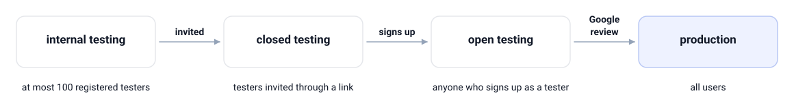

<!--
Dipotong ke catatan (tidak muat di slide):
- **Track** (jalur rilis) — kanal rilis di Play Console: internal, closed, open, production

Bacakan tabel ini sebagai tangga dari paling privat ke paling publik: tiap langkah ke bawah
menambah penguji dan mengurangi kecepatan.

Tegaskan bahwa internal testing tidak melewati peninjauan dan dibatasi paling banyak 100
penguji terdaftar, sedangkan production selalu melewati peninjauan Google dengan durasi yang
bervariasi.

Sebutkan kebijakan yang ditandai peka versi: untuk akun pengembang personal baru, Google
mewajibkan pengujian di closed testing dengan jumlah penguji dan durasi tertentu sebelum rilis
production diizinkan.

Peringatkan bahwa akun pengembang Google Play dikenai biaya pendaftaran sekali bayar.

Definisi istilah kunci bab ini: deployment dan track, keduanya di subbab 15.8 — deployment
sebagai butir di atas tabel, track sebagai butir di catatan ini.
-->

---

## Unggah ke Play Console Bukan Sekadar Kirim File

1. Build AAB: `eas build --platform android --profile production`
2. Lengkapi kehadiran aplikasi: deskripsi, ikon toko, dan tangkapan layar
3. Pilih track, unggah AAB, dan pastikan `versionCode` sudah naik
4. Tulis catatan rilis, lalu tekan tombol rilis
5. Pantau statistik, laporan crash, dan ulasan di dasbor Play

> Rilis production bisa dibatasi ke persentase pengguna tertentu lewat *staged rollout*.

<!--
Tegaskan bahwa langkah pertama bukan mengunggah, melainkan menyiapkan kehadiran aplikasi:
nama, deskripsi pendek dan panjang, kategori, ikon toko 512×512, feature graphic, tangkapan
layar, kuesioner rating konten, dan deklarasi data safety.

Peringatkan soal langkah ketiga: versionCode harus naik pada setiap unggahan. Ini kesalahan
paling umum pada unggahan kedua, dan pesan di Play Console berbunyi version code sudah dipakai.

Pertanyaan: "Kenapa tim profesional memakai staged rollout?" (Jawaban: untuk memantau
kestabilan pada sebagian pengguna sebelum sampai ke semua pengguna.)

Tegaskan bahwa dasbor dan ulasan adalah umpan balik produk yang berharga, bukan gangguan.
-->

---

## App Store: Satu Pintu, Tanpa Jalan Pintas

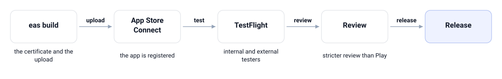

- Tidak ada jalur publik di luar App Store: hanya peninjauan, TestFlight, atau development build
- Biaya keanggotaan tahunan dan peninjauan lebih ketat daripada Play
- TestFlight: ratusan penguji internal dan ribuan penguji eksternal

<!--
Bandingkan dengan Play pada dua hal: pola biayanya (Play sekali, Apple tiap tahun) dan
ketatnya peninjauan.

Tegaskan akibat paling khas di iOS: tidak ada jalur pemasangan dari sumber tidak dikenal.
Distribusi internal bergantung pada TestFlight atau development build ke perangkat terdaftar.

Peringatkan agar tidak menghafal angka kuota TestFlight dan durasi peninjauan: keduanya
ditandai peka versi, dan keduanya berubah dari waktu ke waktu.

Pertanyaan: "Kalau EAS yang mengurus sertifikat dan unggahan, apa yang masih jadi tanggung
jawabmu?" (Jawaban: menyiapkan keanggotaan, informasi aplikasi, dan keputusan rilis.)
-->

---

## Satu Kode, Tiga Lingkungan Build

| Lingkungan | Bentuk build | Distribusi |
|---|---|---|
| Development | Expo Go atau development build | Metro lokal, tidak dibagikan |
| Preview/Pengujian | APK `distribution: internal` | Track internal atau closed Play, TestFlight |
| Production | AAB atau file toko, bertanda tangan | Peninjauan Play atau Apple, publik |

> Kode yang sama, konfigurasi berbeda — inilah obat penyakit *jalan di komputermu saja*.

<!--
Slide konsep penutup: tiga profil build EAS sebenarnya mencerminkan tiga lingkungan yang lazim
di organisasi perangkat lunak, sama seperti di dunia web.

Tegaskan prinsip yang mengikat ketiganya: satu basis kode, tiga konfigurasi berbeda di
app.json, environment variable, versi, dan tanda tangan.

Pertanyaan: "Apa yang berubah antarlingkungan dan apa yang tidak?" (Jawaban: yang berubah
adalah konfigurasi, versi, dan tanda tangan; yang tidak berubah adalah kode aplikasinya.)

Sebutkan bahwa evolusi berikutnya, pembaruan tanpa build ulang lewat mekanisme EAS Update,
ditandai peka versi di bab dan akan kamu temui lagi di dunia kerja.
-->

---

## Studi Kasus: Insiden SIAKAD Mobile Versi 1.0

- APK 1.0 dibangun terburu-buru lalu disebar lewat grup WhatsApp kelas
- Versi 1.0.1 dirilis, tetapi dua versi tetap beredar dan data bentrok di backend
- Laptop pengembang rusak; keystore lokal hilang; pembaruan ditolak sistem
- Build Play membawa IP laptop sebagai alamat API, bukan alamat server produksi
- Biaya perbaikannya: tiga minggu kerja ulang dan kepercayaan pengguna yang turun

<!--
Bacakan sebagai cerita, bukan sebagai daftar. Lima penguji mahasiswa di insiden ini memakai
data statis buku dari Bab 4 sampai 8, jadi kelas akan mengenalinya.

Pertanyaan sebelum slide berikutnya: "Kalau kamu menjadi ketua tim ini, keputusan mana yang
paling awal kamu ubah?" Tampung dua atau tiga jawaban tanpa dikoreksi.

Tegaskan bahwa ini bukan kegagalan menulis kode: aplikasinya jalan, pengguna bisa masuk, dan
fiturnya bekerja. Yang gagal adalah proses pengemasan dan distribusinya.
-->

---

## Setiap Gejala Punya Satu Subbab

| Gejala | Akar masalah | Perbaikan (subbab) |
|---|---|---|
| Dua versi beredar di grup chat | Tidak ada kanal rilis resmi | Track internal atau closed Play (15.8) |
| Keystore hilang bersama laptop | Signing dikelola lokal | EAS + Play App Signing (15.2, 15.7) |
| Alamat API ditulis di dalam kode | Konfigurasi menyatu dengan kode | `EXPO_PUBLIC_` dan `.env` (15.6) |

<!--
Latihan diagnosis: tutup kolom terakhir, minta kelas menebak subbab yang mendasari tiap
perbaikan, lalu buka jawabannya.

Tegaskan pola besarnya: setiap gejala insiden memetakan langsung ke satu subbab di bab ini,
jadi bab ini bukan teori tambahan melainkan daftar pencegahan.

Pertanyaan: "Mana yang paling mahal diperbaiki?" (Jawaban: keystore yang hilang, karena
aplikasi terpasang kehilangan jalur pembaruan sepenuhnya.)

Tutup dengan pesan analis sistem: tiga minggu perbaikan itu jauh lebih mahal daripada satu
pertemuan untuk memahami build dan deployment.
-->

---

## Praktikum: Yang Dibangun Pertemuan Ini

- Lengkapi `app.json`: name, slug, version, application ID, versionCode, buildNumber
- Periksa dengan `npx expo config --type public` sebelum kode dikirim ke cloud
- Buat `eas.json` dengan tiga profil: development, preview, production
- Pisahkan alamat API ke `.env` lalu jalankan ulang `npx expo start`
- Tanpa akun EAS: `npx expo export --platform android` menghasilkan bundle di `dist/`

<!--
Ingatkan agar bekerja di salinan proyek praktikum15 milik Aplikasi Manajemen Data Mahasiswa,
bukan proyek utama; build cloud mengunggah seluruh folder, jadi file yang tidak perlu ikut
terkirim.

Sebutkan dua jalur yang tersedia di bab: jalur cloud dengan akun Expo gratis, dan jalur
alternatif npx expo export yang menghasilkan bundle produksi di dist/ tetapi bukan APK yang
bisa dipasang. Jalur alternatif tetap melatih pemahaman tentang apa yang dikemas.

Peringatkan kesalahan praktikum paling umum: path aset yang berbeda huruf besar-kecil antara
Windows dan server EAS, sehingga build gagal dengan pesan aset tidak ditemukan.

Ingatkan bahwa hasil praktikum ditutup dengan LAPORAN-BUILD.md di folder praktikum15.
-->

---

<!-- _class: compact -->

## Laporan Build Itu Catatan Rilis Versi Kuliah

| Kegiatan | Artefak | Dasar |
|---|---|---|
| Menyiapkan rilis | `app.json`, `eas.json`, `.env.production` | 15.2, 15.5, 15.6 |
| Menguji calon rilis | APK preview untuk dosen dan penguji | 15.2, 15.8 |
| Mencatat riwayat rilis | `LAPORAN-BUILD.md`: tanggal, profil, hasil | Praktikum |
| Merancang publikasi | Rencana Deployment Project Akhir | 15.8–15.10 |

> Catatan rilis yang diminta perusahaan saat kamu melamar kerja bentuknya sama dengan laporan build ini.

<!--
Hubungkan artefak kuliah dengan artefak kerja: LAPORAN-BUILD.md adalah bentuk paling
sederhana dari release notes yang dipakai tim produk.

Tegaskan bahwa Rencana Deployment di Project Akhir adalah lanjutan langsung bab ini: daftar
versi dan changelog, profil build yang dipakai, kanal distribusi per lingkungan, dan langkah
di Play Console.

Pertanyaan: "Kalau kamu analis sistem, bagian mana yang pertama kamu tanyakan ke tim
pengembang?" (Jawaban terbuka; arahkan ke application ID, versionCode, dan kanal rilis.)
-->

---

## Yang Harus Teramati

Untuk tiap baris laporan build, catat tiga hal:

- **Sumber build** — profil mana yang dipakai, dan hasilnya APK atau AAB
- **Identitas** — `version` yang dipakai dan `versionCode` yang naik dibanding unggahan sebelumnya
- **Bukti** — link unduhan atau tangkapan layar dasbor, bukan nama profil saja

> Laporan yang baik menyebut bukti yang bisa diperiksa: "APK preview 1.0.0 (versionCode 1) terpasang di HP Redmi", bukan "build sudah jalan".

<!--
Tiga hal inilah yang dinilai di laporan build, jadi bacakan perlahan. Yang paling sering
hilang adalah butir ketiga: mahasiswa menulis nama profil, bukan bukti.

Beri satu contoh buruk dan satu contoh baik di papan tulis, lalu minta mereka menilai mana
yang bisa diperiksa ulang oleh orang lain.

Kalau waktu memungkinkan, minta satu mahasiswa membuka dasbor Expo dan menunjukkan bukti
untuk ketiga butir ini.
-->

---

<!-- _class: center -->

## Kuis Kilat

- Apa beda utama production build dan development build?
- Kenapa Google Play mewajibkan AAB untuk aplikasi baru?
- Variabel `EXPO_PUBLIC_API_URL` di dalam kode aplikasi...
- Track Play tanpa peninjauan dan paling banyak 100 penguji adalah...

<!--
Kuis lisan 5 menit: tampilkan pertanyaan, minta kelas menjawab serempak atau dengan mengangkat
jari, lalu lanjut ke slide kunci.

Jangan bocorkan jawaban di slide ini; file PDF yang dibawa mahasiswa memuat semua slide, jadi
jawabannya harus ada di slide berikutnya.

Kalau jawaban kelas berbeda-beda di pertanyaan ketiga, ulangi slide EXPO_PUBLIC_ sebelum
menutup pertemuan.
-->

---

<!-- _class: center -->

## Kunci Kuis Kilat

- Diminifikasi, dioptimalkan, bertanda tangan, dan tanpa alat debugging
- Play merakit split APK per perangkat dari AAB, jadi unduhan lebih kecil
- Nilainya disisipkan ke bundle saat build, jadi tidak layak untuk secret
- Internal testing: sampai 100 penguji, rilis cepat tanpa peninjauan

<!--
Ulangi pembedaan yang paling sering tertukar: production build menukar kemudahan debugging
dengan ukuran dan keamanan; AAB bukan file yang bisa dipasang; nilai EXPO_PUBLIC_ tertanam di
bundle.

Kalau banyak yang salah di pertanyaan keempat, ulangi tabel jalur rilis sebelum lanjut ke
diskusi penutup.

Ingatkan bahwa empat pertanyaan ini setara dengan butir pilihan ganda di Evaluasi Bab, jadi
kuncinya sekaligus bahan belajar mandiri.
-->

---

## Ringkasan

1. Development build mengejar iterasi; production build mengejar ukuran dan keamanan
2. EAS Build adalah build cloud dengan tiga profil: development, preview, production
3. APK bisa dipasang langsung; AAB adalah format induk untuk Play, wajib sejak 2021
4. `EXPO_PUBLIC_*` tertanam di bundle: berguna untuk alamat server, bukan untuk secret
5. Signing menjamin keaslian; keystore yang hilang membuat aplikasi tidak bisa diperbarui

<!--
Jangan dibacakan. Minta lima mahasiswa menjelaskan satu nomor dengan kata-kata sendiri, dan
koreksi langsung kalau keliru.

Yang belum tertulis di slide dan perlu diucapkan: application ID bersifat permanen, versi
mesin harus naik pada setiap unggahan, dan tiga lingkungan memakai kode yang sama dengan
konfigurasi berbeda.

Pesan penutup: keputusan rilis dibuat sebelum rilis pertama, bukan sesudah pengguna mengeluh.
-->

---

<!-- _class: center -->

## Diskusi: Kebiasaan Rilis Dimulai Sebelum Rilis Pertama

- Kanal apa yang selama ini kamu pakai untuk membagikan aplikasi ke teman?
- Kebiasaan mana yang kamu wajibkan di timmu sejak hari pertama?
- Apa risiko tersembunyi mengirim APK lewat grup chat?

> Soal analisis 1 dan Tantangan 1 menjadi bahan Tugas 3 bersama laporan build dan laporan QA Bab 14.

<!--
Beri 5 menit berpasangan untuk tiga pertanyaan di slide, lalu tampung dua atau tiga jawaban.
Jawaban yang kuat menyebut alasannya, bukan hanya nama kebiasaannya.

Untuk latihan pilihan: soal analisis 1 meminta perbandingan WhatsApp, internal testing, dan
production; Tantangan 1 meminta rancangan mini Rencana Deployment satu halaman. Keduanya
kandidat penilaian Tugas 3.

Kalau kelas mengangkat pilihan kebiasaan, arahkan ke empat hal: konfigurasi app.json,
penomoran versi, pengelolaan kunci penandatanganan, dan kanal rilis.

Pengingat tenggat: laporan QA dan laporan build dikumpulkan sebelum ujian akhir di pertemuan
berikutnya, dengan format kolom seperti di slide praktikum.
-->

---

<!-- _class: compact -->

## Referensi

| Sumber | Link |
|---|---|
| Dokumentasi Expo — EAS Build (2026) | docs.expo.dev |
| Dokumentasi Expo — `app.json` dan environment variable (2026) | docs.expo.dev |
| Dokumentasi React Native (2026) | reactnative.dev |
| Dokumentasi React (2026) | react.dev |

**Bacaan lanjutan:** Lampiran D — dokumentasi React, React Native, dan Expo; bab terkait: Bab 2, 10, 14.

**Versi teknologi:** Expo SDK 57 · React Native 0.86 · React 19.2 · Node.js ≥ 22

<!--
Rujukan lengkap ada di Lampiran D — mencakup dokumentasi React, React Native, dan Expo.
Kebijakan unggah Play Console dan syarat Apple Developer tidak tercantum di sana karena
keduanya peka versi; arahkan mahasiswa memeriksa situs resmi keduanya. Istilah EAS Build,
splash screen, environment variable, APK/AAB, dan application ID dijelaskan di Lampiran C
(glosarium); istilah signing dan keystore didefinisikan di subbab 15.7.

Ingatkan bahwa dokumentasi EAS, kebijakan unggah Play Console, dan syarat Apple berubah tiap
versi: cocokkan lagi dengan dokumentasi resmi sebelum semester berjalan.

Tegaskan bahwa bab ini merujuk proyek Bab 6–8 dan backend Bab 10 tanpa mengulang materinya.
Bab yang terkait langsung: Bab 2 (app.json pertama), Bab 10 (fetch, 10.0.2.2, dan folder
backend/), serta Bab 14 (jaminan mutu isi aplikasi).
-->

---

<!-- _class: lead -->
<!-- _paginate: skip -->

# Selesai: dari Nol ke Aplikasi yang Dirilis

**Tugas 3:** laporan QA (Bab 14) dan laporan build (Bab 15) — tanggal, profil, platform, hasil, catatan.

Pertemuan berikutnya: UAS — presentasi dan demo Project Akhir "Sistem Informasi Akademik Mobile".

<!--
Tutup dengan satu kalimat: "Bab 14 memeriksa isi aplikasi; bab ini memastikan aplikasi sampai
ke pengguna dengan aman dan terkendali."

Sebutkan tenggat Tugas 3 secara eksplisit: laporan QA Bab 14 dan laporan build Bab 15, dengan
kolom tanggal, profil, platform, hasil, dan catatan seperti di slide praktikum.

Pertemuan berikutnya adalah ujian akhir: demo aplikasi, arsitektur, API, testing, dan rencana
deployment sesuai rubrik Project Akhir di Lampiran B.
-->
